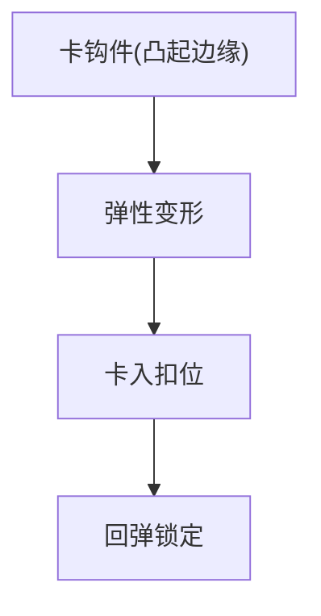

# 卡扣三种基本形式：悬臂、环形、扭转

> [!summary] 一句话概述
> 卡扣按受力方式分三类：悬臂（最常用，可设计成可拆或永久）、环形（靠环向应变，如笔帽、瓶盖）、扭转（靠扭转变形）；是整理其他卡扣案例时的基础参照。

## 配图

![[附件/snap-fit-cantilever.png]]
*Wikimedia Commons：悬臂卡扣示意*

> 图片版权归原作者所有，仅作个人学习收藏；出处见文末「来源与核实记录」。

## 结构原理

> 本节数字只写来源里给出的；来源没有就写「来源未给出」。

### 堆叠方案

方向：**（原理类案例，以配合关系代替堆叠）**

| 层级 | 零件 | 材料 | 厚度/尺寸 | 固定方式 | 依据 |
| --- | --- | --- | --- | --- | --- |
| A | 带凸起边缘的卡钩件 | 塑料 | 来源未给出 | 插入时弹性变形 | Design |
| B | 卡入区（扣位） | 塑料 | 来源未给出 | 卡钩回弹后锁住 | Design |

剖面示意：

### 零件清单

| 零件 | 数量 | 功能 | 材料 | 依据 |
| --- | --- | --- | --- | --- |
| 卡钩（悬臂/环/扭转臂） | — | 产生弹性变形并锁定 | 塑料 | Design |
| 止挡 (stopper) | 可选 | 防止过度变形导致断裂 | — | Cantilever 段 |

### 装配顺序

1. 两件对位
2. 推入，卡钩弹性变形越过凸起
3. 卡钩回弹进入扣位完成锁定

> 来自词条的通用描述。

### 受力与运动分析

- **受力路径**：悬臂：卡钩弯曲变形；环形：外件周长扩张（环向应变）；扭转：卡扣边缘绕轴扭转后释放（Wikipedia）。
- **运动关系**：装配时的弹性变形；可拆式悬臂卡扣通常带拨杆或销用于解锁。
- **失效风险**：设计时需确定装配时应力位置，否则装配时会断；注塑冷却收缩会造成配合误差；环形卡扣多次使用会产生永久变形而松动（Wikipedia）。

## 设计要点与参数

| 要点 | 内容 | 依据 |
| --- | --- | --- |
| 允许应变/挠度公式 | 词条只说工程上有挠度、扭矩等计算公式，未给数值 | Design 段 |
| 推荐延伸阅读 | Bayer《Snap-fit joints for plastics: A design guide》、Bonenberger《The First Snap-fit Handbook》 | 参考文献 |

## 优缺点

**优点**
- 装配快、没有散件，可替代螺丝

**缺点 / 代价**
- 需要更精确的工程计算和模具，成本可能更高

## 可借鉴点

- 新增卡扣案例时先归类到悬臂/环形/扭转
- 可拆卡扣加止挡防过度变形

## 相关案例

- [[苹果 AirTag 旋转后盖与内部卡扣]]
- [[PS5 免工具侧板与 DualSense 隐藏螺丝]]
- [[活动铰链（Living Hinge）：一体成型的柔性铰链]]
- 分类索引：[[02-连接与紧固 索引]]

## 来源与核实记录

- 主来源：[Snap-fit - Wikipedia](https://en.wikipedia.org/wiki/Snap-fit)（持续更新的百科词条，Wikipedia 编者）
- 图片来自 Wikimedia Commons（随 Wikipedia 词条展示），遵循原图许可。
- 核实：2026-11-13 打开词条核对三种类型定义、悬臂卡扣的可拆/永久说明及生产风险。
