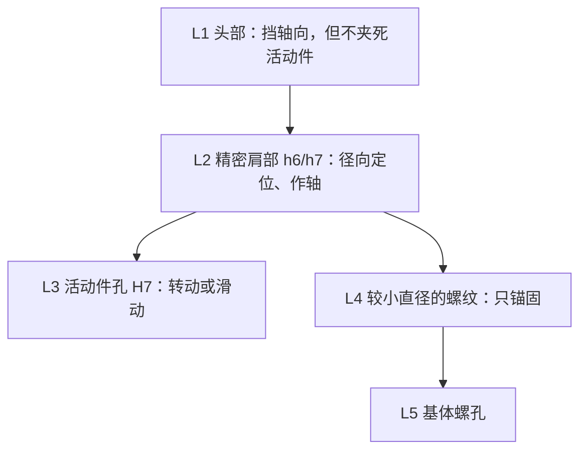

# 台阶螺丝（ISO 7379 塞打螺丝）：光杆定位、螺纹只锁紧

> [!summary] 一句话概述
> 台阶螺丝（shoulder bolt / shoulder screw，模具里常叫塞打螺丝或 stripper bolt）沿轴向分成三段：头部、精密磨削的无螺纹肩部、以及直径更小的螺纹。径向定位和转动/滑动都靠肩部与孔的配合（常用孔 H7、肩 h6），螺纹只负责把螺丝锚在基体里，不负责定心。肩长必须等于或略大于需要活动的零件厚度（AIMS 写通常大 0.1–0.3 mm）：太短则头部把零件夹死，太长则轴向窜动。ISO 7379 的常用对应关系例如：肩径 10 mm 配 M8 螺纹，肩长系列 12–100 mm。

## 配图

![[附件/shoulder-screws-s76.jpg]]
*图源：Wikimedia Commons [S76-tech-docs meer5 shoulder-screws.jpg](https://commons.wikimedia.org/wiki/File:S76-tech-docs_meer5_shoulder-screws.jpg)（System76 Meerkat 5 技术文档，CC BY-SA 4.0）；实物台阶螺丝：头部、无螺纹肩部与更细的螺纹段分界清楚。尺寸与配合仍以文中 AIMS / ISO 7379 为准，不要把照片里的规格当成标准值。*

本篇打开的 AIMS、RR Hydraulics 页面没有提供可成功另存的结构剖面图；米思米相关页是配合公差表。结构层级和示意见下文。

> 图片版权归原作者所有，仅作个人学习收藏；出处见文末「来源与核实记录」。

## 结构原理

> 本节数字只写来源里给出的。AIMS 与 RR 都按 ISO 7379 讨论，表中肩径–螺纹对应以 AIMS 的 Quick Reference 为准；RR 补充 h6 在 10 mm 肩上约为 0 到 −0.011 mm。米思米文讲的是定位销的 H7/h6、H7/g6，用来说明同一套公差体系，不把定位销尺寸当成台阶螺丝尺寸。

### 堆叠方案

方向：**从头部到螺纹，再进入基体螺孔。**

| 层级 | 零件/区域 | 材料 | 厚度/尺寸 | 固定方式 | 依据 |
| --- | --- | --- | --- | --- | --- |
| L1 | 头部（ISO 7379 为内六角圆柱头） | 常用 12.9 | 头径大于肩径，提供单向轴向挡。例如肩 10 mm 时头径 16 mm、头高 7 mm | 头部不把活动件夹死，通常与活动件之间留间隙 | AIMS |
| L2 | 精密肩部（工作段） | 磨削，h6 或 h7 | 肩径 × 肩长是主参数，例如“10 mm × 50 mm”指肩径 10、肩长 50，螺纹另计 | 与活动件孔（常用 H7）形成间隙配合，作轴、枢轴或导柱 | AIMS；RR |
| L3 | 活动件（杠杆、剥料板、滚轮等） | — | 孔径按肩径选 H7（或按应用改）；厚度总和应与肩长匹配 | 在肩上转动或滑动 | AIMS |
| L4 | 螺纹段（直径小于肩） | 同螺丝 | 例如 10 mm 肩配 M8；螺纹长度在肩长之外，不计入“50 mm” | 拧入基体螺孔，只锁紧、不定心 | AIMS |
| L5 | 基体螺孔 | — | 螺纹规格按 ISO 7379 表，深度 AIMS 建议至少 1.5 倍螺纹直径 | 固定台阶螺丝 | AIMS 安装节 |

剖面示意：

### 零件清单

| 零件 | 数量 | 功能 | 材料 | 依据 |
| --- | --- | --- | --- | --- |
| 台阶螺丝 | 1 | 肩部当轴，螺纹锚固 | AIMS：12.9 为常用；另有 A2/A4、黑氧等 | AIMS、RR |
| 活动件（带 H7 孔，最好铰出） | 1 或一组 | 绕肩转动或沿肩滑动 | — | AIMS |
| 基体（螺孔） | 1 | 提供锚固 | — | AIMS |
| 可选衬套 | 按需 | 提高耐磨、便于维修 | RR 提到可作为线性轴承轴、衬套轴使用 | RR |

### 装配顺序

按 AIMS“Correct Installation Sequence”：

1. 确认基体螺孔规格和深度（至少约 1.5 倍螺纹直径），不要按头部外观误判成更大规格的内六角螺丝。
2. 活动件孔铰到 H7（或选定的公差）。
3. 如有振动，AIMS 举例可在螺纹上用中等强度锁固剂（文中写 Loctite 243）；需要经常拆的则用干螺纹。
4. 用手导入螺纹，避免细牙交叉咬死；用正确规格的内六角扳手拧到厂商扭矩，或“中等手力”。**不要按头部看起来的规格去套普通杯头的大扭矩。**
5. 装完后活动件应能灵活转动或滑动。如果发紧：不是肩太短被夹死，就是孔偏小。

肩长与厚度（AIMS）：

- 肩长应等于或略大于需要自由活动的零件总厚，文中写通常大 0.1–0.3 mm。
- 太短：头把零件压在基体上，无法转动。
- 太长：轴向间隙过大，产生窜动、噪声或错位。
- 剥料板这类要沿肩部走一段行程的场合：肩长比叠厚再长出所需行程，让零件先滑动、再被头部挡住。

### 受力与运动分析

- **受力路径**：径向载荷和转动/滑动摩擦走肩部与孔（或衬套）；轴向挡靠头部或肩根台阶；夹紧与防松走较小的螺纹和肩–螺纹过渡。AIMS 写明：ISO 7379 指出最大拧紧扭矩**不是**按 12.9 性能等级来定，而是受肩部端面较小的承压面积和肩–螺纹过渡的较小截面限制。
- **运动关系**：活动件相对肩部有转动或移动自由度；螺丝相对基体应无相对运动。
- **失效风险**：按头部规格过拧，拧断螺纹或压溃过渡截面（AIMS 称为最常见错误）。肩太短夹死、肩太长窜动。把普通缩颈螺丝或普通杯头当成台阶螺丝，没有精密肩，定心和枢轴都会虚（AIMS：“What a shoulder bolt is not”）。

## 设计要点与参数

AIMS 给出的 ISO 7379 速查（肩径 × 螺纹、肩长范围、头径、头高）：

| 要点 | 内容 | 依据 |
| --- | --- | --- |
| M5 × 肩 6 mm | 肩长 8–60 mm，头径 10 mm，头高 4.5 mm | AIMS 表 |
| M6 × 肩 8 mm | 肩长 10–80 mm，头径 13 mm，头高 5.5 mm | AIMS 表 |
| M8 × 肩 10 mm | 肩长 12–100 mm，头径 16 mm，头高 7 mm | AIMS 表 |
| M10 × 肩 12 mm | 肩长 16–120 mm，头径 18 mm，头高 8 mm | AIMS 表 |
| M12 × 肩 16 mm | 肩长 20–150 mm，头径 24 mm，头高 10 mm | AIMS 表 |
| M16 × 肩 20 mm | 肩长 25–200 mm，头径 30 mm，头高 13 mm | AIMS 表 |
| M20 × 肩 25 mm | 肩长 30–250 mm，头径 36 mm，头高 16 mm | AIMS 表 |
| 肩部公差 | AIMS：h6 / h7；与孔常用 H7/h6 间隙配合（slip fit） | AIMS |
| 10 mm 肩的 h6 例子 | RR：典型为 0 到 −0.011 mm（该页对 10 mm 肩的表述） | RR Hydraulics |
| 命名 | “10 mm × 50 mm”= 肩径 10 mm、肩长 50 mm，对应螺纹是 M8，螺纹长度另计 | AIMS |
| 螺孔深度 | 安装节建议至少 1.5 倍螺纹直径 | AIMS |
| 扭矩 | 不按 12.9 和头部外观选取；按较小承压面和过渡截面，参考制造商扭矩 | AIMS（ISO 7379 注） |
| 配合体系补充 | 米思米：活动而对中要求高时常用孔 H7、轴 h6（滑动配合，可拆装又不严重松动）；允许更松可选 e8/H8、c9/H9；要固定不活动则选过渡或过盈。这是通用配合规则，用来理解肩–孔，不是 ISO 7379 尺寸本身 | 米思米 2022-04-27 文；p2883 公差表 |

## 优缺点

**优点**
- 把“定心/作轴”和“拧紧”分开，枢轴类结构不必再拿普通螺丝的螺纹当轴
- 肩部公差可以按轴孔配合来选，转动或滑动质量可控
- 一种零件同时完成定位、轴向挡和锚固，模具剥料板等场合很常见

**缺点 / 代价**
- 肩长选错就会夹死或窜动，公差链要算到 0.1 mm 量级
- 拧紧扭矩窗口比看上去的头部小，容易拧断
- 已打开来源没有给出完整的承压、剪切或许用载荷表，结构核算还要查制造商或标准正文
- 本篇缺少原厂剖面图，出图时应直接对照 ISO 7379 或供应商图纸

## 可借鉴点

- 出图主参数写**肩径 × 肩长 + 螺纹规格 + 肩公差（h6）+ 孔公差（H7）**，不要只写“M8 台阶螺丝”
- 肩长 = 活动件总厚 + 所需间隙或行程（活动用 0.1–0.3 mm 量级，行程用则再加行程）
- 安装说明书里写明扳手规格和扭矩，避免维修按头部当 M12 杯头来拧
- 需要耐磨或经常拆活动件时，给孔加衬套，肩仍按 h6 配
- 不要用普通螺丝磨出“大概光杆”来代替磨削肩部

## 与库中相似案例对比

| 对比项 | 本案例（台阶螺丝） | [[钣金压铆隔离柱（PEM SO）：孔径、最小板厚、柱长与板材硬度上限]] | 普通内六角螺丝（对照，非库中专篇） |
| --- | --- | --- | --- |
| 谁负责径向定位 | 精密肩部与孔的配合 | 压入板内的柱，对第二块板主要是端面支承和螺纹 | 螺纹或光杆余量，通常不是精密轴 |
| 谁负责锁紧 | 较小的螺纹 | 内螺纹 + 对面螺钉 | 螺纹本身 |
| 间距 / 长度 | 肩长对应活动件厚度或行程 | 柱长 L 对应两板间距 | 无确定作轴长度 |
| 典型运动 | 允许转动或滑动 | 压入后无相对运动 | 一般夹紧，不设计成轴 |

## 相关案例

- [[钣金压铆隔离柱（PEM SO）：孔径、最小板厚、柱长与板材硬度上限]]
- 分类索引：[[02-连接与紧固 索引]]

## 来源与核实记录

- 主来源：[AIMS Industrial《Shoulder Bolt Guide: Sizes, Specifications and Applications》](https://aimsindustrial.com.au/blogs/product-guides/shoulder-bolt-guide)（AIMS Industrial Supplies，页上日期 Sep 29, 2026；2026-11-21 GET，HTTP 200。三段结构、ISO 7379 速查表、H7/h6、肩长与厚度、安装与过拧风险。）
- 独立第二来源：[RR Hydraulics《Shoulder Bolts (ISO 7379)》](https://rrhydraulics.com/shoulder-bolts/)（2026-11-21 GET，HTTP 200。肩径大于螺纹、h6 磨削，以及 10 mm 肩 h6 约 0 到 −0.011 mm 的例子。）
- 配合体系补充（非台阶螺丝尺寸来源）：[米思米《常用配合的案例解说》](https://techinfo.misumi.com.cn/exportarticle/article/2381/)（2022-04-27；2026-11-21 GET 打开，正文以定位销为例讲 H7/h6 等）；[米思米 2018 技术数据 p2883](https://www.misumi.com.cn/pdf/fa/2018/p2883.pdf)（JIS B 0401 配合表，同日 GET 打开）。szsst88.com 起始链接连接失败，未引用。
- 核实：2026-11-21 打开上述 URL。两家英文页内容独立，不是同一经销商转载。页面无合适配图可下载，故封面图留空，用结构表和示意图代替。
- 配图来源（2026-11-21 补录）：Wikimedia Commons System76 Meerkat 5 技术文档照片（CC BY-SA 4.0）；不作为尺寸来源。
