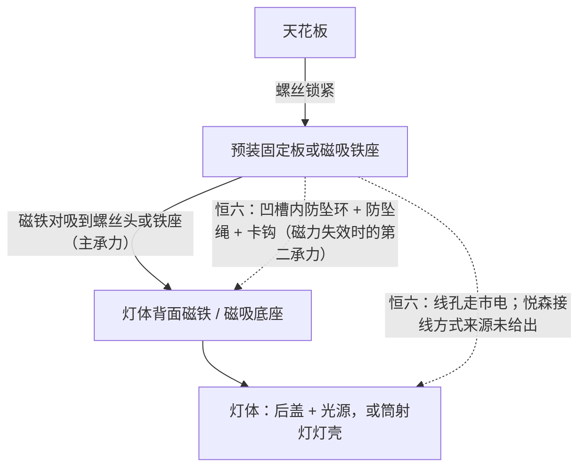

# 吸顶灯磁吸安装座：预装固定板或铁座与灯体磁铁对吸，并可加防坠绳（对照低压磁吸轨道灯）

> [!summary] 一句话概述
> 这类吸顶 / 明装灯把「承力底板」和「灯体」分开：先把固定板或铁座用螺丝打到天花板上，再让灯体背面的磁铁吸到螺丝头或铁座上，灯体不必再在后盖板上打膨胀螺丝。磁力只负责把灯体保持在预装底盘上，不是沿导轨滑移，底盘里也没有给灯取电的铜轨。若担心磁力减退后坠落，可像恒六的明装筒射灯那样，在底盘和灯体的对合凹槽里加防坠环、防坠绳和卡钩，作为第二道承力。

## 配图

![[附件/yuesen-ceiling-exploded.jpg]]
*图源：悦森照明科技（上海）有限公司实用新型「一种吸顶式灯具」，申请号 202220884723.X，转载页 [一种吸顶式灯具的制作方法](https://www.xjishu.com/zhuanli/22/202220884723.html) 所附分解图（本轮已下载）。自上而下：固定板 1（四角螺丝 5，中心矩形散热孔 92）→ 后盖板 2（卡扣件 21，圆形散热孔 91，锁固件 8）→ 光源板 3（光源 31、光学透镜 7、圆形散热孔 91）→ 灯体 4（发光孔 41）及装在灯体背面的磁铁 6。安装时先把固定板用螺丝锁到天花板，再让磁铁 6 与对应螺丝 5 磁吸固定。*

![[附件/hengliu-downlight-magnetic-base.jpg]]
*图源：广东恒六智能照明有限公司实用新型「一种便于安装的筒射灯」，申请号 202222127237，转载页 [一种便于安装的筒射灯的制作方法](https://www.xjishu.com/zhuanli/22/202222127237.html) 所附结构图（本轮已下载）。上方圆盘为安装座 1（磁吸铁座），螺孔 13 用于把铁座拧到天花板，中心为第一线孔 11；防坠绳 8 与卡钩 9 从铁座垂向灯体磁吸底座 3 上的第二凹槽 7 / 第二线孔 12。下方为带球形连接头 16 的灯壳 4，可在磁吸底座下调整角度。*

> 图片版权归原作者所有，仅作个人学习收藏；出处见文末「来源与核实记录」。

## 结构原理

> 本节所有数字只写来源里给出的；来源没有就写「来源未给出」。悦森专利以方形吸顶灯体吸附到预装固定板的螺丝上为主；恒六专利以明装筒射灯吸附到预装铁座、并加防坠绳为主。两件不要混成同一盏灯的零件表。本结构也不是本轮已有的「低压磁吸轨道灯」：轨道灯是在带电铝轨里滑移并用针脚取电。

### 堆叠方案

方向：**从天花板向下到出光面**（先按悦森吸顶灯，再注明恒六筒射灯的对应层）

| 层级 | 零件 | 材料 | 厚度/尺寸 | 固定方式 | 依据 |
| --- | --- | --- | --- | --- | --- |
| L1（天花板） | 承重顶面 | 来源未给出 | 来源未给出 | 固定板或铁座的螺丝打入此处 | 两件专利的安装描述 |
| L2 | 预装固定板 1（悦森）或磁吸铁座 / 安装座 1（恒六） | 悦森：板材牌号来源未给出；恒六：磁吸铁座 | 来源未给出边长或板厚。悦森：边角各穿一颗螺丝；中心开矩形散热孔 92，孔径大于后盖 / 光源板上的圆形散热孔 91 | 螺丝将板或铁座锁在天花板上 | 悦森权利要求 1、7、8 与具体实施方式；恒六权利要求 3 |
| L3（对合面） | 灯体背面磁铁 6（悦森）或磁吸底座 3（恒六） | 磁铁牌号来源未给出 | 来源未给出磁铁尺寸与吸力。悦森：磁铁与固定板上「对应的螺丝」磁吸；恒六：磁吸底座与铁座磁力吸附 | 悦森：磁铁冲压紧配合进灯体背面固定槽 42；恒六：磁吸底座作为灯体上部与铁座对吸 | 悦森权利要求 1、3；恒六权利要求 1 |
| L3a（恒六附加） | 防坠环 6、防坠绳 8、卡钩 9 | 材质来源未给出 | 防坠环长度 ≤ 第一凹槽深度；卡钩长度 ≤ 第二凹槽深度，从而可收入凹槽、不减小贴合面积 | 环固定在安装座第一凹槽 5 内；绳和钩放在磁吸底座第二凹槽 7 内，按压卡钩活动端钩住防坠环 | 恒六权利要求 1、4、8 与第 24 段 |
| L4 | 后盖板 2 + 光源板 3 + 透镜（悦森）；或灯筒内散热器、安装板、电路板、LED 灯板（恒六） | 悦森写明光源可为 LED，不以此为限；其余牌号来源未给出 | 来源未给出板厚。悦森：光源板与后盖板中心都有圆形散热孔 91，与固定板矩形孔对位 | 悦森：光源板按压卡入后盖板下表面的卡扣件 21；后盖板与灯体用若干锁固件 8（也可以是螺丝）连接。恒六：灯筒为空腔，与球形连接头焊接，内部依次为散热器、安装板、电路板和 LED 灯板；驱动电源装在磁吸底座处 | 悦森权利要求 2、4、5、6、9；恒六权利要求 7 与第 21 段 |
| L5（最外 / 出光） | 灯体 4 及发光孔 41（悦森）；圆柱状灯筒 + 球形连接头（恒六） | 来源未给出 | 来源未给出外径。恒六磁吸底座底部做成弧面，与连接头滑动；连接柱带万向球，在连接槽里滑动以调角度 | 发光孔一一对位于光源 / 透镜 | 悦森权利要求 1、2；恒六权利要求 5、6 |

电气路径（必须分开写）：

- 恒六：第一凹槽有第一线孔 11，第二凹槽有第二线孔 12，电线依次穿过这两个孔与市电连接；驱动在磁吸底座里，再向灯壳内接到电路板和灯板。
- 悦森：已打开文本只写了固定、磁吸和散热孔，没有写固定板与灯体之间如何接线，电气连接方式记为「来源未给出」，不推断成针脚或插头。

剖面示意：

和本轮 [[低压磁吸轨道灯：导轨内永磁吸附与铜轨针脚取电]] 的分工：本篇底盘是固定安装座，灯体对吸后位置不再沿轨道滑移，底盘也不内置铜轨给灯取电。轨道灯才是「带电薄铝轨 + 可滑移灯具 + 针脚取电」。

### 零件清单

| 零件 | 数量 | 功能 | 材料 | 依据 |
| --- | --- | --- | --- | --- |
| 固定板 1（悦森） | 1 | 预先固定在天花板上，作为灯体的磁吸对象（通过板上的螺丝） | 牌号来源未给出 | 悦森权利要求 1 |
| 螺丝 5（悦森） | 若干，实施例为四角各 1 | 把固定板锁到天花板，并作为灯体磁铁的吸附对象 | 来源未给出 | 悦森具体实施方式；权利要求 8 |
| 磁铁 6（悦森） | 若干，与螺丝对应 | 把灯体吸到固定板的螺丝上 | 牌号来源未给出 | 权利要求 1、3 |
| 后盖板 2、光源板 3、灯体 4 | 各 1 | 构成可整体吸附、也可整体取下的灯体组件 | 来源未给出 | 权利要求 1 |
| 卡扣件 21、锁固件 8、光学透镜 7 | 若干 | 卡固光源板、连接后盖与灯体、配光 | 来源未给出 | 权利要求 2、4、5 |
| 安装座 / 磁吸铁座 1（恒六） | 1 | 螺丝固定到天花板，与灯体磁吸底座对吸 | 磁吸铁座 | 恒六权利要求 1、3 |
| 磁吸底座 3（恒六） | 1 | 灯体侧的磁吸面，内藏第二凹槽、线孔和驱动 | 来源未给出 | 权利要求 1；第 21 段 |
| 防坠环、防坠绳、卡钩（恒六） | 各至少 1 | 磁力消退或灯体脱开时防止坠落 | 来源未给出 | 权利要求 1、4、8 |
| 灯壳 4：连接头 16 + 灯筒（恒六） | 1 | 出光与转角；万向球调角度 | 连接头与灯筒焊接 | 权利要求 5–7 |

### 装配顺序

悦森吸顶灯（按说明书安装步骤，不是拆解反推）：

1. 先把固定板 1 用螺丝 5 锁到天花板。专利特别写明：固定板可以先发货、先施工，灯体组件后到，以缩短现场交期。
2. 在灯体背面的固定槽 42 里，用冲压把磁铁 6 紧配合进去（工厂侧，不是现场）。
3. 把光源板 3 按压卡入后盖板 2 的卡扣件 21；后盖板与灯体 4 用锁固件 8 连成一个整体。
4. 把灯体举起，让各颗磁铁对准固定板上对应的螺丝，磁吸到位。后盖板本身不再打膨胀螺丝，以免打坏后盖和光源板。
5. 拆卸时拉住灯体，即可让灯体、后盖和光源板一起脱离固定板；固定板留在天花板上。

恒六明装筒射灯：

1. 用紧固螺丝穿过螺孔 13，把磁吸铁座 1 固定到天花板。
2. 把市电线经第一线孔、第二线孔与磁吸底座里的驱动连接。
3. 按压卡钩活动端，使卡钩钩住铁座凹槽里的防坠环；不需要防坠时，可以把绳和钩收进第二凹槽，凹槽深度足够，不妨碍铁座与底座贴合。
4. 将磁吸底座对准铁座吸合。灯筒可相对磁吸底座的弧面 / 万向球调整照射角度。

### 受力与运动分析

- **受力路径**：灯体自重和安装、拆卸时的手法力，主路径是「灯体 → 磁铁 → 螺丝头或铁座 → 预装螺丝 → 天花板」。恒六在磁力失效或灯体脱出时，改由「灯体磁吸底座 → 防坠绳和卡钩 → 防坠环 → 铁座 → 天花板螺丝」这条第二路径承力。悦森专利文本没有写防坠绳。两件都没有给出吸力、灯重或安全系数。
- **运动关系**：对吸到位后，悦森的灯体相对固定板没有工作运动，不是沿轨道滑移。恒六在吸附之后，灯筒还可以绕磁吸底座的万向球 / 弧面改变角度。拆卸都是克服磁力（以及先摘开防坠钩，若已挂上）把灯体取下。
- **失效风险**：恒六写明要防的是「磁力消退导致筒射灯主体掉落」。天花板如果不能承重，预装螺丝本身会失效，磁吸再牢也没有意义（推断：必须打在承重结构上，两件专利都只写「固定在天花板」，未给基层类型）。悦森把磁铁吸在螺丝头上，吸附面积小于整块铁座，对螺丝头位置和磁铁对位更敏感（推断，来源未做对比测试）。接线若从顶上引入，线的拉力不应只靠磁铁（推断；恒六把线走在凹槽线孔里，但未给应变释放结构）。

## 设计要点与参数

| 要点 | 内容 | 依据 |
| --- | --- | --- |
| 预装与后装分离 | 固定板先用螺丝上顶，灯体后吸；后盖板不再穿膨胀螺丝，避免打坏后盖和光源板 | 悦森具体实施方式第 40 段 |
| 磁铁固定 | 灯体背面做固定槽，磁铁冲压紧配合进去 | 悦森权利要求 3 |
| 吸附对象 | 悦森：磁铁与固定板上对应的螺丝磁吸。恒六：磁吸底座与预装铁座对吸 | 悦森权利要求 1；恒六权利要求 1 |
| 散热对位（悦森） | 光源板和后盖板中心圆形散热孔，固定板中心更大的矩形散热孔，三者对位 | 权利要求 6、7 |
| 防坠几何（恒六） | 铁座第一凹槽藏防坠环，灯体第二凹槽藏绳和钩；环和钩的长度不超过各自凹槽深度，既留得下防坠件，又不减小磁吸贴合面积 | 权利要求 4；第 24 段 |
| 防坠操作 | 卡钩有可向内转动的活动端，按压后钩住防坠环 | 权利要求 8 |
| 角度调节（恒六） | 磁吸底座底面做成弧面，连接柱带万向球，在连接头的弧形槽里滑动 | 权利要求 5、6 |
| 电连接 | 恒六：双线孔走市电，驱动在磁吸底座。悦森：接线方式来源未给出 | 恒六第 21 段 |
| 螺丝数量 / 板厚 / 吸力 / 灯重 | 悦森实施例为四角各一颗螺丝；其余毫米数、吸力牛顿数、重量来源未给出 | 已打开文本 |

## 优缺点

**优点**
- 现场先装一块轻的固定板或铁座，再整灯吸上去，不必在灯的后盖上打孔，也不必长时间举着整灯对螺丝孔。
- 维修或清洁时拉下灯体即可，底板留在天花板上。
- 恒六把防坠绳做进对合凹槽，磁力只负责日常保持，坠落风险另有机械保险，而且不用防坠时可以把绳收起来，不妨碍贴合。
- 与低压磁吸轨道相比，这种固定底盘不必做带电铜轨，也更适合不能沿轨滑移的吸顶面灯或单盏明装筒射灯。

**缺点 / 代价**
- 日常承力仍是磁力。没有防坠绳的方案（悦森文本即如此）在磁铁松脱、消磁或对位不良时，灯体可能直接落下。
- 两件专利都没有给出吸力、灯重或基层承重要求，不能直接当施工参数用。
- 磁铁吸在螺丝头上时，对位容差比吸整块铁座更紧。
- 市电仍要从天花板引到灯体（恒六走线孔）；这和低压轨道的触点取电不是同一套安全模型，不能混用轨道灯的 SELV 经验来推断本结构。

## 可借鉴点

- 做「先装底板、后挂灯体」时，把膨胀螺丝只打在底板上，灯体侧用磁铁对吸，后盖就不必再开安装孔。
- 若灯体在人头上方，不要只靠磁力：在对合面做一对够深的凹槽，把防坠环和带卡钩的防坠绳藏进去，既留得下保险，又不减小磁吸面积。
- 磁铁用冲压紧配合进槽，比现场贴磁更适合作为出厂固定方式；现场只负责对位吸取。
- 需要散热时，底板和灯体的通风孔要对齐，底板孔可以做得更大，免得挡住灯体出风。
- 不要把本结构做成可滑移的带电轨道：固定底盘不承担沿轨供电，电线要单独走孔或在底板外接线，并自己做应变释放。

## 与库中相似案例对比

| 对比项 | 本案例（吸顶 / 明装筒射灯磁吸安装座） | [[低压磁吸轨道灯：导轨内永磁吸附与铜轨针脚取电]] | [[橱柜磁吸门吸：只有磁力保持、没有机械锁死（对照 FIDLOCK）]] | [[3D 打印磁吸弹簧钢构建板：热床磁吸固定，取下弯曲脱件（对照橱柜磁吸门吸）]] |
| --- | --- | --- | --- | --- |
| 底盘做什么 | 预装在天花板上的固定板或铁座，位置不再移动 | 带电铝轨，灯可沿轨滑移 | 无底盘，是门上的点吸 | 热床上的磁钢，用来吸构建板 |
| 如何取电 | 恒六走线孔接市电；悦森接线方式来源未给出。都不是铜轨针脚 | 针脚接触轨内铜轨，24 / 48 V SELV | 无电 | 与本篇无关 |
| 磁力的角色 | 把整灯吸在底盘上；可另加防坠绳 | 把灯具保持在轨道上（有的系列另有卡配） | 轻力保持门扇 | 固定钢构建板 |
| 何时用这篇 | 要做固定位置的吸顶面灯或明装筒射灯，希望先装底板再吸灯，并考虑防坠 | 要做可滑移、可带电插拔的低压轨道照明 | 只要门的轻保持 | 要做热床取件，而不是吊顶安装 |

## 相关案例

- [[低压磁吸轨道灯：导轨内永磁吸附与铜轨针脚取电]]
- [[橱柜磁吸门吸：只有磁力保持、没有机械锁死（对照 FIDLOCK）]]
- [[3D 打印磁吸弹簧钢构建板：热床磁吸固定，取下弯曲脱件（对照橱柜磁吸门吸）]]
- [[DIN 导轨卡装模块（IEC 60715 TH35）：卡钩挂住 35 mm 顶帽轨，弹簧卡脚锁紧，拆时拨开卡脚]]
- 分类索引：[[02-连接与紧固 索引]]

## 来源与核实记录

- 主来源：悦森照明科技（上海）有限公司，叶伟文、郭永华、王嘉，「一种吸顶式灯具」，申请号 202220884723.X，申请日 2022-04-15，技术公布日 2022-09-26。[转载页](https://www.xjishu.com/zhuanli/22/202220884723.html)（2026-11-26 用页面抓取打开全文，并下载分解图。固定板、四角螺丝、灯体磁铁与螺丝对吸、冲压紧配合、卡扣光源板、对位散热孔等均来自该文本。本轮在 Google Patents 按申请号检索未定位到对应公开号，故不编造公开号。）
- 交叉来源：广东恒六智能照明有限公司，聂军，「一种便于安装的筒射灯」，申请号 202222127237，技术研发日 2022-08-13，技术公布日 2022-12-27。[转载页](https://www.xjishu.com/zhuanli/22/202222127237.html)（2026-11-26 打开全文并下载结构图。独立第二机构。用于说明「预装铁座 + 磁吸底座 + 凹槽内防坠绳 / 卡钩 + 线孔走市电 + 万向球调角」，不把筒射灯零件写进悦森方形吸顶灯的同一张清单。）
- 核实：未把本结构写成低压磁吸轨道灯，也未把欧普旋转锁扣吸顶灯（CN214790767U，已打开但不是磁吸安装）、橡胶吸盘方案（CN216047217U）或仅用磁铁保持调角复位的筒灯（CN215335959U）当作同一篇。雷士「磁吸灯」说明页面、部分 48 V 磁吸轨道产品页本轮核对后属于轨道灯或内容不足，不引用。吸力、灯重、板厚等未给出的参数不编造。
