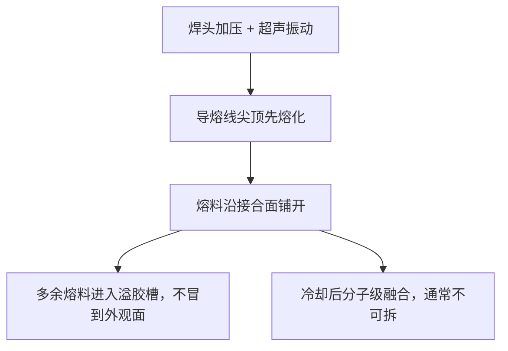

# 塑料件超声波焊接：导熔线、焊筋与溢胶槽

> [!summary] 一句话概述
> 超声波焊接是把高频振动集中到一圈三角形导熔线（能量导向筋）上，让接触面先熔化再融合。焊得住、不溢到外观面，关键是导熔线截面、焊筋宽度、两侧溢胶槽和焊接区壁厚在图纸阶段就定好；这和点焊工艺失效不是同一套规则。

## 配图

![[附件/ultrasonic-energy-director-dukane.jpg]]
*图源：[Dukane Ultrasonic Welding Design Guide](https://www.dukane.com/Portals/0/documents/Ultrasonic%20Welding%20Design%20Guide.pdf) p.16，Figure 3-3/3-4/3-5；非晶料导熔线常用顶角 90° 的直角三角形，半结晶料（以及 PC、亚克力）常用等边三角形；底宽 B 约为壁厚 W 的 1/4 到 1/5*

![[附件/ultrasonic-step-tongue-groove-dukane.jpg]]
*图源：同上 p.18，Figure 3-7/3-8/3-9；台阶接头、榫槽接头在导熔线两侧形成溢胶空间（flash trap），剪切接头则靠过盈竖壁熔合，亦可设溢胶槽*

> 图片版权归原作者所有，仅作个人学习收藏；出处见文末「来源与核实记录」。

## 结构原理

> 本节所有数字只写来源里给出的；来源没有就写「来源未给出」。

### 堆叠方案

方向：**沿焊头施力方向，从上盖接触面到下盖焊筋**

| 层级 | 零件 | 材料 | 厚度/尺寸 | 固定方式 | 依据 |
| --- | --- | --- | --- | --- | --- |
| L1 | 焊头（horn）接触面 / 上盖 | 热塑性塑料 | 近场焊接：焊头到焊缝 ≤ 6 mm（1/4 in.）；远场 > 6 mm | 加压并施加超声振动 | Dukane；赫兹：一般 20–40 kHz（878），每秒振动两万多次（1043） |
| L2 | 定位结构 | 同料 | 定位柱/定位骨；导熔线相对配合面中线偏差赫兹要求不超过 0.1 mm | 一体 | 赫兹 878、1043 |
| L3 | 导熔线（能量导向筋） | 同料 | 见参数表。两家尺寸规则不同，不可折中 | 一体成型在焊接面上 | 赫兹；Dukane |
| L4 | 焊筋 / 支承壁 | 同料 | 赫兹 1043：筋宽一般 1.5–2.5 mm；焊接区壁厚不低于 1.2 mm（低于 1 mm 易焊穿） | 一体 | 赫兹 1043 |
| L5 | 溢胶槽 / 避空 | — | 赫兹：筋两侧各让 0.3–0.5 mm；外观面离焊接区最好 3 mm 以上；焊接面预留 0.1–0.2 mm 间隙 | 一体 | 赫兹 1043 |
| L6 | 下盖配合面 | 同料 | 尽量同种材料或相容材料 | 熔合后成为一体 | 赫兹；Dukane |

剖面示意：

### 零件清单

| 零件 | 数量 | 功能 | 材料 | 依据 |
| --- | --- | --- | --- | --- |
| 上盖、下盖 | 各 1 | 被焊组件 | 相容热塑性塑料 | 赫兹 |
| 导熔线 | 一圈，宜闭环 | 把能量集中到线接触 | 同料 | 两家 |
| 焊筋/壁 | 一圈 | 提供熔合面积和支承 | 同料 | 赫兹 |
| 溢胶槽 / flash trap | 外侧或两侧 | 收容被挤出的熔料 | 一体空腔 | 赫兹；Dukane |
| 定位柱/榫 | 若干 | 焊接过程防错位 | 同料 | 赫兹；Dukane 建议不要单靠焊头/治具对位 |
| 超声焊头与治具 | 1 套 | 施力、传能；剪切焊时治具要托到接合面 | 金属 | Dukane |

### 装配顺序

1. 检查材料相容性和导熔线、溢胶槽是否按图纸成型到位。
2. 下件放入与外形贴合的治具（剪切焊尤其需要侧壁刚性支承，Dukane 建议治具可开合以便取件）。
3. 上件靠定位特征对好，导熔线尖顶朝向对接面。
4. 焊头压住上件，施加超声，至导熔线熔塌并铺展；赫兹 878 写整个过程常见 0.5–2 秒量级（FAQ 对比热板时给出）。
5. 保压冷却后取件，检查是否虚焊、溢胶、外观发白。
6. 需要密封时按密封要求做气密或跌落抽检（赫兹 1043：T0 曾出现「看着严丝合缝，一摔就开」）。

> 焊接是分子级融合，想再拆通常只能破坏。需要维修的产品不要用这套结构。

### 受力与运动分析

- **受力路径**：焊头压力 + 高频振动 → 导熔线尖顶能量密度最高、先熔 → 熔体铺开形成焊缝。使用中的拉剥、跌落、内压都由这条焊缝承担。
- **运动关系**：焊接时上件相对下件沿焊头方向有一段「熔塌」位移；剪切接头还会沿竖壁作过盈熔合（Dukane）。焊后无相对运动。
- **失效风险**：导熔线太矮虚焊（赫兹 1043：0.15 mm 太矮，改到 0.4 mm 后改善）；太高溢胶；壁厚 0.8 mm 被震裂，局部加厚到 1.5 mm 才稳住；导熔线不在施力线上，能量被旁边结构吸走；转角直角应力集中；玻纤不熔，界面像「沙子」。Dukane：能量导向筋本身不对位、也不控制溢胶，这两项必须另做几何。

与 [[微软 Surface Laptop 超声波点焊与 Alcantara 覆面（反面案例）]] 的差别：那篇是点焊在织物/覆面场景下的失效教训；本篇是塑料件导熔线、焊筋和溢胶槽的设计规则，不能把点焊失效直接当成焊筋设计依据。

## 设计要点与参数

两家数字并列如下，设计时按材料选一家规范做样件，不要把角度和高度混成一组「平均经验值」。

| 要点 | 内容 | 依据 |
| --- | --- | --- |
| 赫兹 1043 导熔线 | 三角形，顶角 45°–60°，高度 0.3–0.5 mm；尖顶朝向对接面 | 1043 正文与 FAQ |
| 赫兹 878 导熔线 | 三角形，顶角 60°–90°，高度一般 0.3–0.8 mm；FAQ：经验为壁厚的 1/5 到 1/8，2.5 mm 壁厚对应 0.3–0.5 mm。手持仪案例：0.5 mm 三角筋溢料，改为高度 0.35 mm、顶角 75° | 878 |
| Dukane 非晶料 | 直角三角形，顶角 90°，底角各 45°，高度 = 底宽/2；高度 0.005–0.030 in.（0.127–0.762 mm），底宽 0.010–0.060 in.（0.254–1.53 mm） | Dukane p.16 |
| Dukane 半结晶，以及 PC、亚克力 | 等边三角形，三角 60°，高度 = 0.866×底宽；底宽 0.010–0.050 in.（0.254–1.27 mm）。半结晶熔体易在铺开前凝固，必须用导熔线时应更大、更尖 | Dukane p.16–17 |
| Dukane 相对壁厚 | 导熔线底宽 B = W/4 到 W/5（壁厚的 20–25%）。太大时改用两道较小的平行导熔线 | Dukane Figure 3-5 |
| 焊筋与壁厚（赫兹） | 筋宽一般 1.5–2.5 mm；焊接区壁厚不低于 1.2 mm；两侧各留 0.3–0.5 mm 给熔料 | 1043 |
| 溢胶与外观（赫兹） | 外观面离焊接区最好 3 mm 以上；878 要求若靠近外观面，外侧预留 0.3 mm 以上储料槽；焊接面间隙 0.1–0.2 mm | 1043；878 |
| 闭环与转角（赫兹 878） | 焊接筋宜完整闭环；转角至少 R0.5 mm，案例把 90° 改成 R1.5 后不良率从 3–5% 降到 0.3%；筋距产品边缘至少 1 mm | 878 |
| 台阶接头（Dukane） | 推荐最小壁厚 0.080–0.090 in.（2.03–2.29 mm）；榫的高和宽各为壁厚的 1/3；槽比榫宽 0.002–0.004 in.（0.05–0.10 mm）以免干涉 | Dukane p.17 |
| 榫槽接头（Dukane） | 同样有两侧 flash trap；推荐最小壁厚 0.120–0.125 in.（3.05–3.12 mm）；槽比榫宽 0.004–0.008 in.（0.10–0.20 mm），槽深比榫高低 0.005–0.010 in.（0.13–0.25 mm） | Dukane p.18 |
| 材料 | 非晶料（ABS、PC、PS、PMMA）较好焊；结晶料窗口窄。赫兹 878：玻纤超过 30% 效果很差；1043：超过 20% 强度会明显下降。两者阈值不同，设计时按更保守的验证准备打样。ABS 与 PC 可焊，878 提醒熔点差异（ABS 约 220℃，PC 约 260℃）需调参 | 赫兹；Dukane 强调非晶更易气密 |
| 近场/远场 | 焊头到焊缝 ≤ 6 mm 为近场，否则为远场，传能路径更关键 | Dukane |

## 优缺点

**优点**
- 周期短、无溶剂、焊后通常比胶接更一体
- 适合需要密封且不拆的小型、中型壳体

**缺点 / 代价**
- 基本不可拆，和卡扣、螺丝维修路线相反
- 对导熔线和材料相容性敏感，模具开完再改代价大
- 外观面近、溢胶槽不够时，白印和溢胶难以返修
- 半结晶材料和玻纤料窗口窄，可能要改用剪切接头或换工艺

## 可借鉴点

- **出图清单**：导熔线截面和高度、是否闭环、转角 R、定位、溢胶槽、焊接区壁厚、外观面距离、材料相容性
- **先看 Dukane 的材料分类再套尺寸**：非晶用 90° 直角三角形，半结晶/PC/亚克力用 60° 等边三角形；再和赫兹的项目经验交叉验证
- **溢胶是必然的，只把去处设计好**；外观件优先台阶或榫槽接头
- **焊接区局部加厚**，不要在 1 mm 以下薄壁上硬焊
- 和点焊失效案例分开看：本篇管的是连续焊筋，不是织物覆面的焊点

## 与库中相似案例对比

| 对比项 | 本案例 | [[微软 Surface Laptop 超声波点焊与 Alcantara 覆面（反面案例）]] | [[热铆（热熔柱）：铆柱高度按体积守恒算，蘑菇头直径 2d]] |
| --- | --- | --- | --- |
| 连接对象 | 两件热塑性塑料壳体 | 点焊 + 覆面 | 塑料柱熔塌铆接 |
| 设计核心 | 导熔线、焊筋、溢胶槽 | 点焊在覆面场景下的失效 | 铆柱体积与蘑菇头 |
| 可拆 | 通常不可拆 | 覆面损坏即失败 | 一般不可逆 |

## 相关案例

- [[微软 Surface Laptop 超声波点焊与 Alcantara 覆面（反面案例）]]
- [[热铆（热熔柱）：铆柱高度按体积守恒算，蘑菇头直径 2d]]
- [[双色注塑：硬胶先射、软胶后射的结构拆件规则]]
- 分类索引：[[02-连接与紧固 索引]]

## 来源与核实记录

- 主来源：[塑料件超声波焊接实战：导熔线、焊接筋条、避空位怎么定](https://www.hezidesign.com/gongyi/1043.html)（赫兹工业设计，作者邓铮；2026-11-15 打开）
- 补充来源 1：[超声波焊接在塑料件中的 24 条经验](https://www.hezidesign.com/gongyi/878.html)（同一机构，作同主题补充，不单独算第二独立来源）
- 补充来源 2：[Dukane Ultrasonic Welding Design Guide](https://www.dukane.com/Portals/0/documents/Ultrasonic%20Welding%20Design%20Guide.pdf)（Dukane，PDF 元数据创建于 2021-04-16）——导熔线几何、台阶/榫槽/剪切接头与 flash trap。该 PDF 为独立厂商来源。
- 核实：2026-11-15 打开赫兹两文并 pdftotext 核对 Dukane 第 15–18 页全部引用尺寸。两家角度与高度并未统一，正文保持并列。
