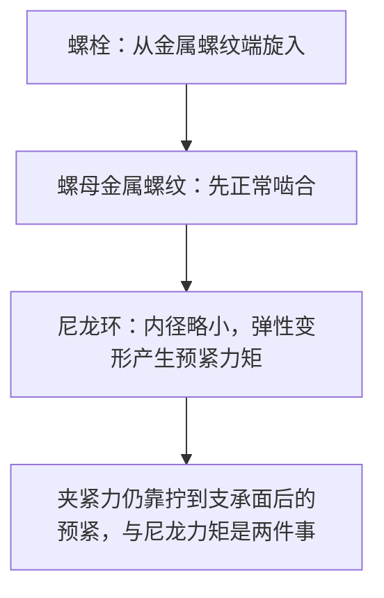

# 尼龙嵌件锁紧螺母（DIN 985 Nyloc）：预紧力矩、120°C 上限与安装方向

> [!summary] 一句话概述
> Nyloc（尼龙嵌件锁紧螺母）在六角螺母顶部压入一圈内径略小于螺栓外径的尼龙环：螺栓先穿过金属螺纹，再挤入尼龙，尼龙弹性变形产生与夹紧力无关的预紧力矩（prevailing torque），用来抵抗振动松动。标准尼龙大约在 −40 °C 至 +120 °C 保持抓力；超过约 120 °C 会软化，持续高于 130–140 °C 会永久变形。必须从金属螺纹端旋入，让尼龙环最后啮合。

## 配图

![[附件/nyloc-nut-a270.jpg]]
*图源：[奥赞《A2-70 不锈钢尼龙锁紧螺母》](https://www.aozhanfasteners.com/zh/news/a2-70-stainless-steel-nylock-nuts-how-they-work-din-985-limits-and-how-to-choose/)；A2-70 不锈钢螺母顶部的蓝色尼龙环（嵌件朝向可见一侧）*

![[附件/din985-dimensions.png]]
*图源：[Aspen Fasteners Metric DIN 985 尺寸表](https://www.aspenfasteners.com/content/pdf/Metric_DIN_985_spec.pdf) 第 1 页；S（对边）、E（对角）、H（高度）、M（金属螺纹段高度）的定义。注意：该表在 M30 之后把一行标成了「M3」且 S=50，按相邻行判断实为 M33 的笔误，本笔记不采用该行作为 M3 尺寸*

> 图片版权归原作者所有，仅作个人学习收藏；出处见文末「来源与核实记录」。

## 结构原理

> 本节数字只写来源里给出的；来源没有就写「来源未给出」。

### 堆叠方案

方向：**沿螺栓轴线，从旋入端（金属螺纹）到顶部尼龙环**

| 层级 | 零件/区域 | 材料 | 厚度/尺寸 | 固定方式 | 依据 |
| --- | --- | --- | --- | --- | --- |
| L1 | 螺栓外螺纹 | 与螺母匹配的等级与螺距 | 必须与螺母粗牙或细牙完全一致 | 旋合 | 奥赞 |
| L2 | 螺母金属螺纹段 | 如 A2-70（304，最小抗拉强度 700 MPa）或 8 级、10 级碳钢 | Aspen 表：M6 的 M=4 mm、H=6 mm、S=10 mm、E=11.05 mm；M8 的 M=5.5、H=8、S=13、E=14.38（对边与普通六角螺母相同，AIMS 也写 M8 用 13 mm 扳手） | 承受夹紧载荷 | Aspen；AIMS |
| L3 | 顶部沉孔中的尼龙环 | 聚酰胺 6 或 6/6 | 内径略小于螺栓外径，装入螺母顶部沉孔 | 过盈压入；旋合时弹性变形产生预紧力矩 | 奥赞、AIMS、Aspen |
| L4 | 被夹紧件 | — | 来源未给出 | 螺母支承面压紧 | — |

剖面示意：

### 零件清单

| 零件 | 数量 | 功能 | 材料 | 依据 |
| --- | --- | --- | --- | --- |
| 尼龙嵌件锁紧螺母 | 每螺栓 1 | 提供螺纹 + 预紧力矩防松 | 钢或不锈钢体 + 尼龙环 | 三来源 |
| 配合螺栓 | 1 | 夹紧，并切入/挤入尼龙 | 等级与螺母匹配 | 奥赞、AIMS |
| 可选螺纹润滑（不锈钢配不锈钢） | 按需 | 防咬死（galling）；尼龙段本身不靠润滑锁紧 | — | AIMS |

### 装配顺序

1. 清洁螺栓螺纹。尼龙环怕砂粒、油漆和锈，脏螺纹会一次毁掉嵌件（AIMS）。
2. **尼龙环朝后（朝向螺栓末端一侧）**，让螺栓先穿过金属螺纹，再进入尼龙环。装反会在金属啮合前压扁嵌件，即使看上去已经拧紧也锁不住（奥赞：尼龙衬套最后啮合）。
3. 拧到支承面后再施加规定夹紧扭矩。预紧力矩会叠加在夹紧扭矩上，总拧紧力矩应按规格的总值，而不是普通螺母的数值（奥赞）。
4. 安全关键或振动工况：拆开后换新螺母（AIMS：制造商普遍建议一次性使用）。

### 受力与运动分析

- **受力路径**：夹紧载荷走金属螺纹和支承面；防松走尼龙环对螺栓牙的弹性抱紧，即使夹紧力暂时下降，仍有阻力矩（奥赞、AIMS）。
- **运动关系**：安装时尼龙被挤出螺纹轮廓；之后不应相对转动。ISO 2320 规定首次拧紧、首次拆卸和第五次拆卸循环的力矩要求（奥赞转述；本笔记未打开 ISO 2320 原文，不抄具体力矩值）。
- **失效风险**：超过约 120 °C 尼龙软化，锁紧失效但螺母不会立即掉下来，属于隐蔽失效（AIMS、奥赞）。重复拆装会切削尼龙、抓力下降；AIMS 写到第三、四次循环时预紧力矩往往所剩无几。

## 设计要点与参数

| 要点 | 内容 | 依据 |
| --- | --- | --- |
| 温度上限 | 标准尼龙约 −40 °C 至 +120 °C；高于约 120 °C 软化失抓；持续高于约 130–140 °C 永久变形。奥赞提到特种工程聚合物嵌件可到 180 °C，仍远不及全金属 | 奥赞、AIMS |
| 重复使用 | 奥赞：可以重复几次，但每次磨损嵌件。AIMS：品牌商普遍建议一次性；非关键场合有人复用一两次，安装时若用手能轻松拧到底则应报废 | 奥赞、AIMS |
| 安装方向 | 从金属螺纹端旋入，尼龙环最后啮合 | 奥赞 |
| 相关标准（来源转述，非标准原文） | 常见规格按 DIN 985 或 ISO 7040；薄型 ISO 10511；加厚 DIN 982。AIMS 把 DIN 985 称为低外形、DIN 982 为标准高度，与奥赞「DIN 985 标准高度、DIN 982 加厚、ISO 10511 薄型」的叫法不完全一致，出图时应直接写标准号，不要只写“Nyloc” | 奥赞、AIMS |
| Aspen 尺寸表示例（标为 DIN 985 / ISO 10511 低外形，属厂商表） | M6：S=10，E=11.05，H=6，M=4；M8：S=13，E=14.38，H=8，M=5.5；M10：S=17，E=18.9，H=10，M=6.5。表中无可靠的 M3 行 | Aspen PDF |
| 材料等级 | A2-70 = 304 系、最小抗拉强度 700 MPa；有氯化物或海洋环境升到 A4（316）。等级指金属体强度，尼龙锁紧机理相同 | 奥赞、AIMS |
| 性能验证 | 奥赞建议向供应商要 ISO 2320 预紧力矩数据，否则锁紧功能未经验证 | 奥赞 |

## 优缺点

**优点**
- 防松不依赖夹紧力，也不依赖额外垫圈，装配不容易漏装锁紧件
- 对配合螺纹的磨损比全金属变形螺母温和（奥赞）
- 规格、扳手尺寸与普通六角螺母一致，便于替换

**缺点 / 代价**
- 温度天花板低，靠近排气管、蒸汽或烤箱的接头不能用
- 重复拆装后锁紧衰减，安全件应按一次性管理
- 有安装方向；装反等于没有锁紧
- 尼龙不耐某些化学品和长期湿热，来源未给出完整介质表

## 可借鉴点

- 图纸同时写标准号（DIN 985 或 ISO 7040 等）、等级和温度校核：接头实际温度是否低于 120 °C
- 工艺卡片写清「尼龙朝外、金属螺纹先吃牙」，并提醒总扭矩含预紧力矩
- 安全件和振动件拆一次换一颗；复用前用手感检查是否还有明显阻力
- 高于 120 °C 或频繁拆装，改全金属锁紧螺母或化学锁固，不要继续加厚尼龙

## 与库中相似案例对比

| 对比项 | 本案例 | [[全金属锁紧螺母（DIN 980）：三点变形与金属嵌片的预紧力矩防松]] | [[预涂微胶囊螺纹胶与现场涂厌氧锁固剂（precote 与 Loctite 243）]] |
| --- | --- | --- | --- |
| 锁紧介质 | 高分子尼龙环弹性干涉 | 金属螺纹局部变形或金属锁片 | 化学填充 |
| 耐温 | 约 120 °C | 明显高于尼龙（具体见该篇各来源） | 随胶种变化 |
| 重复使用 | 很少，建议关键件一次 | 通常多于尼龙，但仍会衰减 | 拆后需再涂或验证 |
| 安装方向 | 必须金属端先旋入 | 有的全金属也有方向（锥面朝上） | 无螺母方向问题 |

## 相关案例

- [[全金属锁紧螺母（DIN 980）：三点变形与金属嵌片的预紧力矩防松]]
- [[预涂微胶囊螺纹胶与现场涂厌氧锁固剂（precote 与 Loctite 243）]]
- [[Nord-Lock 楔形防松垫圈：楔角大于螺纹升角的成对拉伸锁紧]]
- 分类索引：[[02-连接与紧固 索引]]

## 来源与核实记录

- 主来源：[奥赞：A2-70 不锈钢尼龙锁紧螺母：工作原理、DIN 985 标准限制以及如何选择](https://www.aozhanfasteners.com/zh/news/a2-70-stainless-steel-nylock-nuts-how-they-work-din-985-limits-and-how-to-choose/)（编辑 Jenny-AOZHAN，页面日期 2026-10-21）
- 独立第二来源：[AIMS Industrial：Nyloc Nut Guide](https://aimsindustrial.com.au/blogs/product-guides/nyloc-nut-guide)
- 尺寸补充（厂商表，不是标准原文）：[Aspen Fasteners Metric DIN 985 / ISO 10511 规格 PDF](https://www.aspenfasteners.com/content/pdf/Metric_DIN_985_spec.pdf)。表中 M30 下一行误标「M3」（S=50 实为 M33 尺寸），已核对页面图像，不引用该行。
- 核实：2026-11-21 curl GET 打开三份来源。ISO 2320、DIN 985 的官方力矩与公差未直接打开标准文本，只保留厂商转述并标明出处。
