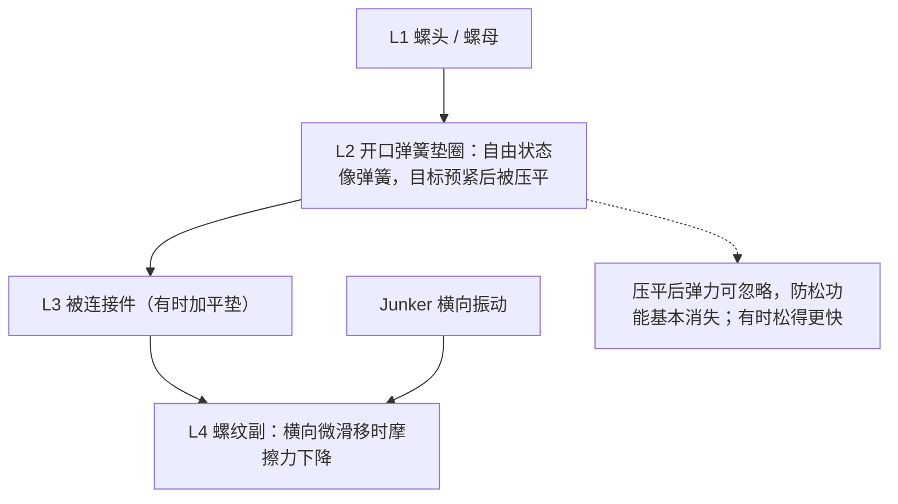

# 开口弹簧垫圈防松失效（反面案例）：压平后在横向振动中几乎无效

> [!summary] 一句话概述
> 开口螺旋弹簧垫圈被广泛当成“防松件”，但在横向振动（Junker，DIN 65151）里几乎没有防松作用，有时还会加快松脱。原因很直接：拧到目标预紧后垫圈已经被压平，弹力可以忽略，剩下的只是一片被压扁的开口垫圈。Bolt Science 用 M8 接头做了对比试验，并指出 8.8 级及以上螺栓上，这类垫圈往往在目标预紧的约 10%–20% 就已经压平；1969 年 Junker 的工作已经表明它不能阻止松转。本篇作为反面案例，对照楔形垫圈（拉伸锁紧）和 Spiralock（改变内螺纹牙型）：不要再把弹簧垫圈当防松件。

## 配图

![[附件/helical-spring-washer.jpg]]
*图源：[Bolt Science《Helical Spring Lock Washers》](https://www.boltscience.com/pages/helicalspringwashers.htm)；典型开口螺旋弹簧垫圈。该页指出这类垫圈已使用一百多年，仍被许多人相信能“锁住”螺母，但经验和试验都表明它不能防止松动，在许多情况下还会加快松脱。*

![[附件/spring-washer-junker-curve.png]]
*图源：同上页的 preload decay curve（GIF 转存）；Bolt Science 用 M8 紧固件，把“只有普通螺母”和“普通螺母 + 开口弹簧垫圈”放在 Junker 试验里对比。页面说明曲线来自与视频同一组试验。本笔记不从图像上估读具体牛顿数，只保留作者的定性结论：弹簧垫圈未能阻止自松，甚至可提高松脱速率。*

![[附件/spring-washer-deflection.png]]
*图源：同上页 Helical Spring Washer Deflection Graph；说明把弹簧垫圈放进接头后的刚度变化。作者强调：8.8 级及以上螺栓上，这类垫圈通常在目标预紧的 10%–20% 就被压平，此后接头刚度与没装它时一样，对抵抗沉降和改善疲劳没有帮助。真正为改变刚度而设计的是接近目标预紧才压平的锥形/碟形垫圈（如 DIN 6796），与开口弹簧垫圈不是一类。*

> 图片版权归原作者所有，仅作个人学习收藏；出处见文末「来源与核实记录」。

## 结构原理

> 本节只写来源中的定性结论和已写明的比例；不编造 Junker 曲线上的预紧力数值。Whole-Spec 文中有一处把 Junker（DIN 65151）写成“相当于 GB/T 10433”，与常见标准编号用法不符（GB/T 10433 在紧固件领域另有电弧螺柱焊标准），本篇不采用这一对应。

### 堆叠方案

方向：**从螺头（或螺母）到被连接件。**

| 层级 | 零件/区域 | 材料 | 厚度/尺寸 | 固定方式 | 依据 |
| --- | --- | --- | --- | --- | --- |
| L1 | 螺头或螺母支承面 | 按螺栓规格 | — | 拧紧 | 通例，来源未给尺寸 |
| L2 | 开口弹簧垫圈 | 螺旋开口垫圈 | 自由状态有开口和翘曲；拧到工作预紧后被压平 | 被夹在支承面和被连接件之间 | Bolt Science；Whole-Spec |
| L3 | 被连接件（有时还加一片平垫） | — | Bolt Science 提到有人把平垫加在弹簧垫圈与工件之间，指望改变刚度 | 夹紧 | Bolt Science |
| L4 | 螺纹副 | 标准 60° 螺纹 | 预紧靠螺纹和支承面的摩擦维持 | 横向微滑移时摩擦力可瞬时下降，发生松转 | Whole-Spec；Bolt Science 引 Junker 1969 |

剖面示意：

### 零件清单

| 零件 | 数量 | 功能（设计意图 vs 实际） | 材料 | 依据 |
| --- | --- | --- | --- | --- |
| 开口螺旋弹簧垫圈 | 1 | 意图：弹力和锐边防松；实际：工作预紧下已被压平 | 来源未给牌号 | 两源 |
| 螺栓、螺母 | 1 套 | 提供预紧 | Bolt Science 试验用 M8 | Bolt Science |
| 平垫（有人会加） | 0 或 1 | 意图改变刚度；压平后无效 | — | Bolt Science |

### 装配顺序

1. 按常规把垫圈套在螺栓上（有时再加平垫）。
2. 拧到目标预紧。此时开口垫圈通常已经压平（Whole-Spec；Bolt Science 对 8.8 级及以上给出 10%–20% 目标预紧即压平）。
3. 在横向振动下，接头按 Junker 机制发生相对滑动和松转。Bolt Science 的 M8 试验显示，加垫圈并不能阻止这一过程。

> 以下为反面案例的“不要这样用”，不是推荐工艺。

### 受力与运动分析

- **传统说法（两源都转述后否定）**：垫圈像弹簧一样保持轴向力；或锐边咬入表面阻止反转。
- **实际**：目标预紧下垫圈已压平，相当于带开口的平垫（NASA 锁紧螺母章节的表述，经 iFast 中译转引；Whole-Spec 也概括了同一结论）。Whole-Spec 还写：弹力大约只有 1–3 kgf 量级，而螺栓夹紧力是数百到数千 kgf，可以忽略——这是该中文文给出的量级，不是 Bolt Science 的试验读数。
- **Junker 机制**：横向载荷使螺纹面和支承面发生相对滑动，摩擦力瞬时下降，螺栓转动退出（Junker 1969，两源）。开口弹簧垫圈既不能阻止这种转动，试验中还可能加快松脱（Bolt Science）。
- **刚度说法也不成立**：只有在工作预紧附近仍保持弹性的垫圈（如 DIN 6796 锥形垫圈）才能减轻沉降损失；开口弹簧垫圈在远低于目标预紧时就已经压平（Bolt Science）。
- **其他失效**：拧紧过程中有的垫圈会裂开，并部分或全部啃进螺母或螺栓表面（Bolt Science）。英国 2007-02-23 一起高速列车在道岔脱轨事故中，使用开口弹簧垫圈的接头螺母完全脱落（Bolt Science）。2004 年 DIN 曾发文解释为何撤回包括开口弹簧垫圈在内的一批“锁紧垫圈”标准，以免设计师继续选用已被证明无效的零件（Bolt Science）。

## 设计要点与参数

| 要点 | 内容 | 依据 |
| --- | --- | --- |
| 定性结论 | 开口弹簧垫圈不能防止自松，许多情况下还会加快松脱 | Bolt Science；Junker 1969 |
| 压平时机 | 8.8 级及以上：大约在目标预紧的 10%–20% 被压平，此后不再改变接头在工作预紧下的刚度 | Bolt Science |
| 试验 | Bolt Science 用 M8，对比“普通螺母”和“普通螺母 + 开口弹簧垫圈”的 Junker 预紧衰减；具体牛顿值页面未写成数字，不估读 | Bolt Science |
| 中文源的补充量级 | 弹力约 1–3 kgf，夹紧力数百到数千 kgf（Whole-Spec 的表述）；Junker 曲线上“带弹簧垫圈”与“只加平垫”几乎相同 | Whole-Spec |
| 历史与标准动向 | 1969 年 Junker 已给出试验证据；2004 年 DIN 撤回相关锁紧垫圈标准 | Bolt Science |
| 事故例 | 2007-02-23 英国高速列车道岔脱轨，相关接头使用了开口弹簧垫圈且螺母脱落 | Bolt Science |
| 有效替代（中文源列举，需另查各自限制） | 楔形垫圈（Nord-Lock 原理）、尼龙锁紧螺母（重复使用和耐温有限）、螺纹锁固剂、双螺母、开口销+槽形螺母；更根本的是正确的预紧和扭矩管理 | Whole-Spec |
| 不要做的事 | 不要再把“加个弹簧垫圈”当作振动环境的防松方案；也不要指望它改善短夹紧长度的沉降 | 两源 |

## 优缺点

**曾被指望的“优点”（实际不成立）**
- 便宜、图纸上随手能加、安装无特殊工具——这只是它仍然出现在很多图样上的原因，不是防松性能（推断：来源着重谈无效，未把“便宜”写成优点）

**缺点 / 代价（作为防松件）**
- 工作预紧下已被压平，防松功能基本消失
- 可能加快松脱，并在拧紧时裂开、损伤支承面
- 给设计者造成“已经防松”的虚假安心，延误改用真正有效的措施（推断，与两源的事故和标准撤回叙述一致）

## 可借鉴点

- 新设计默认**不要**把开口弹簧垫圈填进防松栏；振动环境改用拉伸锁紧垫圈、可靠的锁紧螺纹、胶或机械防转，并先把预紧做对
- 审查旧图时，把“弹簧垫圈 = 已防松”列为风险项，尤其是轨道、车辆、高速旋转和涉及人身安全的接头
- 若目的是补偿沉降、改变刚度，应选用在目标预紧附近才压平的碟形/锥形垫圈（如 DIN 6796），不要用开口弹簧垫圈顶替
- 不要从广告或经验口头禅出发，拿 Junker 曲线或本篇图去“目测”一个牛顿数写进计算书

## 与库中相似案例对比

| 对比项 | 本案例（开口弹簧垫圈，反面） | [[Nord-Lock 楔形防松垫圈：楔角大于螺纹升角的成对拉伸锁紧]] | Spiralock 30° 楔形底内螺纹（本轮另一篇） |
| --- | --- | --- | --- |
| 原理 | 弹力 + 锐边；拧紧后压平，失效 | α > β，松转使夹紧力上升 | 内螺纹牙底楔面，消除径向间隙 |
| Junker 横向振动 | 几乎无效，甚至有害 | 原厂与独立文均承认其在横向振动中表现好（但不是万能） | Machine Design 等文报道预紧保持更好 |
| 附加零件 | 单片垫圈 | 成对垫圈 | 不必须加垫圈，但要改内螺纹 |
| 设计态度 | 不要再当防松件 | 接触面硬度、通孔对数要按规则 | 外螺纹仍用标准牙 |

## 相关案例

- [[Nord-Lock 楔形防松垫圈：楔角大于螺纹升角的成对拉伸锁紧]]
- 分类索引：[[02-连接与紧固 索引]]

## 来源与核实记录

- 中文主来源：[Whole-Spec《弹簧垫圈没用？- 螺栓防松的真相》](https://whole-spec.com/zh/design-tips/bolt-anti-loosening)（2026-11-21 GET，HTTP 200。压平失效、Junker 定性结论、弹力量级和替代措施。不采用文中“DIN 65151 相当于 GB/T 10433”这一说法。）
- 独立第二来源：[Bolt Science《Helical Spring Lock Washers》](https://www.boltscience.com/pages/helicalspringwashers.htm)（Bill Eccles；2026-11-21 GET，HTTP 200。Junker 1969、M8 对比试验、10%–20% 压平、DIN 6796 对照、2004 年标准撤回、2007 年列车事故。曲线数值未写成表，故不估读。）
- 补充、非独立来源：[iFast《开口弹簧垫圈真的能防松吗？》](https://ifast-sensor.com/contents/20/72.html)（页上标明“艾法斯特翻译 作者：Bill Eccles”，内容转述 Bolt Science，并附 NASA 评语摘录。不计入独立来源数。）
- 核实：2026-11-21 打开三页。两篇中文没有新的、可独立引用的试验曲线数字；防松无效的试验证据以 Bolt Science 为准。
