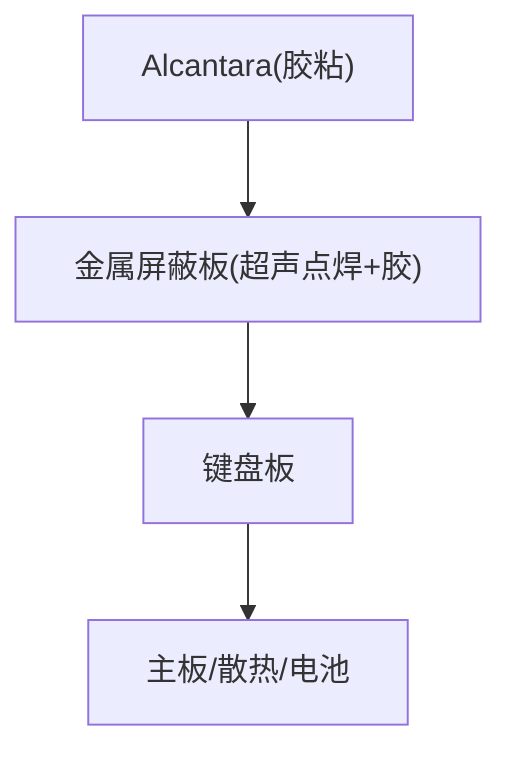

# 微软 Surface Laptop 超声波点焊与 Alcantara 覆面（反面案例）

> [!summary] 一句话概述
> 初代 Surface Laptop 没有可见螺丝：键盘面覆一层胶粘的 Alcantara 织物，下面的金属屏蔽板与塑料件之间看似卡扣、实为超声波点焊——只能破坏性打开，0/10。

## 配图

![[附件/surface-laptop-welds.jpg]]
*iFixit：织物下的金属屏蔽板与塑料点焊*

![[附件/surface-laptop-alcantara.jpg]]
*iFixit：撬起 Alcantara 覆面*

> 图片版权归原作者所有，仅作个人学习收藏；出处见文末「来源与核实记录」。

## 结构原理

> 本节数字只写来源里给出的；来源没有就写「来源未给出」。

### 堆叠方案

方向：**从 C 面（键盘面）向下**

| 层级 | 零件 | 材料 | 厚度/尺寸 | 固定方式 | 依据 |
| --- | --- | --- | --- | --- | --- |
| L1 | Alcantara 织物覆面 | Alcantara | 来源未给出 | 胶粘（撬时以为是卡扣，Step 5 证实为点焊） | Step 4-5 |
| L2 | 金属屏蔽板 | 金属 | 来源未给出 | 下方胶粘 + 塑料件超声波点焊 | Step 5 |
| L3 | 键盘板 | — | 来源未给出 | 长排线连接，连接器压在主板卡扣屏蔽罩下 | Step 6 |
| L4 | 主板 / 散热 / 电池 | — | 电池 45.2 Wh | — | Step 13 |
| 底面 | 橡胶脚垫 | 橡胶 | 来源未给出 | 下面是金属脚而非螺丝 | Step 4 |

剖面示意：

### 零件清单

| 零件 | 数量 | 功能 | 材料 | 依据 |
| --- | --- | --- | --- | --- |
| Alcantara 覆面 | 1 | 外观、触感 | 织物 | Step 4 |
| 超声波焊点 | 多处（数量来源未给出） | 固定屏蔽板与塑料件 | 塑料 | Step 5 |
| 电池 | 1 | 45.2 Wh | 锂电 | Step 13 |

### 装配顺序

1. (按拆解顺序反推) 装电池、主板、散热
2. 键盘板接排线
3. 屏蔽板与塑料件超声波点焊、胶粘
4. 粘 Alcantara 覆面

> 来源只给出（破坏性）拆解顺序，以上为反推。

### 受力与运动分析

- **受力路径**：来源未讨论受力。
- **运动关系**：无相对运动（永久连接）。
- **失效风险**：打开过程会破坏焊点与织物，无法复原；电池更换困难且危险（结论）。

## 设计要点与参数

| 要点 | 内容 | 依据 |
| --- | --- | --- |
| 可维修评分 | 0/10 | Step 15 |
| 电池 | 45.2 Wh | Step 13 |
| 焊点数量/尺寸 | 来源未给出 | — |

## 优缺点

**优点**
- 外观无螺丝、整体感强
- 织物覆面带来独特触感

**缺点 / 代价**
- 永久连接，无法非破坏性维修
- 电池/接口更换代价极高

## 可借鉴点

- 超声波点焊适合「永不打开」的部件；需要维修的面不要用
- 外观覆面（织物、皮革）与可拆结构冲突时，考虑做成可拆的饰板

## 相关案例

- [[苹果 AirPods Pro 全胶粘封装（反面案例）]]
- [[Framework 笔记本模块化扩展卡与磁吸边框]]
- [[卡扣三种基本形式：悬臂、环形、扭转]]
- 分类索引：[[02-连接与紧固 索引]]

## 来源与核实记录

- 主来源：[Microsoft Surface Laptop Teardown](https://www.ifixit.com/Teardown/Microsoft+Surface+Laptop+Teardown/92915)（2017-06-16，Evan Noronha / iFixit）
- 核实：2026-11-13 通过 iFixit API 读取 15 步原文，核对 Alcantara、超声波点焊、电池与评分。
