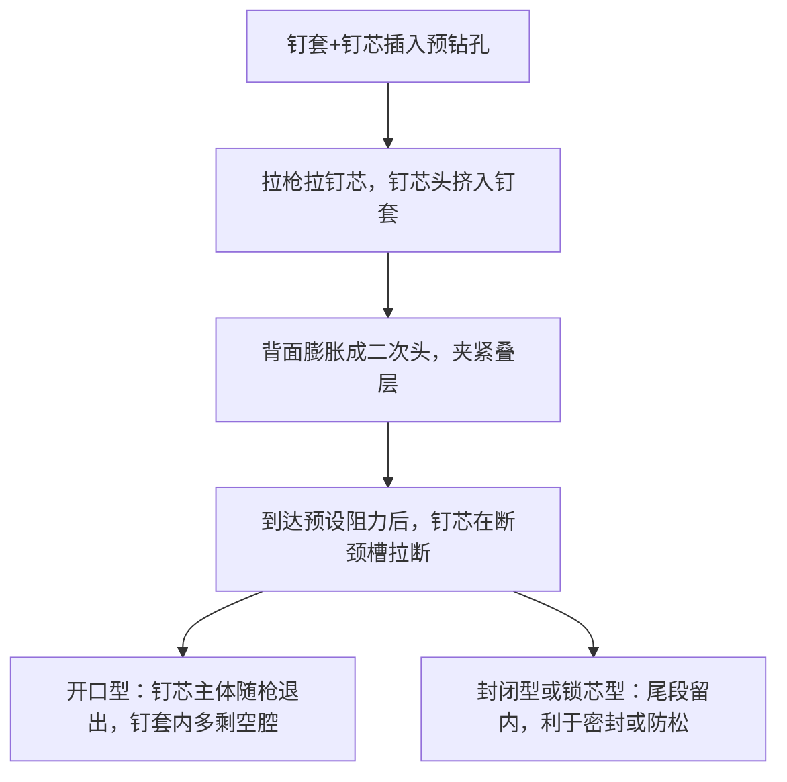

# 抽芯铆钉（盲铆钉）：钉套、钉芯与断颈槽，开口型与封闭型

> [!summary] 一句话概述
> 抽芯铆钉由钉套（铆体）和钉芯（钉杆）组成，从单面插入预钻孔，拉枪拉动钉芯使钉套在背面膨胀形成墩头，钉芯在预设断颈槽处拉断。它和拉铆螺母都是单面施工，但拉铆螺母留下可重复使用的内螺纹，抽芯铆钉是一次性永久夹紧。选型关键是夹紧范围必须覆盖工件总厚，并分清开口型（钉芯主体多被抽走、钉套空腔不密封）与封闭型（钉套尾部封闭，利于防水）。

## 配图

![[附件/blind-rivet-mandrel.png]]
*图源：[飞可斯《抽芯铆钉常识》](https://www.rivet-china.com/cn/know/)；钉芯结构：① 钉芯头（Mandrel Head）② 装配锁点 ③ 断颈点（Break Point）④ 钉芯杆*

![[附件/blind-rivet-body.png]]
*图源：同上；钉套尺寸：钉体直径、铆钉长度、头部直径与头高*

![[附件/blind-rivet-grip-section.png]]
*图源：同上；铆接后剖面：夹紧范围（Grip Range）必须覆盖叠层厚度，背面形成二次头，并预留盲面净空*

> 图片版权归原作者所有，仅作个人学习收藏；出处见文末「来源与核实记录」。

## 结构原理

> 本节数字只写来源里给出的；来源没有就写「来源未给出」。

### 堆叠方案

方向：**从操作面钉头到背面墩头**

| 层级 | 零件/区域 | 材料 | 厚度/尺寸 | 固定方式 | 依据 |
| --- | --- | --- | --- | --- | --- |
| L1 | 钉套头部（Primary Head） | 铝、钢、不锈钢等 | 头径、头高按规格；开口型或封闭型头部形态不同 | 贴在操作面 | 飞可斯 |
| L2 | 被连接叠层 | 薄板等 | 总厚度必须落在该规格的夹紧范围（Grip Range）内 | 被钉头与背面墩头夹紧 | 飞可斯；易紧通表 |
| L3 | 钉套杆部 | 同 L1 | 钉体直径常见 3.0 / 3.2 / 4.0 / 5.0 / 6.0 mm（易紧通表） | 穿过预制孔 | 易紧通 |
| L4 | 背面二次头 | 钉套尾部塑性膨胀 | 长度不足则形不成足够盲面支撑 | 提供夹紧与抗剪 | 飞可斯 |
| L5 | 钉芯与断颈槽 | 钉芯材料随性能等级 | 拉到设定阻力后在预定断点分离；开口型主体多被抽走，锁芯型尾段留在钉套内被锁住 | 拉断 | 飞可斯；徽宇 |

剖面示意：

### 零件清单

| 零件 | 数量 | 功能 | 材料 | 依据 |
| --- | --- | --- | --- | --- |
| 钉套（铆体） | 1 | 形成夹紧和承力 | 铝、钢、不锈钢等 | 飞可斯；易紧通性能等级表 |
| 钉芯（钉子、钉杆） | 1 | 传递拉力并在断点分离 | 随等级（易紧通列出与钉体匹配的牌号） | 两来源 |
| 拉铆工具 | 1 | 拉动钉芯 | — | 飞可斯 |
| 预制孔的工件 | ≥1 层 | 被夹紧 | — | 飞可斯：先测总厚再选夹紧范围 |

### 装配顺序

1. 测量需要铆接的工件总厚度，按样本「铆接范围 Grip Range」选能覆盖该厚度的规格。过短无法在背面形成足够支撑，铆接不牢（飞可斯）。
2. 钻或冲出匹配钉体直径的孔，插入铆钉。
3. 用配套工具拉动钉芯，使钉芯头拉入钉套、背面膨胀；当钉芯头到达背面材料表面、阻力上升到设定断钉力时，在预定断点分离。断掉的钉芯部分掉出或随枪退出（飞可斯）。
4. 按结构检查：开口型应看到钉芯主体被抽出；锁芯型应确认尾段锁在钉套内不脱落；封闭型检查头部是否仍封闭（徽宇）。

### 受力与运动分析

- **受力路径**：拉伸载荷由两个钉头夹紧叠层承担，剪切载荷由钉套杆部承担（飞可斯剖面图同时标了 Tension 与 Shear）。
- **运动关系**：安装过程钉芯相对钉套轴向移动，断颈后不再有预期相对运动。开口型主要靠夹紧摩擦防松；锁芯、多鼓等在内部增加机械锁止，振动下更稳（徽宇）。
- **失效风险**：夹紧范围选错；断点位置不准，钉芯断在错误位置导致夹紧力不够（徽宇）；开口型用在振动或要防水的场合，空腔进水或逐渐松脱。

## 设计要点与参数

| 要点 | 内容 | 依据 |
| --- | --- | --- |
| 两件结构 | 钉套 + 钉芯；钉芯有预定断点 | 飞可斯 |
| 开口型 | 钉芯主体通常被拉出，钉套内部是空腔，成本低，密封和防松要求高时不太合适 | 徽宇 |
| 锁芯型（断颈保留型） | 断点外段被抽走，尾段被锁环卡在钉套内，既防松又利于防水防尘 | 徽宇 |
| 封闭型 | 钉套尾部或头部封闭，水不容易从空腔进入，常用于户外、潮湿部位。徽宇提醒封闭型里也还要区分开口/锁芯等结构 | 徽宇；飞可斯产品分类含封闭型与开口型 |
| 多鼓型 | 拉铆时在板后胀出多个鼓包，贴合面积更大，对薄板、软材料更友好 | 徽宇 |
| 夹紧范围 | 必须覆盖总厚；飞可斯强调过短则盲面支撑不足 | 飞可斯 |
| 易紧通转载的开口型推荐铆接厚度示例（mm） | 公称长度 L=10 时：钉体 3.0 为 4–6.2，3.2 为 3–5.6，4.0 为 2–4.7，5.0 为 1–3.7 | 易紧通「开口型」表（页内标注来源 GB/T 12619-1990，是否为现行版本未核） |
| 封闭型推荐铆接厚度示例（mm） | L=8 时：钉体 3.0 / 3.2 为 2–4，4.0 为 1.5–3.5，5.0 为 1–3 | 易紧通「封闭型」表 |
| 力学性能表 | 易紧通按型式、性能等级和钉体直径给出最小抗剪、最小抗拉载荷，例如开口型等级 06、钉体 4.0 mm：抗剪 450、抗拉 590。**打开页该表表头未标明单位**，本笔记只抄数字，出图前应对原表或标准文本 | 易紧通 |

## 优缺点

**优点**
- 单面施工，设备简单，适合封闭箱体
- 结构种类多：开口、封闭、锁芯、多鼓，可按振动和防水选型
- 比螺栓轻、不需要背面螺母

**缺点 / 代价**
- 一次性，拆开就要破坏铆钉
- 夹紧和抗剪有上限，重载承力节点徽宇建议改看环槽铆钉（哈克钉），两者不是替代关系
- 开口型空腔不密封；断点质量差会直接导致夹不紧

## 可借鉴点

- 出图写：**钉体直径、夹紧范围（按总厚含涂层）、开口还是封闭、是否锁芯/多鼓、材料与性能等级**
- 先量总厚再选长度，不要只写「4 mm 拉钉」
- 振动工况不要只用最便宜的开口型；户外先看封闭型，再看是否要锁芯
- 到货抽检：断点是否干净、鼓头是否饱满、锁芯尾段是否卡死

## 与库中相似案例对比

| 对比项 | 本案例 | [[拉铆螺母（铆螺母）：单面镦头、铆接范围与圆孔滚花及六角防转]] | [[热铆（热熔柱）：铆柱高度按体积守恒算，蘑菇头直径 2d]] |
| --- | --- | --- | --- |
| 留下什么 | 永久夹紧，无螺纹 | 板上留下内螺纹，还可再拧螺钉 | 塑料柱热镦成蘑菇头 |
| 关键参数 | 夹紧范围、断颈槽、开口/封闭 | 铆接范围、孔形防转 | 铆柱高度与体积守恒 |
| 可拆性 | 破坏性拆除 | 螺钉可拆，螺母与板基本不可拆 | 破坏性拆除 |

## 相关案例

- [[拉铆螺母（铆螺母）：单面镦头、铆接范围与圆孔滚花及六角防转]]
- [[热铆（热熔柱）：铆柱高度按体积守恒算，蘑菇头直径 2d]]
- [[钣金压铆螺母（PEM S-CLS）：孔径、最小板厚、边距与板材硬度上限]]
- 分类索引：[[02-连接与紧固 索引]]

## 来源与核实记录

- 主来源：[上海飞可斯：抽芯铆钉常识 / 简介](https://www.rivet-china.com/cn/know/)（钉套与钉芯、断点、夹紧范围；结构示意图）
- 独立第二来源：[徽宇：抽芯铆钉拉完钉芯断在里面还是拉出来？锁芯与多鼓型防松原理](https://www.huiyutools.com/gongjuzixun/2672.html)
- 补充：[易紧通：抽芯铆钉技术条件](https://www.164580.com/data/detail_244.html)（页内写 GB/T 12619-1990；力学性能表未标单位，夹紧范围单位为 mm）
- 核实：2026-11-21 curl GET 打开三页并下载结构图，确认文件头为真实 PNG/JPEG。
