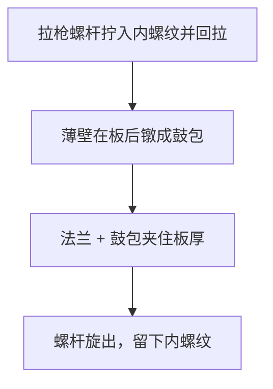

# 拉铆螺母（铆螺母）：单面镦头、铆接范围与圆孔滚花及六角防转

> [!summary] 一句话概述
> 拉铆螺母是单面安装的内螺纹紧固件：把它插入预制孔，拉枪螺杆拧入并回拉，薄壁在板背面塑性镦成鼓包，把板夹在法兰和鼓包之间，再旋出螺杆，板上留下内螺纹。和压铆螺母不同，它不靠双面加压让板料冷流进退刀槽，关键参数是**铆接范围（夹持厚度）必须覆盖实际叠层厚度**，以及圆孔滚花（摩擦防转）还是六角孔（机械防转）。

## 配图

![[附件/rivet-nut-typical.jpg]]
*图源：[Wikipedia: Rivet nut](https://en.wikipedia.org/wiki/Rivet_nut) 所用照片 [Blindnietmutter.jpg](https://commons.wikimedia.org/wiki/File:Blindnietmutter.jpg)（Wikimedia Commons）；外观：带法兰头和待镦粗薄壁的拉铆螺母*

![[附件/rivet-nut-cutaway.jpg]]
*图源：同上词条所用剖开图 [Blindklinkmoer opengewerkt.jpg](https://commons.wikimedia.org/wiki/File:Blindklinkmoer_opengewerkt.jpg)；剖开后可见法兰头、薄壁镦粗区和内螺纹。安装原理亦见文内示意图*

> 图片版权归原作者所有，仅作个人学习收藏；出处见文末「来源与核实记录」。

## 结构原理

> 本节数字只写来源里给出的；来源没有就写「来源未给出」。

### 堆叠方案

方向：**从操作面法兰到板背面鼓包**，以快速打样给出的平头条纹 FL-YS 系列为例

| 层级 | 零件/区域 | 材料 | 厚度/尺寸 | 固定方式 | 依据 |
| --- | --- | --- | --- | --- | --- |
| L1 | 法兰头 | 钢、不锈钢、铝或黄铜等 | 例：M6 法兰直径 D=12.3 mm，头厚 K 在表中为 1.3 mm（该系列） | 贴在板正面，限制轴向 | 快速打样规格表 |
| L2 | 板或叠层 | 钣金、型材等 | 必须落在该规格的夹持厚度 E 内，例如 M6 短款 0.5–3.0 mm、长款 3.0–5.5 mm | 被夹在法兰与鼓包之间 | 快速打样；旺途 |
| L3 | 体部（圆滚花或六角） | 同 L1 | 圆孔款 M6 底孔 A=9.0 mm（+0.1）；六角款要按对边开六角孔，不能按螺钉直径选钻头 | 滚花靠摩擦防转，六角靠机械咬合 | 快速打样；旺途 |
| L4 | 背面鼓包 | 体部薄壁塑性变形 | 来源未给出鼓包外径；旺途强调背面仍要留出变形空间 | 提供抗推出 | 两来源 |
| L5 | 内螺纹（通孔或盲孔） | 同 L1 | 通孔背面可见螺纹；盲孔（Closed End）背面封闭，用于防水、防尘 | 供螺钉后续拧入 | 快速打样 |

剖面示意：

### 零件清单

| 零件 | 数量 | 功能 | 材料 | 依据 |
| --- | --- | --- | --- | --- |
| 拉铆螺母 | 每孔 1 | 单面形成内螺纹 | 碳钢、不锈钢、铝、黄铜等 | 快速打样 |
| 拉铆枪（手动/气动/液压电动） | 1 | 施加拉力与行程 | — | 快速打样：手动适合 M3–M5 打样；气动拉力 15–25 kN，适合 M4–M10 |
| 配合螺钉 | 1 | 后续连接 | 与内螺纹匹配 | — |

### 装配顺序

1. 测量实际叠层厚度（含涂层和公差）。两层板要按总厚选铆接范围，不要把空隙或事后才装上、并不参与铆接的支架厚度算进去（旺途）。
2. 按最终选用的体部形式开孔：圆孔、滚花体、半六角或全六角的孔径和对边都可能不同（旺途：不要根据配套螺钉直径直接选钻头）。
3. 插入螺母，用拉枪拉到设定行程或力，使背面形成鼓包；然后把螺杆从内螺纹里旋出。
4. 出现跟转时，先查实测孔径、毛刺、实际板厚和铆接范围，而不是继续加大拉力（旺途）。

### 受力与运动分析

- **抗推出**：靠法兰和背面鼓包对板厚的夹紧。铆接范围选短了，鼓包形不成；选长了可能拉过或拉断心轴（快速打样）。
- **抗扭转**：条纹/滚花圆孔靠摩擦，适合薄板、铝、塑料；半六角或全六角靠机械咬合，扭矩传递更大。快速打样提醒：条纹款在钢板上拧 M6，打 3–5 N·m 时可能在孔里空转。文中「六角比条纹大 2–3 倍」是该文的经验表述，不是通用试验标准值。
- **与压铆螺母的差别**：压铆需要双面加压，板料冷流进退刀槽（见已有 PEM S-CLS 篇）；拉铆是单面拉镦。注意：快速打样对比表把压铆也写成「单面操作」，与 PEM 手册和库中压铆螺母篇不一致，本篇不以该格为准。

## 设计要点与参数

快速打样平头条纹 FL-YS 系列（单位 mm，底孔公差 +0.1）：

| 螺纹 | 夹持厚度 E | 底孔 A | 头部 K | 法兰 B | 法兰直径相关尺寸 | 总长 L |
| --- | --- | --- | --- | --- | --- | --- |
| M3 | 0.5–2.0 | 5.0 | 0.8 | 8.0 | 表中另给 4.9 | 9.0 |
| M4 | 0.5–2.0 / 2.0–3.5 | 6.0 | 0.8 | 9.0 | 5.9 | 11.0 / 12.5 |
| M5 | 0.5–2.5 / 2.5–4.0 | 7.0 | 1.0 | 10.0 | 6.9 | 13.0 / 16.0 |
| M6 | 0.5–3.0 / 3.0–5.5 | 9.0 | 1.3 | 12.3 | 8.9 | 15.0 / 17.5 |
| M8 | 1.0–3.5 / 3.5–6.0 | 11.0 | 1.5 | 14.5 | 10.9 | 18.0 / 20.0 |
| M10 | 1.0–4.0 | 13.0 | 1.7 | 17.0 | 12.9 | 21.0 |
| M12 | 1.0–4.0 | 15.0 | 1.7 | 18.0 | 14.9 | 22.0 |

（表中「法兰 B / 法兰直径」按原文列表抄录；若出图请再对照该系列图纸，避免把列名理解错。）

| 要点 | 内容 | 依据 |
| --- | --- | --- |
| 选型顺序 | 先看板厚 E，再反查螺纹和长度版本 | 快速打样 |
| 通孔与盲孔 | 盲孔用于防水、防尘、防异物；新能源车电池包该文称几乎全用盲孔 | 快速打样 |
| 背面空间 | 单面操作仍要给本体和变形区留空间；法兰高度影响外侧支架能否贴平 | 旺途；Böllhoff 页强调薄壁件单面形成螺纹 |
| 电偶腐蚀 | 铝板配钢螺母要绝缘或改用铝螺母；不锈钢板配钢螺母要镀层隔离 | 快速打样 |
| 适用板厚（该文对比表） | 拉铆螺母写 0.5–6 mm | 快速打样；具体仍以各规格 E 为准 |

## 优缺点

**优点**
- 只需从正面操作，封闭型材、箱体内部也能做出螺纹
- 无焊接热输入，设备比压铆机更灵活，打样可用手动枪

**缺点 / 代价**
- 铆接范围选错几乎必然失败，同一螺纹有多个长度版本
- 圆孔滚花在钢板上容易跟转，要为防转付出六角孔的模具成本
- 背面鼓包要占空间，齐平外观要选沉头并预先倒角
- 强度和防转通常不如压铆或焊接螺母（视规格和板材而定）

## 可借鉴点

- 图纸同时标注：**螺纹、夹持厚度范围、孔形和孔径（含公差）、通孔还是盲孔、头部形式**
- 送样用真实叠层和涂层，不要只报「M6」
- 钢板上的 M6 以上优先半六角或全六角；跟转先查孔和板厚，再查枪的行程
- 需要双面可压、批量平板，优先压铆螺母；背面完全不可达，才把拉铆当首选

## 与库中相似案例对比

| 对比项 | 本案例 | [[钣金压铆螺母（PEM S-CLS）：孔径、最小板厚、边距与板材硬度上限]] | [[抽芯铆钉（盲铆钉）：钉套、钉芯与断颈槽，开口型与封闭型]] |
| --- | --- | --- | --- |
| 原理 | 单面拉镦，薄壁成鼓包夹住板 | 双面加压，板料冷流进退刀槽 | 同样单面拉，但留下的是永久夹紧，不是内螺纹 |
| 关键参数 | 铆接范围、孔形防转 | 孔径、板厚、边距、硬度 | 夹紧范围、断颈槽 |
| 安装后 | 板上有可重复拧螺钉的内螺纹 | 板上有内螺纹 | 一次性铆死 |

## 相关案例

- [[钣金压铆螺母（PEM S-CLS）：孔径、最小板厚、边距与板材硬度上限]]
- [[钣金压铆螺钉（PEM FH 平头螺柱）：孔径、最小板厚、边距与板材硬度上限]]
- [[抽芯铆钉（盲铆钉）：钉套、钉芯与断颈槽，开口型与封闭型]]
- 分类索引：[[02-连接与紧固 索引]]

## 来源与核实记录

- 主来源：[快速打样：拉铆螺母选型完全指南](https://www.myquicksample.cn/tech-article/tech-7.html)（夹持厚度与底孔表、体部形式）
- 独立第二来源：[旺途：拉铆螺母怎么选：铆接范围、孔尺寸与薄板装配检查](https://wtbolts.com/zh/news/rivet-nut-grip-range-hole-size.html)（2026-09-05）
- 补充：[Böllhoff RIVKLE 拉铆螺母和螺柱中文页](https://www.boellhoff.com/cn-zh/产品/专用紧固件/rivkle拉铆螺母和螺柱/)
- 核实：2026-11-21 curl GET 打开三页。未把快速打样对比表里「压铆螺母单面操作」写入结论。FL-YS 表中法兰列名按原文抄录，出图建议再对厂家图纸。
- 配图来源（2026-11-21 补录）：[Wikipedia: Rivet nut](https://en.wikipedia.org/wiki/Rivet_nut) 及 Wikimedia Commons 照片/剖开图；不作为结构参数来源。
