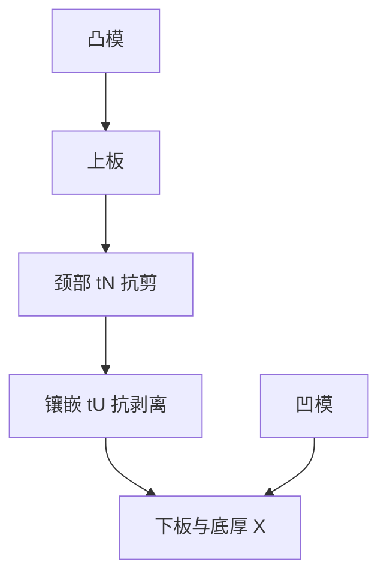

# 无铆连接（Clinching、TOX）：冲头与凹模把两层板挤压成机械互锁

> [!summary] 一句话概述
> 无铆连接不用铆钉也不熔化金属，而是用凸模和凹模把两层（或多层）板冷挤到一起，形成颈部和镶嵌量构成的机械互锁；抗剪主要看颈部厚度，抗剥离主要看镶嵌量。

## 配图

![[附件/sheet-clinch-simitch-5steps.png]]
*图源：[施米特，《无铆连接（Clinching）技术介绍》](https://www.simitch.cn/clinching-technology.html) 五步成形与接头剖面示意（圆点无切口工艺）。*

![[附件/sheet-clinch-tox80-p5.png]]
*图源：[TOX, Clinching Technology](https://assets.tox.com/f/176476/x/dd4b9050dd/tox_clinching-technology_80_en.pdf) 第 5 页，圆点接头（Round joint）模具与成形示意。原 PDF 页。*

![[附件/sheet-clinch-tox8018-p4.png]]
*图源：[TOX, TB 8018 Installation and design guidelines](https://assets.tox.com/f/176476/x/0260a6bba4/tox_tb_8018_en.pdf) 第 4 页，压边器/剥离与控制尺寸相关说明。原 PDF 页。*

> 图片版权归原作者所有，仅作个人学习收藏；出处见文末「来源与核实记录」。

## 结构原理

> 本节所有数字只写来源里给出的；来源没有就写「来源未给出」，不估算、不编造。

施米特把无铆连接定义为：在板材局部施加瞬时高压，使两层或多层金属在凸模与凹模之间冷挤压、相互嵌入咬合，接点就是板材本身。它与自冲铆（SPR）的关键区别是不引入铆钉。该文给出三个几何量：颈部厚度 tN（主要决定抗剪）、镶嵌量 tU（主要决定抗剥离）、底厚 X（底部两层剩余总厚度）。

圆点无切口工艺的五个阶段是：压边器压紧并开始压入 → 初期成形 → 材料向凹模流动 → 形成颈部和镶嵌 → 达到控制底厚后保压、卸荷。TOX TB 8018 把控制尺寸 X 写成模具带板闭合时应达到的量，并给出穿透深度 PD＝S1＋S2＋DD－X（S1、S2 为两侧板厚，DD 为凹模相关深度，原文用于计算弹簧行程）。

### 堆叠方案

方向：沿接点轴线，从凸模侧上板到凹模侧下板。

| 层级 | 零件 | 材料 | 厚度/尺寸 | 固定方式 | 依据 |
| --- | --- | --- | --- | --- | --- |
| L1 上板 | 凸模侧板 | 钢、铝等，可带涂层 | TOX：单板最小约 0.2 mm，组合最大约 12.0 mm；施米特写单板最小 0.3 mm 起 | 与下板冷挤互锁 | TOX TB 8018 第 9 页；施米特页头 |
| L2 颈部 | 上板被挤薄的环壁 | 同上 | 颈部厚度 tN | 成形形成 | 施米特 |
| L3 镶嵌 | 下板材料流入上板下方形成的倒勾 | 同上 | 镶嵌量 tU | 机械互锁 | 施米特 |
| L4 下板与底厚 | 凹模侧板及底部剩余厚度 | 同上 | 底厚 X；TOX 示例见下表 | 一体 | TOX；施米特 |

剖面示意：

### 零件清单

| 零件 | 数量 | 功能 | 材料 | 依据 |
| --- | --- | --- | --- | --- |
| 被连的 2～3 层板 | 2 层，TOX 也可 3 层；施米特写单点可连 2–4 层 | 自身互锁 | 金属板，可带夹层（TOX 提到纺织/塑料夹层） | TOX 第 9 页；施米特 |
| 凸模、凹模、压边器 | 1 套 | 成形、限制整体流动、卸荷时剥离 | 来源未给出模具钢号 | 施米特；TOX |
| 铆钉 | 0 | 本工艺不引入铆钉 | — | 施米特 |

### 装配顺序

按施米特五步：压边定位 → 凸模压入 → 材料向凹模流动 → 形成颈部和镶嵌 → 达到底厚 X 后卸荷，用压边器把凸模从接点上剥离。TOX 警告：没有板材时不得闭合模具，否则表面压力过高会损坏工具；应用行程限位，使带板闭合时得到控制尺寸 X。凸模与凹模必须保持对中。工具凸肩不要顶到折弯圆角，以免折断刀杆。

### 受力与运动分析

- **受力路径**：剪切载荷主要经过颈部；剥离载荷主要靠镶嵌倒勾。TOX 写明：一般规律是圆点直径越大，接头强度越大。
- **运动关系**：成形时板料局部塑性流动；使用后无相对运动（除非过载把镶嵌拉开）。
- **失效风险**：颈部太薄被剪断，镶嵌不足被剥开，强行无压边剥离会把圆点拉变形（TOX）。板厚比超出建议范围（TOX：厚装薄侧约 2.5:1，薄装厚侧约 1:2）会成形不良。

## 设计要点与参数

| 要点 | 内容 | 依据 |
| --- | --- | --- |
| 最小/最大厚度 | 施米特：单板最小 0.3 mm 起。TOX：单板最小约 0.2 mm，总厚最大约 12.0 mm。两处下限不同，设计时按所用模具样本 | 施米特；TOX TB 8018 第 9 页 |
| 板厚搭配 | 厚在凸模侧对薄：2.5:1；薄在凸模侧对厚：1:2 | TOX 第 9 页 |
| 控制尺寸 | 带板闭合应得到 X；PD＝S1＋S2＋DD－X | TOX 第 4 页 |
| 强度例子（未涂层钢 DC01） | 圆点 φ12，3.00+2.00 mm：抗剪 7800 N，抗拉 6100 N，压接力 98 kN；φ10，0.75+1.00 mm：抗剪 3000 N，抗拉 1600 N，压接力 82 kN | TOX 第 10 页表 |
| 节拍与层数 | 施米特：典型 20–60 次/分；单点 2–4 层 | 施米特页头 |

## 优缺点

**优点**
- 不增加铆钉，没有热影响区，适合镀层板和部分异种金属
- 几何量（tN、tU、X）可以检测，便于过程监控
- 比点焊更不依赖导电和表面清洁（来源作为工艺优势叙述）

**缺点 / 代价**
- 接头强度通常低于合适的点焊或自冲铆；SPR 综述也把 clinching 更多用于非承力覆盖件
- 需要双面接近模具，并严格对中和限位
- 圆点在凹模侧有凸起，装配面要让开

## 可借鉴点

- 把 tN、tU、X 写进检验表，不要只看「冲了一个圆点」。
- 板厚比和哪一面朝凸模要按样本选，不能任意厚薄对调。
- 需要更高强度或单面操作时，转到自冲铆或点焊，不要把无铆点当万能接头。

## 与库中相似案例对比

| 对比项 | 本案例（无铆连接） | [[自冲铆（SPR）：半空心铆钉刺入上层并在下层张开互锁，不必预冲孔]] | [[电阻点焊：按薄件厚度选熔核直径、搭边宽度与最小点距]] |
| --- | --- | --- | --- |
| 是否引入第三零件 | 否 | 是，半空心铆钉 | 否，但熔化形成熔核 |
| 连接原理 | 冷挤互锁 | 铆钉刺入并张开 | 电阻热熔核 |
| 何时用这篇 | 镀层板、希望冷连接且可双面接近 | 铝车身等需要更高机械互锁 | 钢板上常规电气点焊 |

## 相关案例

- [[自冲铆（SPR）：半空心铆钉刺入上层并在下层张开互锁，不必预冲孔]]
- [[电阻点焊：按薄件厚度选熔核直径、搭边宽度与最小点距]]
- [[钣金压铆螺母（PEM S-CLS）：孔径、最小板厚、边距与板材硬度上限]]
- 分类索引：[[02-连接与紧固 索引]]

## 来源与核实记录

- 主来源：[苏州施米特机械，《无铆连接（Clinching）技术介绍》](https://www.simitch.cn/clinching-technology.html)（页上标注 2026 年 11 月。2026-11-27 打开并下载五步图。定义、tN/tU/X、五步成形、0.3 mm 起点和 2–4 层来自该页。）
- 交叉来源：[TOX, Clinching Technology](https://assets.tox.com/f/176476/x/dd4b9050dd/tox_clinching-technology_80_en.pdf) 与 [TB 8018 Installation and design guidelines](https://assets.tox.com/f/176476/x/0260a6bba4/tox_tb_8018_en.pdf)（2026-11-27 下载并提取。厚度范围、板厚比、控制尺寸 X、PD 公式和 DC01 强度表示例来自 TB 8018。两份文档同一制造商，只计一个交叉来源。）
- 核实：2026-11-27 打开上述来源。未把无铆写成自冲铆。
