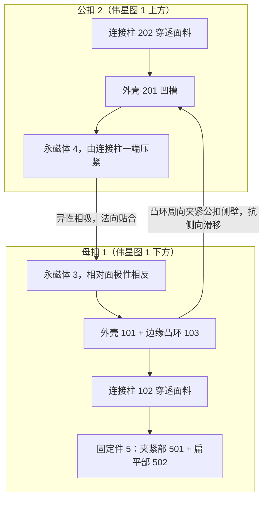

# 服装箱包磁四合扣：公母壳包住永磁体对吸，凸环或凹腔抗剪而无机械锁死

> [!summary] 一句话概述
> 服装和箱包上的磁四合扣（也称磁吸扣、磁吸暗扣）把一对永磁体分别包在公扣、母扣的外壳里，相对面极性相反，靠近即自行吸合，沿法向拉开即可打开：它没有弹簧片或圆珠头那种机械嵌合锁死，也不同于 FIDLOCK V-BUCKLE 那种“磁吸只负责引导、再由机械扣锁死”的结构。抗剪切主要靠母扣边缘的凸环（或缝制式凹腔）把对方扣头周向挡住，而不是再加一套锁舌。

## 配图

![[附件/weixing-cn205728416-fig1.jpg]]
*图源：[CN205728416U《一种四合扣》](https://patents.google.com/patent/CN205728416U/zh) 说明书附图第 1 页图 1（本轮从已下载的授权文本 PDF 抽出）；浙江伟星。上方为公扣 2：外壳 201 包住第二磁性块 4，连接柱 202 穿过面料。下方为母扣 1：外壳 101 包住第一磁性块 3，边缘凸环 103 用于周向夹紧公扣侧壁，连接柱 102 穿透面料后由固定件 5（夹紧部 501 + 扁平部 502）从背面夹住。*

![[附件/us10244806-fig1.jpg]]
*图源：[US10244806B2 Magnetic snap fastener](https://patents.google.com/patent/US10244806B2/en) 附图 Sheet 1 of 5，FIG. 1（本轮从已下载的 USPTO PDF 抽出）；发明人 Alan C. Marks。缝在两层面料 2 上的一对薄型磁吸扣 6（承接件）与 8（插入件），线 12 穿过板上的孔；右侧插入件的磁铁明显凸出，左侧承接件的磁铁是凹进去的。*

![[附件/us10244806-fig1c.jpg]]
*图源：同上 Sheet 2 of 5，FIG. 1a–1c。FIG. 1a / 1b 为承接件 6 与插入件 8 的平面：板 16、26 上有缝孔 20，中心开孔 24 分别容纳凹入的磁铁 22 与凸出的磁铁 28。FIG. 1c 是剖面：磁铁 22 的厚度小于开孔深度，因而在板 16 上形成凹腔 18；磁铁 28 凸出板 26 的前表面，对合后进入凹腔，用来阻止两件侧向滑开。*

> 图片版权归原作者所有，仅作个人学习收藏；出处见文末「来源与核实记录」。

## 结构原理

> 本节所有数字只写来源里给出的；来源没有就写「来源未给出」。伟星专利讲的是打入式磁四合扣（尖脚加垫片），US10244806B2 讲的是可缝的薄型互锁磁扣，ApparelX 补充行业上的缝制式 / 打入式分类与使用注意。三处不要混成「同一只扣的同一组尺寸」。

### 堆叠方案

方向：**沿公母扣对合轴线，从公扣背面固定件到母扣背面固定件**（以 CN205728416U 图 1 为主）

| 层级 | 零件 | 材料 | 厚度/尺寸 | 固定方式 | 依据 |
| --- | --- | --- | --- | --- | --- |
| L1（公扣背面） | 公扣连接柱 202 穿过面料后的固定（图 1 上方未单独画出对称固定件，结构与母侧同类） | 来源未给出牌号 | 来源未给出 | 尖钉状连接柱穿透面料 | CN205728416U 权利要求 5、说明书 |
| L2 | 面料（衣襟或袋盖一侧） | 纺织面料，牌号来源未给出 | 来源未给出 | 被连接柱穿过 | 图 1 中的剖面填充层 |
| L3 | 公扣外壳 201 + 第二磁性块 4 | 外壳为圆形凹槽；磁性块为永磁体，横截面可为矩形，也可为圆形 | 来源未给出毫米数 | 磁性块放在外壳凹槽内，由连接柱 202 的一端压紧封装 | 权利要求 3、8；说明书 [0029][0030] |
| L4（对合面） | 母扣凸环 103 与公扣外壳侧壁的周向配合 | 与外壳一体（来源未给出分件） | 母扣外壳表面面积大于公扣外壳；凸环用于周向夹紧公扣侧壁。具体直径来源未给出 | 磁力把公扣吸进母扣，凸环在侧向挡住公扣 | 权利要求 4；图 1 |
| L5 | 母扣外壳 101 + 第一磁性块 3 | 同上，永磁体；与公扣相对表面极性相异 | 来源未给出 | 磁性块在凹槽内，由连接柱 102 一端压紧 | 权利要求 1、3、8 |
| L6 | 另一侧面料 | 纺织面料 | 来源未给出 | 被连接柱 102 穿透 | 图 1 |
| L7（母扣背面） | 固定件 5：夹紧部 501 + 便于抓握的扁平部 502 | 来源未给出 | 来源未给出 | 夹紧连接柱穿过面料后的尖端，防止脱落 | 权利要求 5、6；图 1 |

缝制式对照（US10244806B2，不是伟星那一套尖脚）：

| 层级 | 零件 | 材料 | 厚度/尺寸 | 固定方式 | 依据 |
| --- | --- | --- | --- | --- | --- |
| 承接件 6 | 非磁性板 16 + 凹入的钕铁硼圆片 22 | 板：热塑性塑料，例如共聚酯；磁铁：钕铁硼 | 板厚约 1.6 mm（1/16 in）；磁铁厚约 0.8 mm（1/32 in）；磁铁 22 直径约比凸出磁铁 28 大 0.8 mm；由此形成约 0.8 mm 深的凹腔 18 | 磁铁背面与板背面齐平放入中心孔；线经缝孔 20 缝到面料 | 说明书 DETAILED DESCRIPTION，FIG. 1a / 1c |
| 插入件 8 | 非磁性板 26 + 凸出的磁铁 28 | 同上 | 板厚约 1.6 mm；磁铁 28 凸出板的前表面 | 同样经缝孔缝到对面料 | FIG. 1b / 1c |

剖面示意：

### 零件清单

| 零件 | 数量 | 功能 | 材料 | 依据 |
| --- | --- | --- | --- | --- |
| 母扣外壳 101 | 1 | 包裹第一磁性块，并提供大于公扣的对合面和凸环 | 来源未给出牌号；圆形凹槽 | CN205728416U 图 1、权利要求 3–4 |
| 凸环 103 | 1（在母扣外壳边缘） | 周向夹紧公扣外壳侧壁，限制侧向错动 | 与外壳一体（来源未写分件） | 权利要求 4 |
| 第一磁性块 3 | 1 | 与公扣磁性块异极相吸，提供保持力 | 永磁体 | 权利要求 1、8 |
| 第一连接柱 102 | 1 | 压紧磁铁，并穿透面料 | 尖钉状，材料来源未给出 | 权利要求 3、5 |
| 固定件 5 | 至少母侧 1（公侧结构同类） | 从面料背面夹住连接柱，防止脱落 | 夹紧部 + 扁平部，材料来源未给出 | 权利要求 5、6 |
| 公扣外壳 201 | 1 | 包裹第二磁性块，对合时进入母扣凸环内侧 | 圆形凹槽，表面积小于母扣外壳 | 权利要求 3、4 |
| 第二磁性块 4 | 1 | 与母扣异极相吸 | 永磁体 | 权利要求 1、8 |
| 第二连接柱 202 | 1 | 压紧公扣磁铁并穿透面料 | 尖钉状 | 权利要求 3、5 |
| 缝制式板与缝孔（对照件，非伟星结构） | 每侧 1 块板，板上多个缝孔 | 把磁铁留在薄板中心孔里，用线缝到衣物 | 热塑性板 + 钕铁硼圆片 | US10244806B2 |
| 垫片 / 补强衬（行业做法） | 视面料而定 | 打入式在背面分散拉力；薄料、针织需衬布以免撕布或表面显形 | 来源未给出具体牌号 | ApparelX Wiki |

### 装配顺序

按伟星专利的打入式结构（说明书与权利要求，不是拆解反推）：

1. 把第一磁性块 3 放入母扣外壳 101 的凹槽，将连接柱 102 的一端伸进外壳并压紧磁性块，完成母扣封装。
2. 同样把第二磁性块 4 放入公扣外壳 201，用连接柱 202 压紧，完成公扣封装。两块磁铁相对面极性必须相反。
3. 在衣襟或袋盖的设计位置，把连接柱的尖端穿透面料（ApparelX：量产前须用指定打具或手压机在相同面料结构上试打，替代工具可能导致变形或固定不良）。
4. 在面料背面把固定件 5 的夹紧部 501 夹到连接柱尖端上；扁平部 502 便于用手操作。
5. 对位后把公扣靠近母扣，磁力自动吸合；凸环 103 套在公扣外壳侧壁外。
6. 若改用缝制式（ApparelX / US10244806B2）：不打大孔，把带缝孔的扣件（或带部）用线均匀缝到面料；薄料、针织、毛绒要加衬布或贴布。US10244806B2 还允许把这种薄型磁扣缝到已有服装上，而不必拆掉原来的纽扣。

> ApparelX 写明：左右或上下配对中心如果偏了，吸附力会不足，前门襟或翻盖也会歪，要在纸样和临时固定阶段先确认开闭。

### 受力与运动分析

- **受力路径**：开合时的法向拉力由公母永磁体之间的吸力承担，再经外壳和连接柱传到面料；打入式还经过背面固定件（或垫片）把力散到更大一块布上。侧向（剪切、错动）不是靠磁铁“卡住”，而是靠母扣凸环对公扣侧壁的周向阻挡（伟星），或靠凸出磁铁进入凹腔后的几何互锁（US10244806B2）。专利都没有给出额定拉开力或抗剪力的牛顿数。
- **运动关系**：扣合只有沿对合轴的靠近与贴合，以及在凸环 / 凹腔对中后被限制的平面内错动。打开方式是沿法向拉开，克服磁力即可，没有需要按压解锁的锁舌，也没有侧向滑开才能脱离的轨道。US10244806B2 还写到：插入侧磁铁靠近凹腔时会被吸着侧向滑进凹腔，自动对中。
- **失效风险**：ApparelX 明确指出，在持续较大拉力的部位把磁吸扣当主扣件，可能强度不够，需要连同面料撕裂、垫片脱落、缝线断裂一起评估。薄料上力会集中在垫片或缝位，可能撕布或在表面显出扣的轮廓。含磁铁的成品会影响检针机，必须事先用实机测试并在规格书中标明。伟星专利提醒永磁体若消磁，公母之间就不再有磁力（推断：高温、强冲击或长期靠近更强磁体时需按辅料规范验证，专利未给温度上限）。侧向载荷如果超出凸环或凹腔能挡住的范围，仍可能滑脱（推断，来源未给侧向力数值）。

## 设计要点与参数

| 要点 | 内容 | 依据 |
| --- | --- | --- |
| 闭合原理 | 公母两块永磁体相对面极性相反，靠近即自动吸合；打开只需克服磁力使两者脱离，不必像传统四合扣那样双手按压圆珠头与弹簧片形成过盈配合 | CN205728416U 摘要、背景技术与实用新型内容 |
| 磁铁如何被包住 | 外壳做成凹槽，磁铁放入槽内，连接柱的一端伸进外壳把磁铁压紧；磁铁不直接外露为可拆的裸磁块 | 权利要求 3；图 1 |
| 抗剪几何（打入式） | 母扣外壳表面积大于公扣，边缘做凸环，周向夹紧公扣外壳侧壁 | 权利要求 4 |
| 抗剪几何（缝制薄型） | 承接件中心孔做成凹腔，插入件磁铁凸出并进入凹腔，防止两件侧向相对移动而脱开 | US10244806B2 摘要与 FIG. 1c |
| 缝制薄型的示例尺寸 | 板厚约 1.6 mm；凹入磁铁厚约 0.8 mm；凹腔深约 0.8 mm；凹入磁铁直径约比凸出磁铁大 0.8 mm | US10244806B2 DETAILED DESCRIPTION（示例，不是所有磁扣的统一规格） |
| 磁铁材料 | 伟星：永磁体，横截面可为矩形或圆形，毫米尺寸来源未给出。Marks 专利示例：钕铁硼圆片 | CN205728416U [0029][0030]；US10244806B2 |
| 安装方式 | 打入式：指定打具或手压机，脚部穿布后与垫片 / 固定件连接。缝制式：线经孔位或带部缝固，不对面料开大孔，但保持力受缝线和衬布影响 | ApparelX Wiki「材料与结构」「安装方法与缝制要点」 |
| 与传统四合扣的差别 | 传统四合扣靠母扣弹簧片或塑料圈与公扣圆珠头过盈嵌合；磁四合扣没有这套机械锁死 | CN205728416U 背景技术；ApparelX「注意事项与相近术语的区别」 |
| 拉开力 / 抗剪力 / 寿命次数 | 来源未给出具体牛顿数或循环次数 | 已打开的三份来源均无此数 |
| 检针 | 含磁铁可能让检针机误动作，须按客户标准和实机测试决定能否过检，并在规格书中标明有磁铁 | ApparelX |

## 优缺点

**优点**
- 靠近即吸合，单手就能扣上，不必像传统四合扣那样双手对压，穿脱更省力（伟星专利要解决的正是这个问题）。
- 没有必须卡死的机械嵌合，外观可以做成暗扣或隐藏式，表面不一定露出金属件（ApparelX）。
- 凸环或凹腔用很薄的几何就能补上纯平面磁铁不抗剪的弱点，而不必再做一套锁舌。
- 缝制式可在不打大孔的情况下装到成衣或既有纽扣附近，便于改制（US10244806B2）。

**缺点 / 代价**
- 保持力就是磁力，没有机械锁死；持续大拉力部位不宜单独当主扣（ApparelX）。
- 对位偏了就会吸不紧或把门襟吸歪；薄料要补强，否则易撕或显形。
- 含磁铁的服装在检针工序上要单独管理，不适合对检针零容忍又未做豁免的产线。
- 永磁体有消磁风险；专利和 Wiki 都没有给出可直接采用的拉力等级表，选型必须按面料和实际开闭来测。

## 可借鉴点

- 只要磁力保持、不要机械锁死时，优先把磁铁完全包进外壳，用连接柱或盖板压紧，避免裸磁铁刮布或掉出。
- 平面对吸几乎不抗剪：需要侧向定位时，做一圈凸环（打入式四合扣）或做一个浅凹腔让对方凸台掉进去（缝制薄型），这两套几何都不必引入锁舌。
- 打入式的载荷路径是「扣壳 → 脚 → 面料 → 背面垫片」，薄料、针织、毛绒一定要衬布，并在量产前用指定打具试打。
- 规格书里要同时写清：外径与厚度、安装方式（缝还是打）、是否隐藏、洗涤 / 干洗条件，以及能否过检针，而不是只写「有磁力」。
- 不要把这种服饰磁扣和 FIDLOCK V-BUCKLE 当成同一类：后者磁吸之后还有机械锁死，本结构拉开就能开。

## 与库中相似案例对比

| 对比项 | 本案例（服装箱包磁四合扣） | [[FIDLOCK V-BUCKLE：磁吸引导到位后再由机械扣锁死]] | [[橱柜磁吸门吸：只有磁力保持、没有机械锁死（对照 FIDLOCK）]] | [[FIDLOCK SNAP：圆形磁吸按扣侧向滑开（对照 V-BUCKLE 上掀）]] |
| --- | --- | --- | --- | --- |
| 磁铁做什么 | 既对中又提供全部保持力 | 只负责引导到位，锁死靠机械扣 | 点状磁力保持门扇 | 磁吸按扣，打开要侧向滑开 |
| 有无机械锁死 | 无；凸环 / 凹腔只抗剪、不锁死法向 | 有机械锁死 | 无机械锁死 | 有按扣几何，打开方向与 V-BUCKLE 不同 |
| 安装基体 | 可缝或可铆 / 可打在软质面料上的薄型扣 | 织带、箱包带 | 家具门与柜体上的点吸 | 织带或箱包带 |
| 打开方式 | 沿法向拉开，克服磁力 | 先解开机械扣再分离 | 拉开门扇克服磁力 | 侧向滑开 |
| 何时用这篇 | 做服装、箱包的薄型磁吸开合，且接受纯磁力保持 | 需要磁吸方便、又必须锁死承力 | 家具门的轻保持，不是缝在布上的扣 | 需要按扣手感与侧向开启时用 SNAP 篇，不要和本篇服饰四合扣混写 |

## 相关案例

- [[FIDLOCK V-BUCKLE：磁吸引导到位后再由机械扣锁死]]
- [[橱柜磁吸门吸：只有磁力保持、没有机械锁死（对照 FIDLOCK）]]
- [[FIDLOCK SNAP：圆形磁吸按扣侧向滑开（对照 V-BUCKLE 上掀）]]
- [[Peak Design SlimLink：方形陶瓷凹槽磁吸预定位与弹簧卡舌硬锁]]
- 分类索引：[[02-连接与紧固 索引]]

## 来源与核实记录

- 主来源：[CN205728416U，一种四合扣，浙江伟星实业发展股份有限公司，发明人舒子安，授权公告日 2016-11-30](https://patents.google.com/patent/CN205728416U/zh)（2026-11-26 打开 Google Patents 中文页，并下载授权文本 PDF。公母扣、凹槽外壳、连接柱压紧永磁体、母扣凸环、尖钉与固定件、与传统弹簧四合扣的对比，均来自这份专利。专利未给出扣径、磁铁牌号以外的力学数值，不编造。）
- 交叉来源：[US10244806B2 Magnetic snap fastener，发明人 / 申请人 Alan C. Marks，2019-04-02 授权](https://patents.google.com/patent/US10244806B2/en)（2026-11-26 下载 USPTO PDF 并核对照附图 FIG. 1、FIG. 1a–1c 与说明书中的 1.6 mm 板厚、0.8 mm 磁铁厚度与凹腔深度示例。独立第二机构，用于说明缝制薄型「凹腔 + 凸出磁铁」的抗剪几何，不把这些英寸换算示例写成所有市售磁扣的统一规格。）
- 交叉来源：[ApparelX Wiki，《磁吸扣是什么？含义、特点与用途》](https://cn.apparel-x.com/wiki/magnetic-snap)（2026-11-26 打开中文全文。ApparelX 为服饰辅料术语与选型说明，与伟星、Marks 都不是同一机构。用来核对缝制式 / 打入式分类、金属外罩包覆磁铁、拉开即开、与弹簧按扣的区别，以及薄料补强和检针注意。该页未给出可引用的具体牛顿数或扣径系列。）
- 核实：未把本结构写成又一个 FIDLOCK，也未写成橱柜门吸。亚洲纽扣等商品页本轮未作为结构依据引用。伟星专利只有一幅结构图，尺寸来源未给出处一律保持「来源未给出」。
