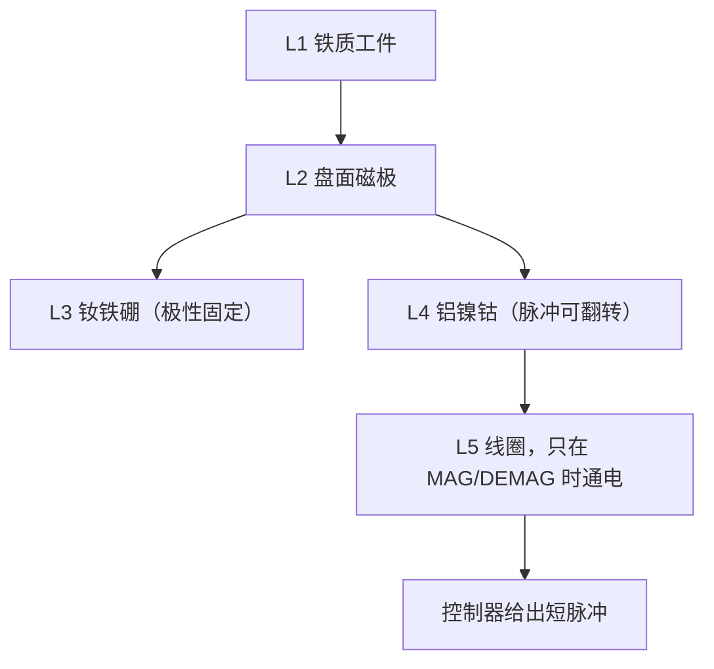

# 机床电永磁吸盘：脉冲充磁后停电仍保持夹紧

> [!summary] 一句话概述
> 机床电永磁吸盘用「可逆的铝镍钴 + 不可逆的钕铁硼 + 只在切换时通电的线圈」来夹持铁质工件：给线圈一个 0.1–2 秒量级的脉冲，铝镍钴极性翻转，与钕铁硼同向时磁力线走出盘面吸住工件；再给一次脉冲让铝镍钴反向，磁力线在盘内自成回路，工件松开。夹持过程不必通电，停电也不会像电磁门锁那样自动释放。

## 配图

![[附件/hvr-epm-magnetize.jpg]]
*图源：[株洲悍威磁电，铣床用电永磁吸盘产品页](https://www.hvr-magnetics.com/products/xcydyc.html)「吸合时：充磁状态」示意；标注钕铁硼磁铁、铝镍钴磁铁、电磁线圈、磁极和磁盘。铝镍钴与钕铁硼极性方向相同，磁力线集中于磁极表面，与工件形成回路。该页写线圈只需瞬间励磁电流（0.1–2 秒）*

![[附件/hvr-epm-demagnetize.jpg]]
*图源：同上产品页「松开时：退磁状态」；再给一次瞬间电流后铝镍钴极性改变，钕铁硼与铝镍钴在吸盘内部形成磁场，磁极表面磁力线消失，工件松开。注意：退磁同样要用电脉冲，不是靠停电*

![[附件/tecnomagnete-milltec-anatomy.png]]
*图源：[MAG Autoblok Tecnomagnete MillTEC 样本第 17 页](https://www.mag-tecnomagnete.com/)；电永磁吸盘解剖：7 可逆永磁 AlNiCo，8 静态永磁 Neodymium，9 封装线圈，10 密封端盖，以及整体钢框架、快速接头、工艺参数铭牌等。与悍威的磁路分工一致，只是品牌和盘面结构不同*

> 图片版权归原作者所有，仅作个人学习收藏；出处见文末「来源与核实记录」。

## 结构原理

> 本节所有数字只写来源里给出的；来源没有就写「来源未给出」。

### 堆叠方案

方向：**从工件接触的盘面向下看一个磁极单元（两家叙述一致的「铝镍钴 + 钕铁硼 + 线圈」单元）**

| 层级 | 零件 | 材料 | 厚度/尺寸 | 固定方式 | 依据 |
| --- | --- | --- | --- | --- | --- |
| L1（最外，工件） | 铁质工件 | 铁磁性材料 | 来源未给出最小厚度的统一值；夹持力与接触和厚度有关，本篇不估读 | 被盘面磁通吸住，无需压板挡住五面加工（Tecnomagnete 把「五面加工」列为优点） | Tecnomagnete；悍威写夹紧工件 |
| L2 | 磁极表面 / 盘面 | 钢（Tecnomagnete：整体钢框架，磁极位置用浅圆刻线标出，表面无树脂、黄铜或铝嵌条） | 来源未给出极距的通用毫米值 | 与盘体一体或组成极阵 | Tecnomagnete 零件 1、2 |
| L3 | 不可逆永磁（钕铁硼） | 钕铁硼 / Neodymium | 来源未给出牌号与尺寸 | 固定在磁极单元内，极性保持不变 | 悍威图注；Tecnomagnete 零件 8 |
| L4 | 可逆永磁（铝镍钴） | 铝镍钴 / AlNiCo | 来源未给出牌号与尺寸 | 与线圈配合，脉冲后极性保持到下一次脉冲 | 悍威；Tecnomagnete 零件 7 |
| L5 | 封装线圈 | 来源未给出线径 | Tecnomagnete 写 encapsulated electric coil | 绕在可逆磁钢上，由电缆和快速接头接到控制器 | Tecnomagnete 零件 4、9 |
| L6 | 盘体与密封 | 整体钢框架；密封端盖（Tecnomagnete 零件 10 Hermetic closing cap） | 来源未给出盘厚 | 安装到机床工作台；M8 / M10 螺孔用于附件或挡块（Tecnomagnete） | Tecnomagnete |

剖面示意：

两种稳态（夹持阶段都不再通电）：

- **充磁 / MAG**：铝镍钴与钕铁硼同向，磁力线走出盘面，穿过工件再回来。
- **退磁 / DEMAG**：铝镍钴与钕铁硼反向，磁力线在盘内短路（Tecnomagnete 称 magnetic short circuit），盘面几乎不对外吸。

悍威写可在 3 秒内安全夹紧工件；脉冲本身是 0.1–2 秒。Tecnomagnete 写相对电磁吸盘只需约 1 秒电流，并强调夹持阶段无电流。

### 零件清单

| 零件 | 数量 | 功能 | 材料 | 依据 |
| --- | --- | --- | --- | --- |
| 磁极单元（AlNiCo + NdFeB + 线圈） | 按盘面阵列，具体只数视型号 | 建立或取消对外磁通 | 铝镍钴、钕铁硼、铜线圈 | 悍威；Tecnomagnete 7–9 |
| 整体盘体 | 1 | 结构、导磁、防护 | 钢 | Tecnomagnete 1 |
| 快速电气接头 | 1 | 与控制器短时接通 | 来源未给出 | Tecnomagnete 4：precise, safe and watertight |
| 控制器 | 1 | 发出 MAG / DEMAG 脉冲，可带显示或 PLC 联锁 | 来源未给出 | Tecnomagnete 优点列表 |
| 参考挡块螺孔 | 若干 M10（该样本） | 机械定位，不靠磁力单独定侧向基准 | — | Tecnomagnete 5 |

### 装配顺序

1. 把吸盘固定到铣床或加工中心工作台，按机床和样本要求接线到控制器（逐步螺钉力矩以随机说明书为准，本页未给出）。
2. 用挡块或已有基准把工件放到盘面上，确认接触面清洁。
3. 按控制器发出充磁脉冲（悍威：0.1–2 秒），检查夹紧后再加工。夹持期间不必保持通电。
4. 加工结束后发出退磁脉冲，待盘面磁通收回后再取件。
5. 电缆在不需要切换时可以离开盘体（Tecnomagnete 强调快速接头），盘面仍保持上一状态。

> 悍威与 Tecnomagnete 都没有在已打开页面给出某一型号的完整工厂装配节拍。使用顺序按两家对 MAG/DEMAG 的文字整理。

### 受力与运动分析

- **受力路径**：切削力经工件进入盘面磁极，由走出盘面的磁通产生的法向吸力（以及由此带来的摩擦力）抵抗翻倒和滑移。Tecnomagnete 把「无振动、不额外变形、五面可加工」写成这种均布吸力的好处，并建议用机械挡块做参考。侧向力主要靠摩擦和挡块，不能把吸盘理解成销钉定位。
- **运动关系**：夹持阶段工件相对盘面无相对运动。唯一的「内部运动」是铝镍钴磁畴/极性在脉冲下的翻转，之后状态自行保持。
- **失效风险**：停电不会释放——这是相对电磁吸盘和电磁门锁的关键差异，也意味着取件前必须真正完成退磁脉冲，不能指望拉电闸松件。接触不良、非导磁材料、过薄工件会减弱磁路（机理与其它磁夹具相同，具体最小厚度两家已打开页未给统一数）。高温可能影响钕铁硼，来源未在这两页给出允许工作温度上限。控制器故障或误发脉冲会导致意外松开或无法取件，需要联锁（Tecnomagnete 提到 PLC interlocking）。

## 设计要点与参数

| 要点 | 内容 | 依据 |
| --- | --- | --- |
| 磁路分工 | 钕铁硼极性固定；铝镍钴可被脉冲翻转；两者同向则吸合，反向则内短路松开 | 悍威产品页；Tecnomagnete MAG/DEMAG 静态相 |
| 用电方式 | 只在充磁或退磁的瞬间通电，夹持阶段无电流；停电仍保持上一状态 | 悍威；Tecnomagnete（No electric current is used during this phase） |
| 脉冲时间 | 悍威：0.1–2 秒；Tecnomagnete：几分之一秒量级，优点列表写约 1 秒电流。两家数字不要合成一个「标准脉冲」 | 悍威；Tecnomagnete |
| 夹紧时间 | 悍威写可在 3 秒内安全夹紧 | 悍威 |
| 结构封装 | 线圈封装，端盖密封；整体钢框架 | Tecnomagnete 1、9、10 |
| 与电磁吸盘的能耗对比 | Tecnomagnete：相对电磁吸盘只需约 1 秒电流，节能 | Tecnomagnete 优点列表 |
| 某一型号的吸力 N/cm²、极距、允许温度 | 已打开页未给出可引用的统一数表 | — |

## 优缺点

**优点**
- 停电或断线不会突然松件，比电磁吸盘更适合长时间加工和安全停机。
- 夹持阶段不发热、不耗电，盘面也可以更干净、少嵌条。
- 均布吸力有利于五面加工和减少压板干涉。
- 取件必须再给退磁脉冲，流程上比「拉掉电源就掉下来」更可控。

**缺点 / 代价**
- 需要专用控制器和正确的 MAG/DEMAG 操作，不能用普通直流电源一直顶着。
- 只对足够厚、接触良好的铁磁工件有效，薄件、铸件空腔、不锈钢效果要另评。
- 侧向和翻转不能只靠磁吸，仍要考虑挡块和切削力方向。
- 若控制器误动作，停电也救不了「已经被退磁」的状态，联锁和状态显示很重要。

## 可借鉴点

- 需要「通电切换、断电保持」时，用可逆永磁（铝镍钴）去改变不可逆永磁（钕铁硼）的合成磁路，而不是用线圈持续励磁。
- 把 MAG 和 DEMAG 都设计成短脉冲，并在人机界面上明确当前是吸还是放，避免和电磁锁的「停电即开」混淆。
- 线圈要封装、接头要可分离，使工作台上的盘体在加工时不必拖着电缆受力。
- 磁力负责法向夹紧，侧向基准用挡块或销，不要让磁吸同时当定位销。
- 对照电磁门锁：门禁要的是断电开门；机床夹具要的是断电仍夹紧。同一套「电磁」词汇，停电策略相反。

## 与库中相似案例对比

| 对比项 | 本案例（电永磁吸盘） | [[电磁门锁（磁力锁）：通电线圈吸合衔铁，断电释放]] | [[橱柜磁吸门吸：只有磁力保持、没有机械锁死（对照 FIDLOCK）]] | [[3D 打印磁吸弹簧钢构建板：热床磁吸固定，取下弯曲脱件（对照橱柜磁吸门吸）]] |
| --- | --- | --- | --- | --- |
| 夹持时是否通电 | 否，脉冲后保持 | 是，持续通电 | 否，永磁 | 否，永磁阵列 |
| 停电后 | 仍夹紧 | 典型释放 | 仍吸住 | 仍吸住 |
| 如何松开 | 再给退磁脉冲 | 断电 | 手拉开 | 取下钢板并弯曲 |
| 何时用这篇 | 机床夹持，安全策略是停电不松 | 门禁疏散，安全策略是停电就开 | 柜门轻保持 | 热床取件 |

## 相关案例

- [[电磁门锁（磁力锁）：通电线圈吸合衔铁，断电释放]]
- [[橱柜磁吸门吸：只有磁力保持、没有机械锁死（对照 FIDLOCK）]]
- [[3D 打印磁吸弹簧钢构建板：热床磁吸固定，取下弯曲脱件（对照橱柜磁吸门吸）]]
- [[KTR MINEX-S 磁力联轴器：隔离套两侧磁转子无接触传扭]]
- 分类索引：[[02-连接与紧固 索引]]

## 来源与核实记录

- 主来源：[株洲悍威磁电科技有限公司，铣床用电永磁吸盘](https://www.hvr-magnetics.com/products/xcydyc.html)（2026-11-26 重新打开中文产品页，并下载充磁/退磁原理图。0.1–2 秒脉冲、铝镍钴换向、与钕铁硼同向吸合/反向内闭合松开、3 秒内夹紧，均来自该页）
- 交叉来源：[MAG Autoblok Tecnomagnete，MillTEC / permanent-electro magnetic systems 样本](https://www.mag-tecnomagnete.com/)（本轮重新打开已下载样本相关页。独立意大利厂商。AlNiCo 可逆磁、钕铁硼静磁、封装线圈、MAG/DEMAG 静态相不耗电、整体钢框架与零件 1–10，均来自该样本。优点列表中的「约 1 秒电流」保留为该样本表述，不与悍威 0.1–2 秒混成同一测量）
- 核实：未与电磁门锁、永磁门吸写成同一结构。未编造吸力牛顿数。
