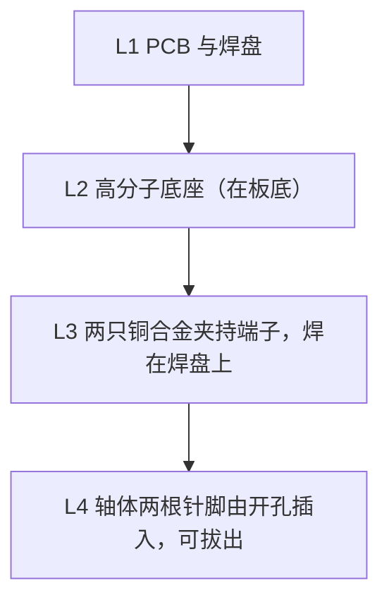

# 机械键盘热插拔轴座：PCB 插座夹住轴针脚，换轴不必焊接（对照 Cherry MX 轴内部）

> [!summary] 一句话概述
> 热插拔轴座是焊在机械键盘 PCB 上的小型插座：两只弹性端子夹住轴体的两根金属针脚，换轴时沿针脚轴线把轴拔出再插入新轴，不必拆焊。佳达隆把 2.0 代做成铜合金端子 + 黑色高分子底座，规格书给出 4 点接触所需的开孔和 50 000 次机械寿命；凯华 CPG151101S11 则给出 3 kg 上限插入力与 200 gf 下限拔出力。它和 [[Cherry MX 机械键盘轴：轴心、螺旋弹簧与金交叉触点]] 不在同一层：本篇是板级插座，不是轴内部的触点。

## 配图

![[附件/gateron-hotswap-2-socket.jpg]]
*图源：[佳达隆 Hot swap 2.0 规格书（KS-2P02B01-01-a）](https://gateron.com/u_file/2311/22/file/GATERONUpgradeHot-swapPCB20Socket-KS-2P02B01-01-a.pdf) 内嵌官方效果图；俯视可见两个矩形插孔和孔内金色触点，侧视可见每孔两只叠放的金色夹持件，两端是焊到 PCB 上的镀锡端子。这与中关村在线所写的「4 点弹性接触」一致。*

![[附件/gateron-hotswap-2-pcb-layout.jpg]]
*图源：同一份佳达隆规格书第 4 页；第 8 节安装剖面标注 PCB 厚 1.5 mm，插座在板底；第 9 节给出两只 φ3.0±0.05 插孔、孔心距 6.35±0.05 mm 与 2.54±0.05 mm 错位，以及轴体 14 mm 方框、中心孔 φ4.0±0.10 和塑料定位柱孔 φ1.70±0.05；第 10 节 BOM：端子 ×2 铜合金，底座 ×1 高分子聚合物（黑色）。*

![[附件/kailh-cpg151101s11-pcb-layout.jpg]]
*图源：[凯华 CPG151101S11 产品规格书 KH-PS-1607-10 第 8/9 页](https://www.kailhswitch.com/uploads/15927/files/CPG151101S11.pdf?rnd=992)；推荐 PCB 为顶视、单面覆铜板 T=1.6 mm，布局图可见 6.35、2.54 与 φ3.00 等标注，与佳达隆开孔同族。该页同时给出波峰/回流焊条件。凯华 Rainbow 中文宣传图另见文末相关说明，不把「6000 次」写入本规格书的寿命栏。*

> 图片版权归原作者所有，仅作个人学习收藏；出处见文末「来源与核实记录」。

## 结构原理

> 本节所有数字只写来源里给出的；来源没有就写「来源未给出」。佳达隆与凯华是同一类「焊在 PCB 上、夹住轴针脚」的插座，参数按来源分列，不互相套用。

### 堆叠方案

方向：**从 PCB 焊接面（轴座所在的一面）到键轴针脚插入方向**。佳达隆安装剖面把插座画在 PCB 下方，针脚由板上开孔进入夹持端子。

| 层级 | 零件 | 材料 | 厚度/尺寸 | 固定方式 | 依据 |
| --- | --- | --- | --- | --- | --- |
| L1（PCB） | 单面或 SMT 焊盘所在的印制板 | 凯华：单面覆铜层压板；佳达隆：来源未给出板材牌号 | 佳达隆剖面标注 1.5 mm；凯华推荐 T=1.6 mm | 轴座端子焊接到焊盘 | 佳达隆规格书第 8 节；凯华规格书第 9、11.1 节 |
| L2 | 轴座底座 | 佳达隆：高分子聚合物，黑色；凯华 CPG151101S11：来源未给出 | 来源未给出座高 | 随端子焊在板上 | 佳达隆 BOM |
| L3 | 两只夹持端子 | 佳达隆：铜合金；凯华 CPG151101S11：来源未给出 | 插孔 φ3.0±0.05 mm（佳达隆）、φ3.00（凯华布局图）；孔心距 6.35±0.05 mm 与错位 2.54±0.05 mm（佳达隆），凯华布局图同样标了 6.35 与 2.54 | SMT/焊锡连接到焊盘，插孔夹住轴针脚 | 佳达隆第 9、10 节；凯华第 9 节 |
| L4（最外，可拔） | 机械轴的两根金属针脚（轴体其余部分不在本篇） | 本篇来源未给出针脚材料 | 须落入上述开孔；14 mm 轴体轮廓、中心孔 φ4.0±0.10、定位柱孔 φ1.70±0.05 见佳达隆布局 | 沿轴向插入/拔出，由端子弹性夹持 | 佳达隆第 9 节；中关村在线：插拔轴座夹持导通 |

剖面示意：

### 零件清单

| 零件 | 数量 | 功能 | 材料 | 依据 |
| --- | --- | --- | --- | --- |
| 端子 Terminal | 2（佳达隆 BOM） | 弹性夹住轴针脚并导电，两端焊接到 PCB | 铜合金（佳达隆）；凯华该规格书未给材料 | 佳达隆第 10 节 |
| 底座 Base | 1（佳达隆 BOM） | 绝缘壳体，为端子和插孔提供几何约束；中关村在线还写了卡扣、凸筋限位与过锡位 | 高分子聚合物、黑色（佳达隆） | 佳达隆 BOM；中关村在线「热插拔 2.0」段 |
| PCB 开孔与焊盘 | 每座一组 | 让针脚穿过并给 SMT 端子提供焊接区 | 凯华写明单面覆铜板 | 两家第 8–9 节或第 9、11.1 节 |
| 机械轴（对照件，不属插座本身） | 每键 1 | 提供按压手感与内部通断；本篇只使用它的两根针脚作为被夹持对象 | 见 Cherry MX 案例，不写入本表参数 | 对照 [[Cherry MX 机械键盘轴：轴心、螺旋弹簧与金交叉触点]] |

### 装配顺序

1. 按规格书推荐的 PCB 开孔与焊盘做板（佳达隆要求孔位与图形以工程图推荐尺寸为准；凯华给出顶视、单面板 T=1.6 mm 布局）。
2. 把轴座放到焊接面，端子对准焊盘。佳达隆 SMT 可焊性：浸锡温度 ≤260±5℃，时间 2±0.5 s，浸入部分至少 90% 上锡；耐焊：熔锡 ≤260±5℃、5±1 s。凯华回流 260±5℃、5±0.5 s；手焊烙铁 350℃ 以内、3 s 以内；波峰预热板面不超过 110℃、60 s，浸锡最多 2 次。
3. 凯华与佳达隆都写：回流后不要用溶剂清洗连接器；佳达隆还写不要使用水溶性助焊剂，并等冷却后再操作连接器。
4. 轴体两根针脚对准插座插孔，沿轴线插入。中关村在线把「导通牢固」归到插拔轴座；拔轴时沿同一轴线向外拉（凯华给出拔出力下限，见下表）。
5. 按拆解顺序反推时，先拔轴，再（若维修插座）拆焊端子。来源没有给出专用拔轴器的力值。

### 受力与运动分析

- **受力路径**：换轴时外力沿针脚轴线进入插座。插入时要克服端子张口阻力，凯华把 mating force 上限写成 3 KG（16 mm/min）；佳达隆把 push force 上限写成 3 kgf（16 in/minute，规格书原文如此，不改单位）。拔出时端子必须仍能夹住针脚，凯华 unmating force 下限 200 gf，寿命试验后仍要求插入≤3 kg、拔出≥200 gf。这对力经端子传到焊点；佳达隆注意事项写明「若受力超过规格，连接器可能损坏」，凯华写「不要给连接器过大静载」。
- **运动关系**：轴相对插座只有沿针脚轴线的插入/拔出；插座相对 PCB 在焊后无相对运动。佳达隆防护等级为 IP00，规格书提醒该连接器没有防尘结构。
- **失效风险**：接触电阻超标或开路（灰尘、助焊剂、硫化物气氛，两家注意事项均有）；插偏或过载导致端子或壳体损坏（佳达隆）；焊接不良。中关村在线把一代轴座与焊锡配合不够理想，作为 2.0 增加卡扣平整贴合、凸筋限位防摇晃、过锡位的原因。凯华 CPG151101S11 机械寿命只写 100 次，与 Rainbow 宣传页的 6000 次不是同一份规格，不能混用。

## 设计要点与参数

| 要点 | 内容 | 依据 |
| --- | --- | --- |
| 结构本质 | PCB 上的插座用弹性端子夹住轴的两根针脚，换轴不必焊接 | 两家规格书 Scope；中关村在线「插拔轴座」段 |
| 佳达隆 2.0 接触 | 4 点弹性接触；官方效果图侧视每孔两只夹持件 | 中关村在线；佳达隆规格书配图 |
| 佳达隆 2.0 壳体细节 | 卡扣新设计、与 PCB 接触面平整不易变形；凸筋限位使塑胶件与端子更紧密、防摇晃；过锡位便于上锡 | 中关村在线 2023-04-20 |
| 佳达隆 BOM | 端子 ×2 铜合金；底座 ×1 高分子聚合物，黑色 | 规格书第 10 节 |
| 佳达隆开孔 | 插孔 φ3.0±0.05；孔心距 6.35±0.05 与 2.54±0.05；中心孔 φ4.0±0.10；定位柱孔 φ1.70±0.05；14 mm 方框；SMT 焊盘最小 2.5 × 2.55 | 规格书第 9 节 |
| 佳达隆安装剖面 | 图中 PCB 厚 1.5 mm，插座在板底 | 规格书第 8 节 |
| 佳达隆电性能 | 接触电阻 100 mΩ Max；绝缘 100 MΩ Min（100 V DC、60±5 s）；介质耐压 100 V；IP00 | 规格书第 3–4 节 |
| 佳达隆力与寿命 | Push force 3 kgf Max；机械耐久 50 000 次（20 次/分，配合 Key Switch），试验后接触电阻 200 mΩ Max | 规格书第 5.1、6.1 节；中关村在线写 50 000+ 次 |
| 佳达隆温度 | 工作 −40℃～+80℃ | 规格书第 1.2 节 |
| 凯华 CPG151101S11 额定 | 12 V AC/DC max、2 V DC min；10 mA AC/DC max、10 µA DC min；接触电阻 100 mΩ Max；绝缘 ≥100 MΩ / DC 500 V | 规格书第 3–4 节 |
| 凯华力与寿命 | 插入 3 KG max、拔出 200 gf min（16 mm/min）；机械寿命 100 cycles；工作温度 −10℃～+60℃ | 规格书第 3、4、7.1、7.2 节 |
| 凯华 PCB | 推荐单面覆铜板 T=1.6 mm，布局标注 6.35、2.54、φ3.00 | 规格书第 9、11.1 节 |
| 凯华 Rainbow 宣传（不同产品） | 航空级弹性材料，部分镀金，机械寿命宣传至 6000 次；与 MX 轴兼容，用拔键器即可换轴 | 凯华 Rainbow 产品页。不覆盖 CPG151101S11 的 100 次寿命 |

> 来源没有给出的参数一律写「来源未给出」，不估算、不编造。尤其不要用 MX 轴的内部触点参数来填本表。

## 优缺点

**优点**
- 换轴不必拆焊，插座留在 PCB 上，维修和客制化换轴的代价集中在「拔插」而不是「重焊」。
- 两家都把插孔放在 6.35 / 2.54 这一族间距上，同一块板可以接受符合该针脚几何的多品牌轴（来源未逐一列出兼容轴型号，不在此编名单）。
- 力值与寿命可按规格书验收：需要频繁换轴时，佳达隆 2.0 给出 50 000 次量级；凯华 CPG151101S11 只保证 100 次，选型时必须看对应规格书而不是宣传图。
- 2.0 的卡扣贴合、凸筋限位和过锡位，直接针对「晃动」和「上锡」这两个板级失效点。

**缺点 / 代价**
- 插座本身是 IP00，助焊剂、板屑和腐蚀气体都会进夹持区，规格书都要求工艺防尘和避免硫/硅氧烷气氛。
- 拔插力全部经焊点传递，过载会坏座而不是只坏轴；凯华还提醒不要给过大静载、焊后不要把 PCB 叠放。
- 不同代产品的寿命数字差一个数量级（100 次 vs 6 000 次宣传 vs 50 000 次），如果只看外形相近就混用参数，会把验收标准选错。
- 它不提供轴内部的手感与触点，那些仍由轴体自己负责。

## 可借鉴点

- **把「可换模块」做在针脚这一层，而不是把整颗开关焊死**：只要电接触可以改成弹性夹持，现场更换就不需要返焊。检查项：夹持力下限、插入力上限、寿命次数、焊点是否按拔出力校核。
- **开孔和焊盘跟插座一起出图，不要只给 3D 外形**：佳达隆把 φ3.0、6.35、2.54 和中心孔、定位柱孔画在同一页；凯华把 T=1.6 mm 写进推荐布局。漏掉板厚或孔心错位，座会焊不平或插不进。
- **寿命写清「这是哪一份规格」**：宣传页的 6000 次不能代替 CPG151101S11 规格书的 100 次；2.0 的 50 000 次只属于 KS-2P02B01-01-a。
- **壳体上的卡扣、凸筋和过锡位是为了「座不要在板上晃、端子要吃锡」**，不是装饰。做仿制或选座时，应检查接触面是否贴平、端子与塑胶是否被限位。

## 与库中相似案例对比

| 对比项 | 本案例（板级热插拔轴座） | [[Cherry MX 机械键盘轴：轴心、螺旋弹簧与金交叉触点]] | [[键盘内胆Gasket悬置：把按键触底载荷从刚性螺柱改经弹性垫传到壳体]] | [[Pogo Pin 弹簧顶针：针头、弹簧与针管的工作行程和弹力]] |
| --- | --- | --- | --- | --- |
| 解决的问题 | 轴要能从 PCB 上拔插更换，不必焊接 | 一次按压如何产生手感和电气通断 | 按键触底载荷如何传到壳体 | 两个组件之间要可分离的轴向电接触 |
| 被夹持/被连接的对象 | 轴底部两根针脚 | 轴内部的金交叉触点，与板级插座无关 | 内胆与外壳之间的垫 | 针头与对面板 |
| 可拆方式 | 沿针脚轴线拔出 | 传统焊接轴要拆焊；本篇不讨论把整个轴从板上拆下来的焊接工艺 | 不是换轴接口 | 压缩弹簧后分离 |
| 关键力值 | 凯华插入 ≤3 KG、拔出 ≥200 gf；佳达隆推入 ≤3 kgf，寿命 50 000 次 | 见该篇轴内弹簧与触点，不套用到本座 | 见该篇垫的压缩，不是拔轴力 | 见该篇弹力与行程，不是本座的 3 kg / 200 gf |
| 分类取舍 | 放在 02：核心是板载连接器的夹持与焊接 | 04，核心是轴内机构 | 04，核心是悬置传力 | 02，同属可分离电连接，但结构是弹簧顶针而不是叉形夹持端子 |

## 相关案例

- [[Cherry MX 机械键盘轴：轴心、螺旋弹簧与金交叉触点]]
- [[键盘内胆Gasket悬置：把按键触底载荷从刚性螺柱改经弹性垫传到壳体]]
- [[Pogo Pin 弹簧顶针：针头、弹簧与针管的工作行程和弹力]]
- [[16 英寸 MacBook Pro 剪刀脚键盘：1 mm 键程与交叉支架（对照蝶式）]]
- 分类索引：[[02-连接与紧固 索引]]

## 来源与核实记录

- 主来源：[GATERON Hot swap 2.0 Product Specification，Item No. KS-2P02B01-01-a](https://gateron.com/u_file/2311/22/file/GATERONUpgradeHot-swapPCB20Socket-KS-2P02B01-01-a.pdf)（惠州佳达隆电子科技有限公司官方规格书，2026-11-22 下载并提取全文与插图。核对：BOM、1.5 mm 安装剖面、开孔尺寸、3 kgf、50 000 次、电性能与 SMT 条件。签发单位地址见规格书末页。）
- 补充来源 1：[Kailh CPG151101S11 Product Specification，DOC. No. KH-PS-1607-10，Rev. A](https://www.kailhswitch.com/uploads/15927/files/CPG151101S11.pdf?rnd=992)（东莞凯华电子官方规格书，2018-09-07 编制栏，2026-11-22 从 kailhswitch.com 打开。核对：12 V / 10 mA、100 次寿命、3 KG / 200 gf、T=1.6 mm 布局与焊接条件。kailh.com 英文站在本次抓取中返回 500，改用已打开的 kailhswitch.com 官方 PDF。）
- 补充来源 2：[Kailh Rainbow MX Hot Swapping PCB Socket 产品页](https://www.kailhswitch.com/mechanical-keyboard-switches/box-switches/kailh-rainbow-mx-hot-swapping-pcb-socket.html)（同一机构的新一代宣传页。航空级弹性材料、部分镀金、机械寿命至 6000 次、可用拔键器换轴。仅作产品线对照，不覆盖 CPG151101S11 参数。）
- 补充来源 3：[中关村在线：佳达隆 2023 年五大新品重磅发布，引领「超凡突破」](https://news.zol.com.cn/816/8162796.html)（2023-04-20，作者：新闻快讯，独立机构。交叉热插拔 2.0：4 点弹性接触、卡扣贴合、凸筋限位、过锡位、插拔寿命 50 000+ 次。）
- 核实：2026-11-22 打开并下载上述规格书与页面，提取官方插图。未把轴内部金交叉触点写入本篇参数，也未把 Rainbow 的 6000 次写进 CPG151101S11 的寿命栏。
