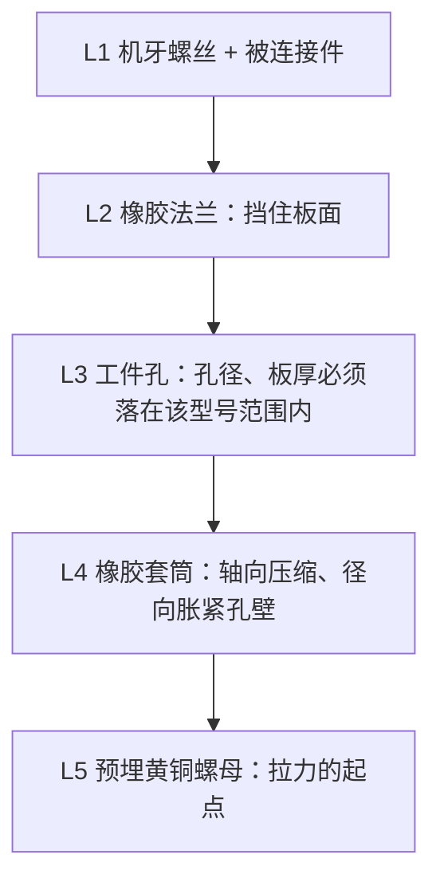

# 橡胶膨胀螺母（Well nut）：橡胶套筒胀紧孔壁兼隔振

> [!summary] 一句话概述
> Well nut（橡胶膨胀螺母 / Rubber-Nut）是带法兰的橡胶套筒，一端模内预埋黄铜螺母：把套筒塞进工件孔后，用普通机牙螺丝从法兰一侧拧进铜螺母，橡胶被轴向压缩、径向胀紧孔壁，从而夹紧、并兼有隔振、降噪和一定的隔潮。它与拉铆螺母（金属镦头、基本不可反复当橡胶件那样拆）和卡式螺母（弹簧钢夹板）都不同。Hanson 强调可拆、可在盲孔使用、不需要专用安装工具；ESTCO 给出公制例子：如 10S（M5×0.8）孔径 9.58 mm，握持范围 0.38–4.88 mm，拧紧扭矩 0.56 N·m。

## 配图

![[附件/well-nut-hanson.jpg]]
*图源：[Hanson Rivet《Rubber Nuts》](https://www.hansonrivet.com/threaded-inserts-2/rubber-nut-threaded-inserts/)；带法兰的橡胶套筒，一端包住铜螺母。拧紧螺丝后套筒膨胀，形成可拆的夹紧。该页还列出：减振降噪、有助于隔开电化学腐蚀、有助于隔绝环境湿气、可在盲孔使用、不需安装工具。*

![[附件/well-nut-estco-metric.png]]
*图源：[ESTCO《Well Nut Metric Threaded Inserts》](https://www.estcoenterprises.com/well-nuts/well-nut-metric-threaded-inserts)；公制产品照片（页面截图图）。ESTCO 说明：平头、圆身的橡胶盲孔螺母，标准场合用氯丁橡胶，日照和紫外环境用 EPDM，内螺纹为黄铜，螺纹公差英制 2B、公制 6H，RoHS。部分型号为可预卡入的 Snap-in。*

> 图片版权归原作者所有，仅作个人学习收藏；出处见文末「来源与核实记录」。

## 结构原理

> 本节数字只写来源里给出的；两家的孔径、握持范围和扭矩都按**具体型号**引用，不合并成一张“通用公制表”。

### 堆叠方案

方向：**从法兰外侧到盲孔内侧。**

| 层级 | 零件/区域 | 材料 | 厚度/尺寸 | 固定方式 | 依据 |
| --- | --- | --- | --- | --- | --- |
| L1 | 螺钉头 + 被连接件 | 普通机牙螺丝 | 按螺纹规格选用 | 拧入铜螺母 | Hanson |
| L2 | 橡胶法兰（头部） | 氯丁或 EPDM | ESTCO 表中的 Head Diameter / Head Height，随型号变化 | 挡住工件外表面 | ESTCO、Hanson |
| L3 | 工件孔壁 | 薄板、型材等 | 孔径必须落在该型号的 Work/Hole Size；板厚必须落在 Grip Range | 橡胶径向胀紧 | Hanson、ESTCO |
| L4 | 橡胶圆身套筒 | 同 L2 | Body Diameter 略小于或等于孔径，以便塞入 | 轴向被压缩后鼓起 | ESTCO |
| L5 | 预埋黄铜螺母 | 黄铜，6H（公制）或 2B（英制） | 位于套筒内侧一端 | 承受螺丝拉力，把橡胶拉胀 | ESTCO、Hanson |

剖面示意：

### 零件清单

| 零件 | 数量 | 功能 | 材料 | 依据 |
| --- | --- | --- | --- | --- |
| Well nut 本体（橡胶套筒 + 铜螺母） | 每孔 1 | 胀紧、隔振、提供内螺纹 | 氯丁或 EPDM + 黄铜 | Hanson、ESTCO |
| 机牙螺丝 | 1 | 轴向拉伸铜螺母 | 来源未限定牌号 | Hanson |
| 被连接件 | 1 | 被夹在螺头和法兰之间 | — | Hanson |

### 装配顺序

1. 按型号查孔径和握持范围，钻孔或冲孔。
2. 把橡胶法兰朝外，将套筒塞进孔（Snap-in 型可先卡在母材上，ESTCO）。
3. 从法兰一侧把机牙螺丝拧进黄铜螺母并拧到该型号给出的参考扭矩。橡胶被压缩、径向胀紧。
4. 拆卸时反拧螺丝，膨胀消失，套筒一般可以取出（Hanson 把 Removable 列为特点）。扭矩和抗拉强度只是指南，随应用变化很大（Hanson 表注）。

### 受力与运动分析

- **受力路径**：螺丝拉力作用在铜螺母上，橡胶被轴向压缩，孔壁承受径向膨胀压力，法兰和螺头夹住被连接件。夹紧力的上限受橡胶强度和拧紧扭矩限制，远低于同规格金属拉铆螺母（两家都给了“近似”抗拉强度，见下表）。
- **运动关系**：拧紧后无相对运动；橡胶弹性还提供隔振和缓冲（两家均列为优点）。
- **失效风险**：超扭会拧坏铜螺母或撕胶；板厚超出握持范围则胀不紧或法兰变形；孔径过大则膨胀后仍无足够过盈。Hanson 注明扭矩和抗拉值仅供参考。户外日照应改 EPDM（ESTCO）。

## 设计要点与参数

**Hanson（英制，摘录常用规格；扭矩单位 in-lb，抗拉单位 lb。）**

| 要点 | 内容 | 依据 |
| --- | --- | --- |
| 6-32，RN-0632-1 | 孔径 0.250 in，握持 0.375–0.607，拧紧 2 in-lb，抗拉约 110 lb（试验板厚 0.500 in） | Hanson 表 |
| 8-32，RN-0832-1 | 孔径 0.312 in，握持 0.015–0.156，拧紧 2 in-lb，抗拉约 110 lb | Hanson 表 |
| 10-32，RN-1032-1 | 孔径 0.375 in，握持 0.015–0.192，拧紧 3 in-lb，抗拉约 132 lb | Hanson 表 |
| 1/4-20，RN-2520-07 | 孔径 0.500 in，握持 0.250–0.457，拧紧 10 in-lb，抗拉约 445 lb | Hanson 表 |
| 使用注意 | 标注 * 的型号为 Snap-in；扭矩和抗拉“only a guide”，随应用变化很大 | Hanson 表注 |

**ESTCO（公制，摘录；扭矩 N·m，抗拉 N。标注 • 为 EPDM。）**

| 要点 | 内容 | 依据 |
| --- | --- | --- |
| E632，M3×0.5 | 孔径 7.92 mm，握持 0.38–3.96，长 12.67，拧紧 0.45 N·m，抗拉 507 N | ESTCO 表 |
| B832，M4×0.7 | 孔径 7.92 mm，握持 0.38–3.96，长 12.67，拧紧 0.34 N·m，抗拉 649 N | ESTCO 表 |
| 10S，M5×0.8 | 孔径 9.58 mm，握持 0.38–4.88，长 14.07，拧紧 0.56 N·m，抗拉 1023 N | ESTCO 表 |
| 1/4S，M6×1.0 | 孔径 12.7 mm，握持 0.38–2.82，长 16，拧紧 1.13 N·m，抗拉 1023 N | ESTCO 表 |
| E51618，M8×1.25 | 孔径 15.88 mm，握持 0.38–3.96，长 18.42，拧紧 2.82 N·m，抗拉 2033 N | ESTCO 表 |
| 材料与螺纹 | 氯丁（一般）或 EPDM（日照/紫外）；黄铜螺母；公制 6H | ESTCO |
| 额外优点 | 隔电、隔离异种金属电化学腐蚀；Snap-in 可预装 | ESTCO |

## 优缺点

**优点**
- 盲孔可装，不需要拉铆枪或压铆机（Hanson）
- 可拆、可重复使用（相对一次性金属镦头）
- 同时提供隔振、降噪和一定隔潮（两家）
- 有助于隔离异种金属的电化学腐蚀（两家）

**缺点 / 代价**
- 承载远低于同规格金属螺纹嵌件，扭矩窗口很窄（见表中零点几到数牛米）
- 橡胶会老化、蠕变，预紧可能随时间下降（来源未给松弛曲线，推断）
- 孔径和握持范围必须按型号选，几乎没有“一个规格打天下”
- 不适合高温或对夹紧力稳定要求很高的结构连接

## 可借鉴点

- 需要在薄板或封闭型材上做**可拆、要隔振/隔潮**的连接时再选 Well nut，不要拿它去替代拉铆螺母承受结构载荷
- 出图同时写：型号（不要只写 M5）、孔径、握持范围、参考扭矩和橡胶材质（氯丁还是 EPDM）
- 拧紧必须用小扭矩扳手或明确的手工规范，防止拧坏铜螺母
- 异种金属（例如铝板配钢螺丝）时，橡胶隔离是它相对金属嵌件的加分项
- 先卡到位再总装时选 Snap-in 型

## 与库中相似案例对比

| 对比项 | 本案例（Well nut） | 拉铆螺母（金属镦头，本轮不展开） | 卡式/U 形螺母（弹簧钢夹板，本轮不展开） |
| --- | --- | --- | --- |
| 原理 | 橡胶轴向压缩、径向胀紧 | 金属管壁被拉枪镦成凸缘 | 弹簧钢夹在板边，螺纹对孔 |
| 可重复拆 | 可以（橡胶回弹后可取出） | 基本作为永久嵌件 | 可以拆，但靠钢弹力 |
| 隔振/密封 | 本身具备 | 基本无 | 基本无 |
| 承载 | 低，受橡胶和铜螺母限制 | 高得多 | 中等，受夹板和牙强度限制 |
| 工具 | 只需螺丝 | 需要拉铆工具 | 通常手工卡入 |

## 相关案例

- [[钣金压铆螺母（PEM S-CLS）：孔径、最小板厚、边距与板材硬度上限]]
- [[钣金压铆隔离柱（PEM SO）：孔径、最小板厚、柱长与板材硬度上限]]
- 分类索引：[[02-连接与紧固 索引]]

## 来源与核实记录

- 主来源：[Hanson Rivet — Rubber Nuts / Rubber-Nut Threaded Inserts](https://www.hansonrivet.com/threaded-inserts-2/rubber-nut-threaded-inserts/)（2026-11-21 GET，HTTP 200。原理、优点和英制规格、扭矩、抗拉表。）
- 独立第二来源：[ESTCO — Well Nut Metric Threaded Inserts](https://www.estcoenterprises.com/well-nuts/well-nut-metric-threaded-inserts)（2026-11-21 GET，HTTP 200。氯丁/EPDM、黄铜 6H、公制孔径/握持/扭矩/抗拉表及 Snap-in 型号。）
- 核实：2026-11-21 打开两页。rivetnutusa.com 曾 403，未引用。The Insert Company 页面也打开过并有公制表，但本篇已有两家独立来源，未再把经销表并入主参数，避免把不同厂家的“M5 孔径”合成一个假通用值。
