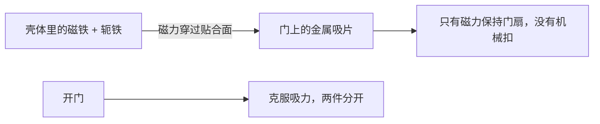

# 橱柜磁吸门吸：只有磁力保持、没有机械锁死（对照 FIDLOCK）

> [!summary] 一句话概述
> 普通橱柜磁吸门吸只有两件：带磁铁的壳体，和门上的金属吸片。关上时磁力把吸片吸住，把门留在关闭位置；打开就是把这对磁力拉开。海福乐把常用规格做成 4.0 kg 或 6.0 kg 吸力、锌合金可移动外壳；Sugatsune 把内部拆成壳体、轭铁、铁氧体磁铁和吸片。它和 [[FIDLOCK V-BUCKLE：磁吸引导到位后再由机械扣锁死]] 的差别正好在「锁」：本篇没有机械扣，长期保持主要靠磁力。

## 配图

![[附件/sugatsune-mc-sp-magnetic-catch.jpg]]
*图源：[Sugatsune Catches and Latches 目录（2026）第 156 页](https://www.sugatsune.com/content/site-assets/501%20Catalog/4-Catches%20Latches_2026-0427.pdf)；MC-SP / MC-K 螺钉安装磁吸的零件：① 壳体 ② 轭铁 ③ 吸片 ④ 铁氧体磁铁；并给出单扇吸片和对开门双吸片两种做法。MCH 为锌合金壳体的重型规格*

> 图片版权归原作者所有，仅作个人学习收藏；出处见文末「来源与核实记录」。海福乐中国产品页有实物图，但打开时未能稳定下载到本地，故封面采用已下载的 Sugatsune 目录插图；海福乐的吸力与材料仍以该产品页为准。

## 结构原理

> 本节所有数字只写来源里给出的；来源没有就写「来源未给出」。三家是同一类「磁铁吸住吸片」的柜门磁碰，参数按来源分列。

### 堆叠方案

方向：**从柜体内（磁铁壳体）到门内侧（吸片）**。Furnica 写得更具体：磁铁在柜体里，吸片在门内侧。

| 层级 | 零件 | 材料 | 厚度/尺寸 | 固定方式 | 依据 |
| --- | --- | --- | --- | --- | --- |
| L1（柜体内） | 磁吸外壳 | 海福乐：锌合金，外壳可移动；Sugatsune MC-SP：PBT 白色；MC-K：PBT；MCH：锌合金镀镍 | 海福乐该页未给出长宽高；Sugatsune MC-SPM 长 86 mm 等，见目录表 | 海福乐：螺钉固定；Furnica：常用 Ø3–3.5 mm 盘头螺丝，先不要拧死，沿长圆孔还可前后微移 | 海福乐产品页；Sugatsune 第 156 页；Furnica 工具与步骤 3 |
| L2 | 轭铁（yoke） | Sugatsune MC-SP：430 不锈钢；MC-K / MCH：钢（镀铬或黄色镀层，按型号） | 来源未给出板厚 | 装在壳体内，把磁路引到工作面 | Sugatsune 零件表。海福乐、Furnica 未拆出轭铁这一层 |
| L3 | 磁铁 | Sugatsune：铁氧体（MC-SP / MC-K / MCH 该页均为 Ferrite） | 来源未给出牌号和外形尺寸 | 嵌在轭铁/壳体里 | Sugatsune；海福乐只写磁吸，未写磁材 |
| L4 | 空气隙 / 贴合面 | — | Furnica：吸片螺丝头若凸出，会把贴合面变成点接触，吸力降到「只剩一小部分」；可用透明胶带做极薄空气隙来减弱吸力 | 关闭时应全面贴合 | Furnica 步骤 5、常见错误 1、FAQ |
| L5 | 吸片（counterplate） | 海福乐：金属，刚性；Sugatsune MC-SP：430 不锈钢；MC-K：钢镀铬；MCH：钢 | Furnica 举例：吸片厚 1.5 mm（用于退距计算的例子，不是所有吸片的统一厚度） | 海福乐：螺钉固定；Furnica：必须用沉头螺丝，钉头与板齐平或略低于板面 | 海福乐类型/材料；Sugatsune；Furnica |
| L6 | 柜门 | 海福乐：适用于木门；Furnica 另提到玻璃或极薄板可用带 3M 胶垫的自粘吸片，但木门仍建议螺丝 | Furnica 举例常用 16 mm 或 19 mm 门，预钻时要防止钻穿可视面 | 吸片装在门内侧 | 海福乐适用范围；Furnica |

剖面示意：

和 FIDLOCK 的关键差别（对照，不把对方参数抄过来）：

- [[FIDLOCK V-BUCKLE：磁吸引导到位后再由机械扣锁死]]：磁铁负责把两半拉到对位，机械翻盖再咬死；载荷主要由机械锁承担；打开要先把机械扣错开。
- 本篇：合上、保持、打开都走同一对磁力。海福乐、Furnica、Sugatsune 已打开的页面都没有再写一套卡舌或锁扣。Sugatsune 卡入式（如 MC-FS34）零件表里的弹簧，是把壳体留在钣金开孔里用的，不是把门锁死的机械扣，不要误读。

### 零件清单

| 零件 | 数量 | 功能 | 材料 | 依据 |
| --- | --- | --- | --- | --- |
| 磁吸外壳（含磁铁，海福乐作整体；Sugatsune 再拆轭铁和磁铁） | 每处 1 | 提供吸力并固定在柜体上 | 见上表 | 海福乐标准配置：1 个外壳；Sugatsune ①②④ |
| 吸片 | 每处 1（对开门可用双吸片，Sugatsune 写 Double plate option） | 作为衔铁被吸住 | 见上表 | 海福乐：1 个吸片；Sugatsune ③ |
| 固定螺丝 | 来源未给出统一数量 | 海福乐页推荐关联 Hospa 平头全螺纹镀锌螺丝；Furnica：壳体用盘头，吸片用沉头 | 来源按螺丝型号 | 海福乐关联件；Furnica |
| 长圆孔 | 做在壳体上（Furnica 强调不要改用圆孔钉死） | 关门后面沿前后微调几毫米 | — | Furnica 步骤 2、3、6 与错误 3 |

### 装配顺序

按 Furnica 指南（专业安装步骤；海福乐页只规定主体和吸片螺钉固定，未逐步演示）：

1. **选吸力**：Furnica 写小而轻的刨花板门常用 2–3 kg；实木或较大衣柜门用 4–6 kg，或一门上下各装一只。海福乐本页提供 4 kg 和 6 kg 两档，适用于木门。Sugatsune 该页例如 MC-SPM 为 10.5 lbs（4.8 kg），MC-SPL 为 12.3 lbs（5.6 kg），MC-KM 为 5.2 lbs（2.4 kg），MC-KL 为 6.1 lbs（2.8 kg）；重型 MCH-40/50/61/80/105 分别为 3 / 7 / 11 / 14 / 15 kg。
2. **定壳体位置**：高门装在拉手一侧、尽量靠近拉手高度，减小开门力臂；小门通常装在柜体顶板或底板。最关键的是相对柜口前缘的退距。Furnica 公式：门厚 + 吸片厚 + 门档/缓冲垫厚度 = 磁铁前缘到柜体外沿的距离。例子：19 mm 门 + 1.5 mm 吸片，磁铁前缘正好在柜口内 20.5 mm。
3. **先在长圆孔中心点窝、预钻**：Furnica 用 Ø2 mm 或 2.5 mm 木钻，孔深约比螺丝短 2 mm（例：15 mm 螺丝钻 13 mm），防止钻穿。螺丝先打到还能用手推动壳体的程度。
4. **把位置转移到门上**：把吸片先吸在已装好的磁铁上，背面贴一小块双面胶，轻轻关门按一下，再开门，吸片就会留在正确位置。
5. **固定吸片**：同样先点窝再预钻，用沉头螺丝把钉头沉到与板齐平或略低。Furnica 明确禁止在吸片上用盘头或半圆头螺丝。
6. **微调**：门还探出柜外，就把壳体沿长圆孔向后移 1–2 mm；门先碰到柜口、磁铁还没吸上，就把壳体向前移。到位后再把螺丝打紧。

Furnica 还写：高门建议上、下各一处，减轻门板受潮翘曲；小格子一门一处、装在铰链对侧即可。吸力太大时，可在吸片上贴一条透明胶带做极薄气隙来减弱，不必立刻换件。门已吸住但仍向前晃，通常是壳体太靠里，向前移约 1 mm，让门轻轻压在柜口缓冲垫上。

### 受力与运动分析

- **受力路径**：开门力经门板传到吸片，再经过贴合面进入磁铁和轭铁，最后由壳体螺丝传到柜体。保持力以厂家标称的 kg 或 lbs 给出（见上），已打开来源没有再把它换算成牛顿，也没有给出力矩或门宽修正公式。Furnica 把「吸片螺丝头凸出」视为气隙，会明显削弱这条磁力路径。
- **运动关系**：关闭是门绕铰链转到贴合，磁力把吸片吸上；打开是反向拉开。没有锁舌落入、没有心形槽换相，也没有「先解锁再分离」的第二步。这与 FIDLOCK「先把机械扣移开，磁力再减弱」不是同一顺序。
- **失效风险**：退距不对，门关不严或还没贴上就撞柜口。吸片偏了，只有局部接触，吸力下降。MDF 或刨花板不预钻直接上螺丝会裂（Furnica）。只用胶贴木门吸片，Furnica 认为反复开门的拉力会让胶疲劳，木门仍应上螺丝。磁吸不能代替重型上翻门的气撑（Furnica：向上开的重型翻门应使用气撑）。铰链若已带自闭或软关，Furnica 把磁吸主要用在「没有自带闭合力或卡档的门」上，两者是否叠加要按具体铰链判断，来源未给出定量干扰值。

## 设计要点与参数

| 要点 | 内容 | 依据 |
| --- | --- | --- |
| 结构本质 | 壳体磁铁 + 金属吸片，只有磁力保持，无机械锁死 | 海福乐；Furnica 开篇定义；Sugatsune 零件表 |
| 海福乐本页吸力 | 4 kg 或 6 kg 两档 | 海福乐产品页 |
| 海福乐材料与安装 | 锌合金可移动外壳，刚性金属吸片，主体和吸片螺钉固定，用于木门 | 海福乐 |
| Furnica 选型 | 小门 2–3 kg；实木或高大门 4–6 kg，或上下各一只；约 600×600 mm、19 mm 刨花板门 2–3 kg 即可，约 2000 mm 高门用 4–5 kg 或两只 | Furnica 应用段与 FAQ |
| 退距公式 | 门厚 + 吸片厚 + 门档厚度；例 19 + 1.5 = 20.5 mm | Furnica 步骤 1 |
| 螺丝 | 壳体盘头 Ø3–3.5 mm；吸片必须沉头；预钻约 Ø2 mm | Furnica |
| 微调 | 壳体用长圆孔，先点在槽中心，保留前后余量 | Furnica |
| Sugatsune MC-SP / MC-K 磁材 | 铁氧体 + 轭铁 + 吸片 | 目录第 156 页 |
| Sugatsune 该页磁力举例 | MC-SPM 4.8 kg，MC-SPL 5.6 kg，MC-KM 2.4 kg，MC-KL 2.8 kg；MCH 3–15 kg | 同上 |
| 减弱吸力 | 吸片上贴透明胶带，形成极薄气隙 | Furnica FAQ |
| 与机械锁的关系 | 本类产品打开时直接克服磁力；FIDLOCK 则先打开机械扣 | 对照 FIDLOCK 案例，不把对方力值写入本表 |

## 优缺点

**优点**
- 零件少、没有活动锁舌，磨损主要在贴合面
- 吸力按 kg 分档，现场可以用两只或加一层薄胶带做粗调
- 壳体做成可移动/长圆孔，门缝和铰链下沉以后还能往后或往前挪
- 外观只在柜内看到一小块壳体，门边不必开球孔

**缺点 / 代价**
- 没有机械锁死，不能把它当成承载扣或防盗锁；载荷靠吸力，吸力又以贴合质量为条件
- 对位和退距不准时，表现为吸不牢或门关不严，不像碰珠那样有「落入凹坑」的明确到位
- 吸力过大时开门费劲，过小时门会回弹或虚掩
- 不适合作为向上开启的重型翻门的承重件

## 可借鉴点

- **先问「要不要机械锁」再选磁吸**：只需要把门留在关上、载荷不大，用磁铁+吸片就够；只要有跌落、承重或必须「先解锁再分开」的安全要求，就应改走 FIDLOCK 这类「磁吸对位 + 机械锁死」。
- **把可调做在壳体的长圆孔上，把贴合做在吸片的沉头螺丝上**：两个细节分别解决「门缝会变」和「气隙吃掉吸力」。
- **退距要算，不要靠眼睛齐平**：门厚、吸片厚、缓冲垫都要进公式，否则要么门关不进，要么吸住了还有前后窜动。
- **用 kg 档位选型，用只数和薄气隙微调**，比在图纸上发明一个中间力值更安全。来源没给的力值不要换算。
- 高门上下各放一只，既提高保持力，也有助于限制门板翘曲（Furnica）。

## 与库中相似案例对比

| 对比项 | 本案例（普通磁吸门吸） | [[FIDLOCK V-BUCKLE：磁吸引导到位后再由机械扣锁死]] | [[橱柜弹簧碰珠（Hager、Brusso）：弹簧把钢珠顶入锁片凹坑]] | [[任天堂 Switch 2 Joy-Con 2 磁吸连接]] |
| --- | --- | --- | --- | --- |
| 磁力的角色 | 负责对位和长期保持 | 引导合拢，锁主要靠机械翻盖 | 不用磁力 | 主机磁铁与手柄衔铁，主要靠磁吸保持并带电触点 |
| 有无机械锁死 | 无 | 有，载荷越大越难打开 | 有：钢珠落入凹坑 | 无机械扣（该案例范围内） |
| 打开 | 直接拉开磁力 | 先拉开翻盖，磁力再减弱 | 把珠拉出凹坑 | 拉开磁力 |
| 典型力值来源 | 海福乐 4/6 kg；Furnica 2–6 kg 分档；Sugatsune 目录 lbs/kg | 不以本篇磁力值套用 | 已打开来源未给保持力 | 来源未给吸力值 |
| 分类取舍 | 放在 02：它是靠磁力保持的可分离连接，活动锁芯不是重点 | 04，因为核心是机械扣的开合 | 04，因为核心是弹簧钢珠的伸缩与落入 | 02，磁吸连接 |

## 相关案例

- [[FIDLOCK V-BUCKLE：磁吸引导到位后再由机械扣锁死]]
- [[橱柜弹簧碰珠（Hager、Brusso）：弹簧把钢珠顶入锁片凹坑]]
- [[任天堂 Switch 2 Joy-Con 2 磁吸连接]]
- [[任天堂 Switch Joy-Con 滑轨连接]]
- 分类索引：[[02-连接与紧固 索引]]

## 来源与核实记录

- 主来源：[海福乐中国：磁吸，拉力 4.0 kg 或 6.0 kg，螺丝固定，直边](https://www.hafele.com.cn/zh/product/-4.0-kg-6.0-kg-/P-00871792/)（2026-11-22 打开。4 kg / 6 kg、锌合金可移动外壳、刚性金属吸片、木门、主体与吸片螺钉固定、标准配置 1 外壳 + 1 吸片）
- 补充来源 1：[Furnica：Installing Magnetic Catches（2025-12-30）](https://furnica.com/blogs/guides/installing-magnetic-catches-step-by-step-guide)（独立机构。壳体+磁铁+金属吸片的定义、2–6 kg 选型、退距公式与 20.5 mm 例子、长圆孔微调、吸片必须沉头、常见错误与 FAQ）
- 补充来源 2：[Sugatsune Catches and Latches 目录，2026 年版第 156 页](https://www.sugatsune.com/content/site-assets/501%20Catalog/4-Catches%20Latches_2026-0427.pdf)（独立第三机构。MC-SP / MC-K / MCH 零件：壳体、轭铁、铁氧体磁铁、吸片，以及该页磁力值。卡入式型号仅用于说明「零件表里的弹簧不是门锁弹簧」，其力值未写入本篇选型表）
- 核实：2026-11-22 打开海福乐与 Furnica 页面，并下载 Sugatsune 目录相应页。未把 FIDLOCK、MagSafe 或 Joy-Con 的结构当作本篇变体。
