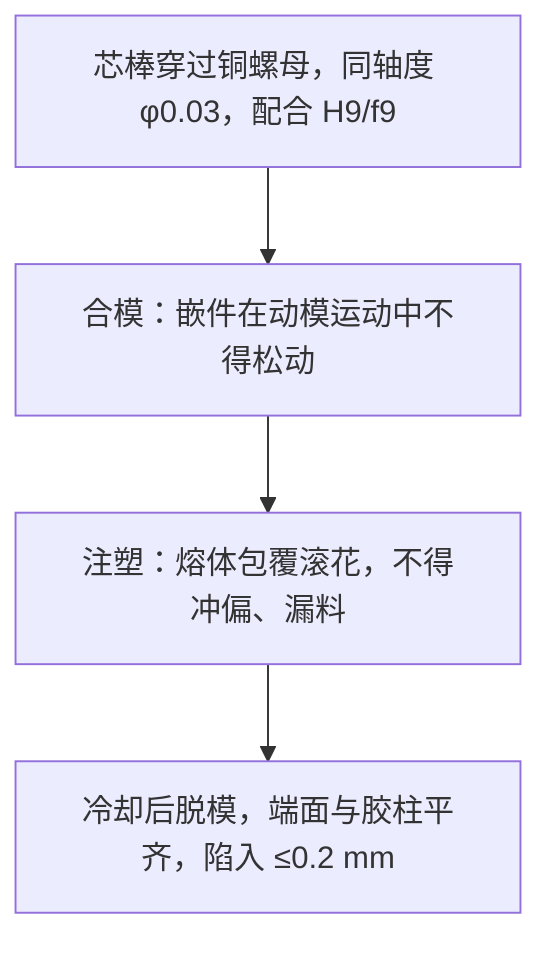

# 注塑模内预埋铜螺母：模具定位、溢胶风险与直纹及斜花滚花

> [!summary] 一句话概述
> 模内预埋是把铜螺母先套在模具芯棒上，注塑时熔体包住滚花，冷却后与塑件成为一体。它和热熔铜螺母不是同一工序：热熔是成型后再加热压入，预埋发生在注塑当时。结合强度通常最好，但会拉长成型节拍，而且定位不准就会溢胶、堵牙或撞坏模具。直纹滚花更常用于模内（抗拔出好），双斜花/阶梯形更常留给事后热熔，以免攻牙膨胀和溢胶。

## 配图

![[附件/mold-in-insert-section.jpg]]
*图源：[泛沃《塑胶件热压螺母、预埋螺母安装加工技术要求》](https://www.finesz.com/date29.php)；嵌件剖面尺寸符号（A 长度、D 外径等）。该页同时给出热压和预埋，预埋规格采用与热压相同的外形表*

![[附件/pem-si-insert-processes.jpg]]
*图源：[PEM《解决塑料螺纹嵌件问题的四种方法》](https://www.pemnet.com/cn/products/engineering-guides/four-ways-to-tackle-threaded-inserts-for-plastics/)；SI 嵌件的滚花与植入示意。该文同时讨论热熔、超声、注塑和冷压，此图表现为工具压入过程，不单独代表模内预埋，只用来看滚花形态*

> 图片版权归原作者所有，仅作个人学习收藏；出处见文末「来源与核实记录」。本篇不把同页的热压工装图当作模内预埋封面。

## 结构原理

> 本节数字只写来源里给出的；来源没有就写「来源未给出」。本节不重复热熔工艺步骤。

### 堆叠方案

方向：**沿嵌件轴线，从胶柱顶面到孔底，注塑包覆状态**

| 层级 | 零件/区域 | 材料 | 厚度/尺寸 | 固定方式 | 依据 |
| --- | --- | --- | --- | --- | --- |
| L1 | 胶柱顶面与嵌件端面 | 塑料 + 金属 | 预埋后应与胶柱顶平面平齐，陷入不超过 0.2 mm | 注塑包覆 | 泛沃 3.2.3 |
| L2 | 滚花段 | 黄铜等；直纹或斜花 | 泛沃预埋采用与热压相同外形：M3×5.7 外径 Φ4.4，圆头 Φ3.9；M4×8.1 外径 Φ6.1 | 熔体流入滚花后机械锁合 | 泛沃表 1；PEM 滚花方向说明 |
| L3 | 胶柱孔壁 | 注塑塑料 | 热压/预埋共用推荐：M3 胶柱孔内径 Φ4.0 +0.1，最小胶柱外径 Φ8.0，最小深度 6.2 mm | 一体成型包覆 | 泛沃表 1 |
| L4 | 模具芯棒 | 模具钢 | 芯棒与螺母同轴度 φ0.03 mm；模具圆柱孔与芯棒轴段配合 H9/f9 | 定位内螺纹、防止熔体进入牙内 | 泛沃 |
| L5 | 螺母内螺纹 | 金属 | 必须由芯棒或堵头保护，否则溢胶堵牙 | — | 义文（位置不准影响质量）；泛沃（不偏移、不漏料） |

剖面示意：

### 零件清单

| 零件 | 数量 | 功能 | 材料 | 依据 |
| --- | --- | --- | --- | --- |
| 内螺纹嵌件 | 每柱 1 | 提供金属螺纹 | 义文：铜（C3604 或无铅铜）最常见，也有 SUS303、12L14/12L15、铝 | 义文 |
| 注塑件胶柱 | 1 | 包覆嵌件 | 与壳体相同 | 各来源 |
| 模具芯棒 | 每穴 1 | 定位并保护内螺纹 | 模具零件 | 泛沃 |
| 螺钉 | 后续装配 | 与嵌件旋合 | — | — |

### 装配顺序

1. 把螺母套到芯棒上，保证同轴和防转，合模过程中不松动（泛沃）。
2. 注塑充模，熔体包住滚花；对 PC、PC+ABS 等敏感材料，泛沃要求对螺母预热或事后保温以减小热应力，并写明**不推荐 PC 做预埋**（残余应力易在结合处开裂）。若必须做，该文提到提高模温、减少保压时间和压力、提高料筒温度，或在 90–100 °C 加热产品提前释放应力。
3. 冷却、脱模，检查端面平齐（陷入 ≤0.2 mm）、螺纹是否进胶、有无裂纹。
4. 后续只需拧螺钉，不再做热熔。

### 受力与运动分析

- **受力路径**：拉拔力由滚花与塑料的机械互锁承担；拧入力矩由滚花的周向形态承担。PEM：直纹（与嵌件长度平行）拔出性能最佳，但扭力较差；对角线或螺旋滚花平衡两个方向；六角或菱形滚花在各方向都提供阻力。
- **运动关系**：成型后嵌件与塑料无相对运动。失效往往发生在结合面开裂或溢胶导致螺纹无法旋合。
- **与热熔的差别**：热熔是二次加热把塑料挤入滚花；预埋是一次成型包覆，结合通常更好，但把定位和溢胶风险前移到模具（义文）。

## 设计要点与参数

| 要点 | 内容 | 依据 |
| --- | --- | --- |
| 工艺取舍 | 义文：模内结合强度最好，但放嵌件会显著增加成型周期；位置必须十分精准，否则影响质量或损坏模具 | 义文 |
| 滚花选型（泛沃技术问答） | 不建议用「土八字 / 双斜花」做注塑植入：同等规格下比 GB809 直纹差，且阶梯外形使攻牙膨胀、孔径跳动，容易溢胶或 PIN 针进不去。双斜花一般留给后期热熔，直纹用于模具植入。问答中举例双斜花旋转角 β=45°（DIN 82） | 泛沃留言区（2023 年后问答，作为该厂工艺经验，不是国家标准试验报告） |
| PEM 滚花方向 | 直纹抗拔出最好、抗扭差；斜花/螺旋平衡；六角或菱形最常见、各向都有阻力 | PEM |
| 定位公差 | 芯棒与螺母同轴度 φ0.03 mm；模具孔与芯棒 H9/f9 | 泛沃 |
| 端面 | 与胶柱顶平齐，陷入不超过 0.2 mm | 泛沃 |
| 预埋拉力和扭矩（该页推荐表，单位为 kg 与 kgf·cm） | M3×5.7：拉力 100 kg，扭力矩 15 kgf·cm；M4×8.1：200 kg，30 kgf·cm。未写测试材料和标准号，只作该页推荐值 | 泛沃 3.2.2 |
| 外形参考（与热压共用） | M3×5.7：长 5.7，外径 4.4，胶柱孔 4.0+0.1，最小胶柱外径 8.0，最小深度 6.2；M4×8.1：长 8.1，外径 6.1，孔 5.6+0.1，最小外径 10，最小深度 8.6 | 泛沃表 1 |
| 材料限制 | 不推荐 PC 预埋；PC/PC+ABS 要预热或后处理 | 泛沃 |
| PEM 尺寸范围（英制为主） | 标准嵌件直径约 1/8–9/16 in，长 1/8–5/8 in，螺纹约 #0-80 到 3/8-16（视类型合 M2–M10）；微小型可到直径 1 mm、长 1.75 mm，容纳 M1 | PEM |

## 优缺点

**优点**
- 一次成型，结合强度通常高于事后热熔或冷压（义文、PEM 都把注塑列为高强度路线）
- 外观面不必再过热熔工位，适合大批量、对拉拔要求高的结构件

**缺点 / 代价**
- 注塑周期变长，模具要做芯棒和防漏料
- 漏放、放反、偏心会直接伤模或批量堵牙
- 不适合所有塑料，PC 尤其要谨慎
- 改嵌件规格往往要改模

## 可借鉴点

- 模内优先选**直纹（如 GB809）**，把双斜花留给热熔返修或 3D 打印后加工
- 模具图写清：芯棒同轴度 φ0.03、H9/f9、防转、螺纹封堵，以及端面陷入 ≤0.2 mm 的验收
- 节拍敏感或品种多、产量不大时，用热熔可能更划算（对照库中热熔铜螺母篇）
- PC、PC+ABS 先做应力和预热方案，不要默认定能预埋

## 与库中相似案例对比

| 对比项 | 本案例 | [[3D 打印件热熔铜螺母：孔径与拉拔力实测]] | [[注塑螺丝柱（Boss 柱）：壁厚比 0.6 分水岭与自攻底孔公式]] |
| --- | --- | --- | --- |
| 何时植入 | 注塑当时，放在模芯上 | 成型后加热压入 | 无嵌件，自攻直接打入柱孔 |
| 关键风险 | 定位、溢胶、节拍、PC 应力开裂 | 孔径与背面毛刺、拉拔力随孔径下降 | 柱壁开裂与外观缩水 |
| 滚花 | 模内偏向直纹 | 热熔常用带锥度的交错滚花 | 无 |
| 强度与成本 | 强度通常最好，模具和节拍更贵 | 设备和孔径控制即可，强度略低一档（定性） | 零件最少，螺纹在塑料里 |

## 相关案例

- [[3D 打印件热熔铜螺母：孔径与拉拔力实测]]
- [[注塑螺丝柱（Boss 柱）：壁厚比 0.6 分水岭与自攻底孔公式]]
- [[EJOT Delta PT 塑料用三角齿自攻螺丝：底孔 0.8·d1、20° 牙侧角与应力释放沉孔]]
- [[钢丝螺套（Helicoil 与 STI 底孔）：菱形钢丝嵌件与专用底孔攻丝]]
- 分类索引：[[02-连接与紧固 索引]]

## 来源与核实记录

- 主来源（独立中文，非 PEM、非泛沃）：[义文：内螺纹嵌件的分类和安装](https://www.evan.cn/news/detail/139)（义文五金，2024-08-20；热熔/超声/模内/压入/膨胀的分类与模内节拍、定位风险）
- 补充：[PEM 中文指南《解决塑料螺纹嵌件问题的四种方法》](https://www.pemnet.com/cn/products/engineering-guides/four-ways-to-tackle-threaded-inserts-for-plastics/)（滚花方向与工艺比较；PEM 已在本批压铆螺钉篇用作主来源，本篇只作补充）
- 补充：[泛沃热压/预埋工艺要求](https://www.finesz.com/date29.php)（芯棒公差、平齐、PC 限制、拉力推荐表、直纹与双斜花分工）。泛沃已在本批其他篇出现，不作本篇唯一第二来源。
- 核实：2026-11-21 curl GET 打开三页。义文配图未成功下载（HTTP 403）。预埋拉力单位按原表 kg / kgf·cm 抄录，未换算。热压温度表属于热压工序，未当作预埋参数。
