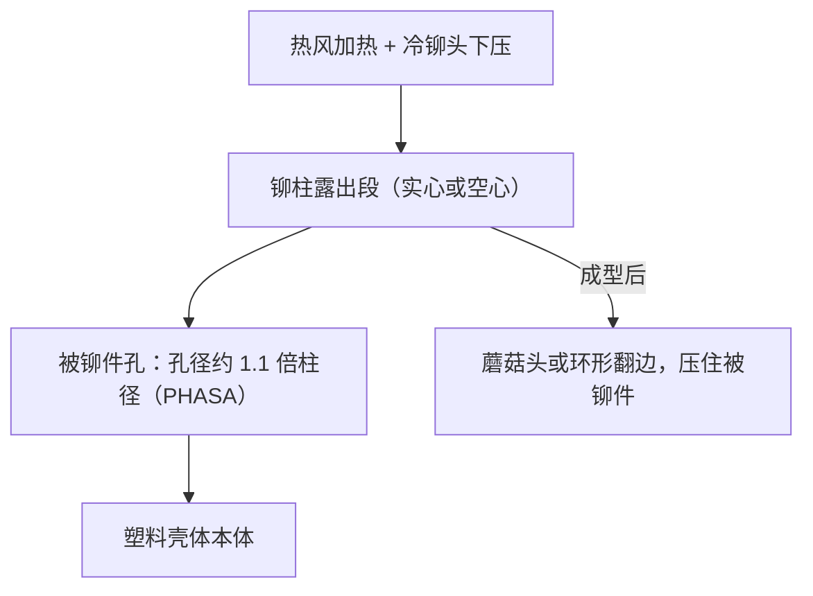

# 热铆柱几何：实心柱不超过3mm、空心壁厚0.75–2.0mm，被铆孔径按柱径1.1倍

> [!summary] 一句话概述
> 热铆是把壳体上一体成型的塑料柱穿过被连接件的孔，加热软化后再压成头，把另一零件锁在壳体上。和已经收录的 [[热铆（热熔柱）：铆柱高度按体积守恒算，蘑菇头直径 2d]] 不同，本篇补的是那一篇当时写「来源未给出」的部分：实心柱什么时候该改空心、空心壁厚取多少、被铆件孔径相对柱径留多大间隙。莱丹把实心蘑菇头用在直径 ≤3 mm，空心环形头用在直径 >5 mm，壁厚建议 1.5 mm±0.3 mm；PHASA 同样避免实心柱大于 3.0 mm，推荐管壁 0.75–2.0 mm，并把被铆孔径定为柱径的 1.1 倍（间隙不大于 10%）。

## 配图

![[附件/phasa-stake-hole-clearance.jpg]]
*图源：[PHASA《A guide to plastics assembly》](https://www.agaria.se/wp-content/uploads/2014/09/PHASA-Stake-Design-Guide.pdf) 第 9 页；上图是带中心 V 槽的实心柱（露出高度 0.75d，V 深 0.4d），下图是空心柱，被铆件孔径都标成 1.1d。右侧表格按柱径 1–12 mm 给出 V 深或抽芯直径、露出高度和间隙孔直径，并写明孔径作为经验值不应比柱径大过 10%*

![[附件/leister-mushroom-stake.jpg]]
*图源：[莱丹《热风冷铆铆头结构设计准则 V3》](https://www.leisterchina.com/d/file/content/2020/04/5e97b7fa97927.pdf) 第 3 页；标准圆柱铆柱的蘑菇头：铆接前直径 D1≤3 mm，成型后头径 D2=1.5×D1，头下方剩余高度 H3≥0.5 mm，成型体积 V2 为原柱体积 V1 的 85%–95%*

![[附件/leister-hollow-stake.jpg]]
*图源：同上第 5 页；直径 >5 mm 时改用空心铆柱做环形铆头。图中 D1 标的是管壁厚度，建议 1.5 mm±0.3 mm；成型后环形头宽 D2=1.8×D1，H3≥0.5 mm，体积关系同样是 V2=(85%–95%)×V1*

> 图片版权归原作者所有，仅作个人学习收藏；出处见文末「来源与核实记录」。

## 结构原理

> 本节所有数字只写来源里给出的；来源没有就写「来源未给出」。

### 堆叠方案

方向：**从铆头一侧到塑料壳体本体**

莱丹把热风冷铆写成四步：热风对铆柱整体加热 → 铆柱软化 → 冷铆头下压 → 成型。PHASA 是同类工艺：先用热空气加热（不接触），再用冷模具把软化段成形、夹紧并冷却。

| 层级 | 零件 | 材料 | 厚度/尺寸 | 固定方式 | 依据 |
| --- | --- | --- | --- | --- | --- |
| L1 | 成型铆头（蘑菇头、环形翻边、沉头等） | 铆柱熔融后再成形 | 莱丹蘑菇头 D2=1.5×D1；空心环形头 D2=1.8×D1；H3 蘑菇头 ≥0.5 mm，沉头 ≥0.8 mm | 冷却后压住被铆件 | 莱丹第 3、5、6 页 |
| L2 | 被铆件（板、PCB、另一塑件） | 金属、PCB 或塑料 | 孔径：PHASA 推荐不比柱径大过 10%，表中即 1.10 倍柱径 | 被铆头压住 | PHASA 第 9 页 |
| L3 | 铆柱露出段 | 与壳体一体的热塑性塑料 | 见下方实心 / 空心表 | 穿过被铆孔 | 莱丹；PHASA |
| L4 | 塑料壳体本体 | 热塑性塑料 | PHASA：铆柱任何截面最好不超过基体厚度的 70%，大柱做在薄壁上会有应力释放风险 | 一体注塑 | PHASA 第 9 页 |

**莱丹按头型给出的柱几何（不要和 PHASA 表混成同一组）**

| 类型 | 应用 | 铆接前 | 成型后 | 依据 |
| --- | --- | --- | --- | --- |
| 蘑菇头，标准圆柱 | 直径 <3 mm，如汽车电子、PCB 固定 | D1≤3 mm；H1–H2≤2 mm | D2=1.5×D1；H3≥0.5 mm；V2=(85%–95%)×V1 | 莱丹第 3 页 |
| 蘑菇头，中心 V / 凹槽 | 直径 3–5 mm，强度要求偏高 | 3 mm≤D1≤5 mm；H1–H2≤1.5 mm | D2=1.5×D1；H3≥0.5 mm；同样的体积比 | 莱丹第 4 页 |
| 环形头，空心柱 | 直径 >5 mm，或材料刚性差但固定要求高 | 壁厚 D1=1.5 mm±0.3 mm；H1–H2≤2.5 mm | D2=1.8×D1；H3≥0.5 mm | 莱丹第 5 页 |
| 沉入式铆头 | 直径 <3 mm，不允许铆头突出 | D1≤3 mm；H1–H2≤2 mm | D2=1.8×D1；H3≥0.8 mm | 莱丹第 6 页 |

莱丹还提醒：产品壁厚较薄、刚性较差且有外观要求时，反面可能产生热缩痕，需要考虑空心铆柱。

**PHASA 被铆孔径与露出高度（柱径 1–12 mm）**

| 柱径 | V 深或抽芯直径 | 露出高度 | 间隙孔径 |
| --- | --- | --- | --- |
| 1 mm | 不适用 | 1.75 mm | 1.10 mm |
| 2 mm | 不适用 | 2.50 mm | 2.20 mm |
| 3 mm | V 1.2 mm | 2.75 mm | 3.30 mm |
| 4 mm | V 1.6 mm | 3.00 mm | 4.40 mm |
| 5 mm | 抽芯 3.5 mm | 3.75 mm | 5.50 mm |
| 6 mm | 抽芯 4.5 mm | 5.50 mm | 6.60 mm |
| 8 mm | 抽芯 6.0 mm | 5.75 mm | 8.80 mm |
| 10 mm | 抽芯 7.5 mm | 6.50 mm | 11.00 mm |
| 12 mm | 抽芯 9.0 mm | 7.50 mm | 13.20 mm |

PHASA 还给出一条经验：外径 4 mm 时，露出高度约等于直径的 75%；柱径增大应减露出高度（例如 10 mm 柱约 6.5 mm 高），柱径减小则要加高（例如 2 mm 柱约 2.5 mm 高），否则小柱没有足够料做头，大柱又会无谓延长加热时间。只有孔径间隙过大、需要把料填进空隙时，才有理由把大柱留得更高。

剖面示意：

### 零件清单

| 零件 | 数量 | 功能 | 材料 | 依据 |
| --- | --- | --- | --- | --- |
| 铆柱（实心、带 V 槽或空心） | 每个连接点 1 | 提供成型料，穿过被铆孔 | 与壳体一体的热塑性塑料 | 莱丹；PHASA |
| 被铆件孔 | 每柱 1 | 让柱通过；间隙过大会把本该做头的料漏进缝里 | 金属、PCB 或另一塑件 | PHASA 第 9 页 |
| 冷铆头 / 成形模具 | 每柱 1，或多头同压 | 决定头型，并在压力下冷却定型 | 来源未给出模具材料牌号 | 莱丹；PHASA |
| 定位用长柱或带筋柱（可选） | 按需要 | PHASA：带三或四条锥筋的长柱可在装配初期当导向销 | 与壳体同材 | PHASA 第 2 页 |

### 装配顺序

1. 注塑壳体时一体成型铆柱。直径要按实心 / 空心分档：莱丹与 PHASA 都把约 3 mm 当作实心柱的上限；更大直径抽芯做管状柱。
2. 把被铆件的孔套到铆柱上。孔尽量小到还能顺利装配，PHASA 的经验是孔径不比柱径大过 10%，孔口或柱端做导入。需要摩擦预定位时，可在柱或孔上做花键；长组件若有热胀或收缩差，可把孔做成沿长边的长圆孔，并略微加大空心柱高度以补偿漏进长孔的料（PHASA）。
3. 用热风（莱丹、PHASA）把露出段加热到可成型，再用冷铆头下压、保压冷却。
4. 退铆头。成型头压住被铆件。莱丹用 V2=85%–95% V1 来检查头型体积，而不是把全部料都算进头部。

### 受力与运动分析

- **受力路径**：工作载荷从被铆件经成型头压到柱根，再进入壳体。头的宽度和高度决定抗拔；间隙过大会让料流失、头部填不满，保持力下降（PHASA：「material designed to produce the head will be lost into the cavity」）。
- **运动关系**：成型后无相对运动，连接基本不可拆。库内已有篇提到空心柱有时可改成自攻螺丝底孔；莱丹和 PHASA 本两份资料没有重复写这条返修路径。
- **失效风险**：实心大柱在 A 面留下缩痕，并延长加热时间（两家都写了 3 mm 这一档）。薄壁壳体上立大柱，有应力释放风险（PHASA）。孔径太大则头部缺料。莱丹把成型体积故意留到原柱的 85%–95%，推断是为飞边和充填留余量（来源未解释差值来源，仅记录公式）。

## 设计要点与参数

| 要点 | 内容 | 依据 |
| --- | --- | --- |
| 实心柱上限 | 莱丹蘑菇头：D1≤3 mm；PHASA：应避免实心圆柱大于 3.0 mm，否则 A 面易缩痕、加工时间变长 | 莱丹第 3 页；PHASA 第 2 页 |
| 空心壁厚 | 莱丹：D1=1.5 mm±0.3 mm（图中 D1 为管壁，不是外径）。PHASA：0.75–2.0 mm，多数场合 1.25 mm 已足够；抽芯做成 1.0 mm 壁的管，成型稳定且强度更好 | 莱丹第 5 页；PHASA 第 2 页 |
| 何时抽芯 | PHASA：小于 2.5 mm 的柱一般不必抽芯或开 V 槽（高温或高填充料除外）；大于 4.0 mm 应抽芯，减薄待加热壁厚并避免 A 面缩痕 | PHASA 第 9 页 |
| 被铆孔径 | 间隙尽可能小到仍能装配；经验是孔径不比柱径大过 10%。表中即 1.10 倍柱径，例如 4 mm 柱配 4.40 mm 孔 | PHASA 第 9 页 |
| 柱与壳体壁厚 | 铆柱任何截面最好不超过基体厚度的 70% | PHASA 第 9 页 |
| 露出高度（PHASA） | 4 mm 柱约 0.75d（表中 3.00 mm）；更大柱减高度，更小柱加高度 | PHASA 第 8–9 页 |
| 成型头（莱丹蘑菇头） | D2=1.5×D1，H3≥0.5 mm | 莱丹第 3 页 |
| 体积关系（莱丹） | V2=(85%–95%)×V1 | 莱丹各型共用 |
| 中心 V 槽（PHASA） | 4 mm 柱的示意为 V 深 0.4d，用来改善热量分布 | PHASA 第 9 页图 |

> 库内已有篇用 TPI 的「蘑菇头约 2d」和体积守恒算露出高度。莱丹蘑菇头是 1.5×D1，体积还留 5%–15% 余量，不要和 2d、100% 体积守恒混成同一条公式。被铆孔径以本篇 PHASA 的 1.1 倍为准；已有篇当时未打开孔径来源。

## 优缺点

**优点**
- 不需要螺丝或胶水，可以把金属件、PCB 直接锁在塑料壳上（莱丹、PHASA）
- 空心柱能做大直径连接，同时避免实心柱的缩痕和过长加热（两家口径一致）
- 孔径按 1.1 倍设计后，料会留在头部而不是漏进缝里

**缺点 / 代价**
- 连接基本不可拆
- 孔径公差松或做成过长的长圆孔时，必须加高柱子来补漏掉的料（PHASA）
- 薄壁外观件上的实心柱仍可能在反面留下热缩痕，需要改空心（莱丹）
- 它不是侧向定位手段：PHASA 写明，工艺通常并不靠柱在孔里膨胀来做横向定位，需要定位时要另做涨大部分、销或单独的定位结构

## 可借鉴点

- 先按直径分档：≤3 mm 可以实心蘑菇头；3–5 mm 加中心 V 槽；>5 mm 或薄壁外观件改空心，壁厚先按 1.5 mm±0.3 mm（莱丹）或 0.75–2.0 mm（PHASA）来画
- 被铆孔径默认按柱径的 1.1 倍，并加导入角；不要按「松一点好装配」随便放大
- 用莱丹的 V2=85%–95% V1 检查头型，不要默认 100% 体积都进头部
- 柱根截面不要超过壳体壁厚的 70%
- 需要精确对位时，另做定位销或花键，不要指望铆柱膨胀把孔撑圆

## 与库中相似案例对比

| 对比项 | 本案例 | [[热铆（热熔柱）：铆柱高度按体积守恒算，蘑菇头直径 2d]] | [[注塑螺丝柱（Boss 柱）：壁厚比 0.6 分水岭与自攻底孔公式]] | [[塑料件超声波焊接：导熔线、焊筋与溢胶槽]] |
| --- | --- | --- | --- | --- |
| 要解决的问题 | 实心/空心分档、空心壁厚、被铆孔径间隙 | 按头型体积反推露出高度，蘑菇头约 2d | 自攻或螺丝柱的壁厚和底孔 | 两件塑料用焊筋熔接 |
| 关键尺寸 | 3 mm 实心上限、壁厚 0.75–2.0 mm 或 1.5±0.3 mm、孔径 1.1d | TPI / Dukane 的头型倍数与柱高公式 | 柱壁约 0.6 倍主壁、底孔公式 | 导熔线、焊筋、溢胶槽 |
| 连接对象 | 把另一零件铆在壳体柱上 | 同左，但当时孔径来源未给出 | 螺丝 | 两件同类塑料 |
| 何时用这篇 | 要定孔径和空心壁厚，或直径已经大于 3 mm | 要按头型算露出高度 | 还想可拆、用螺丝 | 两件塑料要对焊，不是铆第三件 |

## 相关案例

- [[热铆（热熔柱）：铆柱高度按体积守恒算，蘑菇头直径 2d]]
- [[注塑螺丝柱（Boss 柱）：壁厚比 0.6 分水岭与自攻底孔公式]]
- [[塑料件超声波焊接：导熔线、焊筋与溢胶槽]]
- [[3D 打印件热熔铜螺母：孔径与拉拔力实测]]
- 分类索引：[[02-连接与紧固 索引]]

## 来源与核实记录

- 主来源：[莱丹《热风冷铆铆头结构设计准则 V3》](https://www.leisterchina.com/d/file/content/2020/04/5e97b7fa97927.pdf)（2020-02-14，莱丹塑料焊接技术（上海）有限公司 / Leister Technologies Ltd，9 页中文准则。已打开预下载 PDF，核对第 3–6 页头型、D1/D2/H3 和 V2=85%–95% V1；第 5 页插图确认空心柱的 D1 是壁厚）
- 补充来源：[PHASA《A guide to plastics assembly》](https://www.agaria.se/wp-content/uploads/2014/09/PHASA-Stake-Design-Guide.pdf)（2002 年 2 月，作者 Denis W. Eagles，Phasa Developments。已打开预下载 15 页 PDF，核对第 2 页实心 3.0 mm 上限与空心壁厚 0.75–2.0 mm，第 9 页 1.1d 孔径表和 70% 壁厚限制。独立第二机构）
- 核实：2026-11-22 打开上述两份 PDF。Fictiv《Heat Staking in Product Design》已打开，有工艺和头型名称（dome、flush、hollow、flared），以及加热温度约为熔点的 60–80%，但没有柱径、壁厚和孔径表，故未列入参数表。无锡睿特《塑料热铆接-圆形及空芯铆柱》已打开，正文与 PHASA 第 2 页高度同文（含 3 mm、0.75–2.0 mm、1.25 mm 等），按转载处理，不作为独立机构，也不单列参数。未把已有篇的 2d 蘑菇头公式重复写成这篇的要点。
