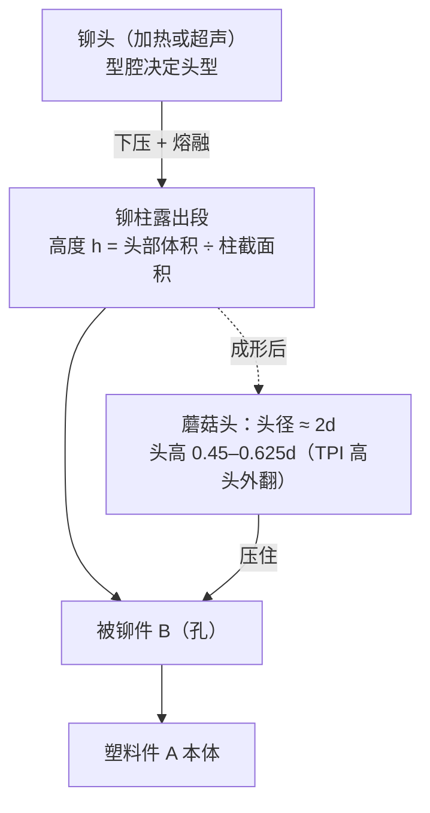

# 热铆（热熔柱）：铆柱高度按体积守恒算，蘑菇头直径 2d

> [!summary] 一句话概述
> 热铆是把塑料件 A 上预留的铆柱穿过被连接件 B 上的孔，再用加热（或超声）的铆头把露出的部分压成蘑菇头，把两件锁在一起（B 站「就像小时候补鞋」）。设计的核心是**体积守恒**：头部需要多少料，柱子就要露出多高。Thermal Press International（TPI）给出 6 种头型的倍数，例如高头外翻型：露出 1.5–2.0d、成形头宽约 2d、头高 0.45–0.625d。Dukane 超声铆接资料给出按半径 r 推出的柱高公式，例如标准 Rosette：柱径 2r → 头径 4r、头高 r、柱高 3.14r，并说明这些数按 0° 拔模计算，有拔模时要重新平衡体积。

## 配图

![[附件/heatstake-tpi-flared-high.png]]
*图源：[TPI Thermal Staking Probe Tip Design Guide](https://thermalpress.com/thermal-staking-probe-tip-design-guide/)：高头外翻型，铆前露出 1.5–2.0d，铆后头宽 2d、头高 0.45–0.625d*

![[附件/heatstake-dukane-profiles.png]]
*图源：[Dukane Ultrasonic Staking Configurations](https://www.ultrasonic-resonators.org/misc/references/articles/Dukane__'Ultrasonic_Staking_Configurations'.pdf) 第 2 页：6 种成形头型（简单、Rosette 低/标准、平头、盘头、空心）*

![[附件/heatstake-bili-principle.jpg]]
*图源：[B 站 cv35647179](https://www.bilibili.com/read/cv35647179)：热铆接原理（热熔焊头、制件 B、铆柱、蘑菇形铆头）*

> 图片版权归原作者所有，仅作个人学习收藏；出处见文末「来源与核实记录」。

## 结构原理

> 本节数字只写来源里给出的；来源没有就写「来源未给出」。

### 堆叠方案

方向：**从铆头一侧到塑料本体**

| 层 | 零件 | 材料 | 尺寸 | 作用 | 依据 |
| --- | --- | --- | --- | --- | --- |
| 1 | 成形头（蘑菇头/Rosette） | 铆柱熔融后再成形 | 头径约 1.5–2d（TPI）或 3r–4.47r（Dukane） | 压住 B 件 | TPI；Dukane |
| 2 | 被铆件 B | 金属/PCB/热固性塑料/另一种塑料 | 孔径来源未给出（TPI、Dukane 两页均未列） | 被夹持 | B 站；Dukane |
| 3 | 铆柱 | 与 A 件一体的热塑性塑料 | 柱径 d；露出高度按头型 0.6–2.5d | 提供成形料 | TPI |
| 4 | 塑料件 A 本体 | 热塑性塑料 | — | 基体 | B 站 |

**TPI 六种头型（倍数均相对原始柱径 d）**

| 头型 | 露出工作高度 | 成形头宽 | 成形头高 | 适用 |
| --- | --- | --- | --- | --- |
| 高头外翻 | 1.5–2.0d | 2.0d | 0.45–0.625d | 保持力强；低密度、无磨蚀的无定形塑料 |
| 低头外翻 | 0.6–1.0d | 2.0d | 0.25–0.30d | 高度空间受限 |
| 高头球面 | 1.5–2.5d | 2.0d | 0.5–0.9d | 圆头外观；刚性结晶塑料、含磨蚀填料、热敏树脂 |
| 低头球面 | 0.7–1.2d | 1.5d | 0.3–0.55d | 紧凑头，保持力中等 |
| 平齐 | 0.6–1.0d | 与周围平齐 | — | 不允许凸起；保持力中等 |
| 空心 Rosette | 1.25–2.0d | — | 0.5d | 薄壁空心柱向外翻成径向互锁 |

**Dukane 超声铆接公式（柱径 2r，0° 拔模）**

| 柱型 | 头型 | 头径 | 头高 | 柱高 h |
| --- | --- | --- | --- | --- |
| 平顶柱 | Rosette 低型 | 3r | 0.5r | 1.20r |
| 平顶柱 | Rosette 标准 | 4r | r | 3.14r |
| 平顶柱 | 空心（外径 2r + d） | 4r + d | r | 3.14r(2r + d) / 2(r + d) |
| 尖顶柱（90° 尖） | 简单圆头 | 4.47r | r | 2.33r |
| 尖顶柱 | 平头 | 4r | r | 2.90r |
| 尖顶柱 | 盘头 | 4r | r | 2.50r |

剖面示意：

### 零件清单

| 零件 | 数量 | 规格 | 依据 |
| --- | --- | --- | --- |
| 铆柱 | 按连接点 | 实心或空心；平顶或 90° 尖顶 | Dukane |
| 被铆件孔 | 每柱 1 | 来源未给出 | — |
| 铆头 | 每柱 1 或多头同压 | 型腔按头型加工；Rosette 主要用于压机 | Dukane；TPI |

### 装配顺序

1. 注塑 A 件时一体成型铆柱（拔模会改变体积，需要重新算 h，Dukane）。
2. 把 B 件的孔套到铆柱上。
3. 铆头下压：热铆靠加热软化（TPI），超声铆接靠能量导向处的局部发热（Dukane）。
4. 保压冷却后退铆头；成形头压住 B 件（B 站「在热熔焊头一定的压力下成为一定的形状」）。
5. 维修（仅空心柱）：Dukane 指出空心柱铆头可以去掉，留下的孔能当自攻螺丝底孔。

### 受力与运动分析

- **保持力**来自成形头的面积和头高：头越宽越厚，抗拔越强。高头外翻型最强，平齐型最弱（TPI 的定性排序；拉拔力数值来源未给出）。
- **体积平衡**：h 太短，头部填不满；太长则飞边过多（Dukane 原文「to insure a complete fill yet avoid excessive flash」）。
- **能量导向（超声）**：熔化必须从一个很小的接触面开始。平顶柱把导向做在铆头上；尖顶柱（90°）把导向做在柱上，对中容差更宽，适合手持机、ABS 等宽转变温度材料，也能减少铆头磨损和玻纤料问题。Rosette 平顶柱更适合尼龙这种转变温度窄的材料（Dukane）。
- **不同材料选头型**：无定形、低密度材料适合外翻头；结晶塑料、含磨蚀填料、热敏树脂适合球面头（TPI）。

## 设计要点与参数

| 要点 | 参数 | 依据 |
| --- | --- | --- |
| 最常用高头外翻 | 露出 1.5–2.0d；头宽 2d；头高 0.45–0.625d | TPI |
| 空间受限 | 低头外翻 0.6–1.0d；平齐 0.6–1.0d | TPI |
| 标准 Rosette（超声） | 柱径 2r → 头径 4r、头高 r、柱高 3.14r | Dukane |
| 拔模 | 公式按 0° 拔模；PC 等刚性塑料合理；有拔模要重新算体积 | Dukane |
| 尖顶柱角度 | 90° | Dukane 图 10 |
| 被铆件孔径、柱根圆角 | 来源未给出 | — |

> 两家口径对比（推断）：TPI 的「d」是柱直径，Dukane 的「r」是柱半径（柱径 2r）。换算后 Dukane 标准 Rosette 柱高 3.14r ≈ 1.57d，头径 4r = 2d，落在 TPI 高头外翻的 1.5–2.0d 和 2d 范围内，两家数据一致。Dukane 尖顶简单头的头径 4.47r ≈ 2.2d，比 TPI 的球面头宽 2d 略大。

## 优缺点

**优点**
- 不需要螺丝、胶或额外零件；可连接金属、热固性塑料等异种材料（B 站；Dukane）
- 设备简单，可多头同压，手持机也能打样

**缺点**
- 不可拆（空心柱是例外，可改成螺丝底孔）
- 保持力低于螺丝，具体数值来源未给出
- 铆柱是注塑件的细长凸起，本身也有缩痕、断柱风险（属于推断，来源未讨论）

## 可借鉴点

- **先选头型，再按体积守恒倒推露出高度**，不要凭感觉画柱高
- **有拔模的铆柱要重算体积**
- **结晶塑料、玻纤料用球面头或尖顶柱**
- **需要返修的位置用空心柱**，返修时改用自攻螺丝
- **空间矮的地方用低头或平齐**，接受保持力降低

## 与库中相似案例对比

| 对比项 | 本案例 | [[微软 Surface Laptop 超声波点焊与 Alcantara 覆面（反面案例）]] | [[3D 打印件热熔铜螺母：孔径与拉拔力实测]] | [[钣金压铆螺母（PEM S-CLS）：孔径、最小板厚、边距与板材硬度上限]] |
| --- | --- | --- | --- | --- |
| 原理 | 塑料柱熔融成形头 | 超声波熔接 | 铜螺母热压进塑料 | 冷压使板材流入螺母槽 |
| 可拆 | 否（空心柱可改螺丝） | 否 | 可拆（螺丝） | 可拆（螺丝） |
| 关键尺寸 | 露出高度、头型 | 见该案例 | 孔径 | 孔径、板厚、边距 |
| 共同点 | 都靠材料塑性流动形成机械互锁 | 可维修性反面案例 | 金属螺纹嵌件 | 金属对金属 |

## 相关案例

- [[微软 Surface Laptop 超声波点焊与 Alcantara 覆面（反面案例）]]
- [[3D 打印件热熔铜螺母：孔径与拉拔力实测]]
- [[卡扣三种基本形式：悬臂、环形、扭转]]
- [[注塑螺丝柱（Boss 柱）：壁厚比 0.6 分水岭与自攻底孔公式]]（空心铆柱返修后用自攻螺丝）
- 分类索引：[[02-连接与紧固 索引]]

## 来源与核实记录

- 主来源：[Thermal Staking Probe Tip Designs & Post Geometry Guide](https://thermalpress.com/thermal-staking-probe-tip-design-guide/)（Thermal Press International；设备厂商，原文注明为初步设计指南）
- 补充来源 1：[Dukane Ultrasonic Staking Configurations](https://www.ultrasonic-resonators.org/misc/references/articles/Dukane__'Ultrasonic_Staking_Configurations'.pdf)（Dukane Form No. 9839-A-01，2 页 PDF；独立来源）
- 补充来源 2：[热铆接/热熔接与超声波焊接简易说明](https://www.bilibili.com/read/cv35647179)（B 站，闽渔，2024-06-20；定性原理与示意图）
- 核实：2026-11-13 打开全部来源核对。搜索摘要里提到 1.1d 孔径的说法出自另一份 PDF（dribbble 附件），未打开，未引用。
