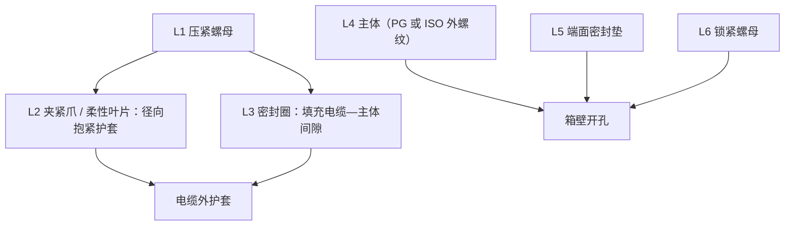

# 电缆防水格兰头：PG 螺纹、夹紧爪与密封圈

> [!summary] 一句话概述
> 格兰头是装在壳体电缆入口上的一套组件，不是在壳上自己开一道 O 形圈槽：主体用 PG 或公制螺纹拧进开孔，拧紧压紧螺母时，弹性夹紧爪（柔性叶片）收拢抱住电缆外护套，密封圈被压缩填充电缆与主体之间的间隙，端面还有密封垫对着箱壁。以 Legrand IP68 塑料件为例，样本同时给出 ISO 和 PG 两套螺纹的夹紧直径范围，以及无卤聚酰胺、氯丁橡胶密封和 −20 ℃ ~ +80 ℃ 的使用条件。

## 配图

![[附件/legrand-ip68-plastic-cable-glands.jpg]]
*图源：[Legrand Plastic cable glands IP 68（ISO and PG）](https://www.elit.ee/docs/legrand/ex218001_316.pdf) 样本第 316 页；左侧为 ISO/PG 夹紧范围订货表，右侧为外形尺寸定义（A、B、ØD、对边 C、螺纹 F、开孔 Drilling Ø 等）及塞头。结构说明写明：防振机械锁紧，氯丁橡胶耐候密封，锁紧部分由柔性叶片对电缆施加压力以获得抗拉能力，并带端面密封与锁紧螺母*

> 图片版权归原作者所有，仅作个人学习收藏；出处见文末「来源与核实记录」。

## 结构原理

> 结构层次以搏恩的金属/通用分解和 RS 的零件说明为准；材料、IP、温度和夹紧直径以 Legrand 该页塑料件为准。不要把搏恩列举的「常见 Φ3–7 mm」写成 Legrand 某型号的规格。

### 堆叠方案

方向：**从箱体外侧沿电缆轴线向箱内（拧紧压紧螺母之后）**

| 层级 | 零件 | 材料 | 厚度/尺寸 | 固定方式 | 依据 |
| --- | --- | --- | --- | --- | --- |
| L1 | 压紧螺母（密封/压缩螺母） | Legrand 本款为塑料；RS 统称为密封或压缩螺母 | 见样本外形尺寸 A 等，具体数值以配图原表为准 | 旋在主体外端，向内挤压夹紧爪和密封圈 | Legrand 页说明；RS「格兰头是如何工作的」；搏恩「压紧螺母」 |
| L2 | 夹紧爪 / 柔性叶片（locking part） | 与主体同类塑料（Legrand 称 flexible blades）；搏恩称夹紧爪或锁紧环 | 来源未给出开槽数量与壁厚 | 被螺母压得径向收缩，抱紧电缆外护套，提供抗拉 | Legrand：「flexible blades which exert strong pressure on the cable thus giving the product excellent tensile strength」；搏恩 |
| L3 | 电缆密封圈 | Legrand：氯丁橡胶（neoprene）耐候密封。搏恩列举 NBR、EPDM、硅橡胶、氟橡胶等可选胶种，适用于其它产品，不是本页 Legrand 的材料声明 | 内孔须覆盖该型号的夹紧范围（见下表） | 被轴向压缩，填充电缆与主体之间的环形间隙 | Legrand；搏恩「密封圈」 |
| L4 | 主体（带外螺纹） | Legrand：无卤聚酰胺，UL 94-V2 | 螺纹为 ISO（公制，符合 EN 50 262）或 PG（符合 UTE C 68-300 与 68-311 指南建议）。螺纹规格见下表 | 拧入箱体开孔（开孔直径见样本 Drilling Ø 列） | Legrand |
| L5 | 端面密封垫（surface seal） | Legrand 写随附 surface seal；RS 提到垫圈/密封 | 来源未给出压缩率和沟槽设计（那是 O 形圈槽篇的内容） | 夹在主体台肩与箱壁之间 | Legrand；搏恩「密封垫片」；RS |
| L6 | 锁紧螺母（locking nut） | 与主体配套，Legrand 写随附 | 来源未给出拧紧力矩 | 在箱内侧（或按该结构）把主体锁在板上，防止转动松脱 | Legrand；RS |
| L7 | 电缆外护套 | 按夹紧范围选择外径 | 必须落在该型号 Ø min–Ø max 内 | 被夹紧爪抱紧、被密封圈包裹 | Legrand 夹紧表 |

剖面示意：

搏恩把工作原理概括为「三重作用」：夹紧爪提供机械抗拉；密封圈提供防水防尘；金属格兰头还可以通过螺纹与箱体形成接地连续（本款 Legrand 是塑料件，样本未把接地写成特性）。RS 的功能列表与此一致：固定防拉出、气密防尘防水、承受应力、保护电缆端部。

### 零件清单

| 零件 | 数量 | 功能 | 材料 | 依据 |
| --- | --- | --- | --- | --- |
| 主体 | 1 | 螺纹安装到箱体，容纳密封与夹紧 | 无卤 PA，UL 94-V2（Legrand） | Legrand |
| 压紧螺母 | 1 | 施加轴向力，收拢夹紧爪并压缩密封圈 | 同系列塑料 | Legrand；RS |
| 夹紧爪 / 柔性叶片 | 1 组 | 抱紧护套，抗拉、抗扭转 | 塑料叶片（本款） | Legrand；搏恩 |
| 电缆密封圈 | 1 | IP 密封 | 氯丁橡胶（Legrand 本款） | Legrand |
| 端面密封垫 | 1 | 主体—箱壁密封 | 随附 surface seal | Legrand |
| 锁紧螺母 | 1 | 防松、固定主体 | 随附 | Legrand |
| 塞头（可选） | — | 暂不开孔时保持箱体 IP | 同页 Grey RAL 7001 stopping plugs，聚酰胺，带端面密封，可用一字螺丝刀拧紧；螺母另订 | Legrand 同页 |

### 装配顺序

综合 RS 的通用安装步骤与 Legrand「机械锁紧、随附端面密封和锁紧螺母」的结构（先断电，并核对该型号与电缆外径）：

1. 按电缆外径选好 ISO 或 PG 规格，确认外径落在夹紧范围内；按样本的开孔直径在箱体上开孔。
2. 拆开格兰头，把锁紧螺母、主体、密封件按顺序预备好；端面密封垫放在主体与箱壁之间。
3. 主体穿入开孔，内侧用锁紧螺母紧固。
4. 电缆从压紧螺母一侧穿入，剥护套长度按该产品说明（RS：与格兰头尺寸匹配；若有铠装则另按铠装步骤，本款塑料件样本未展开铠装结构）。
5. 拧紧压紧螺母：柔性叶片收拢抱紧护套，密封圈被压缩。Legrand 称该结构为防振机械锁紧。
6. 检查电缆不能被轻松拉出，密封圈四周受力均匀（搏恩：拧至密封圈均匀受压）。RS 提醒安装时避免接触溶剂、化学品或污物。

### 受力与运动分析

- **受力路径**：电缆受到的拉力和扭力，经护套传到夹紧爪，再传到主体螺纹和锁紧螺母，最后由箱壁承担。密封圈主要承受径向压缩，用来填缝，而不是当唯一的抗拉件。
- **运动关系**：工作状态无相对运动。唯一的「动作」是安装时压紧螺母的轴向旋入，转换成夹紧爪的径向收拢和密封圈的压缩。
- **失效风险**：电缆外径超出夹紧范围 → 夹不紧或压伤护套；只靠拧死密封圈而不靠夹紧爪 → 抗拉不足、密封也易被拉偏；端面垫漏装或箱壁不平整 → 沿螺纹孔进水；塑料件温度超出 −20 ℃ ~ +80 ℃（Legrand）或遇到不相容的化学品。金属格兰头还要考虑电偶腐蚀和是否需要接地（搏恩、RS），那是另一类产品。

## 设计要点与参数

| 要点 | 内容 | 依据 |
| --- | --- | --- |
| 材料与安全（Legrand 本款） | 无卤聚酰胺，UL 94-V2；自熄 850 ℃，按 IEC 60695-2-11；氯丁橡胶耐候密封 | Legrand 页首 Characteristics |
| 温度（Legrand 本款） | 工作 −20 ℃ ~ +80 ℃ | Legrand |
| 防护等级（Legrand 本款） | 样本标题为 Plastic cable glands IP 68。该页未再写试验水深和时间。RS 泛述「防水格兰头通常提供 IP68，意味着可抵抗水深一米或更深」，这是 RS 对类别的说明，不是 Legrand 本页的试验条件 | Legrand 标题；RS |
| 标准 | ISO 系列符合 EN 50 262；PG 系列符合 UTE C 68-300 与 68-311 指南建议 | Legrand |
| ISO 夹紧范围（Legrand） | ISO 12：3–6.5 mm；16：4–8；20：6–12；25：12–18；32：18–25；40：22–32；50：30–38；63：34–44 mm（货号 0 980 00–0 980 09） | Legrand 左表 |
| PG 夹紧范围（Legrand） | PG7：3–6.5 mm；PG9：4–8；PG11：5–10；PG13.5：6–12；PG16：10–14；PG21：12–18；PG29：18–25；PG36：22–32；PG42：30–38；PG48：34–44 mm（货号 0 980 20–0 980 29） | Legrand 左表 |
| 外形与开孔 | 样本右表给出每规格的 A、B、ØD、对边 C、F、Drilling Ø、C1、E、ØD1。具体数字以配图原表为准，避免转抄误差 | Legrand 右表 |
| 螺纹体系（搏恩分类，用于选型对照） | 公制 M、德制 PG、英制 G、美制 NPT。PG 在欧洲设备上常见。不要把不同螺纹当同一开孔尺寸互换 | 搏恩分类表 |
| 搏恩列举的其它常见范围 | 如适配电缆 Φ3–7、Φ6–12 mm 等，温度 −40 ℃ ~ +100 ℃（标准）或更宽，拉力「通常 ≥50 N」——这些是该文对市场产品的归纳，不是 Legrand 本页数据 | 搏恩「关键技术参数」 |
| 与 O 形圈槽的关系 | 端面密封垫是买来的附件，压在箱壁上；本篇不设计壳体上的 O 形圈沟槽填充率、压缩率。若不用格兰头、改在壳上直接开槽过电缆，才去看 O 形圈槽规则 | 对照已收录案例 |

## 优缺点

**优点**
- 把夹紧、密封、安装螺纹做成标准件，壳体只要按样本开孔
- PG 与 ISO 两套规格覆盖从大约 3 mm 到 44 mm 的护套外径（Legrand 表）
- 夹紧爪专门抗拉，密封圈专门填缝，分工清楚
- 塑料件绝缘、重量轻，适合普通防水场合（搏恩对尼龙/塑料类的定位）

**缺点 / 代价**
- 必须按外径选规格，一根电缆换粗了就要换格兰头或加附件
- 塑料件的温度和机械强度上限低于金属件；本款样本给的是 −20 ℃ ~ +80 ℃
- IP68 的具体水深和时间仍要查该型号的完整试验条件，不能只看标题
- 不能替代防爆、铠装或 EMC 屏蔽专用格兰头（搏恩、RS 都把这些列为不同类别）

## 可借鉴点

- **电缆入口用组件，不要在壳体上临时开个孔再挤一圈胶**：螺纹 + 夹紧爪 + 密封圈 + 端面垫是一套
- **先量护套外径，再选夹紧范围落在中间而不是卡在 min/max 边上**
- **抗拉靠夹紧爪，防水靠密封圈**，两件事都要在拧紧压紧螺母时同时到位
- **开孔直径按厂商 Drilling Ø**，并给端面垫留出平整环形面，不要把开孔开在加强筋或圆弧拐角上
- **螺纹制式要和设备原开孔一致**（PG 与 M 不能当同一尺寸混用）
- 若壳体上已经按 O 形圈槽规则开了沟，那是另一条密封路径，不要和格兰头的端面垫、电缆密封圈混成同一组填充率计算

## 与库中相似案例对比

| 对比项 | 本案例（电缆格兰头） | [[O 形圈密封槽设计：填充率、压缩率与挤出间隙的五个数]] |
| --- | --- | --- |
| 对象 | 电缆入口标准组件：螺纹主体 + 夹紧爪 + 密封圈 + 端面垫 | 在零件上自己开 O 形圈沟槽的通用规则 |
| 密封件 | 买来的电缆密封圈和端面垫，按电缆外径和螺纹规格选 | 按截面直径计算槽宽、槽深、填充率和挤出间隙 |
| 抗拉 | 夹紧爪抱紧护套 | O 形圈不以抗拉为主 |
| 开孔 | 按格兰头样本的 Drilling Ø 和螺纹规格 | 沟槽尺寸按 O 圈手册 |
| 何时用哪套 | 电缆进出箱体、还要可拆和抗拉 | 盒盖、接头、活塞等环形密封面 |

## 相关案例

- [[O 形圈密封槽设计：填充率、压缩率与挤出间隙的五个数]]
- [[GORE 防水透气膜：压力平衡与粘贴式透气阀的安装参数]]
- [[外壳散热通风口与防雨百叶：开孔率、进出风与滴水路径]]
- 分类索引：[[02-连接与紧固 索引]]

## 来源与核实记录

- 主来源：[Legrand Plastic cable glands IP 68 — ISO and PG](https://www.elit.ee/docs/legrand/ex218001_316.pdf)（Legrand 样本页，经 elit.ee 转存，单页，页码 316）——材料、温度、ISO/PG 夹紧范围、外形尺寸图
- 独立第二来源（中文）：[格兰头是什么？电缆格兰头完整定义与结构原理详解](https://www.bjbon.com/newsinfo/230)（北京搏恩科技）——主体、压紧螺母、密封圈、夹紧爪、端面垫的分解及三重作用
- 独立第三来源（中文）：[格兰头是什么？格兰头工作原理和格兰头品牌、安装](https://www.rsonline.cn/web/content/discovery/ideas-and-advice/cable-glands-guide)（RS 欧时，页面标注发布/最后修改 2024-05-28）——零件组成、功能、类型与通用安装步骤
- 核实：2026-11-17 下载 Legrand PDF 并打开搏恩、RS 页面。夹紧直径只采用 Legrand 表；搏恩「常见范围」和 RS 对 IP68 水深的泛述均单独标注。简报中 TIBOX、GEYA 页此前异常，未依赖。
