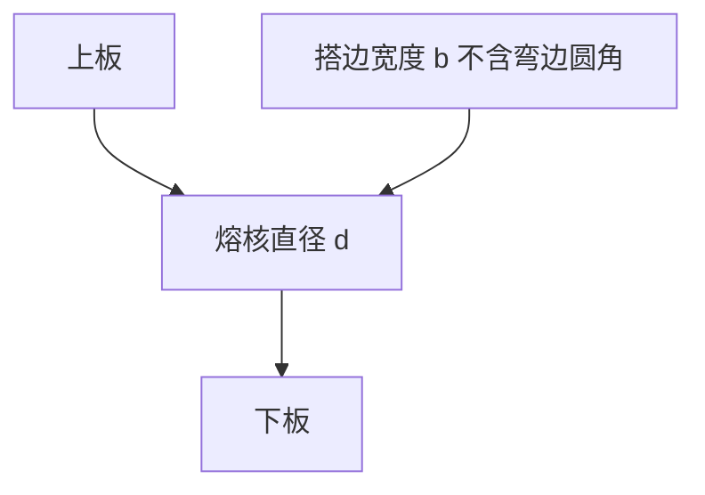

# 电阻点焊：按薄件厚度选熔核直径、搭边宽度与最小点距

> [!summary] 一句话概述
> 电阻点焊在搭接板上熔化出一个熔核，把两层板连在一起；设计时先按较薄一件的厚度选熔核直径，再定最小搭边宽度和点距，板厚比过大或多层板时还要把点距和搭边加大。

## 配图

![[附件/sheet-spotweld-mechtool.png]]
*图源：[机械设计实用手册，推荐点焊接头尺寸](https://www.mechtool.cn/boltsandnuts/boltsandnuts_recommendedtypesandsizesofweldgroove5.html) 页内插图；与该页点距、搭边表配合阅读。*

![[附件/sheet-spotweld-dhmyndt.png]]
*图源：[东禾米亚，汽车白车身电阻点焊焊接工艺规范——点焊篇](https://www.dhmyndt.com/index.php?c=show&id=6) 文内配图。*

> 图片版权归原作者所有，仅作个人学习收藏；出处见文末「来源与核实记录」。

## 结构原理

> 本节所有数字只写来源里给出的；来源没有就写「来源未给出」，不估算、不编造。

机械设计实用手册给出「推荐点焊接头尺寸」表，单位为 mm。设计入口是薄件厚度 δ，对应一个熔核直径 d，再按材料组别给出最小搭边宽度 b 和最小工艺点距。注中特别说明：b 是单排焊缝最小搭边宽度，不包括弯边圆角半径 r；点焊双排或连接 3 个以上零件时，搭接边应增加 25%～30%。两板板厚比大于 2 或连接 3 个以上零件时，点距应增加 10%～20%。

东禾米亚文从汽车白车身角度讨论点焊工艺规范。该页配图已保存；文中若有与手册冲突的经验数，本篇以已完整打开的手册表为准，不把未能逐句核定的汽车厂内部数写进参数表。

### 堆叠方案

方向：沿板厚方向穿过搭接区。

| 层级 | 零件 | 材料 | 厚度/尺寸 | 固定方式 | 依据 |
| --- | --- | --- | --- | --- | --- |
| L1 上板 | 搭接上板 | 钢或轻合金等 | 按较薄件选参数 | 熔核连接 | 手册 |
| L2 熔核 | 熔化后凝固的连接区 | 两板金属融合 | 直径 d 见下表 | 冶金结合 | 手册 |
| L3 下板 | 搭接下板 | 同上 | 板厚比大于 2 时点距要加大 | 熔核连接 | 手册注② |

剖面示意：

### 零件清单

| 零件 | 数量 | 功能 | 材料 | 依据 |
| --- | --- | --- | --- | --- |
| 搭接的两层或多层板 | 通常 2 层，也可 3 层以上 | 被焊件 | 见材料栏 | 手册注 |
| 熔核 | 每焊点 1 | 传递剪切和部分剥离 | 板材熔化凝固 | 手册 |

### 装配顺序

先保证搭边宽度和电极可达，再按点距排列焊点。多层或厚薄比大的接头，先按注增加搭边和点距。来源未给出电极压力和电流的通用公式，本篇不编造工艺规范。

### 受力与运动分析

- **受力路径**：搭接剪切经熔核传递；边距不足时熔核靠板边，容易撕裂。
- **运动关系**：焊后无相对运动。
- **失效风险**：点距过小分流、熔核过小强度不足、边距不够、板厚比过大造成熔核偏移。弯边圆角不能算进搭边宽度。

## 设计要点与参数

手册表（单位 mm；b 按轻合金 / 钢与钛合金分列，点距再按材料分列）。摘录常用薄件档：

| 薄件厚度 δ | 熔核直径 d | 搭边 b 轻合金 | 搭边 b 钢、钛合金 | 最小点距（低合金钢） | 最小点距（不锈钢/耐热钢/耐热合金） |
| --- | --- | --- | --- | --- | --- |
| 0.5 | 3.0+1 | 10 | 8 | 10 | 7 |
| 0.8 | 3.5+1 | 12 | 10 | 11 | 9 |
| 1.0 | 4.0+1 | 14 | 12 | 12 | 10 |
| 1.2 | 5.0+1 | 16 | 13 | 13 | 11 |
| 1.5 | 6.0+1 | 18 | 14 | 14 | 12 |
| 2.0 | 7.0+1.5 | 20 | 16 | 18 | 14 |
| 3.0 | 9.0+1.5 | 26 | 20 | 24 | 18 |

完整表还覆盖 0.3 mm 及 4～6 mm 等档，以及轻合金的点距列；设计较厚或轻合金件时应回到原表。双排或 3 件以上：搭边增加 25%～30%，点距在板厚比大于 2 或 3 件以上时增加 10%～20%。

## 优缺点

**优点**
- 不用添加材料，适合钢板上的大批量点连接
- 参数可以按薄件厚度列表选用，便于在图纸上标注点距和搭边

**缺点 / 代价**
- 需要双面电极接近，涂层和脏污影响质量
- 有热影响区和压痕，外观面要躲开或打磨
- 铝等轻合金的搭边和点距比钢更宽，不能直接套钢的数

## 可借鉴点

- 先锁定较薄一件的厚度，再查 d、b 和点距，不要按平均厚度选。
- 搭边从平直段算起，折弯圆角不算宽度。
- 多层或厚薄悬殊时，按注把搭边和点距加大，不要只加密焊点。
- 需要冷连接或镀层敏感时，对照无铆连接或自冲铆。

## 与库中相似案例对比

| 对比项 | 本案例（电阻点焊） | [[无铆连接（Clinching、TOX）：冲头与凹模把两层板挤压成机械互锁]] | [[自冲铆（SPR）：半空心铆钉刺入上层并在下层张开互锁，不必预冲孔]] |
| --- | --- | --- | --- |
| 结合方式 | 熔化形成熔核 | 冷挤互锁，无第三零件 | 铆钉机械互锁 |
| 热影响 | 有 | 无 | 无 |
| 何时用这篇 | 钢或钛合金等常规点焊搭接 | 涂层板冷连接 | 铝车身等要更高机械连接 |

## 相关案例

- [[无铆连接（Clinching、TOX）：冲头与凹模把两层板挤压成机械互锁]]
- [[自冲铆（SPR）：半空心铆钉刺入上层并在下层张开互锁，不必预冲孔]]
- [[凸焊螺母：在薄板上投影焊接螺纹，对照压铆螺母与攻丝]]
- 分类索引：[[02-连接与紧固 索引]]

## 来源与核实记录

- 主来源：[机械设计实用手册，《推荐点焊接头尺寸》](https://www.mechtool.cn/boltsandnuts/boltsandnuts_recommendedtypesandsizesofweldgroove5.html)（2026-11-27 打开并下载插图。δ、d、b、点距及两条注释来自该页。二级分类在库内原表无「点焊」项，本篇暂挂在 02-连接与紧固，用标签标明电阻点焊。）
- 交叉来源：[东禾米亚，《汽车白车身电阻点焊焊接工艺规范——点焊篇》](https://www.dhmyndt.com/index.php?c=show&id=6)（2026-11-27 打开并下载配图。用作汽车点焊场景的独立机构交叉来源。未把该页未逐字核定的工艺窗口写进参数表。）
- 核实：2026-11-27 打开上述来源。未直接引用未能完整打开的 GB/T 43412 条文。
