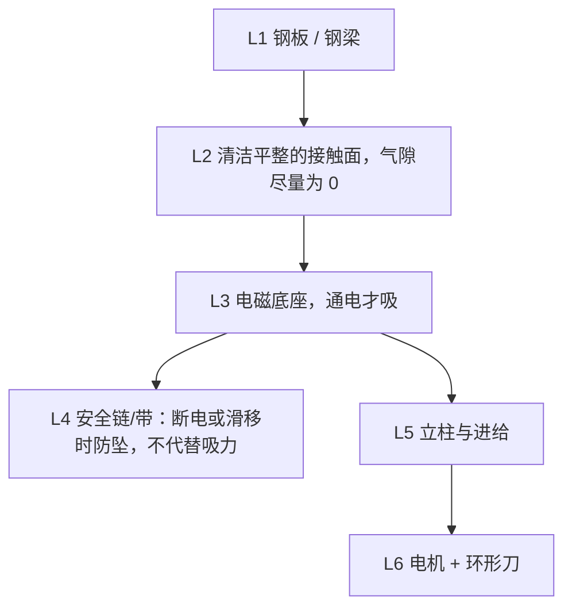

# 磁力钻座：电磁底座把钻机吸在钢板上再钻孔

> [!summary] 一句话概述
> 磁座钻用底座里的电磁铁把自己吸到钢梁或钢板上，再在现场钻孔：通电后面座才有吸力，钢板太薄、不平整或夹了油漆锈层都会让气隙变大、吸力变弱，钻孔的侧向力还可能让整机滑移。所以手册都要求先检查磁路（Hougen 用安全开关绿灯）、材料够厚，并另系安全链或安全带——安全带不能代替磁力，只是在断电或滑掉时不让机器砸下来。它和机床吸盘相反：这里是机器被吸到工件上，不是工件被吸到机床上。

## 配图

![[附件/steelmax-d1-design.png]]
*图源：[Steelmax D1 Operator’s Manual](https://www.steelmax.com/) 第 4 页 Figure 1；整机外形：下方是 electromagnetic base（电磁底座），底座上标有 opening for safety strap（安全带穿孔），上方为滑座、进给手轮、电机和环形刀刀杆。整机外廓约 330 × 300 × 179 mm*

![[附件/steelmax-d1-specs.png]]
*图源：同上手册第 3 页技术数据；电磁底座保持力 9000 N（表面厚度 22 mm、粗糙度 Ra=1.25 时），底座尺寸 80 mm × 160 mm × 38 mm，最小工件厚度 6 mm（0.23"）。正文写明安全带用于防止断电时机器坠落*

![[附件/hougen-hmd904-controls.png]]
*图源：[Hougen HMD904 Operator’s Manual OM904](https://www.hougen.com/) 第 5 页；控制面板把 MAGNET 开关和电机开关分开，并有安全开关指示灯。说明书写：材料必须至少 3/8" 厚，更薄会造成 weak magnet；灯为绿色才允许正常操作，红色可能是磁座下有切屑、表面不平或安全开关故障。并提示断电会让磁座失电，电机需在来电后重新启动*

> 图片版权归原作者所有，仅作个人学习收藏；出处见文末「来源与核实记录」。

## 结构原理

> 本节所有数字只写来源里给出的；来源没有就写「来源未给出」。

### 堆叠方案

方向：**从钢板工件向上到钻削主轴（便携磁座钻）**

| 层级 | 零件 | 材料 | 厚度/尺寸 | 固定方式 | 依据 |
| --- | --- | --- | --- | --- | --- |
| L1（最下，工件） | 钢梁、钢板等铁磁表面 | 钢铁；过薄或非磁材料不能作为唯一固定（Euroboor：非导磁材料要用真空吸盘等其它附件） | Steelmax：最小厚度 6 mm；Hougen：至少 3/8"（约合 9.5 mm，手册只写 3/8"，本文不另换算成精确工艺值来当另一规格）。两家下限不同，不能合成一个「行业标准」 | 被电磁底座吸附 | Steelmax 1.2；Hougen 第 5 页 |
| L2 | 接触面 / 气隙 | 平面应清洁；油漆、锈、弯曲会造成气隙 | Euroboor：从 6 mm 起、要求零气隙；弯曲、漆层和表面不平都会造成气隙，须尽量减小 | 贴合 | Euroboor；Hougen：切屑或不平会使安全灯变红 |
| L3 | 电磁底座 | 电磁铁 | Steelmax：80 × 160 × 38 mm；保持力 9000 N（在 22 mm、Ra=1.25 条件下） | 通电后吸在 L1 上；断电即失去该电磁吸力 | Steelmax；Hougen 称 Magnet (Electromagnet) |
| L4 | 安全链或安全带 | 例如 Hougen 随机件 10730 Safety chain；Steelmax 为 safety strap，底座有穿孔 | Hougen 零件表写 3/16 × 5' 带挂钩的安全链 | 把机体连到可靠结构上，不代替磁力 | Hougen；Steelmax；Euroboor 写 safety chain does not replace the magnetic force |
| L5 | 立柱、滑座与进给机构 | 来源未给出材料牌号 | Steelmax：滑座行程 70 mm | 装在底座上，手轮进给 | Steelmax Figure 1 |
| L6 | 电机与环形刀 / 钻头 | 来源未给出刀材 | Steelmax：最大钻孔直径 36 mm，最大深度 51 mm，刀柄 19 mm Weldon；电机功率 920 W，整机 1000 W | 主轴转动切削，轴向力经立柱回到底座 | Steelmax 1.1、1.2 |

剖面示意：

### 零件清单

| 零件 | 数量 | 功能 | 材料 | 依据 |
| --- | --- | --- | --- | --- |
| 电磁底座 | 1 | 把整机吸到工件上 | 电磁铁 | Hougen；Steelmax |
| 磁路/安全开关及指示灯 | 1 套（Hougen） | 检测磁座是否贴实，未贴实则限制电机 | 来源未给出 | Hougen 第 5 页：绿灯正常，红灯需排除切屑、不平或开关故障 |
| 安全链或安全带 | 1 | 断电或滑移时防止坠落或砸伤 | 链条或带子 | Hougen、Steelmax、Euroboor |
| 滑座、进给手轮、电机 | 各 1 | 钻孔进给与切削 | 来源未给出 | Steelmax Figure 1 |
| 环形刀与导向针 | 按孔径 | 套料钻孔；切屑/芯料排出 | 来源未给出 | Hougen、Steelmax 应用描述 |

Hougen HMD904 还有带冷却、带回转底座以及「Permanent Magnet」的变型（零件号 0904122 等）。本篇只写通电吸合的电磁底座这一主结构；永磁变型不展开成另一套参数。

### 装配顺序

1. 检查工件：材料够厚（Hougen ≥ 3/8"；Steelmax ≥ 6 mm），表面平整、无切屑、尽量去除漆锈（Euroboor 对 <6 mm 要求另加钢板加强）。
2. 把磁座放到钻孔位置附近，先接通电磁铁（Hougen：MAGNET 开关与电机开关分开；先吸合再启动电机）。
3. 确认磁路正常：Hougen 要求安全指示灯为绿色，并可通过翘起磁座看指示灯是否由绿变红来测试开关。
4. 系好安全链或安全带，连到可靠结构。Euroboor 特别强调在非水平面上必须使用所配安全链。
5. 装刀、对中、冷却（若有），再开电机、进给钻孔。卡钻时应先停电机，不要先关磁座（Euroboor 有类似提醒：突然制动时先关电钻开关，不要关磁力开关）。
6. 移位前停刀、关磁座，解开安全链后再搬动。Hougen 写来电后磁座会重新吸合，但电机 START 必须再按一次。

### 受力与运动分析

- **受力路径**：钻削轴向力和侧向力由主轴传到立柱，再传到电磁底座，最后靠底座与钢板之间的法向吸力以及由此产生的摩擦力来抵抗。Steelmax 把 9000 N 的保持力标注在 22 mm 厚、Ra=1.25 的表面上，说明这不是任意薄板、任意粗糙度下的保证值。侧向滑移是主要风险：进给过猛、刀钝、工件弯曲或气隙变大，摩擦力不够，整机就会在板面上滑动。Euroboor 把安全链的作用写成：并不能代替磁力，只保护操作者在机器滑移时不被伤害。
- **运动关系**：底座在吸合后应相对工件静止。滑座沿立柱上下进给，主轴旋转。磁座本身在通电前后有「吸/放」两个状态，没有像电永磁那样的停电保持。
- **失效风险**：断电或插头脱落，电磁吸力消失，机器可能坠落——这是必须另系安全带的原因（Steelmax 原文：A safety strap protects the machine from dropping in case of a power loss）。薄板、漆层、锈、切屑、不平都会造成 weak magnet（Hougen、Euroboor）。在立面或仰面钻孔时，滑移和坠落后果更严重。把磁座钻当成机床吸盘反过来用（想吸住工件）是错误场景。

## 设计要点与参数

| 要点 | 内容 | 依据 |
| --- | --- | --- |
| 谁被吸住 | 机器被吸到工件上，再钻孔 | Steelmax 1.1；Hougen 用途 |
| 磁路类型 | 通电电磁铁；断电失磁（本篇主角）。Hougen 另有永磁变型，不混用参数 | Hougen；Steelmax |
| 最小厚度 | Hougen：至少 3/8"，更薄为 weak magnet。Steelmax / Euroboor：最小 6 mm；Euroboor 对更薄件要求加垫板 | 各手册原文，不合并 |
| 保持力示例 | Steelmax D1：9000 N（22 mm 厚、Ra=1.25） | Steelmax 1.2 |
| 底座尺寸示例 | Steelmax D1：80 × 160 × 38 mm | Steelmax 1.2 |
| 安全开关 | Hougen：检测磁座是否贴实，绿灯才正常，红灯查切屑、不平或开关故障 | Hougen 第 5 页 |
| 安全链/带 | 必须使用；不能代替磁力，用于断电或滑移保护 | Hougen；Steelmax；Euroboor |
| 气隙 | 须尽量为 0；漆、锈、弯曲都会造成气隙并降低吸力 | Euroboor；Hougen |
| 线圈匝数、磁极形状 | 来源未给出 | — |

## 优缺点

**优点**
- 可以把钻削力传到已有钢结构上，不必把大件搬上摇臂钻。
- 电磁底座可以关掉后再挪位，现场移动比永磁吊具更灵活。
- 安全开关（Hougen）能在磁路不可靠时限制启动，比只靠操作者手感更安全。

**缺点 / 代价**
- 依赖连续供电，断电即失磁，必须有第二道防坠。
- 吸力强烈依赖板厚、平面度和气隙，手册中的保持力只在给定试片条件下成立。
- 钻孔侧向力会造成滑移，安全链并不能让孔还打在原位，只能降低伤人风险。
- 不适用于非磁材料或过薄板（除非加垫板或改用其它固定）。

## 可借鉴点

- 先写清「谁吸谁」：吸盘是吸工件，磁座钻是吸机器。对比表里把方向写反就会用错安全策略。
- 电磁方案必须同时设计断电失效：安全链、防坠点、以及「先关刀再关磁」。
- 把板厚、平面度、清洁和气隙写成启动联锁条件，不要只给一个实验室保持力。
- 安全链的说明书用语很重要：它不增加钻削刚度，只防止坠落或甩出。
- 磁路指示灯（绿/红）是低成本的「是否贴实」反馈，适合脏、弯、带漆的现场钢材。

## 与库中相似案例对比

| 对比项 | 本案例（磁座钻电磁底座） | [[机床电永磁吸盘：脉冲充磁后停电仍保持夹紧]] | [[电磁门锁（磁力锁）：通电线圈吸合衔铁，断电释放]] | [[橱柜磁吸门吸：只有磁力保持、没有机械锁死（对照 FIDLOCK）]] |
| --- | --- | --- | --- | --- |
| 谁被吸住 | 机器吸到工件上 | 工件吸到机床上 | 门扇衔铁吸到锁体 | 门吸到柜体 |
| 停电后 | 失磁，须靠安全链防坠 | 仍夹紧 | 典型释放（疏散） | 仍吸住 |
| 主要风险 | 侧向滑移与坠落 | 退磁误操作或接触不良 | 气隙和断电离门 | 保持力不足 |
| 何时用这篇 | 现场把钻机吸到钢梁上钻孔 | 机床上夹工件 | 门禁电控锁 | 柜门轻保持 |

## 相关案例

- [[机床电永磁吸盘：脉冲充磁后停电仍保持夹紧]]
- [[电磁门锁（磁力锁）：通电线圈吸合衔铁，断电释放]]
- [[橱柜磁吸门吸：只有磁力保持、没有机械锁死（对照 FIDLOCK）]]
- [[KTR MINEX-S 磁力联轴器：隔离套两侧磁转子无接触传扭]]
- 分类索引：[[02-连接与紧固 索引]]

## 来源与核实记录

- 主来源：[Hougen HMD904 Series Portable Magnetic Drill Operator’s Manual OM904](https://www.hougen.com/)（本轮重新打开已下载 PDF。电磁底座、安全开关指示灯、3/8" 最小厚度、安全链、断电失磁后电机须重按启动，均来自该手册。Hougen 官网域名用于标明机构）
- 交叉来源：[Steelmax D1 Drilling Machine with Electromagnetic Base Operator’s Manual](https://www.steelmax.com/)（本轮重新打开已下载 PDF。独立第二机构。9000 N 保持力及测试条件、底座尺寸、最小厚度 6 mm、断电防坠安全带、整机设计图，均来自该手册）
- 同结构补充：[Euroboor ECO.200S/T User manual V1.5 EN，October 2024](https://www.euroboor.com/)（已打开手册中关于 6 mm、零气隙、漆锈造成气隙、小于 6 mm 须加垫板、安全链不能代替磁力的表述，用于互证滑移与气隙风险，不另开篇）
- 核实：未把电永磁吸盘或门吸写成同一篇。未使用面向协作机器人的 Magswitch cobot MagBase 手册冒充钻座。
