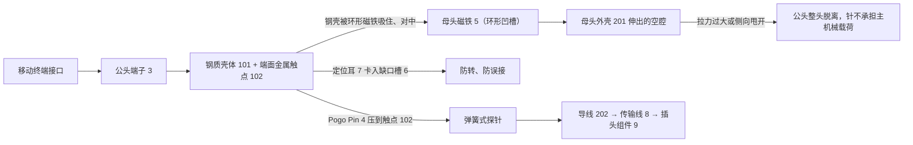

# 磁吸充电线接头：钢壳与环形磁铁对中，弹簧顶针导电，定位耳防误接

> [!summary] 一句话概述
> 通用磁吸充电线把「对中保持」和「导电」分成两件事：母头连接块的环形凹槽里放磁铁，公头用钢质外壳被这块磁铁吸住并伸进母头空腔；导电则由母头上的 Pogo Pin 弹簧探针压到公头端面的金属触点上完成。定位耳卡进外壳缺口槽，用来防插反、也限制公头转动。它解决的是可分离、可换端子的有线充电接头，不是 iPhone MagSafe 那种环形磁铁给无线线圈对中，也不是把弹簧顶针元件本身的内部结构再写一遍。需要防水时，厂商是在这套磁吸对中之外再加密封圈或包胶，而不是靠磁铁来密封。

## 配图

![[附件/cn216929085-fig2-tips.jpg]]
*图源：[CN216929085U《一种磁吸数据线》](https://patents.google.com/patent/CN216929085U/zh) 说明书附图图 2（本轮从已下载 PDF 抽出）。线缆 8 一端是插头组件 9（图中为 USB-C 形态），另一端是磁吸母接头 2：端面可见弹簧式探针 4、供公头伸入的开口 5，以及与定位耳配合的缺口槽 6。旁边三只可换磁吸公接头 1，端子 3 分别为 Micro-USB、Lightning 和 USB-C，侧壁都带定位耳 7，耳上的孔连着挂绳 10。*

![[附件/cn216929085-fig4-section.jpg]]
*图源：同上图 4，沿图 1 中 A–A 线的剖视。左侧公接头：钢质壳体 101 内是端子 3 及其金属触点 102。右侧母接头：外壳 201 套在连接块 203 上，并向前伸出一截形成空腔；连接块端面上的环形凹槽里是磁铁 5，弹簧式探针 4 对准公头触点；导线 202 把探针接到传输线 8。对合后，钢壳 101 与磁铁 5 磁力连接，探针被压到触点上。*

![[附件/sunmon-magnetic-pogo-faces.jpg]]
*图源：[双盟电子，《pogopin磁吸线拆解磁铁塑胶加线材3D图》](https://www.sunmontech.cn/article/3036.html) 页面产品照片（本轮裁切自该页配图，不是 CN216929085U 的同一只接头）。上图为线端接头端面：左右两块圆形磁铁，中间一排弹簧顶针。下图为线端与板端（或对配头）分开后的对应关系，对配面上同样是两端磁铁、中间触点。用来对照「磁铁在两侧、针在中间」这种常见端面布置，与专利里「环形磁铁 + 钢壳」不是同一套零件。该文宣称其磁吸线可带防水防尘、防水等级 IP67。*

> 图片版权归原作者所有，仅作个人学习收藏；出处见文末「来源与核实记录」。

## 结构原理

> 本节所有数字只写来源里给出的；来源没有就写「来源未给出」。CN216929085U 是结构主线；川富、双盟只补充行业上的电流、吸附力和防水做法，不要把三家写成同一只接头的零件表。弹簧顶针内部的针头、弹簧、针管行程见库内专篇，本篇只把它当作被磁铁压到触点上的导电零件。

### 堆叠方案

方向：**从设备侧端子到充电插头，沿磁吸对合轴线**（以 CN216929085U 图 4 剖面为主）

| 层级 | 零件 | 材料 | 厚度/尺寸 | 固定方式 | 依据 |
| --- | --- | --- | --- | --- | --- |
| L1（设备侧） | 端子 3：Micro-USB-B、Lightning 或 USB-C | 来源未给出牌号 | 来源未给出 | 做在可换磁吸公接头 1 的一端，插入移动终端 | 权利要求 1、6；图 2、图 3 |
| L2 | 公接头钢质壳体 101，端面为金属触点 102 | 壳体为钢；触点为金属，牌号来源未给出 | 来源未给出外径或触点间距 | 触点与端子电连接；壳体作为被磁铁吸引的衔铁 | 权利要求 3；说明书 [0010]；图 4 |
| L3 | 定位耳 7 + 母头外壳缺口槽 6 | 来源未给出 | 定位耳上的固定孔到公头外侧壁的距离大于母头外壳厚度，以便挂绳仍露在外壳外 | 公头伸入母头空腔时，定位耳卡进缺口槽，限制转动并指示方向 | 权利要求 1、2；[0007][0009] |
| L4（对合面） | 母头磁铁 5，位于连接块 203 端面的环形凹槽内 | 磁铁牌号来源未给出 | 来源未给出环的内外径和吸力。川富对同类磁吸线给出的吸附力范围是 150 g–3000 g，不是本专利的测定值 | 对合时钢质壳体 101 与磁铁 5 磁力连接，把公头保持在空腔内 | 权利要求 3；[0010]；川富产品页 |
| L5 | 弹簧式探针 4（Pogo Pin） | 来源未给出针管 / 弹簧牌号 | 来源未给出针径、行程或弹力。示例型号 CXA-0129 为 5 V、2 A（川富）；川富还写定制电流可达 ≤40 A、电压 ≤220 V，属于其产品能力范围，不是本专利接头的额定值 | 装在连接块 203 端面，与公头金属触点 102 一一对应；导线 202 接到传输线 8 | 权利要求 3–5；川富 CXA-0129 |
| L6 | 外壳 201 + 连接块 203 | 来源未给出塑料或金属牌号 | 外壳延伸到探针所在端面以外，形成供公头伸入的空腔 | 外壳套在连接块上 | 权利要求 3；图 4 |
| L7 | 传输线 8 与插头组件 9 | 线材牌号在本专利中未给出；川富列出 PVC / TPE / TPU / 硅胶 / PP 带等可选 | 来源未给出线长、线径 | 线的一端伸进连接块与探针相连，另一端接插头组件 | 权利要求 1、4；图 1、图 2 |
| L8（可选） | 挂绳 10 | 来源未给出 | 来源未给出长度 | 一端穿过定位耳固定孔，另一端连在传输线上，防止公头丢失，拆时也可借绳加力 | 权利要求 2；[0009] |

防水变体（来自厂商说明，不是 CN216929085U 的必要结构）：

- 川富：母端定位 / 密封方式可选用凹凸槽、密封圈、卡位锁扣、定位耳、定位柱或模内注塑成型；防水等级可达 IP68。
- 双盟：该文称其磁吸线带防水及防尘，防水等级 IP67，并强调装配气密性，否则可能造成性能不稳、卡针或烧弹簧。
- 拓普联科产品页本轮也已打开，写过「增加密封圈」和 IP67 以上，但与川富同属连接器厂商的概述，本篇不以它为第三结构来源展开，只在核实记录中注明。

剖面示意：

和已有两篇的分工：

- 本篇主角是「磁铁（或钢壳衔铁）负责对中与保持、定位耳负责方向、顶针只负责导电」。
- [[Pogo Pin 弹簧顶针：针头、弹簧与针管的工作行程和弹力]] 讲顶针三件套本身，不负责整头磁路和防呆。
- [[MagSafe 1-2 笔记本磁吸充电头：磁力保持触点对中，拉力过大时整头脱落]] 是笔记本专用充电头，插座做在电脑上，不是这种「可换端子留在设备里、线端母头来吸」的通用磁吸线，更不是 iPhone 环形无线充磁铁。

### 零件清单

| 零件 | 数量 | 功能 | 材料 | 依据 |
| --- | --- | --- | --- | --- |
| 磁吸公接头 1 | 2–3 个（专利：各端子类型不同） | 一端插设备，另一端被母头吸住 | 钢质壳体 + 端子 + 金属触点 | 权利要求 1、3、6 |
| 端子 3 | 每只公头 1 | 接入 Micro-USB-B、Lightning 或 USB-C 设备 | 来源未给出 | 权利要求 6 |
| 金属触点 102 | 若干，与端子电连接 | 给母头探针提供平面或凹坑接触面 | 金属，牌号来源未给出 | 权利要求 3 |
| 定位耳 7 | 每只公头至少 1 | 对方向、限转动，并可穿挂绳 | 来源未给出 | 权利要求 1、2 |
| 磁吸母接头 2 | 1 | 线端的磁吸与导电座 | 外壳 + 连接块 + 磁铁 + 探针 | 权利要求 1、3 |
| 磁铁 5 | 1（环形，位于凹槽内） | 吸引公头钢壳，对中并保持 | 来源未给出牌号 | 权利要求 3 |
| 弹簧式探针 4 | 若干，与触点对应 | 弹性导电 | Pogo Pin | 权利要求 3、5 |
| 外壳 201 | 1 | 形成供公头伸入的空腔，并开缺口槽 6 | 来源未给出 | 权利要求 1、3 |
| 传输线 8、插头组件 9 | 各 1 | 把母头接到充电器或主机 | 线材牌号专利未给 | 权利要求 1 |
| 挂绳 10 | 可选 | 防丢、辅助分离 | 来源未给出 | 权利要求 2 |
| 密封圈等防水件 | 视产品而定 | 提高防护等级 | 川富列出密封圈、包胶成型等 | 川富产品页；非本专利必要件 |

### 装配顺序

按专利说明书的组成关系（不是拆解反推）：

1. 把磁铁 5 放入连接块 203 端面的环形凹槽，将弹簧式探针 4 装到与触点对应的位置。
2. 把外壳 201 套到连接块上，使外壳前沿超出探针端面，形成空腔，并在外壳上留出与定位耳对应的缺口槽 6。
3. 将传输线 8 伸进连接块，用导线 202 接到各探针；线的另一端做好插头组件 9。
4. 公接头按目标设备分别做成 Micro-USB-B、Lightning 或 USB-C 端子，端面做出金属触点，壳体用钢，侧壁做出定位耳；需要时把挂绳穿过定位耳固定孔并连到传输线上。
5. 使用时，先把选定的公头插进设备并可以长期留在设备上；充电时把母头空腔对准公头，靠钢壳与环形磁铁吸合，定位耳落入缺口槽，探针压到触点上。
6. 分离时沿轴向拉开（或借助挂绳加力），整头脱离。换另一种设备时只换公头，不必换线。

> 双盟文提醒：装配气密性和零件精度不够时，可能出现性能不稳、卡针或烧弹簧，这是工艺问题，不是把顶针内部尺寸当作本篇设计对象。

### 受力与运动分析

- **受力路径**：线被绊到或插头被拉时，外力先到母头外壳和公头钢壳，由环形磁铁与钢壳之间的吸力（以及空腔、定位耳对侧向、转动的限制）来决定是否整头脱落。探针只在对合后被压缩，提供接触压力，不应当成主承力件。川富给出的同类产品吸附力范围是 150 g–3000 g，专利本身没有测这只接头的吸力。
- **运动关系**：公头沿空腔轴线伸入并被吸住，定位耳落入缺口槽后，绕轴转动被限制，从而避免正负极接反。分离是克服磁力沿轴向退出。专利没有写必须先侧向滑开。可换公头相对母头是可拆的；公头相对设备则是常规插接，不是磁吸。
- **失效风险**：专利要解决的正是「磁吸头换向时容易误接」。若没有定位耳或缺口槽被损坏，仍可能插反（推断）。磁力过大则难以单手分离，过小则线一甩就掉，吸附力要按设备重量和线材使用场景选（川富给出范围，未给选用公式）。双盟指出气密不良会卡针、烧弹簧。密封圈或包胶如果压缩不够或偏心，防护等级就达不到宣称的 IP67 / IP68（推断，须按厂商测试方法验证）。不要把本结构的外露触点当成无线充电，触点进水后的短路风险要靠密封和电路保护，不是靠磁铁。

## 设计要点与参数

| 要点 | 内容 | 依据 |
| --- | --- | --- |
| 磁路分工 | 母头环形磁铁吸引公头钢壳，公头不必再内置一块对吸磁铁；钢壳同时做结构和衔铁 | CN216929085U 权利要求 3、[0010] |
| 导电分工 | 母头 Pogo Pin 压到公头金属触点；专利直接写明探针为 Pogo Pin，但未给针径、行程、弹力 | 权利要求 3、5 |
| 防呆与防转 | 定位耳 + 缺口槽：既指示方向防止正负极接反，又限制公头偏转 | 权利要求 1；[0007] |
| 空腔导向 | 母头外壳伸出探针端面以外，公头先进入空腔再被吸住、压针，减少刚接触时的侧向错位 | 权利要求 3；图 4 |
| 可换端子 | 一只母头配 2–3 只不同类型公头：Micro-USB-B、Lightning、USB-C | 权利要求 6 |
| 挂绳 | 定位耳固定孔到公头外侧壁的距离大于母头外壳厚度，挂绳不会被外壳挡住；既防丢，也可借力分离 | 权利要求 2；[0009] |
| 示例电气规格 | 川富示例型号 CXA-0129：5 V、2 A。同页还给出定制范围：电压 ≤220 V，电流 ≤40 A，吸附力 150 g–3000 g，连接角度 90° / 180° 或其他 | 川富产品页；不要写成 CN216929085U 的额定值 |
| 防水 | 川富：可达 IP68，母端可用密封圈或模内注塑等。双盟：该文产品宣称 IP67，并强调装配气密。CN216929085U 未把密封圈写成必要特征 | 川富、双盟；与专利分开记录 |
| 寿命 | 川富页未在已核对正文里给出本型号的插拔次数。双盟文也未给出可引用的循环次数。来源未给出本专利接头的寿命 | 已打开文本 |
| 顶针内部尺寸 | 来源未给出，也不在本篇展开 | 对照库内 Pogo Pin 专篇 |

## 优缺点

**优点**
- 一根线配几只可换公头，就能给不同接口的设备充电，公头可以留在设备上，日常只吸母头。
- 磁铁管对中和保持，顶针管导电，职责清楚；拉力大时整头脱落，比较不容易把设备拽走或把针拗断。
- 定位耳同时解决防呆和防转，比只靠磁铁极性防反更直观。
- 母头用环形磁铁 + 公头钢壳，公头可以做得比较短，不必两边都装磁铁。
- 需要防水时，可以在对合面或壳体上另加密封圈、包胶，做成穿戴或户外用变体，而不必改磁路原理。

**缺点 / 代价**
- 公头长期留在设备里，会改变设备口部的外形和防水原状；原接口的密封不能再被当成完整的。
- 外露触点和顶针怕脏、怕水，没有密封圈的消费线不能按 IP67 / IP68 来用。
- 吸附力要在「掉不下来」和「绊一下就能脱」之间折中，专利没有给出选用值。
- 不同厂家的针数、磁铁布置和防呆几何并不通用，不能把双盟那种「两端圆磁铁、中间一排针」和本专利的环形磁铁钢壳当成可以混插的同一接口。
- 它仍然是有线触点充电，不要和 iPhone MagSafe 圆环无线充写成同一种结构。

## 可借鉴点

- 设计磁吸充电接头时，先画清三条路径：磁路（谁吸谁、如何对中）、电路（哪一侧出针、哪一侧是平面触点）、机械防呆（耳、槽、不对称外形）。不要指望磁铁单独完成防反。
- 一侧用钢壳或衔铁、一侧用环形磁铁，可以减少公头里的零件，也便于把磁铁藏进母头连接块的凹槽。
- 母头外壳向前伸出一截做成导向空腔，让公头先进入再压针，有利于保护探针，也让磁铁在接近时把钢壳拉正。
- 可换公头如果用挂绳，要把穿孔做到外壳之外，否则母头一吸合就把绳夹住。
- 做防水款时，密封圈或包胶是单独的结构层，压缩量和密封面要单独验，不能用「吸得很牢」代替 IP 测试。
- 顶针的行程和弹力回到 Pogo Pin 专篇去选，本篇只检查：对合后针是否被压在工作行程内、磁吸力是否大于针的总反力、分离时针会不会被拉出。

## 与库中相似案例对比

| 对比项 | 本案例（通用磁吸充电线接头） | [[MagSafe 1-2 笔记本磁吸充电头：磁力保持触点对中，拉力过大时整头脱落]] | [[Pogo Pin 弹簧顶针：针头、弹簧与针管的工作行程和弹力]] | [[iPhone MagSafe 环形磁铁阵列：18 颗磁铁把线圈对中并对附件保持]] |
| --- | --- | --- | --- | --- |
| 磁铁布局 | 母头环形磁铁吸公头钢壳；常见变体是端面两侧各一块圆磁铁 | 插头与电脑插座上的磁元件对吸，电脑侧可以是强磁、插头侧可以是衔铁 | 顶针内部通常无磁铁 | 手机背面 18 颗磁铁排成环，给线圈和附件对中 |
| 导电方式 | 外露 Pogo Pin 压到公头金属触点，是有线触点充电 | 同样是弹簧顶针压到插座平面触点，但是笔记本专用头 | 只讨论单根顶针的弹力和行程 | 无线电感耦合，不是这组外露顶针 |
| 防呆 | 定位耳 + 缺口槽；可换公头留在设备上 | 五针左右对称，正反都能插；靠 1-Wire 识别 | 与整头防呆无关 | 圆环对中，不是插针防呆 |
| 何时用这篇 | 要做可换端子的通用磁吸线，或穿戴 / 户外设备的磁吸 Pogo 座，并考虑密封圈防水 | 要做笔记本电源的安全分离充电头 | 要设计或选型弹簧顶针本身 | 要做手机无线充对中环，不要和本篇混写 |

## 相关案例

- [[MagSafe 1-2 笔记本磁吸充电头：磁力保持触点对中，拉力过大时整头脱落]]
- [[Pogo Pin 弹簧顶针：针头、弹簧与针管的工作行程和弹力]]
- [[iPhone MagSafe 环形磁铁阵列：18 颗磁铁把线圈对中并对附件保持]]
- [[Apple Watch 磁吸充电盘：中心单颗磁铁对位与电感耦合（对照手机环形阵列）]]
- [[任天堂 Switch 2 Joy-Con 2 磁吸连接]]
- 分类索引：[[02-连接与紧固 索引]]

## 来源与核实记录

- 主来源：[CN216929085U，一种磁吸数据线，发明人邓金环，授权公告日 2022-07-08](https://patents.google.com/patent/CN216929085U/zh)（2026-11-26 打开 Google Patents 中文页并下载 7 页 PDF，抽出图 1、图 2、图 4。钢质公头壳体、环形磁铁、Pogo Pin、定位耳与缺口槽、可换端子和挂绳均来自该专利。页上记载过专利权人变更，本文只把专利文本当结构来源，不把权利人沿革写成某个消费品牌的官方拆解。）
- 交叉来源：[东莞市川富电子有限公司，《磁吸线是什么》，示例型号 CXA-0129](https://www.pogopin.com.cn/ledsdtctcdx/cxxssm.html)（2026-11-26 打开。独立第二机构。用于核对 5 V / 2 A 示例、吸附力 150 g–3000 g、防水可达 IP68，以及母端可采用密封圈、模内注塑等做法。这些是厂商产品能力，不是 CN216929085U 的额定值。）
- 交叉来源：[东莞市双盟电子有限公司，《pogopin磁吸线拆解磁铁塑胶加线材3D图》，2023-01-03](https://www.sunmontech.cn/article/3036.html)（2026-11-26 打开并下载页面配图。独立第三机构。文中把磁吸线拆成磁铁定位 + 塑胶 + 线材 + Pogo Pin，宣称 IP67，并提醒气密不良会卡针、烧弹簧。配图用于展示「两端圆磁铁、中间一排针」的常见端面，已注明与专利环形磁铁不是同一套零件。该页所谓 3D 拆解图在已下载配图中主要为产品照片与宣传拼图，未把未出现的爆炸图写成已核对。）
- 核实：2026-11-26 另打开过拓普联科《磁吸式充电线》页，见到「塑胶内外壳 + Pogo Pin + 线缆 + USB/Type-C」、寿命 10,000 次以上、IP67 以上、电流 1 A–10 A 以及「增加密封圈」等表述；因与川富同属概述性厂商页，正文不以它为参数主依据。该页另有一处「磁铁附着力 ≥50 t」的表述单位明显异常，未写入参数表。未把本篇写成 iPhone MagSafe 圆环，也未复述顶针内部尺寸。永探电子结构页本轮返回 404，不引用。
