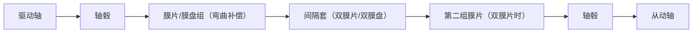

# 膜片（膜盘）式弹性联轴器：扭矩走膜片平面，两半轴毂夹住金属膜片组来补偿不对中

> [!summary] 一句话概述
> 膜片（膜盘）式弹性联轴器把一片或一组薄金属膜片夹在两半轴毂之间：扭矩在膜片平面内传递，轴间的偏角、偏心和轴向窜动则靠膜片的弯曲来吸收。它和螺旋切口联轴器都是零背隙的金属弹性联轴器，但弹性件是独立的膜片组，不是在圆棒上切出来的连续螺旋梁。

## 配图

![[附件/misumi-scpw-structure.jpg]]
*图源：[米思米 FA 目录 2018 年版第 795 页](https://www.misumi.com.cn/pdf/fa/2018/p795.pdf)；左侧为 SCPW 双膜片夹持型实物，右侧剖面标出两半轴毂、中间两个膜片和间隔段。材料栏：主体铝合金阳极氧化，膜片不锈钢，螺栓 SCM435。尺寸表示例：SCPW34 外径 D=34 mm，全长 L=35 mm，夹紧螺栓 M3，紧固扭矩 1.5 N·m*

![[附件/misumi-scpw-specs.jpg]]
*图源：同上第 795 页特性值表；SCPW16～55 的容许扭矩、容许偏角、容许偏心、静态扭转刚度、最高转速 10000 r/min、容许轴向振幅与补偿系数 1.5。注记：偏心、偏角、轴向振幅均为单项容许值，若同时出现多种偏差，则各种偏差的容许值减小为原来的 1/2*

![[附件/ktr-radex-n-discpack.jpg]]
*图源：[KTR RADEX-N Steel disc coupling 样本（Galco 转载目录页）](https://pim.galco.com/Manufacturer/KTR/TechDocument/Catalog%20Page/radex-n_cp.pdf) 第 103 页；上为带间隔套的双膜盘组实物，中为 6 孔膜盘的有限元图，下为螺栓、膜盘组、间隔套与轴毂的剖视。正文写明膜盘由不锈钢弹簧钢多层叠成，有 4、6、8 孔三种，肩轴螺栓预紧使扭转刚度提高 30%*

> 图片版权归原作者所有，仅作个人学习收藏；出处见文末「来源与核实记录」。

## 结构原理

> 本节所有数字只写来源里给出的；来源没有就写「来源未给出」。

### 堆叠方案

方向：**沿轴线从驱动轴毂到从动轴毂（弹性件是夹在中间的膜片/膜盘组）**

| 层级 | 零件 | 材料 | 厚度/尺寸 | 固定方式 | 依据 |
| --- | --- | --- | --- | --- | --- |
| L1（驱动端） | 夹持型或法兰型轴毂 | SCPW：铝合金阳极氧化；RADEX-N：钢合金（牌号来源未给出） | SCPW 按规格号给外径 D 与全长 L，例如 SCPW34：D=34 mm，L=35 mm | 轴毂与轴用夹紧螺栓（SCPW）或多种轮毂安装方式（KTR） | 米思米第 795 页材料与尺寸表；KTR 第 103 页 |
| L2 | 金属膜片或叠层膜盘组 | SCPW：不锈钢膜片；RADEX-N：不锈钢弹簧钢多层膜盘，4/6/8 孔 | 单片厚度来源未给出 | 用螺栓夹紧在轴毂（及间隔套）之间；KTR 用预先装配的肩轴螺栓给膜盘预紧 | 同上 |
| L3 | 双膜片/双膜盘时的中间间隔套（spacer） | 来源未给出间隔套牌号 | 间隔长度随型号与轴间距（DBSE）而变；KTR 提供多种间隔 | 与膜盘同组螺栓固定 | KTR 剖视与正文「spacer combinations」 |
| L4（从动端） | 另一半轴毂 | 同 L1 | 同系列对称或按轴间距选双膜盘布置 | 同 L1 | 同上 |

剖面示意（文字）：单膜片型只有一组膜片直接连两半轴毂，轴向短，但米思米写「结构上不允许偏心」。双膜片（SCPW）或双膜盘带间隔套（RADEX-N 的 NANA 等型）相当于把两个弯曲铰用中间刚体串起来，因而可以同时吸收偏角和偏心。扭矩在膜片平面内以拉压方式走，垂直于平面的弯曲则用来补偿不对中——这与螺旋槽连续梁的弯曲/扭转是两条完全不同的传力路径。

### 零件清单

| 零件 | 数量 | 功能 | 材料 | 依据 |
| --- | --- | --- | --- | --- |
| 轴毂 | 2 | 与轴连接并夹持膜片 | SCPW 铝合金；RADEX-N 钢 | 两家材料栏 |
| 膜片或膜盘组 | 单膜片 1 组；SCPW 双膜片 2 片；RADEX-N 按型式为 1 或 2 组叠层膜盘 | 平面内传扭，弯曲补偿偏差 | 不锈钢（米思米）；不锈钢弹簧钢叠层（KTR） | 第 795 页；KTR「Disc Design」 |
| 间隔套 | 双膜片/双膜盘时 1 件 | 把两组膜片隔开，形成可补偿偏心的几何 | 来源未给出牌号 | KTR 剖视 |
| 夹紧/膜盘螺栓 | 按规格 | 夹紧轴或预紧膜盘 | SCPW：SCM435；KTR：高规格肩轴螺栓（具体牌号来源未给出） | 第 795 页；KTR 正文 |

### 装配顺序

1. 先把两半轴毂分别装到两根轴上（或按 KTR 说明书先装膜盘组再对中）。米思米夹持型用表中的紧固扭矩拧夹紧螺栓，例如 SCPW34 为 M3、1.5 N·m。
2. 双膜片/双膜盘：把膜片组与间隔套对正，用膜盘螺栓按规定预紧。KTR 写其预装配膜盘组和肩轴螺栓会在膜盘上产生预紧，使扭转刚度提高 30%，并减小间隔套窜动。
3. 调整两轴，使偏心、偏角、轴向窜动不超过该规格的容许值。米思米注明这些是单项容许值，同时出现时各减为 1/2。KTR 同样写明各向偏差不得同时用到最大值，同时出现时必须降低。
4. 米思米 2868：单膜片型全长较短，但结构上不允许偏心，只适用于空间窄且定心特别小心的场合；双膜片可吸收偏角和偏心，代价是全长变长。

### 受力与运动分析

- **受力路径**：扭矩经轴毂和螺栓进入膜片平面，膜片在自身平面内主要受拉压，因而扭转刚度可以做高（SCPW 称为高刚性、适用伺服马达）。不对中时膜片垂直于平面弯曲。KTR 还强调毂与膜盘的连接质量决定整体性能。
- **运动关系**：没有滑动摩擦副，两家都按零背隙、无需润滑来介绍。双膜片相当于两个弯曲铰加中间刚体，偏心可以转化成两膜片各自的角变形；单膜片缺少这一层几何，故不能补偿偏心（米思米 2868）。
- **失效风险**：同时用满三项偏差会加速膜片疲劳（两家都要求折减）。夹紧扭矩不足则轴在毂内打滑；米思米另有「轴滑移扭矩」概念，当轴滑移扭矩小于容许扭矩时，要按轴滑移扭矩使用。KTR 用于爆炸性环境时，要求峰值扭矩相对额定扭矩及摩擦扭矩有安全系数 s=2。

## 设计要点与参数

| 要点 | 内容 | 依据 |
| --- | --- | --- |
| SCPW 容许扭矩（N·m） | 16：0.5；21：1.2；28：1.6；34：4.0；46：10.0；55：25.0 | 米思米第 795 页特性值表 |
| SCPW 容许偏角（°） | 16/21：1.0；28：1.2；34/46/55：1.5 | 同上 |
| SCPW 容许偏心（mm） | 16/21：0.10；28：0.15；34：0.20；46/55：0.25 | 同上 |
| SCPW 容许轴向振幅（mm） | 16～34：±0.20；46/55：±0.30 | 同上 |
| SCPW 静态扭转刚度（N·m/rad，最大轴径时） | 16：500；21：800；28：3000；34：4800；46：11500；55：19000 | 同上 |
| SCPW 最高转速与补偿系数 | 全系列最高转速 10000 r/min；补偿系数 1.5 | 同上 |
| 同时偏差 | 偏心、偏角、轴向均为单项值，同时出现时各减为原来的 1/2 | 第 795 页注记 |
| 单膜片 vs 双膜片 | 双膜片可吸收偏角和偏心但全长更长；单膜片较短，结构上不允许偏心 | 米思米 2868 Q7 |
| RADEX-N 膜盘构型 | 不锈钢弹簧钢多层；4 孔（尺寸 20–50）、6 孔（60–135 与 136–336）、8 孔（138–338） | KTR 第 105 页 |
| RADEX-N 许用角向（每片膜盘） | 尺寸 20–135：1.0°；136–246 等 6 孔大规格：0.7°；8 孔系列：0.5° | KTR 第 105 页表 |
| RADEX-N 轴向示例（尺寸 20） | NN：0.02 in；NANA1/NANA2/NNZ：0.05 in（表中径向列因摘录截断，未把看不清的末位数字写入） | KTR 第 105 页表及注 1 |
| RADEX-N 尺寸 20 的转速与刚度 | 最高转速 20,000 rpm；每组膜盘扭转刚度 0.1505×10⁶ lb-in/rad | KTR 第 106 页 |
| 膜片单片厚度 | 来源未给出 | — |

## 优缺点

**优点**
- 扭转刚度高、零背隙，适合伺服定位；米思米把它列为伺服马达用高刚性型。
- 弹性件和轴毂分开，膜片组可以按扭矩和轴间距选层数、孔数和间隔长度，不必重切一根棒。
- 双膜片布置能同时补偏心和偏角，传力路径清楚：平面内传扭，平面外弯曲补偿。

**缺点 / 代价**
- 零件比螺旋切口一体件多，装配要保证膜盘预紧和螺栓力矩。
- 单膜片不能补偏心，选短型时必须把定心做严。
- 单项偏差同时出现要折减，现场如果轴对中较差，实际可用范围比表列小。

## 可借鉴点

- 先决定要不要补偏心：要补就用双膜片（或双膜盘加间隔套），并接受全长增加；空间极窄且能保证定心，才考虑单膜片。
- 把「平面内传扭、平面外弯曲」写进校核：扭转刚度看膜片平面内的拉压，寿命看弯曲循环，不要用同一组数字既当刚度又当补偿能力。
- 样本上的偏心/偏角/轴向若标了「单项」或「不得同时用满」，图样和装配规程里要写折减规则（米思米是减半）。
- 膜盘螺栓的预紧不只是「别松」，KTR 把预紧和扭转刚度、间隔套窜动直接联系起来，应按原厂预装配或规定力矩来，不要随意换普通螺栓。

## 与库中相似案例对比

| 对比项 | 本案例（膜片/膜盘联轴器） | 本批螺旋切口联轴器 | 本批金属波纹管轴向补偿器 | [[恒扭力摩擦铰链：卡簧过盈产生扭力与「最低扭力 > 盖板力矩」选型]] |
| --- | --- | --- | --- | --- |
| 弹性件 | 独立膜片或叠层膜盘，夹在两半轴毂之间 | 棒料上的连续螺旋梁，与轴毂一体 | 成型波纹管，用于管道热补偿 | 摩擦副 |
| 扭矩路径 | 膜片平面内拉压 | 螺旋梁的弯曲与扭转 | 不用于传扭（膨胀节） | 不传轴扭矩 |
| 能否补偏心 | 双膜片可以，单膜片不可以 | 可以 | 不是轴对中功能 | 无关 |
| 是否再按品牌拆篇 | 米思米 SCPW 与 KTR RADEX-N 是同一结构原理的不同尺度，不拆成两篇 | 对照篇 | 对照篇 | 无关 |

## 相关案例

- [[恒扭力摩擦铰链：卡簧过盈产生扭力与「最低扭力 > 盖板力矩」选型]]
- [[活动铰链（Living Hinge）：一体成型的柔性铰链]]
- 分类索引：[[02-连接与紧固 索引]]

## 来源与核实记录

- 主来源：[米思米 FA 目录 2018：膜片式联轴器 高刚性夹持型（双膜片）SCPW，第 795 页](https://www.misumi.com.cn/pdf/fa/2018/p795.pdf)（PDF 创建 2021-10-10。中文规格：材料、尺寸、特性值表与单项偏差折减说明）
- 补充来源 1：[KTR RADEX-N Steel disc coupling 目录页](https://pim.galco.com/Manufacturer/KTR/TechDocument/Catalog%20Page/radex-n_cp.pdf)（第 103–106 页：膜盘叠层、4/6/8 孔、预紧使扭转刚度提高 30%、许用偏差与转速/刚度表。独立第二机构。该 PDF 由 Galco 转载 KTR 原页，参数仍归 KTR）
- 补充来源 2：[米思米技术之窗：联轴器选型遇到困扰时（文章 2868）](https://techinfo.misumi.com.cn/exportarticle/article/2868/)（2022-11-24。单膜片与双膜片差异。与主来源同一机构）；同机构文章 2861《何谓联轴器 种类与特长》只用于类型对照
- 补充来源 3：[KTR Steel lamina couplings 目录章节](https://www.ktr.com/fileadmin/ktr/media/Tools_Downloads/kataloge/04_steel_lamina_couplings.pdf)（已打开；其中位移详表有 RIGIFLEX-N 章节，本篇引用 RADEX-N 时以 Galco 转载的 RADEX-N 专页为准，不把 RIGIFLEX 的数字混入）
- 核实：2026-11-22 下载并打开上述文件。未把螺旋切口或管道膨胀节写成同一结构。
