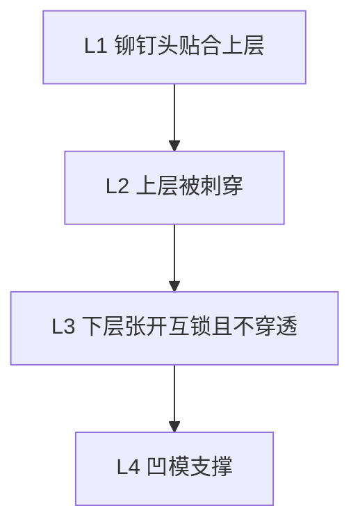

# 自冲铆（SPR）：半空心铆钉刺入上层并在下层张开互锁，不必预冲孔

> [!summary] 一句话概述
> 自冲铆用一颗半空心或全空心铆钉，在模具支撑下刺穿上层板，并在下层板内张开形成机械互锁，一般不必预先打通孔，也不靠熔化金属来连接，因此适合钢铝混合和带镀层的薄板。

## 配图

![[附件/sheet-spr-bsl.png]]
*图源：[博士隆 SPR 自冲铆钉 BA021 产品页](https://www.bsl-tech.com.cn/cp/17/328.html)；铆钉外形与规格示意。*

![[附件/sheet-spr-henrob-rivets.jpg]]
*图源：[阿特拉斯·科普柯《自冲铆接解决方案》](https://www.atlascopco.com.cn/zh-cn/itba/plp/self-pierce-riveting) 页内 Henrob 铆钉照片。*

![[附件/sheet-spr-cmes-p3.png]]
*图源：[Ang，《An Overview of Self-piercing Riveting Process…》，Chin. J. Mech. Eng. (2021) 34:2](https://doi.org/10.1186/s10033-020-00526-3) PDF 插图页；综述中的接头成形与失效示意。*

> 图片版权归原作者所有，仅作个人学习收藏；出处见文末「来源与核实记录」。

## 结构原理

> 本节所有数字只写来源里给出的；来源没有就写「来源未给出」，不估算、不编造。

阿特拉斯·科普柯把 SPR 写成一种双面铆接：把半空心或全空心铆钉穿过要连接的材料层敲入模具，使铆钉尾部在底层材料中扩展并形成机械互锁。该页给出的主要步骤是：启动条件 → 铆钉腿刺入上层板材 → 模具使铆钉腿在下层板材中张开成形且不会穿透板材 → 头部密封到上层板材上，插入完成。该文强调基本没有预钻孔、不需要热处理、也不产生烟气，并用于铝与钢、复合材料与金属等组合，以及白车身和电池托盘。

博士隆把同一过程概括为：铆钉穿透上层并在下层扩张形成永久性机械互锁，无需预钻孔。埃瑞特补充：目前用得较多的是半空心自冲铆钉，规格写成 DXL（直径×长度）。

这与库中已有的无铆连接（Clinching）不同：SPR 要放入一颗铆钉，靠铆钉腿张开互锁；无铆连接没有额外铆钉，只靠两层板被冲头和凹模挤出机械互锁。它也不同于电阻点焊：SPR 是冷成形，来源写明无热影响区、不破坏镀层。

### 堆叠方案

方向：沿铆接点的轴线，从上到下。

| 层级 | 零件 | 材料 | 厚度/尺寸 | 固定方式 | 依据 |
| --- | --- | --- | --- | --- | --- |
| L1（最外） | 铆钉头，压靠并密封在上层板表面 | 博士隆示例为合金钢，达克罗或锌镍合金表层 | 博士隆表：3.3 规格帽径 5.5±0.15 mm、帽沿厚 0.25±0.1 mm；5.3 规格帽径 7.7±0.15 mm、帽沿厚 0.3±0.1 mm | 冲压到位后头部贴合上层 | 博士隆规格表；阿特拉斯步骤 4 |
| L2 | 上层板（被刺穿） | 钢、铝、镁或复合材料（按连接组合） | 综述：上层至少 0.5 mm 厚 | 被铆钉腿穿过 | 阿特拉斯步骤 2；CMES 综述 |
| L3 | 下层板（被扩张但不被穿透） | 同上，可与上层异材 | 综述：下层至少 1 mm 厚 | 模具使铆钉腿在此张开，形成互锁 | 阿特拉斯步骤 3；CMES 综述 |
| L4（最下） | 凹模 | 来源未给出模具材料牌号 | 来源未给出型腔尺寸 | 支撑下层并强迫铆钉腿张开 | 阿特拉斯；CMES |

剖面示意：

### 零件清单

| 零件 | 数量 | 功能 | 材料 | 依据 |
| --- | --- | --- | --- | --- |
| 半空心或全空心自冲铆钉 | 每连接点 1 颗 | 刺入、张开并在上层密封 | 博士隆示例：合金钢 + 达克罗或锌镍 | 阿特拉斯；博士隆；埃瑞特 |
| 待连接板材（两层或多层） | 来源写两块或多块 | 被机械互锁 | 钢、铝、镁、复合材料与金属等 | 阿特拉斯；博士隆 |
| 凹模与铆接设备 | 1 套 | 提供冲压和成形支撑 | 来源未给出 | 阿特拉斯；埃瑞特 |

### 装配顺序

1. 把待连接板材叠放整齐（博士隆：使用专用 SPR 设备）。
2. 按总板厚和空间选择铆钉直径与长度（见参数表；博士隆与埃瑞特公式不同，要按所用钉和设备）。
3. 设备把铆钉压向板叠：腿刺入上层，在下层张开且不穿透，头部贴合上层。
4. 阿特拉斯写明基本没有预钻孔，也没有热处理。

### 受力与运动分析

- **受力路径**：使用载荷由板传递到张开的铆钉腿与头部夹持面，靠机械互锁而不是焊缝承担。
- **运动关系**：成形完成后为永久性连接，无相对运动。成形过程中铆钉腿向下并向外扩张。
- **失效风险**：综述指出先进轻质材料若强度和延性搭配不好，难以承受 SPR 的大塑性变形。下层过薄或被穿透会破坏互锁；直径过小则强度较低（埃瑞特：空间受限才用 3.3 mm，允许时应尽量用 5.3 mm）。把某一家的选长公式套到另一家的钉和设备上，也会选错长度。

## 设计要点与参数

| 要点 | 内容 | 依据 |
| --- | --- | --- |
| 是否预冲孔 | 基本没有预钻孔；博士隆也写无需预钻孔 | 阿特拉斯；博士隆 |
| 下层是否被穿透 | 阿特拉斯：模具使铆钉腿在下层张开，且不会穿透板材 | 阿特拉斯步骤 3 |
| 板厚下限（综述） | 上层至少 0.5 mm，下层至少 1 mm | CMES 综述，引文 [73] |
| 可连接总厚的数量级（综述） | 钢通常到 6 mm，文中还给出 10（单位与后文并列，原文为 steels typically up to 6 mm for steels and 10…；该句在提取文本中不完整，不以不完整句冒充完整上限） | CMES 综述。完整上限不以残句写入 |
| 常用直径 | 埃瑞特：常用 D 为 3.3 mm 和 5.3 mm；空间窄可用 3.3，但强度较低，允许时尽量用 5.3。博士隆表也以 3.3 和 5.3 规格为主 | 埃瑞特；博士隆 |
| 选长公式（博士隆） | T = L − (2～3 mm)，T 为总板厚，L 为铆钉长度 | 博士隆 |
| 选长公式（埃瑞特） | 先测总板厚 H，再取 L = H + 2 mm，并圆整到 4、5、6、7、8、9、10 中相近的规格 | 埃瑞特。与博士隆差 1 mm 量级，不折中 |
| 博士隆 3.3 规格示例 | 3.3×4：外径 3.3±0.1、帽径 5.5±0.15、长 4、帽沿厚 0.25±0.1，最大可铆接板厚 5 mm；同系列 3.3×5 / 3.3×6 对应最大可铆接板厚 6 mm / 7 mm | 博士隆规格表 |
| 节拍（博士隆） | 单点铆接时间约 1–2 秒 | 博士隆 |
| 与点焊的差异 | 无热影响区，不破坏表面镀层，无烟雾和火花 | 博士隆；阿特拉斯也写不产生烟气、不需热处理 |

## 优缺点

**优点**
- 不必预冲孔，对位简单，适合自动化。
- 可连接不同材质和不同厚度的板，包括点焊困难的钢铝混合。
- 冷成形，不破坏镀层，也没有焊接烟尘。

**缺点 / 代价**
- 必须双面接近，要为凹模留空间。
- 下层必须有足够厚度和延性让铆钉腿张开且不穿透。
- 不同厂家的钉长公式并不一致，不能混用。
- 相对无铆连接，每点都要消耗一颗铆钉。

## 可借鉴点

- 先确认能从两面靠近接头，并且下层不会被穿透。
- 直径优先按空间和强度选：窄处才用 3.3 mm。
- 钉长按所用铆钉供应商的公式选，并在样件上切开检查张开和剩余底厚；不要把博士隆的 T = L−(2～3) 和埃瑞特的 L = H+2 合成一个数。
- 需要可拆或只做预定位时，不要用 SPR 去替代压铆螺母或快拆结构。

## 与库中相似案例对比

| 对比项 | 本案例（SPR） | [[无铆连接（Clinching、TOX）：冲头与凹模把两层板挤压成机械互锁]] | [[电阻点焊：按薄件厚度选熔核直径、搭边宽度与最小点距]] |
| --- | --- | --- | --- |
| 连接体 | 额外放入铆钉，腿在下层张开 | 没有铆钉，两层板被挤出互锁 | 熔化形成熔核 |
| 是否预冲孔 | 一般不需要 | 不需要 | 不需要 |
| 对材料 | 适合异种金属和镀层板 | 也适合镀层或钢铝，但互锁体积不同 | 异种金属和镀层更受焊接性限制 |
| 何时用这篇 | 需要更高互锁强度、或材料组合不适合点焊和无铆 | 不想加铆钉、接头载荷中等 | 同种可焊金属、允许热影响 |

## 相关案例

- [[无铆连接（Clinching、TOX）：冲头与凹模把两层板挤压成机械互锁]]
- [[电阻点焊：按薄件厚度选熔核直径、搭边宽度与最小点距]]
- [[凸焊螺母：在薄板上投影焊接螺纹，对照压铆螺母与攻丝]]
- [[钣金压铆螺母（PEM S-CLS）：孔径、最小板厚、边距与板材硬度上限]]
- 分类索引：[[02-连接与紧固 索引]]

## 来源与核实记录

- 主来源：[湖北博士隆科技股份有限公司，《SPR自冲铆钉(BA021)》](https://www.bsl-tech.com.cn/cp/17/328.html)（2026-11-27 打开。规格表、1–2 秒节拍、T = L−(2～3 mm) 以及无需预钻孔等来自该页。）
- 交叉来源：[阿特拉斯·科普柯中国站，《自冲铆接解决方案》/ Henrob](https://www.atlascopco.com.cn/zh-cn/itba/plp/self-pierce-riveting)（2026-11-27 打开。四步工艺、不预钻孔、下层不穿透、白车身与电池托盘用途来自该页。）
- 交叉来源：[武汉埃瑞特机械制造有限公司，袁涛，《埃瑞特教你正确的 SPR 自冲铆接机与自冲铆钉匹配方式》](https://www.rmmic.com/zcm15.html)（2026-11-27 打开。该页写明仅以埃瑞特设备与铆钉为例。常用直径 3.3 / 5.3 mm 与 L = H+2 mm 来自该页。）
- 交叉来源：[Hua Qian Ang，《An Overview of Self-piercing Riveting Process with Focus on Joint Failures, Corrosion Issues and Optimisation Techniques》，Chin. J. Mech. Eng. (2021) 34:2](https://doi.org/10.1186/s10033-020-00526-3)（已下载并提取 PDF。上层 ≥0.5 mm、下层 ≥1 mm 来自该文。钢的总厚上限一句提取不完整，未据残句填写。）
- 核实：2026-11-27 打开上述来源。未把两家选长公式折中。
