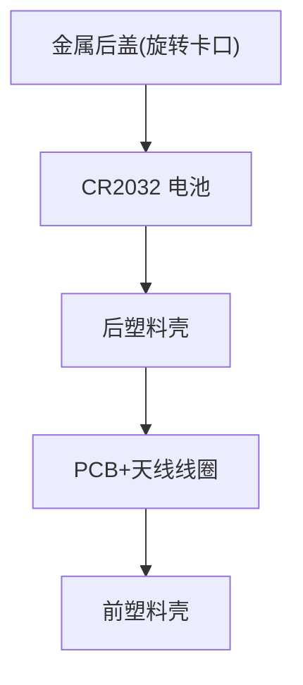

# 苹果 AirTag 旋转后盖与内部卡扣

> [!summary] 一句话概述
> AirTag 用户换电池只需按住旋转金属后盖即可打开（卡口式），而内部前后两片塑料壳用卡扣连接、PCB 嵌在塑料壳里——外部免工具、内部不打算拆。

## 配图

![[附件/airtag-twist.jpg]]
*iFixit：旋下金属后盖露出电池仓*

![[附件/airtag-clips.jpg]]
*iFixit：撬开前后塑料壳之间的卡扣*

![[附件/bayonet-mount.png]]
*Wikimedia Commons：卡口连接示意（Bayonet mount）*

> 图片版权归原作者所有，仅作个人学习收藏；出处见文末「来源与核实记录」。

## 结构原理

> 本节数字只写来源里给出的；来源没有就写「来源未给出」。

### 堆叠方案

方向：**从背面到正面**

| 层级 | 零件 | 材料 | 厚度/尺寸 | 固定方式 | 依据 |
| --- | --- | --- | --- | --- | --- |
| L1 | 金属后盖 | 金属 | 来源未给出 | 旋转卡口（扭转取下） | Step 1-2 |
| L2 | CR2032 纽扣电池 | — | CR2032（标准规格） | 放在电池仓内 | Step 1 |
| L3 | 后塑料壳 | 塑料 | 来源未给出 | 卡扣与前壳连接 | Step 3 |
| L4 | PCB + 天线线圈 | — | 来源未给出 | 嵌在塑料壳内，4 处连接点 | Step 4 |
| L5 | 前塑料壳 | 塑料 | 来源未给出 | — | Step 3-4 |

剖面示意：

### 零件清单

| 零件 | 数量 | 功能 | 材料 | 依据 |
| --- | --- | --- | --- | --- |
| 金属后盖 | 1 | 电池仓盖，旋转锁定 | 金属 | Step 1 |
| CR2032 | 1 | 供电 | — | Step 1 |
| 塑料壳 | 2（前/后） | 卡扣连接 | 塑料 | Step 3 |
| PCB | 1 | U1、nRF52832 等 | — | Step 5 |

### 装配顺序

1. (按拆解顺序反推) PCB 嵌入前壳
2. 后壳与前壳卡扣扣合
3. 放入 CR2032
4. 金属后盖对准后旋转锁定

> 来源只给出拆解顺序，以上为反推。

### 受力与运动分析

- **受力路径**：卡口原理（Wikipedia）：凸销沿 L 形槽进入并旋转，靠弹簧把销推入槽末端的小缺口锁定，抗振动、不会错牙。AirTag 内部弹力元件来源未给出。
- **运动关系**：后盖绕轴旋转锁定/解锁（用户动作）；内部卡扣为一次装配。
- **失效风险**：作者撬 PCB 时必须折断/拆焊 4 个连接点，拆解变为破坏性（Step 4）。

## 设计要点与参数

| 要点 | 内容 | 依据 |
| --- | --- | --- |
| 电池 | CR2032 | Step 1 |
| 后盖旋转角度/卡口数量 | 来源未给出 | — |

## 优缺点

**优点**
- 用户维护（换电池）免工具
- 卡口比螺纹更快、不会错牙（Wikipedia）

**缺点 / 代价**
- 内部 PCB 拆解为破坏性

## 可借鉴点

- 「用户维护件」用卡口免工具开启，「非维护件」用卡扣/嵌装，分级设计
- 卡口要有弹性元件提供锁定预压

## 相关案例

- [[卡扣三种基本形式：悬臂、环形、扭转]]
- [[任天堂 Switch Joy-Con 滑轨连接]]
- 分类索引：[[02-连接与紧固 索引]]

## 来源与核实记录

- 主来源：[Apple Air Tag Teardown](https://www.ifixit.com/Teardown/Apple+Air+Tag+Teardown/218935)（2026-05-22（API 发布时间），Mr.CircuitBoard（iFixit 社区））
- 补充来源：<https://en.wikipedia.org/wiki/Bayonet_mount>
- 图片来自 Wikimedia Commons（随 Wikipedia 词条展示），遵循原图许可。
- 核实：2026-11-13 通过 iFixit API 读取 6 步原文；打开 Wikipedia「Bayonet mount」核对卡口原理。
