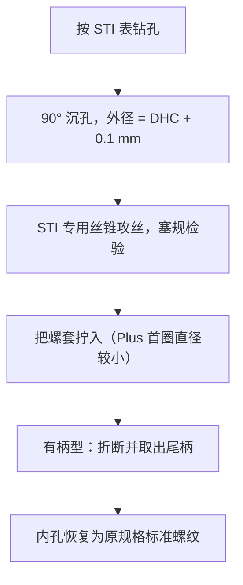

# 钢丝螺套（Helicoil 与 STI 底孔）：菱形钢丝嵌件与专用底孔攻丝

> [!summary] 一句话概述
> 钢丝螺套是把菱形截面的不锈钢钢丝弹簧圈拧进专用 STI 底孔，在软基体或已损坏的螺孔里形成新的标准公制内螺纹。它既不是热熔铜螺母，也不是压铆螺母：底孔必须按 STI 丝锥加工，不能用普通螺纹底孔。M6×1.0 的麻花钻约 6.30 mm（铝件有资料取 6.25 mm），而普通 M6 攻丝底孔只有 5.0 mm；有柄型装完必须折断并取出尾柄。

## 配图

![[附件/helicoil-plus-tight-fit.png]]
*图源：[Böllhoff HELICOIL® Plus 英文手册](https://media.boellhoff.com/files/pdf1/0100-helicoil-plus-en.pdf) 第 9 页；自由状态下外径大于接收螺纹，靠径向胀紧；右下为有无螺套的螺纹加强对比*

![[附件/helicoil-plus-install-steps.png]]
*图源：同上第 16 页；钻孔、切削攻丝与挤牙攻丝。攻丝前 90° 沉孔并去毛刺，沉孔外径 = DHC + 0.1 mm*

> 图片版权归原作者所有，仅作个人学习收藏；出处见文末「来源与核实记录」。

## 结构原理

> 本节数字只写来源里给出的；来源没有就写「来源未给出」。

### 堆叠方案

方向：**从孔口沉孔到螺套尾部（有柄型含折断槽与尾柄）**

| 层级 | 零件/区域 | 材料 | 厚度/尺寸 | 固定方式 | 依据 |
| --- | --- | --- | --- | --- | --- |
| L1 | 孔口 90° 沉孔 | 基体 | 沉孔外直径 = DHC + 0.1 mm | 去毛刺、引导螺套 | Böllhoff 中文页与手册第 16 页 |
| L2 | STI 底孔螺纹（紧固螺纹） | 基体 | 必须用原装 HELICOIL / STI 丝锥；普通型旋入 5H/6H STI 底孔，装配后形成 6H 内螺纹（盈锋转述 GB/T 24425） | 攻丝或挤牙 | 两来源 |
| L3 | 钢丝螺套 | 菱形截面不锈钢丝 | 自由状态外径大于接收螺纹，靠弹性胀开锚定；HELICOIL Plus 第一圈直径较小，可像螺钉一样拧入 | 旋入后形成标准内螺纹 | Böllhoff 中文页、手册第 9 页 |
| L4 | 标准螺栓 | 与公称螺纹匹配 | 装好后按原规格拧入，不必改大一号 | 与螺套内螺纹旋合 | 盈锋 |
| L5 | 尾柄（有柄型） | 与螺套一体 | 装到位后在折断槽处冲断并取出；无柄型（Tangless）无此工序 | — | 盈锋；Böllhoff 工具页 |

剖面示意：

### 零件清单

| 零件 | 数量 | 功能 | 材料 | 依据 |
| --- | --- | --- | --- | --- |
| 钢丝螺套（普通型或锁紧型；有柄或无柄） | 每孔 1 | 形成高强度内螺纹 | 不锈钢丝 | 两来源 |
| STI 丝锥与塞规 | 1 套 | 加工并检验底孔螺纹 | — | Böllhoff |
| 安装芯轴 / 电动或气动工具 | 1 | 把螺套拧入 | — | Böllhoff |
| 尾柄冲断器（有柄型） | 1 | 折断并取出尾柄 | — | 盈锋；Böllhoff 手册第 55 页附近 |

### 装配顺序

1. **钻孔**：按厂商底孔表选钻头，不能套用普通攻丝底孔。盈锋转引 Heli-Coil 目录（STANLEY HC2000 表 VI）：M6×1.0 铝件用 6.25 mm，钢、镁与塑料用 6.30 mm。Böllhoff 手册公制表在 M3×0.5、2.0d 行给出配套麻花钻 3.20 mm，M6×1.0、2.0d 行为 6.30 mm。
2. **沉孔**：切削螺纹前用 90° 倒角钻切沉孔并去毛刺，沉孔外直径 = DHC + 0.1 mm（Böllhoff）。
3. **攻丝**：只用 STI / HELICOIL 原装丝锥。通孔常用锥部 4 牙的 Plug 丝锥，盲孔用锥部 2 牙的 Bottoming 丝锥（盈锋）。也可用挤牙丝锥，无切屑，手册写公差等级 5H（6H 改型）。
4. **检验**：用配套塞规检查底孔后再装螺套。
5. **安装螺套**，有柄型再折断尾柄并取净，尤其盲孔里断柄残留会顶住螺栓。

### 受力与运动分析

- **受力路径**：螺栓载荷经螺套内螺纹传到菱形钢丝的侧面，再传到基体 STI 螺纹。Böllhoff 写作用力通过侧面传递到另一侧面，形成高强度、耐磨损、耐热的连接。
- **运动关系**：自由状态下螺套外径大于底孔，被安装工具收紧旋入后弹性胀开，永久锚定（盈锋）。之后螺栓与螺套内螺纹相对旋合；锁紧型还带有额外的摩擦锁紧（手册 Screwlock / 盈锋锁紧型）。
- **失效风险**：用普通 M6 丝锥攻底孔，装套时会胀裂螺套或撑裂基体（盈锋）。钻大了锚定不牢可能被拔出，钻小了装不进。有柄型漏折尾柄是漏做率最高的工序之一。

## 设计要点与参数

| 要点 | 内容 | 依据 |
| --- | --- | --- |
| 底孔体系 | STI 底孔比被修复的标准螺纹大出一个钢丝直径，与普通底孔不是同一张表。普通 M6 攻丝底孔仅 5.0 mm | 盈锋 |
| M6×1.0 钻头 | Böllhoff 表：6.30 mm。盈锋转引 Heli-Coil：铝 6.25 mm，钢/镁/塑料 6.30 mm。两数接近但铝件取值方向与「软材料取大」的普通攻丝直觉相反 | 两来源，分开标注 |
| M3×0.5 钻头 | Böllhoff 手册 2.0d 行给出 3.20 mm。盈锋打开页未给出 M3 钻头，不补写 | Böllhoff 手册第 18 页 |
| 沉孔 | 90°，外径 = DHC + 0.1 mm | Böllhoff |
| 钻孔深度 | 中文页：手动丝锥时钻孔深度比全螺纹长度深 1d 即可。盈锋给出估算式：螺套公称长度 Q + 0.5×螺栓直径 + 4P（锥留量）+ 1P（沉孔余量），用于保证螺套全长拧入后孔底仍有余量 | 两来源，适用语境不同，不要混成一个公式 |
| 攻丝深度 | 盈锋：H = 螺套公称长度 Q + 1P；盲孔还要留不完整牙和丝锥尾隙 | 盈锋 |
| 普通型与锁紧型 | 普通型底孔 5H/6H，装配后 6H；锁紧型底孔 4H5H/5H，装配后 5H（盈锋转述国标） | 盈锋 / GB/T 24425 转述 |
| 规格范围 | 国标普通型 M2–M39，锁紧型起始 M3；HeliCoil 公制粗牙从 M2×0.4 起 | 盈锋 |
| 修复策略 | 扩到 STI 底孔再装同规格螺套，内孔恢复原规格，原螺栓可继续用；先确认壁厚够不够扩 | 盈锋 |

## 优缺点

**优点**
- 软基体螺纹强度和耐磨性明显提高，并可把已经滑牙的孔恢复到原规格
- 比改大一号镶套更省空间，不必换螺栓
- 有手动到全自动的安装工具

**缺点 / 代价**
- 工艺窗口窄：钻头、丝锥、沉孔、塞规缺一不可，用错普通丝锥会报废
- 有柄型多一道折断取柄，盲孔残留风险高
- 要占用更大的底孔和壁厚，薄壁件可能扩不住

## 可借鉴点

- 图纸同时标注：**螺套规格与长度（如 1.5d / 2d）、STI 底孔标准或厂商底孔表、丝锥与塞规、是否无柄**
- 千万不要写「按普通 M6 底孔 5.0 攻丝再装钢丝螺套」
- 工艺检查单把「尾柄折断并取出」单独列一项
- 铝件与钢件的钻头可能差 0.05 mm，要查该批螺套的表，不要凭记忆

## 与库中相似案例对比

| 对比项 | 本案例 | [[3D 打印件热熔铜螺母：孔径与拉拔力实测]] | [[钣金压铆螺母（PEM S-CLS）：孔径、最小板厚、边距与板材硬度上限]] | [[注塑模内预埋铜螺母：模具定位、溢胶风险与直纹及斜花滚花]] |
| --- | --- | --- | --- | --- |
| 嵌件形态 | 菱形钢丝弹簧圈 | 黄铜热熔嵌件 | 压铆钢螺母 | 注塑包覆的铜螺母 |
| 底孔 | 必须 STI 专用螺纹底孔 | 光孔，靠热熔包滚花 | 光孔，靠冷流 | 模具芯棒定位，无预攻丝 |
| 典型基体 | 金属（也可用于某些塑料，来源有提及） | 3D 打印塑料 | 钣金 | 注塑件 |
| 修复能力 | 可把损坏螺孔恢复到原规格 | 不用于金属螺孔修复 | 不用于螺孔修复 | 不用于螺孔修复 |

## 相关案例

- [[3D 打印件热熔铜螺母：孔径与拉拔力实测]]
- [[注塑模内预埋铜螺母：模具定位、溢胶风险与直纹及斜花滚花]]
- [[钣金压铆螺母（PEM S-CLS）：孔径、最小板厚、边距与板材硬度上限]]
- 分类索引：[[02-连接与紧固 索引]]

## 来源与核实记录

- 主来源：[Böllhoff HELICOIL® 螺纹嵌件安装（中文）](https://www.boellhoff.com/cn-zh/产品/装配技术/helicoil螺纹嵌件安装/)；同公司补充 [HELICOIL® Plus 英文手册](https://media.boellhoff.com/files/pdf1/0100-helicoil-plus-en.pdf)（引用第 9、16、18 页）。Böllhoff 拥有 HELICOIL，两份只计一个独立来源。
- 独立第二来源：[盈锋志诚嘉：钢丝螺套全解析——选型、安装与 GB/T 24425 标准对照](https://www.zcjtech.com.cn/blog/wire-thread-insert-gb-t-24425-guide/)（文中底孔数值转引自 Heli-Coil / STANLEY HC2000 表 VI 与国标，已按转述标注，未打开标准原文）
- 核实：2026-11-21 curl GET 打开中文页与两份来源。http://www.luowent.com 此前为 500，未引用。手册表头分列较密，除麻花钻直径 3.20 / 6.30 mm 与沉孔公式外，未强行解读其余列。
