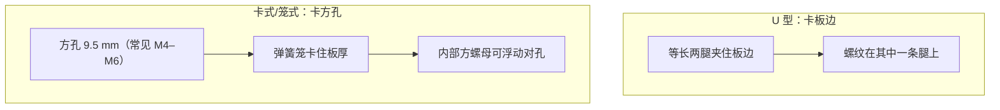

# 钣金 U 型夹板螺母与卡式笼式螺母：板边夹持与方孔浮动螺纹

> [!summary] 一句话概述
> 夹板类螺母不破坏板孔到不可拆，而是用弹簧钢夹在板边或卡进方孔，给薄板一个可拆、常常还能浮动的螺纹。U 型是两腿等长、对称卡在板边上；卡式/笼式则是弹簧钢笼子里装着方螺母，卡进预制方孔（常见 9.5 mm×9.5 mm），并可在长圆孔里滑动补偿孔位偏差。它和压铆、拉铆都不同：板不被冷流或镦死。

## 配图

![[附件/u-type-clip-nuts.jpg]]
*图源：[舟谊《夹(式)板螺母类别…》](https://shzyhz.com/jczs/486.html) 文内配图；U 型/J 型一类弹簧夹，有的自带攻丝孔，有的夹着独立六角螺母*

![[附件/square-clip-nut.jpg]]
*图源：同上；方形夹式：弹簧框卡入方孔或槽，内部螺母在拧紧前可以浮动*

![[附件/cage-nut-cn.jpg]]
*图源：[泛沃卡式螺母页](https://www.finesz.com/ka.php)；机柜用笼式螺母：弹簧钢外壳 + 四方螺母*

![[附件/cage-nut-drawing.png]]
*图源：[Whole-Spec 卡式螺母规格表](https://whole-spec.com/zh/nut/cage-nut)；方孔边长与可夹持板厚的尺寸定义*

> 图片版权归原作者所有，仅作个人学习收藏；出处见文末「来源与核实记录」。

## 结构原理

> 本节数字只写来源里给出的；来源没有就写「来源未给出」。

### 堆叠方案

方向：**先区分两种完全不同的卡法**

**A. U 型（卡板边）**

| 层级 | 零件/区域 | 材料 | 厚度/尺寸 | 固定方式 | 依据 |
| --- | --- | --- | --- | --- | --- |
| L1 | 两只等长弹簧腿 | 弹簧钢 | 来源未给出腿长与板厚范围 | 对称夹住板边；无螺纹的那条腿帮助保持夹持 | 舟谊「U 型螺母」节 |
| L2 | 螺纹（一体攻丝或另附螺母） | 钢 | 来源未给出规格表 | 供螺钉拧入；标准版铰链段较实，宽板版铰链更长并在中部切开以便安装 | 舟谊 |
| L3 | 板边 | 薄金属板 | 来源未给出允许板厚 | 不冲方孔也可以用，但板边要够伸进夹口 | 舟谊 |

**B. 卡式/笼式（卡方孔）**

| 层级 | 零件/区域 | 材料 | 厚度/尺寸 | 固定方式 | 依据 |
| --- | --- | --- | --- | --- | --- |
| L1 | 弹簧钢外壳 | 65 锰或 SUS304（泛沃） | 夹子凹尺寸 D：M4–M6 一型为 14.5 mm | 卡在方孔两侧 | 泛沃 |
| L2 | 四方螺母 | 碳钢或不锈钢 | M4–M6 一型螺母对边 11×11 mm | 被笼子托住，拧紧前可浮动 | 泛沃；Whole-Spec |
| L3 | 板上方孔 | 机柜立柱等 | Whole-Spec：M4/M5/M6 方孔均为 9.5 mm，板厚 M4/M5 为 0.7–2.5 mm、M6 为 0.7–3.0 mm。泛沃一型：孔 9.5×9.5，板厚 0.8–2.8 mm | 弹簧夹两侧卡位；长方孔时可上下滑动 | 两来源 |

舟谊还提到 J 型（两腿不等长，短腿浮动更小、更容易从板边滑脱）和 G 型（像夹在小法兰边上的 G 形）。本篇只把 U 型与笼式作为两种主结构写清，避免混成一种。

剖面示意：

### 零件清单

| 零件 | 数量 | 功能 | 材料 | 依据 |
| --- | --- | --- | --- | --- |
| U 型或 J 型弹簧夹螺母 | 按板边连接点 | 在板边提供螺纹 | 弹簧钢 | 舟谊 |
| 或笼式螺母（壳+方螺母） | 按方孔 | 在立柱方孔提供可浮动螺纹 | 壳：65Mn 或 SUS304；螺母：1010 或 SUS304 | 泛沃 |
| 配合螺钉 | 1 | 穿过被连接件拧入 | — | 各来源 |
| 卡式螺母安装工具（可选） | 1 | 把笼子送入方孔再抽出，使其卡到位 | — | 泛沃 |

### 装配顺序

**U 型**：对准板边推入，使板进入两腿之间，螺纹孔对准板上的光孔（若有），再拧螺钉。宽板版中部切开是为了更容易推上（舟谊）。

**笼式**：
1. 按规格冲方孔，或冲长方孔以便浮动（泛沃）。
2. 用专用工具把螺母放入方孔，抽回工具使其卡在板上；可从板材一侧安装（泛沃）。
3. 拧螺钉。螺母在完全拧紧前可以在笼子里浮动对正，拧紧后压住唇边定位（舟谊对「方形夹式」的描述与笼式类似）。
4. 拆卸时松开螺钉，弹簧未塑性变形则可重复使用（Whole-Spec）。

### 受力与运动分析

- **受力路径**：螺钉预紧把被连接件压向板面；轴向力经螺母传到弹簧夹或笼子的卡边，再传到板孔边缘。它不是压铆那样的冷流互锁，抗推出主要靠夹片弹性与几何卡位，承载力通常低于压铆或拉铆（来源未给出对比牛顿值）。
- **运动关系**：安装后、拧紧前，笼式螺母允许小范围浮动以补偿孔位偏差（Whole-Spec、泛沃长方孔）。U 型在板边上的浮动很小。
- **失效风险**：板厚超出夹持范围则卡不牢或装不进；方孔偏大则晃动，偏小则插不进（Whole-Spec）。弹簧塑性变形后必须更换。

## 设计要点与参数

| 要点 | 内容 | 依据 |
| --- | --- | --- |
| 两种结构不要混用 | U 型卡板边，不必先冲 9.5 方孔；笼式必须有匹配方孔 | 三来源对照 |
| Whole-Spec 笼式 | M4（P=0.7）、M5（P=0.8）：方孔 9.5 mm，板厚 0.7–2.5 mm；M6（P=1）：方孔 9.5 mm，板厚 0.7–3.0 mm | Whole-Spec |
| 泛沃 CN 系列 | M4/M5/M6 规格 1：孔 9.5×9.5，板厚 0.8–2.8，螺母对边 11×11，D=14.5。M6 规格 2 与 M8：孔 12.5×12.5，板厚 1.0–3.5，对边 14×14，D=16。文中提醒 M6 两种规格差别很大 | 泛沃 |
| 板厚数字不一致 | 两家对「M4–M6、9.5 方孔」给出的板厚区间略有不同（0.7–2.5/3.0 对 0.8–2.8），出图按所选型号的厂家表，不要折中 | 两来源 |
| 材料 | 全钢 CN、半不锈钢 CNS（壳不锈钢+钢螺母）、全不锈钢 CNSS | 泛沃 |
| 可重复拆卸 | 弹簧保持弹性即可反复拆装 | Whole-Spec |

> 舟谊同一篇文章后半把「夹板螺母」写成机加工台上的夹具操作，与前文钣金夹式螺母不是同一对象，相关步骤不采用。

## 优缺点

**优点**
- 不必压铆或拉铆设备，现场可装，可拆可改孔位
- 笼式能浮动对孔，适合机柜立柱上的设备安装
- 不给板留下永久变形的压铆痕或鼓包

**缺点 / 代价**
- 承载和抗振一般不如压铆、拉铆或焊接螺母（来源未给对比值，但结构上只靠弹簧卡边）
- 必须按板厚和方孔选对规格，超出夹持范围就会掉
- U 型占用板边，且对板厚更敏感；J 型短腿更容易滑脱

## 可借鉴点

- 先问「螺纹在板边还是在板面中部」：板边用 U 型，立柱方孔用笼式，不要用一种零件两种都凑合
- 机柜图直接写方孔 9.5×9.5（或 12.5×12.5）和板厚范围，并注明能否用长圆孔做浮动
- 弹簧变形、卡口张开的旧螺母不要再装回去
- 需要高强度、抗振的永久螺纹，仍应选压铆或拉铆

## 与库中相似案例对比

| 对比项 | 本案例 | [[钣金压铆螺母（PEM S-CLS）：孔径、最小板厚、边距与板材硬度上限]] | [[拉铆螺母（铆螺母）：单面镦头、铆接范围与圆孔滚花及六角防转]] |
| --- | --- | --- | --- |
| 板是否永久变形 | 基本不；弹簧夹可拆 | 是，冷流进退刀槽 | 是，背面镦出鼓包 |
| 安装面 | U 型用板边；笼式用方孔 | 圆孔，需双面加压 | 圆孔或六角孔，单面拉 |
| 对孔能力 | 笼式可浮动 | 位置由孔决定 | 位置由孔决定 |
| 可拆性 | 高 | 螺母与板基本不可拆 | 螺母与板基本不可拆 |

## 相关案例

- [[钣金压铆螺母（PEM S-CLS）：孔径、最小板厚、边距与板材硬度上限]]
- [[拉铆螺母（铆螺母）：单面镦头、铆接范围与圆孔滚花及六角防转]]
- 分类索引：[[02-连接与紧固 索引]]

## 来源与核实记录

- 主来源：[舟谊：夹(式)板螺母类别，作用，使用方法及注意事项介绍](https://shzyhz.com/jczs/486.html)（U/J/G/方形分类；后半夹具内容已排除）
- 独立第二来源：[Whole-Spec 卡式螺母规格表 M4–M6](https://whole-spec.com/zh/nut/cage-nut)
- 补充：[泛沃卡式螺母](https://www.finesz.com/ka.php)（尺寸表、65Mn/304、安装要求）
- 核实：2026-11-21 curl GET 打开三页。http://www.wzwansheng.com 与 fate001 打开为 HTTP 500，未引用。
