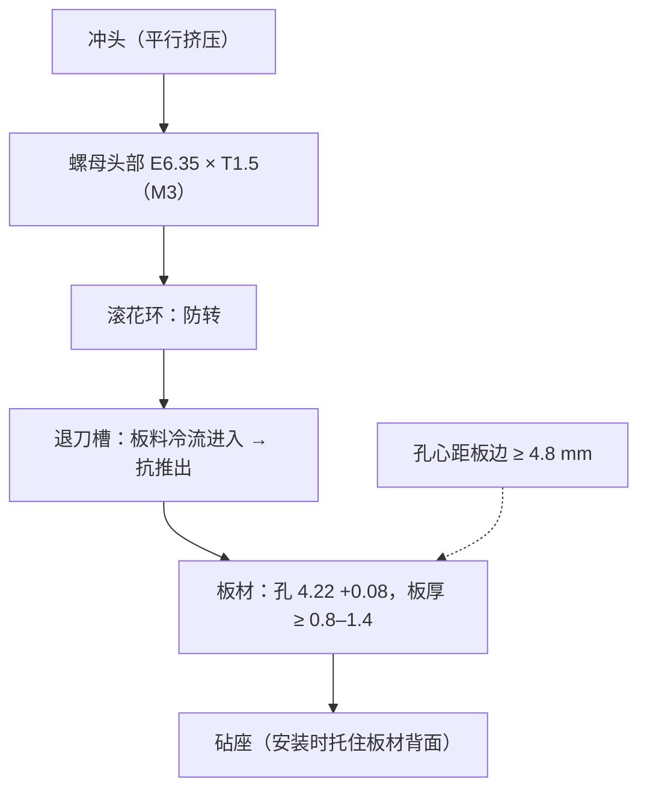

# 钣金压铆螺母（PEM S/CLS）：孔径、最小板厚、边距与板材硬度上限

> [!summary] 一句话概述
> 压铆螺母（自扣紧螺母）是把螺母放进冲好的孔里，用平行压力压它的头部，孔周围的板料**冷流进螺母的退刀槽**，从而和板子成为一体；滚花环负责防转。PEM 手册给出每个规格的三个硬尺寸：**孔径、最小板厚、孔中心到板边的最小距离**，例如 M3：孔 4.22 mm（+0.08）、最小板厚 0.8–1.4 mm（随螺母杆长代码变化）、孔心到边 4.8 mm。还有一条容易忽略的规则：**板材必须比螺母软**（S 型 HRB 80 以下，CLS 型 HRB 70 以下）。B 站经验文补充了选型逻辑：背面够不着用拉铆，0.8 mm 以下薄铝板别用压铆，1 mm 以上平板用压铆最合适。

## 配图

![[附件/pem-clinch-nut-section.png]]
*图源：[PEM Bulletin CL（Self-Clinching Nuts）](https://www.pemnet.com/wp-content/uploads/sites/9/2022/06/cldata.pdf) 第 CL-2 页；压铆后剖面：板料被挤进螺母头部下方的退刀槽，滚花环嵌入板中，背面与螺母杆齐平*

![[附件/pem-cls-nut-dimensions.png]]
*图源：同上 第 CL-4 页；S/CLS 螺母尺寸定义：E 头部外径，C 杆部外径，A 杆长，T 头部高度*

> 图片版权归原作者所有，仅作个人学习收藏；出处见文末「来源与核实记录」。

## 结构原理

> 本节数字只写来源里给出的；来源没有就写「来源未给出」。

### 堆叠方案

方向：**从螺母头部（冲头侧）到板材背面（砧座侧）**，以 M3 S/CLS 为例

| 层级 | 零件/区域 | 材料 | 厚度/尺寸 | 固定方式 | 依据 |
| --- | --- | --- | --- | --- | --- |
| L1 | 螺母头部 | 碳钢（S）/ 不锈钢（CLS） | 头部外径 E 6.35 mm（±0.25）；头高 T 1.5 mm（±0.25） | 承受压铆力 | PEM |
| L2 | 滚花环 + 退刀槽 | 同上 | 来源未给出（具体轮廓 PEM 称可能变化） | 板料冷流进入 | PEM |
| L3 | 板材 | 5052-H34 铝 或 冷轧钢；硬度见下 | 最小板厚：杆长代码 0 → 0.8 mm，1 → 1.0 mm，2 → 1.4 mm | 孔径 4.22 mm（+0.08） | PEM |
| L4 | 螺母杆部 | 同 L1 | 杆径 C 最大 4.2 mm；杆长 A 最大 0.77/0.97/1.38 mm（代码 0/1/2） | 杆长小于板厚，背面不凸出 | PEM |
| L5 | 孔心到板边 | — | ≥ 4.8 mm | — | PEM |

剖面示意：

### 零件清单

| 零件 | 数量 | 功能 | 材料 | 依据 |
| --- | --- | --- | --- | --- |
| 压铆螺母 S/CLS/SP | 每孔 1 | 在薄板上提供承载螺纹 | 碳钢 / 不锈钢 / 淬火不锈钢 | PEM |
| 板材 | 1 | 被冷流挤压的母材 | 铝或钢，硬度低于上限 | PEM |
| 砧座 + 冲头 | 1 套 | 平行压入 | 例：HAEGER / PEMSERTER 专用砧座和冲头 | PEM |
| 配合螺钉 | 每孔 1 | 锁紧 | 锁紧型螺母配 3A/4h，最低 2A/6g | PEM |

### 装配顺序

1. 在板上冲或钻出规定孔径；**不要做去毛刺等二次加工**（PEM）。
2. 把螺母放进砧座孔，再把板材的孔（最好是冲孔面）套在螺母杆上（PEM）。
3. 冲头与砧座保持平行，施加挤压力，直到螺母头部贴住板面（PEM）。
4. 如需先喷涂再装配，可订购带螺纹遮蔽的螺母（后缀 BC）（PEM）。

### 受力与运动分析

- **抗推出（pushout）**：靠板料冷流进退刀槽，形成机械互锁。
- **抗扭出（torque-out）**：靠滚花环嵌入板材。
- **硬度关系**：螺母必须比板材硬，板料才会流动；板材太硬会把螺母压坏或压不进去。PEM 对不锈钢板专门做了硬化的 SP 型，并提醒不锈钢板硬度更高、安装要格外小心。
- **安装力**（PEM 实测，M2/M2.5/M3 共用一组）：5052-H34 铝 6.7–8.9 kN，冷轧钢 11.2–15.6 kN；M4：铝 11.2–13.4 kN，钢 18–27 kN。
- **失效场景**（B 站经验）：0.8 mm 板硬压 M6 压铆螺母，背面顶出鼓包、板面开裂，螺母一掰就掉，原因是板太薄、嵌合深度不够。PEM 的 M6 S 型最小板厚表中最薄一档是 0.92 mm（杆长代码 00），与此一致。

## 设计要点与参数

| 要点 | 内容 | 依据 |
| --- | --- | --- |
| M2 / M2.5 / M3 | 孔 4.22（+0.08）；杆径 ≤ 4.2；E 6.35；T 1.5；孔心到边 ≥ 4.8 mm | PEM |
| M3.5 | 孔 4.75；E 7.11；T 1.5；边距 5.6 mm | PEM |
| M4 | 孔 5.41；E 7.87；T 2；边距 6.9 mm | PEM |
| M5 | 孔 6.35；E 8.64；T 2；边距 7.1 mm | PEM |
| M6 | 孔 8.75；E 11.18；T 4.08；边距 8.6 mm；最小板厚 0.92/1.2/1.4/2.29 mm（杆长代码 00/0/1/2） | PEM |
| 最小板厚（M2–M5） | 杆长代码 0/1/2 → 0.8/1.0/1.4 mm；PEM 建议按板厚用最长的杆，性能最好 | PEM |
| 板材硬度上限 | S/SS：HRB 80 / HB 150；CLS/CLSS：HRB 70 / HB 125；SP：不锈钢 HRB 90 / HB 192；CLA：HRB 50 / HB 82 | PEM |
| 性能（M3，铝 5052-H34） | 推出力 280/400/750 N，扭出力矩 0.9/1.13/1.47 N·m（杆长代码 0/1/2） | PEM |
| 性能（M3，冷轧钢） | 推出力 470/550/1010 N，扭出 1.47/1.7/2.03 N·m | PEM |
| 性能（M4，铝） | 推出力 300/470/970 N，扭出 2.37/2.6/4 N·m；冷轧钢 490/645/1250 N，2.95/4/5.1 N·m | PEM |
| 位置禁区 | SMPP 等型号注明：不要装在折弯或其他严重冷作硬化区域附近 | PEM 注 (7) |
| 选型四问 | 背面能否触及、板厚与材质、受力与防转、产线设备 | cv53442179 |

> 板厚换算（推断）：同规格下杆长代码从 0 到 2，推出力提高约 2.7 倍（M3 铝 280 → 750 N），所以板厚允许时应选长杆。

## 优缺点

**优点**
- 螺纹强度高、防转好，头部可做到与板面基本齐平（cv53442179）
- 无热输入，不烧镀层（与焊接螺母相比）
- 自动化压装，节拍快

**缺点 / 代价**
- 需要双面操作和压铆设备；封闭型材内部压头伸不进去（cv53442179）
- 有最小板厚和最大板材硬度限制
- 需要孔边距，靠近折弯处不能装

## 可借鉴点

- **出图前查三个数**：孔径、最小板厚、孔心到边距离，直接写进钣金图
- **板材硬度要写进材料规格**：冷轧钢、不锈钢板要核对是否在 HRB 70/80/90 以内
- **孔不要去毛刺**，冲孔面朝向螺母杆一侧
- **压铆、拉铆、焊接三选一**：背面够不着选拉铆；薄铝板（< 0.8 mm）避开压铆和焊接；厚钢板、高载荷选焊接（cv53442179）
- 铝板配钢螺母要考虑电化学腐蚀（cv53442179）

## 与库中相似案例对比

| 对比项 | 本案例 | [[3D 打印件热熔铜螺母：孔径与拉拔力实测]] | [[注塑螺丝柱（Boss 柱）：壁厚比 0.6 分水岭与自攻底孔公式]] |
| --- | --- | --- | --- |
| 母材 | 钣金（铝、钢） | 3D 打印塑料 | 注塑塑料 |
| 固定原理 | 板料冷流进退刀槽 + 滚花防转 | 加热熔化塑料包住滚花 | 自攻螺钉切/挤螺纹 |
| 关键参数 | 孔径、板厚、边距、硬度 | 孔径、拉拔力 | 外径/孔径比、底孔 |
| 共同规律 | 都是「孔径决定一切」，孔径偏差直接影响拉拔或推出力 | — | — |

## 相关案例

- [[3D 打印件热熔铜螺母：孔径与拉拔力实测]]
- [[钣金折弯件设计规则：最小弯曲半径与预留切口]]
- [[注塑螺丝柱（Boss 柱）：壁厚比 0.6 分水岭与自攻底孔公式]]
- 分类索引：[[02-连接与紧固 索引]]

## 来源与核实记录

- 主来源：[PEM Bulletin CL — Self-Clinching Nuts](https://www.pemnet.com/wp-content/uploads/sites/9/2022/06/cldata.pdf)（PennEngineering，© 2021，20 页 PDF；引用 CL-2/CL-4/CL-5/CL-9/CL-10 及性能数据页）
- 补充来源：[焊接、拉铆、压铆螺母怎么选？原理、场景、现场踩坑一次说清](https://www.bilibili.com/read/cv53442179)（B 站专栏，见多识广222，2026-10-15；文末有紧固件厂商推荐）
- 核实：2026-11-13 下载 PDF 用 pdftotext 抽取表格核对。性能表在 PDF 中为多列排版，M3/M4 数值已按行对应逐一核对；M5、M6 性能值未收录，避免错列。B 站另一篇《储能钣金结构设计,压铆螺母螺柱设计手册》（cv28715688）打开为空页，未引用。
