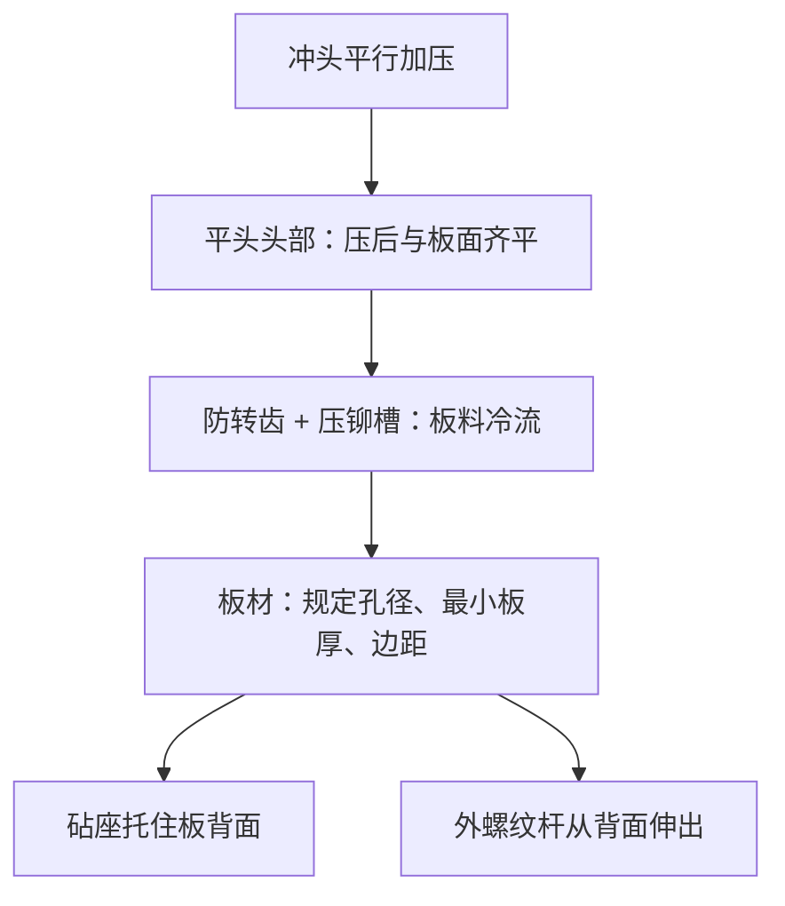

# 钣金压铆螺钉（PEM FH 平头螺柱）：孔径、最小板厚、边距与板材硬度上限

> [!summary] 一句话概述
> 压铆螺钉（平头螺柱）和压铆螺母成对出现：螺母在薄板上留下内螺纹孔，FH 则在薄板上留下外螺纹杆。安装时把螺柱头放进冲好的孔，平行加压，板料冷流进头部下方的压铆轮廓并咬住滚花防转，杆部从背面伸出。PEM 手册给出每个规格的孔径、最小板厚、被连接件最大孔径和孔心到边距离，例如 M3：孔 3.0 mm（+0.08）、最小板厚 1 mm、边距 5.6 mm；板材必须比螺柱软（FH 为 HRB 80 / HB 150 以下，FHS 为 HRB 70 / HB 125 以下）。

## 配图

![[附件/pem-fh-flush-stud.png]]
*图源：[PEM Bulletin FH，Self-Clinching Studs and Pins](https://www.pemnet.com/wp-content/uploads/sites/2/2022/06/fhdata.pdf) 第 FH-5 页；FH/FHS/FHA 平头螺柱外形、S 未螺纹段、公英制尺寸表与板材硬度说明*

![[附件/pem-fh-installation.png]]
*图源：同上，第 FH-18 页；FH/FHS/FHA 安装示意与冲头、砧座要求*

![[附件/finesz-fh-studs.jpg]]
*图源：[泛沃 FH 压铆螺钉页](https://www.finesz.com/fh.php)；国产兼容件外形（碳钢 FH，头部带齿）。数字不作为 PEM 官方值*

> 图片版权归原作者所有，仅作个人学习收藏；出处见文末「来源与核实记录」。

## 结构原理

> 本节数字只写来源里给出的；来源没有就写「来源未给出」。

### 堆叠方案

方向：**从螺柱头部（安装后与板面齐平的一侧）到外螺纹杆伸出的背面**，以 PEM 公制 FH/FHS/FHA 为例

| 层级 | 零件/区域 | 材料 | 厚度/尺寸 | 固定方式 | 依据 |
| --- | --- | --- | --- | --- | --- |
| L1 | 平头头部 | 钢（FH）/ 不锈钢（FHS）/ 铝（FHA） | M3：头径 H=4.6 mm（±0.4）；头部在板面上齐平 | 承受压铆力 | PEM FH-5 |
| L2 | 压铆轮廓与防转齿 | 同上 | 轮廓可能变化（手册注明 Clinching profile may vary） | 板料冷流进入，齿防转 | PEM |
| L3 | 板材 | 钢或铝，硬度见下 | M3 最小板厚 1 mm；孔径 3 mm（+0.08 / −0）；孔心到边 ≥ 5.6 mm | 冲孔后压入 | PEM FH-5 |
| L4 | 未螺纹段 S | 同上 | M3：S 最大 2.1 mm（螺纹可在距此 2 牙之内用 3B/5H 环规检查） | 穿过板厚 | PEM |
| L5 | 外螺纹杆 L | 同上 | 长度码 6–25 mm 等（M3 有 6、8、10、12、15、18、20、25） | 供螺母拧紧 | PEM |
| L6 | 被连接件上的过孔 | — | M3 最大 3.6 mm | 套在螺杆上再锁螺母 | PEM「Max. Hole in Attached Parts」 |

剖面示意：

### 零件清单

| 零件 | 数量 | 功能 | 材料 | 依据 |
| --- | --- | --- | --- | --- |
| 压铆螺柱 FH / FHS / FHA | 每孔 1 | 在薄板上提供外螺纹 | 钢 / 不锈钢 / 铝 | PEM |
| 板材 | 1 | 被冷流嵌合 | 硬度低于螺柱上限 | PEM |
| 冲头与砧座 | 1 套 | 平行压入 | 手册第 18 页起给出工具要求 | PEM |
| 配合螺母 | 1 | 锁紧被连接件 | 3B/5H 最大实体环规应能通过至 S 最大处 | PEM 注 (2) |

### 装配顺序

1. 按手册冲或钻出规定孔径，不要做会改变孔径的去毛刺（与压铆螺母篇同一类工艺纪律；本手册强调孔必须是 properly sized holes）。
2. 把螺柱头部放入孔中，杆朝向将要伸出的一侧；冲头与砧座保持平行加压，直到头部与板面齐平（FH-18）。
3. 被连接件的过孔不超过表中最大值，再拧螺母。

### 受力与运动分析

- **抗推出（pushout）**：靠板料冷流进头部下方轮廓，形成机械互锁。手册封面原则写 high pushout resistance；本笔记未摘录具体牛顿值，避免错列。
- **抗扭出（torque-out）**：靠头部防转齿嵌入板材。
- **硬度关系**：螺柱必须比板硬。FH：钢或铝板 HRB 80 / HB 150 或更软；FHS：HRB 70 / HB 125 或更软；FHA：铝板 HRB 50 / HB 82 或更软（PEM FH-5 条目标题与选表）。
- **与压铆螺母的受力方向**：螺母主要在板上提供内螺纹，载荷由拧入的螺钉拉/压螺母；螺柱则是板上伸出的螺杆，载荷由拧在杆上的螺母传到头部嵌合区。

## 设计要点与参数

PEM 官方公制 FH/FHS/FHA（FH-5 页，孔公差 +0.08 mm）：

| 螺纹 | 最小板厚 mm | 板孔径 mm | 头径 H mm（±0.4） | S max mm | 被连接件最大孔 mm | 最小边距 mm |
| --- | --- | --- | --- | --- | --- | --- |
| M2.5×0.45 | 1 | 2.5 | 4.1 | 1.95 | 3.1 | 5.4 |
| M3×0.5 | 1 | 3 | 4.6 | 2.1 | 3.6 | 5.6 |
| M3.5×0.6 | 1 | 3.5 | 5.3 | 2.25 | 4.1 | 6.4 |
| M4×0.7 | 1 | 4 | 5.9 | 2.4 | 4.6 | 7.2 |
| M5×0.8 | 1 | 5 | 6.5 | 2.7 | 5.6 | 7.2 |
| M6×1 | 1.6 | 6 | 8.2 | 3 | 6.6 | 7.9 |
| M8×1.25 | 2.4 | 8 | 9.6 | 3.7 | 8.6 | 9.6 |

| 要点 | 内容 | 依据 |
| --- | --- | --- |
| 板材硬度上限 | FH：HRB 80 / HB 150；FHS：HRB 70 / HB 125；FHA（铝板）：HRB 50 / HB 82 | PEM FH-5 |
| 靠近折弯 | 边距和与其他压铆件的间距见 PEM Tech Sheet C/L To Edge（本手册注 3，未在本 PDF 展开） | PEM |
| 泛沃兼容件（单独标注，不是 PEM 值） | 中文页公制表与 PEM 上列数字一致（M3：最小板厚 1、孔径 3、连接件最大孔 3.6、H 4.6、S 2.1、边距 5.6）。另给出螺柱自身硬度：FH（10B21 调质）HRC 30–38，默认蓝白锌 48 h；FHS 为 SUS304 本色。不要把「螺柱 HRC」写成「板材硬度上限」 | 泛沃 |

## 优缺点

**优点**
- 薄板上不焊螺柱、不烧镀层，头部可与板面齐平
- 自动化压装，板上直接得到外螺纹杆，适合支架、外壳与另一件用螺母锁紧

**缺点 / 代价**
- 需要双面压铆设备和最小板厚、边距、硬度条件（封闭型材内部伸不进砧座时，应改拉铆或焊钉等方案）
- 杆长按长度码选型，过孔必须小于表值，否则被连接件套不稳或压到压铆区
- 靠近折弯和已硬化区域要按边距表避让

## 可借鉴点

- 出图写四个数：**孔径、最小板厚、孔心到边、被连接件过孔上限**，并写板材硬度上限（FH/FHS/FHA 不要混用）
- 和压铆螺母成对选型：板上要内螺纹用 S/CLS，要外螺纹杆用 FH，不要用错
- 不要把兼容厂的螺柱热处理硬度（HRC）误当成板材允许硬度（HRB）
- 需要板上垫高或内外都要螺纹时，看隔离柱（PEM SO），那是另一件结构

## 与库中相似案例对比

| 对比项 | 本案例 | [[钣金压铆螺母（PEM S-CLS）：孔径、最小板厚、边距与板材硬度上限]] | [[钣金压铆隔离柱（PEM SO）：孔径、最小板厚、柱长与板材硬度上限]] | [[拉铆螺母（铆螺母）：单面镦头、铆接范围与圆孔滚花及六角防转]] |
| --- | --- | --- | --- | --- |
| 板上留下的是 | 外螺纹杆 | 内螺纹孔 | 垫高的隔离柱（螺纹/间距功能不同） | 内螺纹孔 |
| 安装 | 双面平行挤压，板料冷流 | 同样是双面压铆冷流 | 同样是压铆家族 | 单面拉枪，薄壁镦成背面墩头 |
| M3 孔与边距示例 | 孔 3.0，边距 5.6，最小板厚 1 | 孔 4.22，边距 4.8，最小板厚随杆长 0.8–1.4 | 见该篇 | 取决于螺母体外径，不是冷流退刀槽 |

## 相关案例

- [[钣金压铆螺母（PEM S-CLS）：孔径、最小板厚、边距与板材硬度上限]]
- [[钣金压铆隔离柱（PEM SO）：孔径、最小板厚、柱长与板材硬度上限]]
- [[拉铆螺母（铆螺母）：单面镦头、铆接范围与圆孔滚花及六角防转]]
- [[钣金折弯件设计规则：最小弯曲半径与预留切口]]
- 分类索引：[[02-连接与紧固 索引]]

## 来源与核实记录

- 主来源：[PEM® Self-Clinching Studs and Pins（fhdata.pdf）](https://www.pemnet.com/wp-content/uploads/sites/2/2022/06/fhdata.pdf)（PennEngineering；引用 FH-5 尺寸与硬度、FH-18 安装）。2026-11-21 curl GET 下载，HTTP 200。
- 独立第二来源（国产兼容件厂，不是 PEM）：[泛沃 FH / FHS 压铆螺钉](https://www.finesz.com/fh.php)
- 核实：公制表按 PEM 列定义（Min. Sheet Thickness、Hole Size in Sheet、H、S Max.、Max. Hole in Attached Parts、Min. Dist. Hole C/L to Edge）逐行核对；推出力/扭出力具体牛顿值因排版分列风险未收录。
