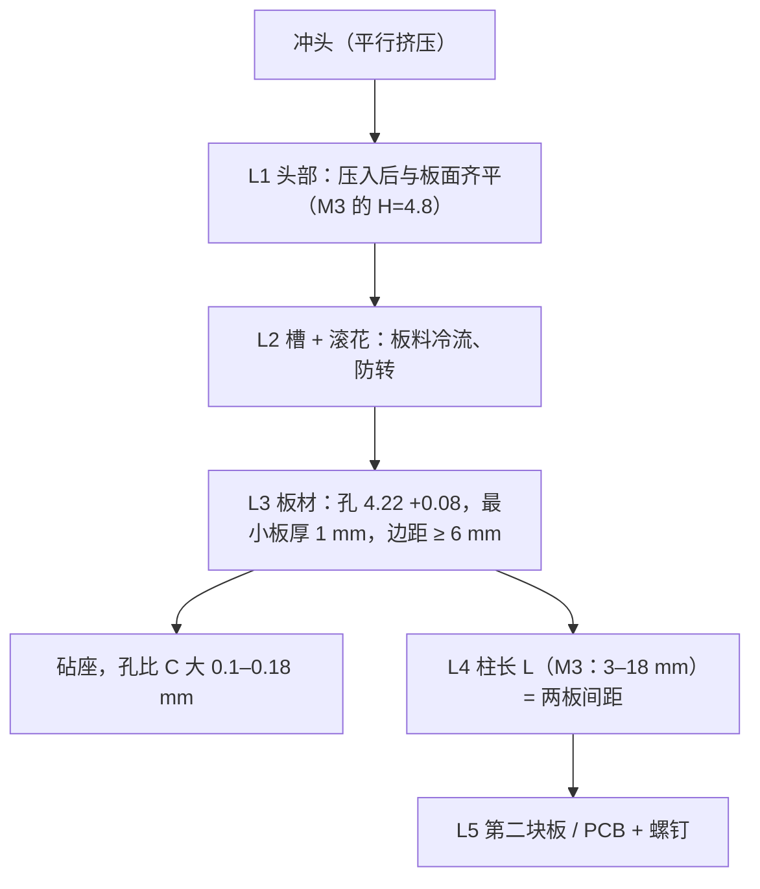

# 钣金压铆隔离柱（PEM SO）：孔径、最小板厚、柱长与板材硬度上限

> [!summary] 一句话概述
> 压铆隔离柱（self-clinching standoff）把带通孔或盲孔螺纹的柱体压进冲好的圆孔，板料冷流进头部下方的槽，在两块板或 PCB 之间给出确定的间距；与压铆螺母不同，它的目的不是“几乎不增加板厚方向的支撑高度”，而是用规定的柱长 L 把两层撑开。PEM SO 通孔型例如 M3：孔径 4.22 mm（+0.08）、最小板厚 1 mm、孔心到边 6 mm、柱长系列 3–18 mm；板材必须比柱软（SO 型 HRB 80 / HB 150 以下）。

## 配图

![[附件/pem-so-standoff-types.jpg]]
*图源：[PEM Bulletin SO — Self-Clinching Standoffs](https://www.pemnet.com/wp-content/uploads/sites/9/2023/10/sodata.pdf) 第 SO-2 页；压入后头部与板面齐平。通孔螺纹（SO/SOS/SOA/SO4）、盲孔螺纹（BSO 等）、薄板用 TSO、靠边缘的 DSOS、带接地齿的 SOSG 等型谱在本页对照。TSO 用于比 SO 更薄的板。手册写明最薄可压入 0.025 in / 0.63 mm（指系列整体，含薄板型）。*

![[附件/pem-so-installation.jpg]]
*图源：同上 第 SO-8 页；安装：冲头与砧座保持平行，把隔离柱从冲孔面一侧插入，只施加足以使头部与板面齐平的挤压力。砧座孔相对柱径 C 放 +0.1～+0.18 mm。材料与硬度、螺纹等级也在本页给出。*

![[附件/clinch-standoff-install-sketch.jpg]]
*图源：[苏州泛沃 SO/SOS 压铆螺柱页](https://www.finesz.com/so.php)；六角薄头与圆柱（尺寸 C）之间有一道槽，预留孔略大于 C，压铆时孔周板料塑性挤入槽内，在薄板上形成一个可固定的内螺纹。*

> 图片版权归原作者所有，仅作个人学习收藏；出处见文末「来源与核实记录」。

## 结构原理

> 本节数字只写来源里给出的；来源没有就写「来源未给出」。

### 堆叠方案

方向：**从冲头侧（隔离柱头部所在的板面）到砧座侧（板材背面），再沿柱长到对面的 PCB/第二块板**。以下以 PEM 公制通孔型 SO/SOS/SOA/SO4、螺纹 M3×0.5 为例。

| 层级 | 零件/区域 | 材料 | 厚度/尺寸 | 固定方式 | 依据 |
| --- | --- | --- | --- | --- | --- |
| L1 | 隔离柱头部（压入后与板面齐平） | 碳钢 SO / 不锈钢 SOS / 铝 SOA / 硬化不锈钢 SO4 | 头部名义尺寸 H：M3 为 4.8 mm | 承受压铆力 | PEM SO-3 |
| L2 | 滚花/夹紧轮廓 + 退刀槽 | 同上；手册注明 clinching profile may vary | 来源未给出具体槽深 | 板料冷流进入，抗推出；滚花防转 | PEM SO-3、泛沃说明 |
| L3 | 被压入的板材 | 钢或铝，硬度见下 | 最小板厚 1 mm（M3）；孔径 4.22 mm（+0.08） | 孔心到边 ≥ 6 mm | PEM SO-3 |
| L4 | 柱身（通孔螺纹，给出间距） | 同 L1 | 柱长 L +0.05/−0.13 mm；M3 可选 3、4、6、8、10、12、14、16、18 mm。杆部外径 C：M3 为 4.2 mm（−0.13） | 柱长等于两板/板与 PCB 之间的设计间距 | PEM SO-3 |
| L5 | 对面的螺钉 + 第二块板或 PCB | 配合螺钉来源未在本表给出规格 | 通孔型可从柱另一端穿螺钉；需要封闭端面时改用 BSO 盲孔型 | 螺纹锁紧，间距由 L 保证 | PEM SO-2、SO-4 |

剖面示意：

### 零件清单

| 零件 | 数量 | 功能 | 材料 | 依据 |
| --- | --- | --- | --- | --- |
| 通孔压铆隔离柱 SO/SOS/SOA/SO4 | 每孔 1 | 提供间距和内螺纹 | 碳钢 / 300 系不锈钢 / 铝 / 400 系硬化不锈钢 | PEM SO-2、SO-8 |
| 盲孔型 BSO/BSOS/BSOA/BSO4（可选） | 每孔 1 | 封闭端，避免螺钉或异物从另一侧露出 | 同上对应材质 | PEM SO-2、SO-4 |
| 板材 | 1 | 被冷流挤压的母材 | 硬度低于对应上限 | PEM SO-3、SO-8 |
| 冲头 + 砧座 | 1 套 | 平行压入；PEM 给出 HAEGER / PEMSERTER 零件号 | 来源未给出材料 | PEM SO-8 |
| 配合螺钉 | 每柱 1 | 把第二块板或 PCB 锁在柱端面 | 手册按柱材质给出最大推荐拧紧扭矩 | PEM SO-12 |

### 装配顺序

1. 在板上冲或钻出规定孔径；**不要做去毛刺等二次加工**（PEM SO-8）。
2. 把隔离柱从冲孔面一侧插入板孔，再进入砧座（PEM SO-8）。
3. 冲头与砧座保持平行，只施加足以使头部与板面齐平的挤压力（PEM SO-8）。
4. 把 PCB 或第二块板套到柱上（或用螺钉从通孔穿过），按柱长得到设计间距。若需要封闭端面、防水防尘，改选 BSO 盲孔型（PEM SO-2；泛沃也把 BSO 写成盲孔螺柱）。

### 受力与运动分析

- **受力路径**：压铆阶段，冲头力经头部把孔周板料挤进槽，形成抗推出的机械互锁；滚花承担抗扭出。使用阶段，螺钉预紧把第二块板压在柱端面上，两板间距由柱长 L 承担，而不是靠螺钉杆的光杆。
- **运动关系**：压入后隔离柱与第一块板无相对运动；第二块板/PCB 相对柱只有沿螺钉轴线的锁紧，没有滑动副。
- **硬度关系**：紧固件必须比板硬，板料才会流动。PEM 在 SO-8 特别说明：300 系不锈钢柱在不锈钢板上往往不够硬，所以提供 SO4/BSO4/TSO4（400 系）；但 400 系不应用于明显腐蚀环境（除非选可选的镍镀 NC）、不允许磁性、或温度高于 300 °F（149 °C）的场合。
- **失效风险**：板太薄或孔径偏大，压铆凸起开裂、夹紧不足（泛沃故障说明）。需要更大承压面、以免压裂或切伤 PCB 时，选用加厚壁的 3.5M3（PEM 注 (2)）。靠近折弯或其他严重冷作硬化区的距离，手册指向 Tech Sheet C/L To Edge，本 PDF 未给出额外数值。

## 设计要点与参数

下列公制通孔型数据均摘自 PEM Bulletin SO 第 SO-3 页（孔径公差 +0.08 mm，C 公差 −0.13 mm，B 公差 ±0.13 mm，L 公差 +0.05/−0.13 mm）。

| 要点 | 内容 | 依据 |
| --- | --- | --- |
| M3×0.5 | 最小板厚 1 mm；孔径 4.22；B（沉孔/通孔内径）3.2；C 4.2；H 4.8；孔心到边 6；L：3–18 mm | PEM SO-3 |
| 3.5M3（加厚壁） | 最小板厚 1 mm；孔径 5.41；B 3.2；C 5.39；H 6.4；边距 6.8。用于给配合板/PCB 更大承压面，降低压裂或切伤风险 | PEM SO-3 注 (2) |
| M3.5×0.6 | 最小板厚 1 mm；孔径 5.41；B 3.9；C 5.39；H 6.4；边距 6.8；L：3–25 mm | PEM SO-3 |
| M4×0.7 | 最小板厚 1.27 mm；孔径 7.14；B 4.8；C 7.12；H 7.9；边距 8；L：3–25 mm | PEM SO-3 |
| M5×0.8 | 最小板厚 1.27 mm；孔径 7.14；B 5.35；C 7.12；H 7.9；边距 8；L：3–25 mm。注意与 M4 共用同一孔径 7.14 | PEM SO-3 |
| 板材硬度上限 | SO：钢或铝 HRB 80 / HB 150 以下；SOS：HRB 70 / HB 125 以下；SOA：铝 HRB 50 / HB 82 以下；SO4：不锈钢板 HRB 88 / HB 183 以下 | PEM SO-3、SO-8 |
| 系列最薄板 | 手册总述：压入金属板最薄 .025 in / 0.63 mm（含比 SO 更薄的 TSO 型） | PEM SO-2 |
| 推荐拧紧扭矩（配合螺钉，N·m） | M3：钢柱 0.55、不锈钢柱 0.44、铝柱 0.33；M3.5：0.91 / 0.73 / 0.55；M4：2 / 1.6 / 1.2；M5：3.6 / 2.88 / 2.16 | PEM SO-12 公制表 |
| 性能（1.5 mm 5052-H34 铝） | M3：安装力 4.9 kN，推出力 710 N，扭出 1.24 N·m；M4：10.7 kN，1780 N，5.08 N·m | PEM SO-12 |
| 性能（1.5 mm 冷轧钢） | M3：安装力 9.8 kN，推出 1000 N，扭出 2.15 N·m；M4：17.8 kN，2490 N，8.47 N·m。铝柱在冷轧钢栏未给数据 | PEM SO-12 |
| 螺纹 | 内螺纹 ASME B1.1 2B / ASME B1.13M 6H | PEM SO-8 |
| 国产兼容规格（对照，非 PEM 原厂） | 泛沃按 SO 标准生产：M3 最小板厚 1 mm、孔径 4.2、C 4.19、边距 6；M4/M5 最小板厚 1.3 mm、孔径 7.14；M6 最小板厚 1.3 mm、孔径 8.75。与 PEM 公制表接近但孔径/板厚有 0.02–0.03 mm 级差别，出图时按所订厂商表，不要混用 | 泛沃规格表 |

> PEM 本册公制通孔表列到 M5；安装工具表出现 0420/M6，但 M6 的孔径与最小板厚未出现在已打开的 SO-3 公制尺寸表中，故不编造。需要 M6 时查厂商当页或改用泛沃等给出 M6 的表格，并在图样上写明依据。

## 优缺点

**优点**
- 一次压入即可同时得到**确定的板间间距**和承载内螺纹，适合钣金与 PCB 叠装
- 无热输入，不烧镀层（相对焊接螺柱）
- 通孔、盲孔、薄板型、靠边缘型、接地齿型可按场景选（PEM SO-2）

**缺点 / 代价**
- 需要双面操作和压铆设备；封闭型材内部压头伸不进去（与压铆螺母相同的工艺限制，推断）
- 有最小板厚、最大板材硬度和孔边距限制；不锈钢板要改用 SO4，并注意腐蚀与磁性
- 柱长必须按叠层一次性选对，压入后不能再调整间距

## 可借鉴点

- **出图前写清四个数**：孔径、最小板厚、孔心到边、柱长 L；L 就是两板/板与 PCB 的设计间距，不要用普通压铆螺母去“垫”出高度
- **板材硬度写进材料规格**：钢/铝用 SO 还是 SOS，不锈钢板用 SO4，并核对 HRB 上限
- **孔不要去毛刺**，冲孔面朝向柱杆一侧
- PCB 承压面不够或怕切伤板时，优先考虑加厚壁代码（如 3.5M3），而不是盲目加大螺纹
- 需要封闭端面或减少异物进入时选 BSO，不要在通孔柱背面另加堵头凑合
- 国产“SO 标准”柱的孔径可能与 PEM 差 0.02 mm 量级（4.2 对 4.22），同一产品不要混用两套底孔

## 与库中相似案例对比

| 对比项 | 本案例（压铆隔离柱 SO） | [[钣金压铆螺母（PEM S-CLS）：孔径、最小板厚、边距与板材硬度上限]] | [[注塑螺丝柱（Boss 柱）：壁厚比 0.6 分水岭与自攻底孔公式]] |
| --- | --- | --- | --- |
| 母材 | 钣金（铝、钢、不锈钢板） | 钣金（铝、钢） | 注塑塑料 |
| 固定原理 | 板料冷流进槽 + 滚花防转，与压铆螺母相同 | 板料冷流进退刀槽 + 滚花防转 | 自攻螺钉在塑料底孔切/挤螺纹 |
| 结构目的 | **给出确定的板间/板–PCB 间距**（柱长 L 系列） | 在薄板上提供与板面基本齐平的螺纹，几乎不增加支撑高度 | 在塑料件上提供螺钉连接 |
| 关键参数 | 孔径、最小板厚、边距、硬度、**柱长 L** | 孔径、最小板厚、边距、硬度、杆长代码 | 外径/壁厚比、底孔 |
| 不要混用 | 需要间距时用隔离柱，不要拿压铆螺母加垫柱凑高度 | 只需要螺纹、不需要撑开距离时更合适 | 底孔公式是塑料自攻，不能套到金属挤牙或压铆孔 |

## 相关案例

- [[钣金压铆螺母（PEM S-CLS）：孔径、最小板厚、边距与板材硬度上限]]
- [[注塑螺丝柱（Boss 柱）：壁厚比 0.6 分水岭与自攻底孔公式]]
- [[3D 打印件热熔铜螺母：孔径与拉拔力实测]]
- 分类索引：[[02-连接与紧固 索引]]

## 来源与核实记录

- 主来源：[PEM Bulletin SO — Self-Clinching Standoffs](https://www.pemnet.com/wp-content/uploads/sites/9/2023/10/sodata.pdf)（PennEngineering；2026-11-21 GET，HTTP 200，约 2.1 MB PDF。引用 SO-2 型谱与 0.63 mm 总述、SO-3 通孔尺寸与硬度、SO-8 材料/安装、SO-12 性能。用无版面模式 pdftotext 核对公制表格，避免多栏错位。）
- 独立第二来源：[苏州泛沃 — SO/SOS 压铆螺柱规格](https://www.finesz.com/so.php)（2026-11-21 GET 打开。国产按 SO 标准生产的通孔/盲孔/全牙说明，以及自有公制规格表。孔径、最小板厚与 PEM 接近但不完全相同，文中分开引用。）
- 补充：[泛沃《压铆螺柱的开孔尺寸开多大》](https://www.finesz.com/blog/archives/330)（同公司开孔说明，不作独立来源计。）
- 核实：2026-11-21 用 curl GET 下载 PDF 与两页中文，pdftotext 抽取表格。未把雅贸/钣金圈等可能转载 PEM 数表的页面当作独立来源。PEM 公制通孔表未列出 M6 的孔径与最小板厚，故不收录该规格尺寸。
