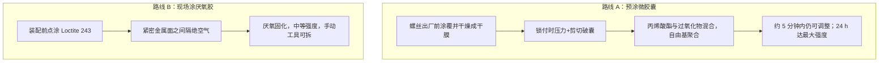

# 预涂微胶囊螺纹胶与现场涂厌氧锁固剂（precote 与 Loctite 243）

> [!summary] 一句话概述
> 螺纹锁固有两条结构路线：precote 把丙烯酸酯和过氧化物分别包在微胶囊里，预先涂在螺丝上并干燥成不粘手的干膜，锁付时压力和剪切把微胶囊挤破才开始反应；Loctite 243 是现场涂的中等强度蓝色厌氧胶，在紧密金属配合面之间隔绝空气后固化，可用标准手动工具拆卸。前者适合产线预涂件，后者适合维修和灵活点胶。

## 配图

![[附件/precote-30-coated-screws.png]]
*图源：[precote 30 中文产品页](https://www.precote.com/cn/products/locking/precote-30/)；预涂在外螺纹上的干膜（产品色为黄色；85 为蓝绿色）*

![[附件/precote-30-strength-curve.png]]
*图源：同上；precote 30、30-3、30-8 强度随时间上升的曲线（30-3 为加速固化变体）*

![[附件/loctite-243-tds.jpg]]
*图源：[LOCTITE 243 中文技术数据表（2020-11）](https://datasheets.tdx.henkel.com/LOCTITE-243-zh_CN.pdf) 第 1 页；厌氧、中强度、触变蓝色液体的产品特性*

> 图片版权归原作者所有，仅作个人学习收藏；出处见文末「来源与核实记录」。

## 结构原理

> 本节数字只写来源里给出的；来源没有就写「来源未给出」。

### 堆叠方案

方向：**沿螺纹旋合，从外螺纹涂层到内螺纹金属表面**

| 层级 | 零件/区域 | 材料 | 厚度/尺寸 | 固定方式 | 依据 |
| --- | --- | --- | --- | --- | --- |
| L1 | 外螺纹上的预涂层（路线 A） | 微胶囊丙烯酸酯 + 漆状粘结剂；precote 30 黄色，85 蓝绿色 | 来源未给出膜厚；摩擦系数 μ=0.10–0.15（ISO 16047，M10 试件） | 预先涂覆并干燥，安装时破囊固化 | precote 30 / 85 页 |
| L1' | 现场点涂厌氧胶（路线 B） | 甲基丙烯酸酯，蓝色液体，中等粘度、触变 | 比重 1.08（23 °C）；需填满螺纹间隙 | 隔氧 + 金属催化固化 | Loctite 243 TDS |
| L2 | 外螺纹与内螺纹配合面 | 金属（243 适用于活性金属及不锈钢、电镀等惰性基材） | 间隙影响固化速度；TDS 用 0.05 / 0.15 / 0.25 mm 控制间隙做轴套试验 | 旋合 | 两来源 |
| L3 | 固化后的螺纹间隙填充 | 聚合物 | 来源未给出固化后膜厚 | 化学锁固，并可密封螺纹 | precote：至少 4 圈涂层长度才能可靠密封 |

剖面示意：

### 零件清单

| 零件 | 数量 | 功能 | 材料 | 依据 |
| --- | --- | --- | --- | --- |
| 预涂螺丝（precote 30 或 85 等） | 按连接点 | 带来可储存的干膜锁固 | 丙烯酸酯微胶囊涂层 | precote 产品页 |
| 或现场胶 + 普通螺丝 | 按连接点 | 灵活点涂 | LOCTITE 243 | TDS |
| 配合螺母或内螺纹 | 1 | 提供金属表面与隔氧间隙 | 钢、不锈钢、电镀件等 | 两来源 |
| 促进剂（可选，路线 B） | 按需 | 间隙大或速度慢时加速固化 | 如 7471™ | TDS |

### 装配顺序

**路线 A（预涂）**

1. 由认证涂胶厂把 precote 涂在外螺纹上并干燥，形成不粘手、防腐蚀的干膜。涂层螺纹在最高 30 °C、相对湿度最大 65% 下储存稳定性为 4 年。
2. 按普通螺丝安装。安装开始后大约最多允许 5 分钟移动调整；室温约 24 小时达到最大强度。
3. 规格选用：precote 30 用于大于 M6 且螺距大于 1 mm；30-8 / 85-8 用于不大于 M6，或螺距不大于 1 mm 至最大 M10×1。需要更快达到 DIN 267-27 指标时用 30-3 / 85-3（约 0.5 小时）。

**路线 B（现场涂）**

1. 清洁螺纹，必要时待表面干燥（TDS 使用说明）。
2. 在螺栓和螺母啮合部位点胶；通孔点在啮合处，较大螺纹和间隙也可涂到内螺纹上；盲孔把胶加到孔底，让螺丝旋入时填充间隙。
3. 固化过慢或间隙较大时使用适合的促进剂。拆卸用标准手动工具；极少数啮合过长拆不下时，TDS 写对螺母或螺栓施加约 250 °C 局部加热，趁热拆卸。

### 受力与运动分析

- **受力路径**：锁固不替代夹紧力。预紧仍由拧紧扭矩产生；胶或微胶囊固化后在螺纹牙侧增加防松阻力（分离/松脱力矩），并填充间隙密封。
- **运动关系**：安装时螺纹相对旋转激活涂层或分配液体；固化后应无相对转动。precote 写「正确使用时均可再次使用」，同时又写拆开后的重复温循环不再固化——重复使用能力要以实际扭矩验证，不能当成无限次。
- **失效风险**：预涂件过期、受潮，或安装后未等固化就加载；现场胶漏涂、间隙过大、表面过度污染。243 声称可承受轻微油污，但不是可以省略清洁。

## 设计要点与参数

| 要点 | 内容 | 依据 |
| --- | --- | --- |
| precote 固化机理 | 丙烯酸酯和过氧化物分别微胶囊化，安装时挤压和剪切破囊后混合固化；固化从涂层首次接触开始 | precote 锁定概述页 |
| precote 30 强度与温度 | 中等强度；工作范围 −60 °C 至 +150 °C；室温约 6 小时达到 DIN 267-27 指标，约 24 小时最终强度 | precote 30 页 |
| precote 30 扭矩（试验件） | 按 DIN 267-27，ISO 4017 M10×35-8.8 + ISO 4032 M10 螺母：装配拧入扭矩小于 3 N·m；无预紧力分离扭矩大于 15 N·m；松开扭矩小于分离扭矩 | precote 30 页 |
| precote 30 密封 | 圆柱/圆柱螺纹至 200 bar；圆柱/锥形螺纹高达 250 bar；至少 4 圈涂层长度且需重叠安装 | 概述页、30 页 |
| precote 85 | 高强度；DIN 267-27 为 −60 °C 至 +170 °C，GMW 14657 为至 +200 °C；分离扭矩大于 20 N·m，松开扭矩小于 55 N·m（同一 M10 试验件） | precote 85 页 |
| 预涂储存 | 不高于 30 °C、相对湿度不大于 65%，4 年 | 30 / 85 页 |
| Loctite 243 特性 | 中强度、触变蓝色液体、厌氧固化；用于锁固和密封，可用标准手动工具正常拆卸；也适用于不锈钢和电镀等惰性基材，并有一定耐油性 | TDS |
| 243 破坏力矩（23 °C 固化 72 h，无上紧扭矩） | M10 氧化发黑螺栓+低碳钢螺母：26 N·m；M6：3 N·m；M16：44 N·m | TDS |
| 243 带预紧的松脱力矩 | ISO 10964，预紧 5 N·m，22 °C 固化 1 周：M10 磷酸锌 26 N·m；M10 不锈钢 17 N·m | TDS |
| 243 温度试验 | 冷强度已在 −75 °C 测试；热强度/热老化图给出 100、120、150、180、200 °C 等点。TDS 未给出单一“使用温度上限”数字，不以推断值代替 | TDS |
| 固化速度影响因素 | 基材活性、温度、间隙；间隙大或速度慢可用促进剂 | TDS |

## 优缺点

**优点**
- 预涂：到线就是干的，不污染、不漏涂，适合大批量自动装配，还能兼作螺纹密封
- 现场胶：维修和多品种灵活，243 中等强度可用手工具拆，对惰性金属和轻微油污更宽容

**缺点 / 代价**
- 预涂要找认证涂胶厂，有储存期和规格分段（M6、螺距分界），装上后有调整窗口，过了窗口再动可能伤胶层
- 现场胶依赖操作者点胶位置和量，垂直面靠触变减流淌但仍可能污染；固化时间受间隙和基材影响
- 两条路线都不是无限次重复使用；关键连接应验证拆后力矩或换件

## 可借鉴点

- 产线标准件优先预涂（按螺纹规格选 30 还是 30-8，要高强度或更高温度选 85），图纸写清涂层型号、涂覆圈数（密封至少 4 圈）和摩擦系数
- 维修、试制、不能预涂的现场用 243，通孔点啮合处、盲孔先加孔底
- 扭矩规范要加上锁固剂的拧入力矩：precote 30 在 M10 试验件上拧入小于 3 N·m，仍会叠在夹紧扭矩上
- 不要把经销商转载的 precote 手册再当成第二个独立来源；汉高 243 TDS 才是另一家

## 与库中相似案例对比

| 对比项 | 本案例 | [[尼龙嵌件锁紧螺母（DIN 985 Nyloc）：预紧力矩、120°C 上限与安装方向]] | [[全金属锁紧螺母（DIN 980）：三点变形与金属嵌片的预紧力矩防松]] |
| --- | --- | --- | --- |
| 防松原理 | 化学填充螺纹间隙（预涂破囊或厌氧固化） | 尼龙环弹性干涉 | 金属螺纹变形或金属锁片干涉 |
| 温度 | precote 30 至 150 °C、85 至 170/200 °C；243 有 −75 °C 和高温曲线，无单一上限 | 尼龙约 −40 至 +120 °C | 全金属，通常高于尼龙 |
| 产线形态 | 可预涂到螺丝上，或现场点胶 | 螺母自带锁紧元件 | 螺母自带锁紧元件 |

## 相关案例

- [[尼龙嵌件锁紧螺母（DIN 985 Nyloc）：预紧力矩、120°C 上限与安装方向]]
- [[全金属锁紧螺母（DIN 980）：三点变形与金属嵌片的预紧力矩防松]]
- [[Nord-Lock 楔形防松垫圈：楔角大于螺纹升角的成对拉伸锁紧]]
- 分类索引：[[02-连接与紧固 索引]]

## 来源与核实记录

- 主来源：[precote 30 中文产品页](https://www.precote.com/cn/products/locking/precote-30/)（omniTECHNIK Mikroverkapselungs GmbH / SurTec；同时打开 [锁定概述](https://www.precote.com/cn/products/locking/) 与 [precote 85](https://www.precote.com/cn/products/locking/precote-85/)，同公司只计一个独立来源）
- 独立第二来源：[LOCTITE 243 中文技术数据表](https://datasheets.tdx.henkel.com/LOCTITE-243-zh_CN.pdf)（Henkel，页眉日期 11月-2020）
- 同公司补充，未计入独立来源：台湾经销商 [precote(C).pdf](https://www.tslg.com.tw/pdf/precote(C).pdf)
- 核实：2026-11-21 curl GET 打开上述页面与 PDF。试验扭矩均对应资料注明的 M10 试件，不外推到其他规格。243 的「平均拆卸扭矩 @ 180°」是 ISO 10964 测试角度，不是 180 °C。
