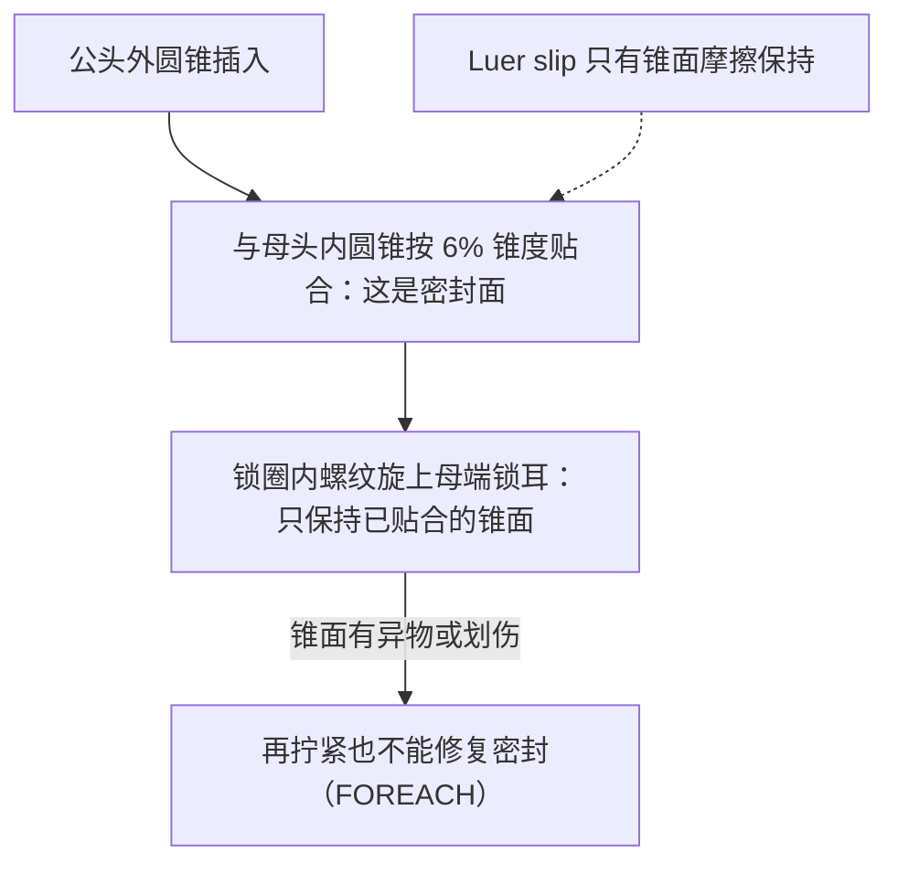

# 鲁尔锁定接头：6% 锥面负责密封，螺纹与锁耳只负责保持

> [!summary] 一句话概述
> 鲁尔锁定接头（Luer lock）的液体密封发生在公头外锥面和母头内锥面的 6% 锥度贴合上；外围的锁圈内螺纹和母端锁耳（或相应凸耳）只负责把已经贴合的锥面保持在位，并不代替锥面做密封。这和四分之一转快锁「靠凸轮把板拉紧」不是同一条传力路径：这里拧紧锁圈是为了保持，漏液时继续加力往往修不好已经划伤或夹了异物的锥面。

## 配图

![[附件/foreach-luer-lock-cutaway.jpg]]
*图源：[恒永达（FOREACH）《什么是鲁尔接头？》](https://www.foreachtek.com/resources/technical-articles/what-is-a-luer-fitting/)（2026-10-13）文中「公母鲁尔连接后的外围锁合示意」剖视；黄色锁圈为局部剖开的保持结构，中心白色锥面为密封配合。原文：外围锁合负责保持连接，中心锥面的贴合负责密封*

![[附件/foreach-luer-fixed-collar-end.jpg]]
*图源：同上；固定锁圈公鲁尔的端面视图。锁圈与公头一起转动，内圈可见螺纹/保持结构，中心仍是锥形通道，不能只根据最外层有没有螺纹来判断公母*

![[附件/foreach-luer-lock-photo.jpg]]
*图源：同上文页头产品照片（穿板母鲁尔等）；可见锁圈、色环、倒刺接管。照片是仪器用鲁尔配置，文中明确：不能单凭外形把仪器接头当成已验证的医疗成品*

> 图片版权归原作者所有，仅作个人学习收藏；出处见文末「来源与核实记录」。

## 结构原理

> 本节所有数字只写来源里给出的；来源没有就写「来源未给出」。涉及 ISO 80369-7 的尺寸，分别注明是 Antpedia 解读页还是 Kingpo 参考页给出的，二者不是标准原文，也不能互相 合并 成「标准值」。

### 堆叠方案

方向：**沿流体通道轴线，从公头（外圆锥）插入端看到母头（内圆锥），再看到外围锁合**

| 层级 | 零件 | 材料 | 厚度/尺寸 | 固定方式 | 依据 |
| --- | --- | --- | --- | --- | --- |
| L1 中心流体通道 | 公鲁尔外圆锥 + 母鲁尔内圆锥 | FOREACH 系列有 PP、PA、部分 PVDF；具体接头看配置 | 6% 锥度：沿轴向每 1 mm，直径变化 0.06 mm（FOREACH；Kingpo 同此定义）。Kingpo 称该比值也可写成 1:16.67，半角 3.44°（包角 6.87°），百分比不是 6° 锥角 | 轴向插入，锥面压紧形成密封 | FOREACH；Kingpo；Antpedia 也写 6% 锥度、约 3.44° |
| L2 公头尖端外径等（仅作参考引用） | 公锥本身 | 按材料分档见下方注意 | Kingpo 称摘自 ISO 80369-7:2016 表 B.1：Ød（距尖端 0.750 mm 处外径）3.970–4.072 mm，名义 4.021；锥长 e 7.500–10.500 mm，名义 8.400；Øg（距尖端 7.500 mm）4.376–4.476 mm。Antpedia 2021 解读写外圆锥尖端外径 3.970–4.072 mm「依材料」，与 Kingpo「2016 已不再分两列直径」的说法不完全同一口径 | 与母锥配合，不靠螺纹密封 | Kingpo 尺寸页（并声明须用自己持有的标准文本核对）；Antpedia 解读页。**不要把两页数字当成同一版标准的正式表** |
| L3 母头开口内径 | 母锥孔 | 同上 | Kingpo 称表 B.2：ØD（距开口 0.750 mm）4.198–4.298 mm，名义 4.248；深度 E 7.500–10.500 mm。Antpedia 写内圆锥开口内径 4.198–4.298 mm「依材料」 | 接收公锥 | 同上，分别标注 |
| L4 外围锁合 | 公端锁圈内螺纹 + 母端锁耳/凸耳 | 与接头配置一体或做成可旋转锁圈 | Kingpo 称锁并不改变锥面尺寸，ØD、E、ØG 与 slip 相同；表 B.5 给出锁耳大径 ØH 7.730–7.830 mm（名义 7.780），螺距 P 名义 2.500 mm、双线右旋，一圈轴向进给 5.0 mm。Antpedia 写螺距 p=2.5 mm 双线右旋，并另列带固定套外圆锥的螺纹内径 h 等，口径与 Kingpo 不完全对应，本文不合并 | 旋合后保持锥面贴合位置 | FOREACH 原理；Kingpo 表 B.5 引用说明；Antpedia 解读 |
| L5 接管或穿板固定 | 倒刺、安装螺母、色环等 | FOREACH：倒刺覆盖 1.6、2.4、3.2 mm 软管内径；有锁圈、色环和安装螺母等配件 | 软管内径见左列；其余安装尺寸来源未给出完整表 | 与软管或面板连接，不属于锥面密封本身 | FOREACH |

注意（材料分档，两家解读不一致处只分列、不折中）：

- Kingpo：ISO 594-1 曾经按硬质/半硬质给出两列直径，ISO 80369-7 把直径合成一列，材料改由模量要求处理；该页写「弹性模量高于 700 MPa」。
- Antpedia（针对 2021 版解读）：半硬质弹性模量 700–3433 MPa，硬质 >3433 MPa，并举例半硬质如 PP、ABS，硬质如 PC、金属。
- 二者都不是标准原文。设计、检验须核对所持标准版本，不能用本表代替。

剖面示意：

独立来源对同一分工的表述：

- FOREACH：6% 锥度是（大端直径－小端直径）÷锥段轴向长度＝0.06，不是 6°。公母锥面沿轴向接合后，接触面受压，形成通道周围的密封。锁紧式在锥面外侧增加机械保持：母端凸耳与公端锁圈内螺纹啮合，使已贴合的锥面保持在连接位置。「密封应检查中心锥面，防松和保持应检查外围锁合。」
- Kingpo：Luer lock 不是另一种尺寸的鲁尔，而是同一条 6% 锥外面加了螺纹；母端 lock 的 ØD、E、ØG 与 slip 相同。
- 对照库中四分之一转快锁：Southco/DZUS 用约 90° 凸轮爬斜面，把面板拉向框架，密封或贴合来自轴向夹紧。鲁尔的轴向贴合来自锥面本身，螺纹行程用来保持，而不是用凸轮把密封面「拉紧出密封」。

### 零件清单

| 零件 | 数量 | 功能 | 材料 | 依据 |
| --- | --- | --- | --- | --- |
| 公鲁尔（外圆锥，可带固定或旋转锁圈） | 每对 1 | 提供外锥密封面；锁圈提供保持 | FOREACH 配置：PP、PA、部分 PVDF | FOREACH：向外伸出的锥形接管端为公鲁尔，即使外面带内螺纹锁圈仍是公鲁尔 |
| 母鲁尔（内圆锥，外可有锁耳） | 每对 1 | 提供内锥密封面和锁耳 | 同上，按配置 | FOREACH：锁合凸耳不改变母接口属性 |
| 锁圈（固定式或旋转式） | 锁紧式 1 | 旋合保持，不负责密封 | 来源按型号 | FOREACH：固定锁圈随公头转；旋转锁圈可在保持公头方向时完成锁合 |
| 倒刺/接管、穿板螺母、色环 | 按配置 | 接软管或固定到面板 | 来源按系列 | FOREACH |
| 自封阀 | 普通贯通鲁尔没有 | FOREACH 写明本文普通贯通接头断开后不会自动止液 | — | FOREACH 常见问题 |

### 装配顺序

按 FOREACH 对锁紧式的操作说明（不是某一无菌工艺卡）：

1. 先分清公母：看中心锥面，不要只看最外层有没有螺纹。
2. 把公锥插入母锥，使 6% 锥面贴合。插入式（Luer slip）到此结束，只靠锥面摩擦保持。
3. 锁紧式再旋锁圈：固定锁圈会带着公头（以及已接好的软管）一起转；若管路已布置、不希望扭转，应改用旋转锁圈，只转外围锁圈。
4. 锁圈只收到「保持已贴合锥面」为止。FOREACH 写：若锥面夹有异物或已经划伤，锁圈拧紧也可能漏液，继续加力并不能修复密封面。
5. 拆开则反向旋出锁圈，再轴向分开锥面。普通贯通接头不会因此自动止液。

### 受力与运动分析

- **受力路径**：流体压力作用在已贴合的锥面上；轴向分离力先由锥面摩擦承担，锁紧式再由锁耳/螺纹的承托面承担拉开趋势。Kingpo 写螺纹牙型有「抵抗分离的承托面角度」Σ（该页给出 25.0°–30.0°，名义 27.5°），这是保持，不是密封楔角。FOREACH 明确反对「锁紧式一定比插入式更耐压」这种只凭有锁圈就给压力等级的做法。
- **运动关系**：插入是沿轴线的锥面滑配；锁合是锁圈相对锁耳的螺旋运动。Kingpo 称双线、螺距 2.500 mm，转一圈轴向进 5.0 mm。固定锁圈会把这段旋转传给公头和软管；旋转锁圈则把旋转限制在锁圈上。
- **失效风险**：锥面划伤、残屑或未插到位却把锁圈拧死，造成「拧很紧仍然漏」（FOREACH）。不同厂商都叫鲁尔，并不自动可互换，须核接口尺寸、锁合结构和完整连接的密封/保持验证（FOREACH）。两家解读页都提到锁紧式与插入式的轴向分离试验力不同，但数字来自解读而非标准原文，设计须对正式条款。Antpedia 还强调系列标准的目的是减少与肠内、神经轴索等其他小口径接头的误连接，鲁尔只应用于血管内/皮下场景。

## 设计要点与参数

| 要点 | 内容 | 依据 |
| --- | --- | --- |
| 密封与保持分工 | 中心 6% 锥面密封；外围锁圈/锁耳只保持 | FOREACH |
| 6% 的定义 | （大端直径－小端直径）÷轴向长度＝0.06，不是 6°。Kingpo 另给出半角 3.44° / 包角 6.87° / 1:16.67 | FOREACH；Kingpo |
| 锥长 | Kingpo 引用：最小 7.500 mm，名义 8.400，最大 10.500；短于 7.5 mm 即使直径对也不合格（该页说法） | Kingpo，须用标准原文核对 |
| 锁不改锥 | 母端 lock 的 ØD、E、ØG 与 slip 相同，外面再加锁耳 | Kingpo |
| 螺纹（Kingpo 引用表 B.5） | 双线右旋，P 名义 2.500 mm；ØH 7.730–7.830 mm | Kingpo；Antpedia 也写 p=2.5 mm 双线右旋，但其余螺纹代号不要和 Kingpo 混抄 |
| 固定锁圈 vs 旋转锁圈 | 前者锁合时公头和软管一起转；后者保持公头方向 | FOREACH |
| 插入式 vs 锁紧式 | 插入式只靠锥面摩擦保持；锁紧式增加机械保持。耐压不能只凭有锁圈下结论 | FOREACH |
| 试验力（仅作解读页记录） | Antpedia 写第 6 章：Luer slip 轴向拔出 23–25 N，Luer lock 32–35 N；旋松力矩 0.018–0.020 N·m 不应松脱等。Kingpo 也写 slip 受 23–25 N、lock 须承受 32–35 N。**两页都是第三方表述，不是本任务打开的标准原文** | Antpedia；Kingpo。正式设计须核对所持版本第 6 章 |
| 断开是否止液 | 普通贯通鲁尔不会自动止液 | FOREACH |
| 仪器接头 ≠ 医疗成品 | 不能只凭外形认定无菌或医疗适用 | FOREACH |

Kingpo 页下部用名义锥度推算的「任意截面直径」和接触深度，该页自己声明「不是标准原文摘录」，本文不列入参数表。

## 优缺点

**优点**
- 密封面和保持结构分开，检查漏液先看锥面，检查脱落先看锁圈，责任清晰
- 同一条 6% 锥既用于 slip 也用于 lock，锁只是外围附加，有利于形成可互换的接口族（前提是都按同一版标准制造并完成规定试验）
- 旋转锁圈可以在软管已经布好时完成锁合，避免把管子拧成麻花

**缺点 / 代价**
- 锥面一旦划伤或夹渣，拧紧锁圈往往无济于事，对装配清洁和反复插拔很敏感
- 第三方尺寸页与解读页的版本、材料分档和个别代号并不完全一致，抄错版本会做出不能互配或不能过检的零件
- 普通鲁尔不断开止液；需要自封要另选带阀接头
- 「都叫鲁尔」不等于可以混用，更不等于可以接到肠内等其他 ISO 80369 接口上

## 可借鉴点

- **密封和保持要拆开设计**：需要密封时先指定密封面（这里是 6% 锥），再用另一套结构防脱。不要指望「再拧半圈」去补已经破坏的密封面。这和台阶螺丝「光杆定位、螺纹只锁紧」、以及四分之一转「凸轮拉紧面板」都不同，对标时先问密封发生在哪一个面上。
- **百分比锥度不要写成角度**。6% 是直径对轴向长度的比例。
- **引用标准尺寸时写版本、写来源页，不把解读和目录合成一张「标准表」**。2016 与 2021、硬质/半硬质分列与合并，都会改公差理解。
- 已布管、一端不能转时，保持结构要做成「可转的是锁圈，不是接管」。
- 需要断开止液，不要在普通贯通鲁尔上找这个功能。

## 与库中相似案例对比

| 对比项 | 本案例 | [[Southco、DZUS 四分之一转快锁：90° 凸轮与按总材料厚度选钉长]] | [[台阶螺丝（ISO 7379 塞打螺丝）：光杆定位、螺纹只锁紧]] |
| --- | --- | --- | --- |
| 密封或贴合靠什么 | 6% 锥面压紧 | 凸轮把面板拉向框架，不是靠锥面 | 不做密封；光杆管定位 |
| 螺纹/锁的角色 | 锁圈和锁耳只保持已贴合的锥面 | 旋转约 90° 是锁紧动作本身 | 螺纹只锁紧，不负责定距 |
| 选错的典型后果 | 拧得很紧仍然漏（锥面已坏） | TMT 和钉长不配，夹不紧或转不到位 | 把螺纹段当定位面，同轴和长度失控 |
| 标准注意 | 解读页 ≠ 标准原文，须对版本 | 按所属系列手册的 TMT 公式 | 按 ISO 7379 的光杆和螺纹分段 |

## 相关案例

- [[Southco、DZUS 四分之一转快锁：90° 凸轮与按总材料厚度选钉长]]
- [[台阶螺丝（ISO 7379 塞打螺丝）：光杆定位、螺纹只锁紧]]
- [[电缆防水格兰头：PG 螺纹、夹紧爪与密封圈]]
- 分类索引：[[02-连接与紧固 索引]]

## 来源与核实记录

- 主来源：[恒永达（FOREACH）《什么是鲁尔接头？公母结构、锁紧方式与选型方法》](https://www.foreachtek.com/resources/technical-articles/what-is-a-luer-fitting/)（2026-10-13；深圳市恒永达科技股份有限公司。6% 定义、锥面密封与锁圈保持的分工、固定/旋转锁圈、倒刺规格与材料配置、仪器用鲁尔不可直接当医疗成品）
- 补充来源 1：[Antpedia：DIN EN ISO 80369-7:2021 解读](https://m.antpedia.com/standard/1119780518-10.html)（第三方解读，页面声明不等同于标准原文。用于了解 2021 版范围、误连接背景和该页列出的试验项目；其中部分尺寸写「依材料」，与 Kingpo 对 2016 表的摘录口径不同，不合并）
- 补充来源 2：[Kingpo: Luer Dimensions Quick Reference](https://www.iso80369testingequipment.com/product/luer-dimensions.html)（东莞检测设备商参考页；自称数字摘自 ISO 80369-7:2016 Annex B 表 B.1/B.2/B.5，并对照 2021 变更说明；该页要求设计/检验前用质量体系持有的标准文本核对。计算表已声明非标准摘录，本文不用）
- 核实：2026-11-22 实际打开上述三页并下载 FOREACH 剖视/端面/产品图。未获得 ISO 80369-7 正式文本，故所有公差和试验力只作为「解读页/参考页给出」，不写成「标准规定」。
