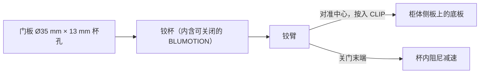

# Blum CLIP top BLUMOTION 杯型铰链：35 mm 杯孔、免工具卡底板与杯内集成阻尼

> [!summary] 一句话概述
> CLIP top BLUMOTION 把暗铰链做成「门上的 35 mm 杯 + 柜体上的 CLIP 底板」：杯孔按 Ø35 mm、深 13 mm 钻在门板上，铰臂对准底板中心按进去即可免工具上门；缓关阻尼做在铰杯里，可以拨开关关掉，不必再在转轴上另装一颗独立油缸。它和 [[旋转阻尼器（缓降盖板）：硅油黏性、水平型与垂直型的扭矩曲线]] 解决的都是「松手不要砸上」，但一个是铰链自己带阻尼，一个是转轴上的分立阻尼器。

## 配图

![[附件/blum-clip-top-assembly.jpg]]
*图源：[Blum CLIP top BLUMOTION 装配页](https://www.blum.com/us/en/products/hingesystems/clip-top-blumotion/assembly/) 页面主图；铰杯已在门板上，铰臂卡在柜体底板上看三向调节*

![[附件/blum-clip-top-cup-drill.jpg]]
*图源：[Blum KIT 说明书 H002（CLIP top BLUMOTION 110°）](https://d2.blum.com/services/BEC003/cme198264_ma_dok_bus_$sen-us_$aof_$v1.pdf) 第 2 页；杯孔 Ø35 mm、杯深 13 mm（1/2"），杯体前缘必须与门边平行*

![[附件/blum-clip-onto-plate.jpg]]
*图源：同上说明书第 5 页；CLIP：铰臂对准底板中心，先在 A 点贴合再按到 B 点卡死；拆卸须先把门开到位，拉释放杆再把铰臂拉离底板*

> 图片版权归原作者所有，仅作个人学习收藏；出处见文末「来源与核实记录」。

## 结构原理

> 本节所有数字只写来源里给出的；来源没有就写「来源未给出」。

### 堆叠方案

方向：**从门板外侧到柜体侧板（全盖门，frameless）**

| 层级 | 零件 | 材料 | 厚度/尺寸 | 固定方式 | 依据 |
| --- | --- | --- | --- | --- | --- |
| L1（门板） | 柜门木板 | 海福乐写 for wood | 本套件门厚 16–26 mm（5/8"–1"） | 开 Ø35 mm 杯孔 | Blum KIT 说明书 NOTE；海福乐 For door material: wood |
| L2 | 铰杯（含 BLUMOTION） | 钢（海福乐） | 杯孔 Ø35 mm，深 13 mm | 本套件：预钻两个 3 mm（1/8"）孔，深小于 5/8"，用 2 颗 #6×5/8" 木螺丝；海福乐另有压入式、INSERTA 免工具杯 | Blum KIT 步骤 3–5；海福乐 Cup drilling Ø 35 mm、Cup drilling depth 13 mm |
| L3 | 铰臂 | 钢（海福乐，与铰一体） | 本套件为 110°；海福乐 Opening angle 110° | 与铰杯一体，另一端 CLIP 到柜体底板 | Blum KIT；海福乐 |
| L4 | CLIP 底板 | 来源未给出单独牌号 | 螺丝孔距 32 mm（1-1/4"）；水平位置距柜口前缘 37 mm（1-7/16"） | 本套件用 2 颗 #6×5/8" 木螺丝；箭头朝柜口 | Blum KIT 步骤 6c–6e |
| L5 | 柜体侧板 | 应用自定 | 计入全盖量（overlay） | 底板固定在侧板上 | Blum KIT |

剖面示意：

和独立转轴油缸的分工（对照用，不是同一零件）：

- 本案例：阻尼集成在铰杯里，海福乐写 with integrated Blumotion soft closing mechanism in hinge cup, can be deactivated；Blum 说明书第 9 步用杯上的拨杆开关打开/关闭阻尼。
- [[旋转阻尼器（缓降盖板）：硅油黏性、水平型与垂直型的扭矩曲线]]：阻尼是单独的转轴油缸，按盖板扭矩 T = m × g × ℓ 选型，不负责门的开合定位和三向调节。

### 零件清单

| 零件 | 数量 | 功能 | 材料 | 依据 |
| --- | --- | --- | --- | --- |
| CLIP top BLUMOTION 110° 铰链 | 本套件 2 只 | 开门、定位、杯内缓关 | 钢（海福乐） | Blum KIT；海福乐 Product Material: Steel |
| CLIP 底板 | 本套件 2 只 | 把铰臂留在柜体上，提供 CLIP 接口和高度调节凸轮 | 来源未给出 | Blum KIT Kit contains |
| #6×5/8" 十字木螺丝 | 本套件 8 颗（可能含备用） | 固定铰杯和底板 | 来源未给出 | Blum KIT |
| 释放杆 | 每只铰链 1（在铰臂上） | 把门从底板上卸下 | 与铰臂一体 | Blum KIT 步骤 7 拆卸 |

海福乐列出的同一 110° 全盖家族杯体固定方式（不要和本套件的螺丝固定混成唯一做法）：螺丝式 71B3550、压入式 71B3580、免工具 INSERTA 71B3590，钻孔图案均为 45/9.5 mm。

### 装配顺序

按 Blum KIT 说明书 H002（无框柜、全盖门）的步骤：

1. 选定门相对侧板的盖量（overlay），用表查出铰杯中心到门侧边的距离 C。本套件：14 mm 盖量对应 C = 20.5 mm，之后每增加 1 mm 盖量，C 增加 1 mm，直到 18 mm 盖量对应 24.5 mm。同一扇门上所有铰链的 C 相同。
2. 确定铰杯中心距门下边（或上边）的距离 X。说明书要求：为了最大稳定性，上下铰链的间距必须大于门宽；并且 X 至少 3–4 inches。
3. 用 Ø35 mm 钻头把杯孔钻到深 13 mm（1/2"）。上下铰链重复。
4. 把铰杯放入孔中，使铰链前缘与门边平行；建议用直角尺对齐。
5. 预钻两个 3 mm 孔（深小于 5/8"），用 2 颗 #6×5/8" 木螺丝把铰杯固定在门上。
6. 算底板中心线：Y = X − OL（OL 是门下边超出柜口下沿的距离）。水平方向从柜口前缘量 37 mm；再沿中心线上下各 16 mm 标出螺丝孔（孔距 32 mm）。预钻 3 mm、深小于 5/8"，用木螺丝固定底板，箭头必须朝向柜口。
7. 上门：铰臂对准底板中心，先保证 A 点贴合，再把铰臂按到 B 点，直到 CLIP 卡死。卸门：先把门完全打开，拉释放杆，再把铰臂拉离底板。
8. 三向调节（本套件，用 2 号十字或 POZI）：侧向拧铰臂前部凸轮螺丝，范围 ±2 mm（3/32"）；高度拧底板上的凸轮螺丝，范围 ±2 mm（说明书同时印了 13/32"，与 ±2 mm 的英寸换算不一致，本文只采用毫米值）；深度拧铰臂后部凸轮螺丝，范围 +3 mm / −2 mm。
9. BLUMOTION 出厂在开启位置（A）。要关闭阻尼，把开关滑向铰臂方向（B），并且必须再关一次门，关闭才算完成；要恢复就把开关拨回原位。

### 受力与运动分析

- **受力路径**：门的自重和开关门的力经过铰杯进入铰臂，再由 CLIP 接口传到底板，最后由底板螺丝传到柜体侧板。关门末端，杯内的 BLUMOTION 提供缓关阻力。海福乐还写该铰链带自动闭合力弹簧（automatic closing spring），与可关闭的软关是两件事，不要混成同一个开关。
- **运动关系**：门绕铰链转动，本产品开度 110°（Blum 套件名与海福乐 Opening angle）。侧向、高度、深度靠三颗凸轮螺丝微调，不靠重新钻孔。CLIP 是可反复卡上、拉释放杆取下的快拆，不是螺丝连接。
- **失效风险**：杯深不够或杯心距门边（C）与盖量表不一致，门会擦柜口或留缝过大。海福乐给出了按门厚和杯心距 E 计算的最小间隙 F 表，门越厚所需间隙越大（例如 16 mm 门在所列 E 下 F 为 0.5 mm，26 mm 门则到 3.0–4.3 mm）；28–30 mm 门该页注明建议做安装试验。上下铰链间距小于门宽时，说明书认为稳定性不足。把 BLUMOTION 关掉却期望它缓关，会变成普通撞击关闭。

## 设计要点与参数

| 要点 | 内容 | 依据 |
| --- | --- | --- |
| 杯孔 | Ø35 mm，深 13 mm | Blum KIT 步骤 3；Blum 装配页写 boring depth has changed to 13 mm；海福乐 Cup drilling Ø 35 mm、depth 13 mm |
| 适用门厚 | 本套件 16–26 mm | Blum KIT NOTE |
| 杯心距 C（本套件盖量表） | 盖量 14/15/16/17/18 mm → C = 20.5/21.5/22.5/23.5/24.5 mm | Blum KIT 步骤 1 |
| 底板位置（本套件） | 距柜口前缘 37 mm；螺丝孔距 32 mm；中心线上下各 16 mm | Blum KIT 步骤 6c–6d |
| 三向调节（本套件） | 侧向 ±2 mm；高度 ±2 mm；深度 +3 / −2 mm | Blum KIT 步骤 8 |
| 三向调节（海福乐，110° 全盖家族） | 侧向 ±2 mm，高度 ±3 mm（Height adjustment depending on mounting plate），深度 −2 / +3 mm | 海福乐 Adjustment facility |
| 开度 | 110° | 套件名称；海福乐 Opening angle |
| 钻孔图案 | 海福乐：45/9.5 mm（螺丝、压入、INSERTA 共用） | 海福乐 Drilling pattern |
| 杯体固定三种方式 | 螺丝 71B3550、压入 71B3580、INSERTA 免工具 71B3590 | 海福乐型号表 |
| CLIP | 门向柜体免工具卡上；拆卸先开门再拉释放杆 | Blum KIT 步骤 7；海福乐 Installation: Door on cabinet without tools with clip system；Blum 装配页 Tool-free door attachment |
| 阻尼 | 集成在铰杯内，可关闭；关闭后须再关一次门才生效 | Blum KIT 步骤 9；海福乐 can be deactivated |
| 自闭弹簧 | 海福乐：with automatic closing spring | 海福乐 Function |
| INSERTA | 杯体也可做成免工具卡入（与 CLIP 卡底板不是同一处） | Blum 装配页 Tool-free hinge attachment With INSERTA；海福乐 Cup fixing: Without tools |

## 优缺点

**优点**
- 杯孔是家具行业常用的 35 mm，钻深统一到 13 mm，和老款 CLIP top 孔位图案兼容（Blum 装配页：same boring pattern，只改了深度）
- 上门是 CLIP 快拆：对准按下即可，返修卸门不用拧铰链螺丝
- 三向都在凸轮螺丝上调，装完还能纠偏
- 阻尼做在杯里，少一颗外挂阻尼器，还可以按门扇需要关掉（例如两扇对开时，常只留一只带阻尼）

**缺点 / 代价**
- 必须先按盖量选 C、再按 X 和 OL 算底板位置，量错会整门错位
- 杯深 13 mm 吃掉门板厚度，薄门或空心门要先核对角材
- 同一家族里高度调节会随底板变化（本套件 ±2 mm，海福乐写 ±3 mm 且取决于底板），不能拿一套说明书的数套到所有底板上
- 本套件英寸对照有一处自相矛盾（高度 ±2 mm 旁印了 13/32"），现场以毫米为准，并按实际底板复核

## 可借鉴点

- **快拆和功能件要分开**：CLIP 负责「门能不能快速上、下柜体」，BLUMOTION 负责「关上最后一段要不要减速」。两套功能不要做死在同一颗螺丝上，这样关阻尼也不会把整扇门卸掉。
- **把阻尼做到已有铰杯里**，比在转轴上再串一颗油缸更省零件、也更省对中；但要用开关处理「对开门只需一侧阻尼」这种现场需求。
- **可调范围写在凸轮上，位置基准写在钻孔上**：盖量靠 C 一次钻孔保证大致位置，余量留给 ±2 mm / +3/−2 mm 的凸轮。钻孔错了不要指望调节螺丝挽回全部误差。
- **杯深和门厚要一起核**：13 mm 杯深对 16 mm 门已经很紧，海福乐对更厚的门还给出最小间隙表，28 mm 以上要做安装试验，不要直接抄 16 mm 的缝。
- 需要和独立旋转阻尼器做方案比较时：门扇用杯型铰、盖板绕一根轴转动，走的是两条结构路径，见下表。

## 与库中相似案例对比

| 对比项 | 本案例（CLIP top BLUMOTION） | [[旋转阻尼器（缓降盖板）：硅油黏性、水平型与垂直型的扭矩曲线]] | [[Blum TIP-ON 按压弹开抽屉：柜体轨弹簧单元与抽屉锁止模块]] |
| --- | --- | --- | --- |
| 主要功能 | 暗铰开门 + 杯内缓关 | 只提供转轴制动扭矩 | 按压解锁后弹簧把抽屉弹出一段 |
| 阻尼在哪 | 集成在 35 mm 铰杯里，可关闭 | 独立油缸，转子在硅油里转 | 本篇对照的是纯 TIP-ON，缓关是另一套 TIP-ON BLUMOTION，不要混用参数 |
| 上门/安装 | CLIP 免工具卡底板；杯孔 Ø35×13 mm | 按 T = m·g·ℓ 选扭矩，装到转轴上 | 柜体轨上的弹簧单元 + 抽屉底板下的锁止模块 |
| 调节 | 侧向/高度/深度凸轮螺丝 | 选型为主，目录不靠三向凸轮纠门缝 | 深度可在锁止模块上调 |
| 和自闭力的关系 | 海福乐写同时带自动闭合力弹簧 | 油缸原则上双向都有扭矩，单向要加离合器 | 按开方向与软关方向相反，普通带闭合力的杯铰不宜再配纯机械碰碰锁 |

## 相关案例

- [[旋转阻尼器（缓降盖板）：硅油黏性、水平型与垂直型的扭矩曲线]]
- [[Blum TIP-ON 按压弹开抽屉：柜体轨弹簧单元与抽屉锁止模块]]
- [[恒扭力摩擦铰链：卡簧过盈产生扭力与「最低扭力 > 盖板力矩」选型]]
- 分类索引：[[03-转轴与铰链 索引]]

## 来源与核实记录

- 主来源：[Blum KIT Instructions H002：CLIP top BLUMOTION 110° (soft close) hinge](https://d2.blum.com/services/BEC003/cme198264_ma_dok_bus_$sen-us_$aof_$v1.pdf)（© 2025 Blum, Inc.；PDF 创建 2025-10-16。套件内容、门厚 16–26 mm、盖量–杯心距表、Ø35 mm / 13 mm 杯孔、底板 37 mm 与 32 mm 孔距、CLIP 卡上/释放杆拆下、三向调节范围、BLUMOTION 拨杆开关）
- 补充来源 1：[Blum 官网 CLIP top BLUMOTION 装配页](https://www.blum.com/us/en/products/hingesystems/clip-top-blumotion/assembly/)（与主来源同属 Blum，不另计机构。INSERTA 免工具装杯、CLIP 免工具上门、三向调节、杯孔图案与 CLIP top 相同但深度改为 13 mm）
- 补充来源 2：[海福乐：Concealed hinge, Blum Clip top Blumotion 110°, full overlay](https://www.hafele.com.de/en/product/concealed-hinge-blum-clip-top-blumotion-110-full-overlay-mounting/P-00898218/)（独立第二机构。钢制、开度 110°、杯径 35 mm、杯深 13 mm、钻孔 45/9.5 mm、71B3550/3580/3590 三种杯体固定、CLIP 免工具上门、杯内集成可关闭阻尼、带自动闭合力弹簧、调节范围及最小间隙表）
- 核实：2026-11-22 下载 H002 PDF（7 页）并打开 Blum 装配页与海福乐产品页。Blum 中英文站点视为同一机构，未再把 Blum 中国站算作第二来源。高度调节以各自文本为准，不把 ±2 mm 和 ±3 mm 合并。
