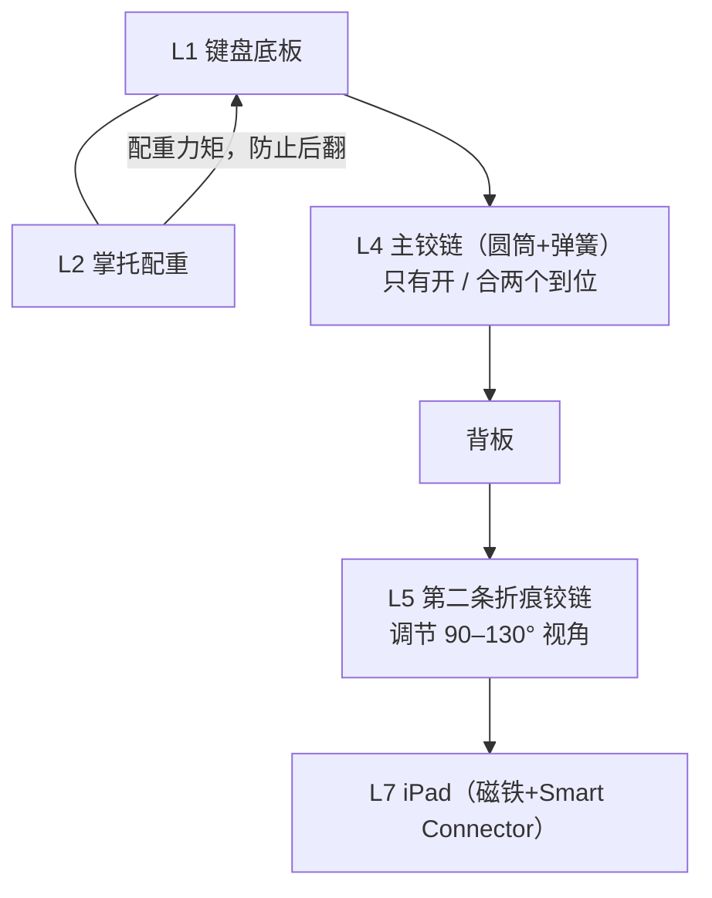

# iPad Magic Keyboard 双铰链悬浮支架与配重

> [!summary] 一句话概述
> iPad Pro 的 Magic Keyboard 不是普通笔记本转轴：主铰链是带弹簧的金属圆筒，只有开/合两个到位；打开后再用背板上的第二条「折痕铰链」去调视角（官方宣传 90–130°）。因为 iPad 比笔记本屏幕重得多，键盘掌托里放了大块金属配重，并且把背板做成可折的悬臂，把 iPad 的重心往前移，整机才不会向后翻。

## 配图

![[附件/ipad-magic-keyboard-xray.jpg]]
*图源：[iFixit *Dang, The iPad Pro Magic Keyboard Looks Cool in X-Rays*](https://www.ifixit.com/News/41291/dang-the-ipad-pro-magic-keyboard-looks-cool-in-x-rays)（Kevin Purdy，2020-05-07；X 光由 Creative Electron 拍摄），11 英寸款。可见：键帽下的剪刀脚、掌托两侧大块不透光金属（后经评论更正为配重）、触控板杠杆、主折页两侧的弹簧铰链、背板上更小的销轴铰链、通向 Smart Connector 的两根分开走线，以及摄像头开孔周围大量小磁铁。*

![[附件/ipad-magic-keyboard-stability-diagram.jpg]]
*图源：[Dr. Drang *Never believe it’s not so*](https://leancrew.com/all-this/2020/03/magic/)（2020-03-21）；用苹果官方产品图改成受力示意——折起的背板把 iPad 重心移到接近键盘后沿的上方，用键盘自身重量产生反向力矩，抵抗点屏时的倾覆。*

![[附件/macbook-pro16-scissor-keycap.jpg]]
*图源：[iFixit MacBook Pro 16" 2019 Teardown](https://www.ifixit.com/Teardown/MacBook+Pro+16-Inch+2019+Teardown/128106) 第 3 步，作结构对照：Magic Keyboard 用的是剪刀脚而不是蝶式。iFixit 在 X 光文里写，这是 Magic Keyboard 相对旧 Smart Keyboard 最明显、也可能是最大的改进。本图是 16 英寸 MacBook Pro 上的同类剪刀脚，不是 iPad 键盘本体照片。*

> 图片版权归原作者所有，仅作个人学习收藏；出处见文末「来源与核实记录」。

## 结构原理

> 本节所有数字只写来源里给出的；配重质量、弹簧刚度来源未给出，不估算。

### 堆叠方案

方向：**从桌面/膝上的键盘底板，到悬浮的 iPad（11 英寸款 X 光）**

| 层级 | 零件 | 材料 | 厚度/尺寸 | 固定方式 | 依据 |
| --- | --- | --- | --- | --- | --- |
| L1（最下） | 键盘底板 + 掌托 | 来源未给出 | 来源未给出整机厚度 | 坐在桌面或腿上 | iFixit X 光 |
| L2 | 左右两块大金属配重 | 金属（评论猜测钢材，来源未确认） | 来源未给出质量；X 光上几乎不透光，中间像两只「眼睛」 | 嵌在掌托里、触控板两侧 | iFixit 原文起初猜是加强板，评论指出是配重后，编辑更正 |
| L3 | 剪刀脚键盘 + 触控板 | 剪刀脚为塑料交叉支架（同类结构见 16 英寸 MacBook Pro 拆解） | 12.9 英寸款触控板约 100×50 mm（Gruber） | 键轴在键盘层内；触控板用胶，加热后可撬，是整机里少数能无损拆的部分 | iFixit；Daring Fireball |
| L4 | 主铰链：金属圆筒 + 每侧至少两套弹簧加载铰链 | Gruber 推测圆筒是铝，未证实 | 来源未给出直径 | 连接键盘底板与背板，只有开/合两个到位，开到位会「咬死」 | iFixit；Daring Fireball |
| L5 | 背板上的第二条铰链（折痕 / 较小销轴铰链） | 来源未给出 | 来源未给出 | 用来调节 iPad 视角；Gruber 形容像把 GorillaPod 弯到某个角就会停住 | iFixit；Daring Fireball |
| L6 | 磁铁阵列 + Smart Connector | 大量小磁铁（X 光可见摄像头开孔附近） | 来源未给出磁铁数量和吸力牛顿 | 吸附 iPad；两根走线分很开地通向 Smart Connector，iFixit 猜测是给铰链运动留余量 | iFixit；Gruber 称磁铁很强，倒提键盘 iPad 也不会掉 |
| L7（最上） | iPad | 11 英寸裸机 0.47 kg；12.9 英寸裸机 0.64 kg（Gruber 表） | — | 磁吸 + Smart Connector | Daring Fireball |

剖面示意：

### 零件清单

| 零件 | 数量 | 功能 | 材料 | 依据 |
| --- | --- | --- | --- | --- |
| 主铰链弹簧组件 | 每侧至少 2 套（iFixit：「at least two spring-loaded hinge designs at each side」），外加上方更小的销轴铰链 | 提供开合阻尼，并在完全打开时咬到位 | 来源未给出 | iFixit |
| 第二条视角铰链 | 1 条折痕（背板中） | 调节观看角度并保持该角 | 来源未给出 | Daring Fireball |
| 掌托配重块 | 2 | 用重量抵抗点屏和 iPad 自重造成的后翻 | 金属 | iFixit 更正；Dr. Drang 分析 |
| 触控板杠杆 + 单颗实体按键 | 1 套 | 在触控板任何位置按下都能点到中间那颗键 | 来源未给出 | iFixit Taylor Dixon 补更：不是多颗按键 |
| 剪刀脚按键 | 全键盘 | 按键导向与回弹（配合锅仔/橡胶穹顶，穹顶细节来源未在此文展开） | 塑料支架 | iFixit |
| Smart Connector 走线 | 2 根，走线间距被有意拉宽 | 供电和数据 | 来源未给出 | iFixit |
| 磁铁 | 「大量」小磁铁，数量来源未给出 | 对位并吸住 iPad | 来源未给出 | iFixit；Gruber |

### 装配顺序

> 来源没有工厂装配步骤。iFixit 只拆了触控板（加热 + 撬片去胶），并写：触控板是当时唯一能在不严重破坏整机的前提下拆开的部分。其余结构依据 X 光和使用方式反推，标为观察而非工艺文件。

1. 键盘层、配重、剪刀脚和触控板先装进底板。
2. 主铰链圆筒连接底板与背板，弹簧组件装在圆筒两侧。
3. 背板做出第二条折痕铰链，Smart Connector 走线穿过铰链区。
4. 磁铁按阵列装在背板与 iPad 相对的位置。
5. 用户侧：先把 iPad 磁吸到背板上，再两手打开主铰链到咬死位置，然后把 iPad 下沿从背板下段分开，弯第二条铰链调视角。Gruber 强调：主铰链完全打开时，iPad 其实还几乎贴在背板上，视角仍偏合；必须再分开下沿，才进入可用角度。

### 受力与运动分析

- **受力路径（Dr. Drang）**：点屏的力和背板上段的自重，都想让整机绕键盘后沿向后翻（他图中的逆时针）。能抗住的只有键盘（含配重）的重量乘以质心到后沿的距离。把背板做成可折悬臂，是为了把 iPad 的重心往前移到接近键盘后沿的上方，减小倾覆力臂；再把配重放到掌托、尽量靠前，加大稳定力矩。Gruber 补充：往后调视角时，通常要用另一只手按住掌托，否则抬起来的是键盘而不是屏幕。
- **运动关系**：主铰链近似只有开、合两个位置，开到位会咬死（Gruber）。视角完全由第二条铰链承担，官方宣传 90–130°；Gruber 用量角器量到全开正好约 130°，并认为再开一点就会开始发「飘」。对照：当时新 MacBook Air 大约开到 135°，Smart Keyboard 更开的那一档约 125°，更立的一档约 110°。Smart Keyboard 的「铰链」只是没有预紧的橡胶折页，可以翻到 iPad 背后当盖；Magic Keyboard 做不到，它是便携支架而不是保护盖。
- **失效风险 / 使用约束**：因为 iPad 相对键盘太重，不能像普通笔记本那样单手开盖——Gruber 把它比成「把 MacBook Air 倒过来再单手开」。磁铁和铰链被做得很紧：Gruber 写可以抓住掌托大力摇、甚至倒提，iPad 不会掉、视角也不会走。代价是手感「出乎意料地紧」。配重克数和磁铁吸力来源未给出。

## 设计要点与参数

| 要点 | 内容 | 依据 |
| --- | --- | --- |
| 视角范围 | 官方 90–130°；Gruber 用量角器看全开约等于 130° | Apple 宣传（经 Gruber 转述并实测） |
| 两级铰链分工 | 主铰链只管开合并咬死；第二条折痕铰链管视角 | Daring Fireball |
| 11 英寸 Magic Keyboard 重量 | 实测 597 g（Dr. Drang 先前估计 483 g，偏低） | Daring Fireball 2020-04-22 更新 |
| 组合重量（Gruber 表） | 11" iPad + Magic Keyboard 1.07 kg；12.9" 组合 1.35 kg | Daring Fireball |
| 12.9" 触控板尺寸 | 约 100×50 mm；对照当时 MacBook Air 约 120×80 mm | Daring Fireball |
| 触控板点击 | 实体按键 + 杠杆，不是 Force Touch 触感马达；边角按下会通过杠杆抬起中心触点 | iFixit 补更（Taylor Dixon） |
| 配重质量、弹簧圈数、磁铁数量 | 来源未给出 | — |

## 优缺点

**优点**
- 用「悬臂把重心前移 + 掌托配重」解决了重平板的倾覆，不必把键盘做成一块铁板
- 双铰链分工清楚：开合有明确到位，视角可以停在任意角
- 磁铁足够强，膝上使用也不容易脱开（Gruber 的摇晃/倒提测试）
- 按键改回剪刀脚，避开了蝶式键盘的问题

**缺点 / 代价**
- 不能单手开盖，也不能像 Smart Keyboard 那样翻到背后当保护盖
- 全开被限制在约 130°，再开会有翻倒风险
- 整机做得很「紧」，第一手感往往像被卡住（Gruber 的最初印象）
- 除了触控板，iFixit 当时认为继续拆会严重破坏，可维修性差
- 12.9 英寸组合已经略重于当时 13 英寸 MacBook Air（1.35 kg vs 1.28 kg，Gruber 表）

## 可借鉴点

- **重屏幕的便携支架先做受力，再做铰链。** 先把屏幕质心移到支撑面后沿附近（可折背板），再把配重放到离后沿最远的掌托；不要只靠把主铰链拧得很死来防翻。
- **开合和调角不要共用同一道铰链。** 主铰链给出一个可靠的「完全打开」到位，第二条铰链专门管视角，用户每次拆下 iPad 再吸回去，角度还能保持（Gruber）。
- **全开角度要按临界倾覆来设上限**，而不是按「和笔记本一样开到 135°+」来设。130° 这个数字在来源里既是官方规格，也被 Gruber 解释成稳定性和开合手感的折中。
- **触控板要「到处都能点」时，不一定上触感马达**：一个中心按键加覆盖四角的杠杆，就可以把边缘的按压传到中间（iFixit 拆解）。
- 配重是结构件，不是装饰。X 光里那两块「不透光的板」一旦被认成单纯加强筋，就会漏掉真正的稳定策略。

## 与库中相似案例对比

| 对比项 | 本案例 | [[微软 Surface Pro Kickstand 宽角摩擦铰链]] | [[恒扭力摩擦铰链：卡簧过盈产生扭力与「最低扭力 > 盖板力矩」选型]] | [[16 英寸 MacBook Pro 剪刀脚键盘：1 mm 键程与交叉支架（对照蝶式）]] |
| --- | --- | --- | --- | --- |
| 屏幕/平板怎么站住 | 悬臂改重心 + 掌托配重 + 双铰链预紧 | 后盖撑脚摩擦铰链 | 元件扭矩 > 盖板力矩 | 不负责整机俯仰 |
| 开合 | 主铰链开/合两态，不能单手开 | 撑脚可连续展开 | 单轴连续 | — |
| 按键 | 剪刀脚（iFixit 指出这是相对 Smart Keyboard 的改进） | 外接 Type Cover，不在本篇 | — | 同为剪刀脚，但是笔记本 C 壳里的实现 |

## 相关案例

- [[微软 Surface Pro Kickstand 宽角摩擦铰链]]
- [[恒扭力摩擦铰链：卡簧过盈产生扭力与「最低扭力 > 盖板力矩」选型]]
- [[16 英寸 MacBook Pro 剪刀脚键盘：1 mm 键程与交叉支架（对照蝶式）]]
- [[苹果蝶式键盘（反面案例）：变薄 40% 的代价与硅胶防尘膜补救]]
- 分类索引：[[03-转轴与铰链 索引]]

## 来源与核实记录

- 主来源：[Dang, The iPad Pro Magic Keyboard Looks Cool in X-Rays](https://www.ifixit.com/News/41291/dang-the-ipad-pro-magic-keyboard-looks-cool-in-x-rays)（iFixit，Kevin Purdy，2020-05-07；后有编辑更正配重，以及 Taylor Dixon 对触控板杠杆的补更）
- 补充来源 1：[The iPad Magic Keyboard](https://daringfireball.net/2020/04/the_ipad_magic_keyboard)（Daring Fireball，John Gruber，2020-04-20，4 月 22 日补 11 英寸重量）——双铰链分工、90–130°、重量表、不能单手开盖、磁铁强度。这是独立使用评测，不是转述 iFixit
- 补充来源 2：[Never believe it’s not so](https://leancrew.com/all-this/2020/03/magic/)（Dr. Drang，2020-03-21）——悬臂改变力臂、用键盘重量提供稳定力矩的力学说明
- 核实：2026-11-15 用 WebFetch 打开以上三篇原文。未把 16 英寸 MacBook Pro 的剪刀脚尺寸写成 iPad Magic Keyboard 的尺寸。配重克数、弹簧参数和磁铁数量来源未给出，不编造。
