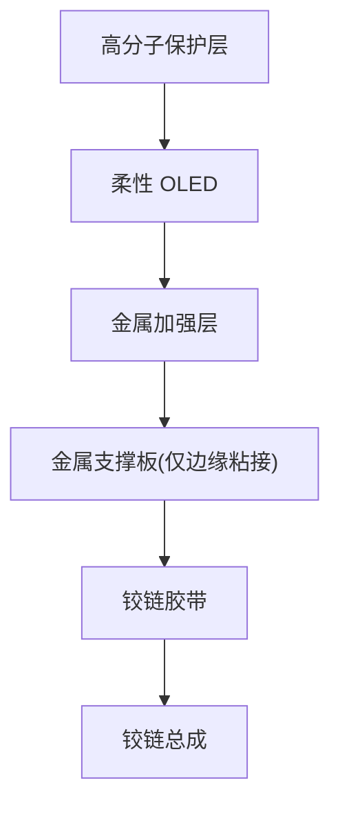

# 三星 Galaxy Fold 一代铰链与屏幕支撑结构

> [!summary] 一句话概述
> 初代 Galaxy Fold 用「4 个弹簧卡扣 + 上下 2 个可横向浮动的铰链 + 中间 1 个齿轮同步铰链」实现开合，屏幕只在外缘粘接、中间留空让屏幕随折叠浮动。

## 配图

![[附件/galaxy-fold-hinge.jpg]]
*iFixit：铰链总成（弹簧卡扣、上下铰链、中间齿轮铰链）*

![[附件/galaxy-fold-hinge2.jpg]]
*iFixit：两根排线跨过铰链连接两半机身*

![[附件/galaxy-fold-display-armor.jpg]]
*iFixit：屏幕背面的金属支撑层*

> 图片版权归原作者所有，仅作个人学习收藏；出处见文末「来源与核实记录」。

## 结构原理

> 本节数字只写来源里给出的；来源没有就写「来源未给出」。

### 堆叠方案

方向：**从折叠屏正面向内**

| 层级 | 零件 | 材料 | 厚度/尺寸 | 固定方式 | 依据 |
| --- | --- | --- | --- | --- | --- |
| L1 | 高分子保护层 (Advanced Polymer Protective Layer) | 高分子膜 | 来源未给出 | 与屏幕一体，延伸到边框下方 | Step 18 |
| L2 | 柔性 OLED | 塑料基板 OLED | 来源未给出 | 仅外缘粘接 + 新增黑色胶条 | Step 17 |
| L3 | 带缺口的金属加强层（像锁子甲） | 金属 | 来源未给出 | 粘在屏幕背面 | Step 18 |
| L4 | 金属支撑板 | 金属 | 来源未给出 | 边缘粘在机身框架上，中间脊部无胶 | Step 18 |
| L5 | 铰链胶带 | 胶带 | 来源未给出 | 覆盖铰链内侧 | Step 19 |
| L6 | 铰链总成 | 来源未给出 | 来源未给出 | 固定在中轴脊上 | Step 20 |

剖面示意：

### 零件清单

| 零件 | 数量 | 功能 | 材料 | 依据 |
| --- | --- | --- | --- | --- |
| 弹簧卡扣 | 4 | 把屏幕锁定在展开状态 | 来源未给出 | Step 20 |
| 上下铰链（圆形滑动铰链） | 2 | 允许少量横向游动以吸收扭转 | 来源未给出 | Step 20-21 |
| 中间齿轮铰链 | 1 | 均分开合力，保证两半同步打开 | 来源未给出 | Step 20 |
| 跨铰链排线 | 2 | 连接两半机身；两端在弯折前固定 | 来源未给出 | Step 20 |
| T 形保护盖 + 柔性垫片 | 2 处（折痕两端） | 挡住折痕两端的缝隙防异物 | 塑料/柔性材料 | Step 16 |
| 内屏塑料边框 | 1 | 遮住屏幕边缘（约 2 mm） | 塑料 | Step 16 |

### 装配顺序

1. (按拆解顺序反推) 铰链总成固定在中轴脊上，贴铰链胶带
2. 两根排线穿过铰链，两端在弯折前固定
3. 屏幕（含金属加强层和支撑板）放入，仅外缘粘接
4. 装折痕两端 T 形保护盖与垫片，再粘上塑料边框
5. 装两侧主板、电池，最后粘上外屏和后盖

> 来源只给出拆解顺序，以上为按拆解顺序反推；iFixit 称三星习惯「从正面开始组装，最后装后盖」。

### 受力与运动分析

- **受力路径**：开合力经中间齿轮铰链分配到两半机身，使两侧同步；上下铰链的横向游隙吸收扭转力（原文）。展开后由 4 个弹簧卡扣锁定。
- **运动关系**：两半机身绕脊部旋转；屏幕不是完全压平，合上时像活页夹而非书本，只在外缘接触（Step 4）；屏幕中间不粘胶，允许折叠时浮动。
- **失效风险**：屏幕与金属背板之间夹入任何异物都会成为致命压点；铰链脊两侧仍有能插进撬片的缝隙，会进灰（Step 3、19）。

## 设计要点与参数

| 要点 | 内容 | 依据 |
| --- | --- | --- |
| 屏幕边框覆盖宽度 | 约 2 mm（「barely cover two millimeters」） | Step 16 |
| 折叠寿命 | 三星称折叠超过 200,000 次（厂商数据） | Step 21 |
| 整机重量 | 276 g | Step 1 |
| 两块电池尺寸 | 42.2×76.8×3.8 mm；42.6×64.3×4.8 mm | Step 8 |
| 铰链尺寸/齿轮模数 | 来源未给出 | — |

## 优缺点

**优点**
- 齿轮同步 + 弹簧锁定，开合手感稳定（iFixit 认为设计扎实）
- 屏幕中间不粘，降低折叠应力
- 排线跨铰链的固定方式考虑了弯折寿命，排线可单独更换

**缺点 / 代价**
- 屏幕非常脆弱，维修评分 2/10
- 防尘只靠胶带和端盖，脊部缝隙仍会进灰

## 可借鉴点

- 多段铰链分工：同步（齿轮）、锁定（弹簧卡扣）、容差（浮动铰链）分开做
- 柔性件跨转轴：两端先固定、中段留自由弯曲长度
- 大柔性面板只粘外缘，中间允许相对滑移

## 相关案例

- [[三星 Galaxy Z Flip 铰链与尼龙防尘刷]]
- [[微软 Surface Duo 360° 双铰链]]
- [[三星 Galaxy Z Fold3 折叠屏防水结构]]
- 分类索引：[[03-转轴与铰链 索引]]

## 来源与核实记录

- 主来源：[Samsung Galaxy Fold Teardown](https://www.ifixit.com/Teardown/Samsung+Galaxy+Fold+Teardown/122600)（2019-04-24（页面首发；后更新为零售版拆解），Taylor Dixon / iFixit）
- 核实：2026-11-13 通过 iFixit 公开 API 读取全部 23 步原文，核对铰链数量、功能、屏幕粘接方式与尺寸数据。
