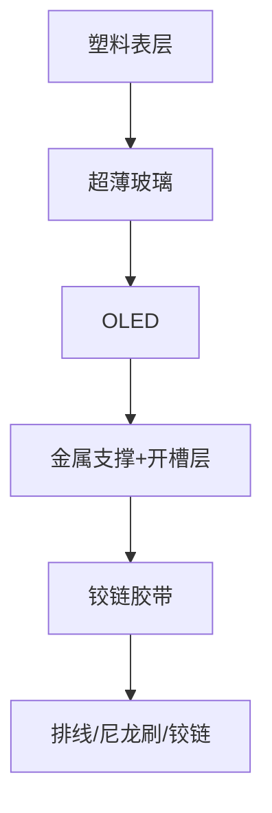

# 三星 Galaxy Z Flip 铰链与尼龙防尘刷

> [!summary] 一句话概述
> Z Flip 在铰链里加了「尼龙刷毛」防尘（三星称 Sweeper 技术），但 iFixit 用紫色粉尘实测后铰链卡死，说明刷毛防尘效果有限——是一个值得对照的反面验证案例。

## 配图

![[附件/zflip-hinge.jpg]]
*iFixit：粉尘测试后的铰链总成*

![[附件/zflip-brushes.jpg]]
*iFixit：铰链侧的尼龙刷*

![[附件/zflip-display-armor.jpg]]
*iFixit：屏幕背面的金属支撑与中间开槽「锁子甲」*

> 图片版权归原作者所有，仅作个人学习收藏；出处见文末「来源与核实记录」。

## 结构原理

> 本节数字只写来源里给出的；来源没有就写「来源未给出」。

### 堆叠方案

方向：**从内屏正面向内**

| 层级 | 零件 | 材料 | 厚度/尺寸 | 固定方式 | 依据 |
| --- | --- | --- | --- | --- | --- |
| L1 | 塑料表层 | 塑料 | 来源未给出 | 屏幕叠层的一部分 | Step 12 |
| L2 | 超薄玻璃 (UTG) | 玻璃 | 来源未给出 | 屏幕叠层中间层 | Step 12 |
| L3 | OLED 面板 | 来源未给出 | 来源未给出 | 主要在上下边缘粘接，中部胶少 | Step 11 |
| L4 | 金属支撑板（两侧）+ 中间开槽金属层 | 金属 | 来源未给出 | 贴在屏幕背面 | Step 11 |
| L5 | 铰链保护胶带 | 胶带 | 来源未给出 | 粘贴 | Step 13 |
| L6 | 异形排线 + 尼龙刷 + 铰链 | 尼龙/金属 | 来源未给出 | 排线成形绕过铰链 | Step 13-14 |

剖面示意：

### 零件清单

| 零件 | 数量 | 功能 | 材料 | 依据 |
| --- | --- | --- | --- | --- |
| 铰链总成（Hideaway Hinge） | 1 | 开合（初代悬停能力来源未说明；Fold3 文章称 Flip3 改为可停在任意角度） | 来源未给出 | Step 14 |
| 尼龙刷 | 来源未给出 | 扫除灰尘 | 尼龙纤维（三星称微高度切割工艺） | Step 5 |
| 磁铁 | 每角成组 | 合盖吸附 | 磁铁 | Step 2（X 光） |
| 异形排线 | 来源未给出 | 绕过铰链连接两半 | 来源未给出 | Step 13 |
| 电池 | 2 | 供电（2370 mAh/9.15 Wh 与 930 mAh/3.59 Wh） | 锂电 | Step 10 |

### 装配顺序

1. (按拆解顺序反推) 铰链与尼龙刷装入框架，排线成形后绕过铰链布置
2. 贴铰链保护胶带
3. 装两块电池（强力胶粘）与主板（双层堆叠板）
4. 屏幕主要沿上下边缘粘接，再粘塑料边框
5. 最后粘上两块后盖

> 来源只给出拆解顺序，以上为按拆解顺序反推。

### 受力与运动分析

- **受力路径**：开合时铰链齿轮传动；X 光可见弹簧加载的铰链总成和四角磁铁用于合盖吸附（Step 2）。
- **运动关系**：上下翻折。铰链胶带把粉尘挡在屏幕之外，却也把粉尘「关」在铰链里（Step 13）。
- **失效风险**：粉尘测试几秒后开合出现爆裂声、铰链卡死，倒出约一茶匙粉末；刷毛上留下的粉尘很少（Step 5、15）。iFixit 也注明该测试并不完全代表真实使用。

## 设计要点与参数

| 要点 | 内容 | 依据 |
| --- | --- | --- |
| 厂商标称厚度 | 6.9–7.2 mm（不含塑料边框） | Step 4 |
| 电池总能量 | 12.74 Wh | Step 10 |
| 刷毛规格/铰链扭矩 | 来源未给出 | — |

## 优缺点

**优点**
- 铰链结构紧凑，外观完整
- 屏幕背面用开槽金属层兼顾刚度与可弯折

**缺点 / 代价**
- 刷毛防尘在极端粉尘测试中失效
- 可维修性 2/10：玻璃粘接、电池强胶

## 可借鉴点

- 防尘设计要做验证测试，而不是只依赖结构概念
- 胶带挡尘要考虑「挡在哪一侧」——可能把污物留在运动副里
- 刚度板中段开槽是常见的可弯折加强做法

## 相关案例

- [[三星 Galaxy Fold 一代铰链与屏幕支撑结构]]
- [[三星 Galaxy Z Fold3 折叠屏防水结构]]
- 分类索引：[[03-转轴与铰链 索引]]

## 来源与核实记录

- 主来源：[Samsung Galaxy Z Flip Teardown](https://www.ifixit.com/Teardown/Samsung+Galaxy+Z+Flip+Teardown/131002)（2020-02-18，Taylor Dixon / iFixit）
- 核实：2026-11-13 通过 iFixit API 读取 16 步原文，核对刷毛描述、粉尘测试结果、屏幕层次与电池数据。
