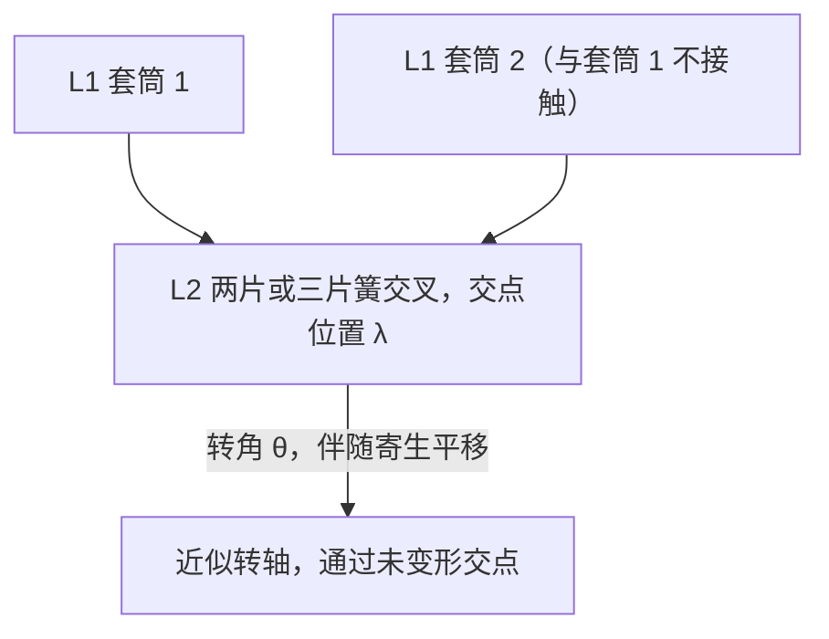

# 十字交叉簧片枢轴（Cross-spring pivot）：交叉位置对寄生位移的影响与 C-Flex I-10 实例

> [!summary] 一句话概述
> 十字交叉簧片枢轴用两片（或三片）簧片交叉构成转动中心：簧片可以在中点相交（λ = 1/2），也可以把交点移开；中点交叉在 α = 45°、θ = 30° 时寄生位移约为 L/31，把交点移到 λ = 1/2 ± √5/6 可以消掉二阶的横向寄生，但会让其中一段簧变得很短、应力升高。商品上的 C-Flex I-10 把三片簧放在两个互不接触的不锈钢套筒里钎焊成一体，额定最大转角 ±15°，作为量产实例写在本篇，不再按品牌拆第二篇。

## 配图

![[附件/cflex-pivot-cutaway.jpg]]
*图源：[C-Flex Pivot Bearings 产品页](https://c-flex.com/products/pivot-bearings/) 剖切图；两个套筒互不接触，内部可见交叉簧片。产品页说明：两只不锈钢套筒由两平面上的三片簧片保持位置*

![[附件/cflex-i10-loading.jpg]]
*图源：[C-Flex I-10 Specification Sheet](https://c-flex.com/wp-content/uploads/2025/02/I-10-SERIES-Specification-Sheet.pdf)；径向外载使簧片受压（L_c）时的剖视与端面：三片簧在套筒内交叉，剖面 A-A 标出 Springs in Compression*

![[附件/cross-spring-lambda.jpg]]
*图源：[Naves 等, *Precision Engineering* 63 (2020) 105–114](https://ris.utwente.nl/ws/files/175963914/1_s2.0_S0141635919308104_main.pdf) 第 107 页 Fig. 3；交叉位置 λ 的定义：λ = 1/2 为中点交叉，λ > 1 为交点落在簧长之外的外交叉；P 为（未变形时的）交叉点，2α 为交叉角，θ 为转角*

> 图片版权归原作者所有，仅作个人学习收藏；出处见文末「来源与核实记录」。Zelenika 等 Fig. 1（中点交叉在横向载荷下的寄生平移 OO′）见该 PDF 第 382 页，本篇配图不超过 3 张，不另嵌入。

## 结构原理

> 本节所有数字只写来源里给出的；来源没有就写「来源未给出」。

### 堆叠方案

方向：**从外圈套筒看向内部交叉簧片，转轴通过未变形时的簧片交点**

| 层级 | 零件 | 材料 | 厚度/尺寸 | 固定方式 | 依据 |
| --- | --- | --- | --- | --- | --- |
| L1 | 外圈套筒（可有单端或双端结构） | C-Flex：416 不锈钢，AMS 5610L Type II | I-10：直径 0.7500 in（+0.0000/−0.0005）；尺寸 A = 1.200 ± 0.003 in；B_min = 0.564 in | 与设备轴或座孔配合；两套筒之间不接触 | I-10 规格书；产品页 |
| L2 | 交叉簧片（及芯） | C-Flex：410（AMS 5504M）与 420（AMS 5506F）不锈钢。簧材：疲劳强度 75,000 psi，抗拉强度 294,000 psi，弹性模量 29,000,000 psi，晶粒度 ASTM #6 或更细 | 厚度、宽度由系列与扭簧刚度决定，I-10 规格书未列出每片簧的厚度 | 两端固定在套筒内；C-Flex 用钎料 AMS 4765 钎焊。硬度 46–56 Rc | I-10 规格书；产品页写 three leaf springs on two planes |
| L3（可选） | 中间附加套筒（双端轴承，尺寸 AD 至 JD） | 来源写 additional sleeve，牌号同系列不锈钢 | 来源未给出与 I-10 单端件不同的单独尺寸表 | 中央安装，形成两个枢轴臂 | 产品页与 I-10 规格书文末 |

分析模型（Zelenika、Naves）把簧片画成在夹角 2α 下交叉的等长叶簧，不一定带商品套筒，但运动原理相同。

剖面示意：

和卡特轮的差别：卡特轮在交点把梁做成一体的“轮”；本篇是分立簧片，靠套筒或框架固定两端。同一套 λ 公式可以用来解释为什么有人把交点从中点移开。

### 零件清单

| 零件 | 数量 | 功能 | 材料 | 依据 |
| --- | --- | --- | --- | --- |
| 套筒 | 2（双端型再加 1 个中间套筒） | 与外部连接，并固定簧端；彼此不接触以免摩擦 | I-10：416 不锈钢 | I-10 规格书；产品页 |
| 簧片 | C-Flex：3 片，分在两个平面；分析模型常用 2 片 | 弯曲形成转角并自定心 | I-10：410/420 不锈钢 | 产品页；Zelenika 写 two leaf springs；Naves 写 two (or more) |
| 钎缝 | 簧端与套筒之间 | 保持簧的位置 | AMS 4765 | I-10 规格书 |

### 装配顺序

商品件按出厂成品安装（C-Flex 规格书与产品页）：

1. 按直径、扭转刚度、载荷和转角选型号（I-10 为其中一种规格）。
2. 把套筒装入座孔或轴上。规格书写：刚度按悬臂安装、载荷作用在无支承那一半的中点、0° 转角时的数据给出；一对串联（tandem）的悬臂轴承若连接很刚，总刚度可将表中值除以 3。
3. 在额定转角内使用。I-10 系列：零载荷时 ±15° 寿命可视为 indefinite；最大 θ = ±15.0°。规格书警告：转角不要超过最大 θ 的两倍。
4. 不需要润滑；套筒互不接触。

分析用的交叉位置在制造时就已经做进簧片长度和固定点，使用中不能再调 λ。

### 受力与运动分析

- **受力路径**：外载经过套筒传到簧端。C-Flex 区分径向外载使簧受压（L_c）还是受拉（L_t），以及轴向载荷；扭转刚度以 in·lb/degree 给出。Zelenika 专门分析横向力、垂向力不是纯力偶时，寄生平移会改变。
- **运动关系**：输出相对输入作有限转角。未变形时交点为几何中心 O；转动后出现寄生平移 OO′（Zelenika Fig. 1）。Naves 等对中点交叉（λ = 1/2）给出主导寄生位移

  dᵧ = [L / (12 cos α)] θ²

  典型 α = 45°、最大偏转 θ = 30° 时，约为 L/31。把交叉位置改到 λ = 1/2 ± √5/6，可消去 y 向的二阶寄生，剩下 x 向更高阶项；同一角度下比中点交叉减小 20 倍以上。代价是其中一段簧大约只剩 0.127 L，弯曲应力升高，而且对 λ 的制造偏差更敏感（Naves 等第 3.1 节）。
- **失效风险**：超过最大转角或在高载荷下反复大角度摆动，寿命从“无限”下降（I-10 寿命曲线：角度高于 ±15° 且载荷增大时，期望寿命下降）。水平使用不是本篇商品的主要讨论对象。横向载荷会让中心漂移比纯力偶时更明显（Zelenika）。把卡特轮或短切口公式直接拿来算分立簧片会错（推断）。

## 设计要点与参数

| 要点 | 内容 | 依据 |
| --- | --- | --- |
| I-10 外形 | 直径 0.7500 in（+0.0000/−0.0005）；A = 1.200 ± 0.003 in；B_min = 0.564 in | I-10 规格书表 |
| I-10 载荷容量（零偏转时的最大值，磅） | L_c = 32.40；L_t = 129.40；轴向 = 207.40 | 同上。L_c 为径向外载使簧受压，L_t 使簧受拉 |
| I-10 刚度 | 径向 L_c：0.00006 in/lb；径向 L_t：0.00004 in/lb；轴向：0.00005 in/lb；扭转弹簧率：0.0482 in·lb/degree。扭转弹簧率在零载荷时一般在标称值的 ±10% 以内 | 同上，注释 1、4 |
| 转角与寿命 | −10 系列最大 θ = ±15.0°；零载荷、±15° 时寿命可视为 indefinite；角度超过 ±15° 且载荷增大时寿命下降。枢轴转角不应超过最大 θ 的两倍。产品页另写：典型最大偏转可达 ±30°（与 I-10 规格书的 ±15° 不是同一档，不混成一个数） | I-10 规格书曲线与注释；产品页 Typical supports maximum deflection angles of +/-30° |
| 温度 | −100 °F 至 375 °F；可到 450 °F 但不得超过 8 小时，否则可能损坏 | I-10 规格书注释 6 |
| 中点交叉寄生位移 | dᵧ = L θ² / (12 cos α)；α = 45°、θ = 30° 时约 L/31 | Naves 等式 (1) 及随后文字 |
| 交叉位置优化 | λ = 1/2 ± √5/6 可消去 y 向二阶寄生，改善超过 20 倍，但短段约 0.127 L，应力升高，对 λ 偏差敏感 | Naves 等第 3.1 节 |
| Zelenika 的要点 | 讨论对象是中点交叉、夹角 2α 的等长簧；一般 2α = π/2。重点是横向载荷下的中心漂移，而不是再给一套 λ 公式 | Zelenika 引言与 Fig. 1 |
| 套筒互不接触、无需润滑、无间隙 | 产品页与规格书均强调 frictionless、zero backlash、self centering | 产品页；I-10 规格书文末 |

## 优缺点

**优点**
- 无摩擦、无润滑、无间隙，适合光学和真空等不能用油的场合（C-Flex 产品页给了质谱仪扫描镜的例子）。
- 商品规格把直径、载荷、刚度和转角寿命做成可选型谱，不必从零设计簧片。
- 交叉位置 λ 提供一条不靠改材料就能减小寄生位移的几何路线。

**缺点 / 代价**
- 转角有限；超过额定角度寿命迅速下降，且不能转到超过 2 倍最大 θ。
- 中点交叉有固有的圆弧式寄生平移；优化 λ 又会牺牲一段簧的强度和公差鲁棒性。
- 径向/轴向刚度和扭转刚度互相牵制：产品页写，大转角需要更薄的簧，扭转刚度和载荷容量会一起变小。

## 可借鉴点

- 先分清是中点交叉、外交叉还是优化 λ，再估寄生位移，不要只说「有中心漂移」。
- 商品选型至少同时看：直径与安装尺寸、L_c/L_t/轴向载荷、扭转弹簧率、最大转角和寿命曲线，以及工作温度。
- 一对串联安装的刚度不能把单只表值直接相加；I-10 规格书写，连接很刚时可把表值除以 3。
- 需要一体交叉、更小寄生时，改看卡特轮，而不是把三片簧再叠一层当成卡特轮。

## 与库中相似案例对比

| 对比项 | 本案例：十字交叉簧片 | [[卡特轮柔性铰链（Cartwheel flexure）：中心交叉梁转动副，对照切口短铰与十字簧片]] | [[直圆切口柔性铰链（Right circular flexure hinge）：最薄处厚度 t、切口半径 R 与公式适用范围]] | [[恒扭力摩擦铰链：卡簧过盈产生扭力与「最低扭力 > 盖板力矩」选型]] |
| --- | --- | --- | --- | --- |
| 结构 | 分立簧片交叉，套筒互不接触 | 交点材料连续的轮式梁 | 短圆弧切口 | 摩擦副 |
| 关键参数 | λ、2α、L、商品的载荷与 ±15° 寿命 | L/2 臂长、寄生约 L/162（α = 45°、θ = 30°） | t、R、t/R | 最低扭力 > 盖板力矩 |
| 中点交叉寄生 | 约 L/31（同上角度） | 更小 | 中心漂移机制不同 | 无弹性转心漂移这套算法 |
| 是否重复 | 本篇写分立簧与 λ，商品只作实例 | 本轮另篇 | 本轮另篇 | 已有摩擦铰，不是本结构 |

## 相关案例

- [[卡特轮柔性铰链（Cartwheel flexure）：中心交叉梁转动副，对照切口短铰与十字簧片]]
- [[直圆切口柔性铰链（Right circular flexure hinge）：最薄处厚度 t、切口半径 R 与公式适用范围]]
- [[恒扭力摩擦铰链：卡簧过盈产生扭力与「最低扭力 > 盖板力矩」选型]]
- [[活动铰链（Living Hinge）：一体成型的柔性铰链]]
- 分类索引：[[03-转轴与铰链 索引]]

## 来源与核实记录

- 主来源：[C-Flex I-10 SERIES Specification Sheet](https://c-flex.com/wp-content/uploads/2025/02/I-10-SERIES-Specification-Sheet.pdf)（C-Flex Bearing Co.；材料、尺寸、载荷、刚度、±15° 寿命曲线。文档本身未另印发布日期，按打开的 2025/02 路径下载）
- 同机构补充：[C-Flex Pivot Bearings 产品页](https://c-flex.com/products/pivot-bearings/)（三片簧、两套筒不接触、双端结构、典型 ±30° 与扭转刚度范围。与规格书同属 C-Flex，不另算第二机构）
- 补充来源 1：[Zelenika, De Bona, Analytical and experimental characterisation of high-precision flexural pivots subjected to lateral loads](https://wp.optics.arizona.edu/optomech/wp-content/uploads/sites/53/2016/10/Zelenika-2002.pdf)（*Precision Engineering* 26 (2002) 381–388；PSI 与乌迪内大学。中点交叉与横向载荷下的中心漂移）
- 补充来源 2：[Naves 等 2020 年文](https://ris.utwente.nl/ws/files/175963914/1_s2.0_S0141635919308104_main.pdf)（第 3.1 节 λ 定义与寄生位移公式，独立机构）
- 核实：2026-11-22 下载并打开上述文件与产品页。Free-Flex / Riverhawk 未作为第二种结构单独立篇。未把卡特轮或摩擦铰写成同一篇。
