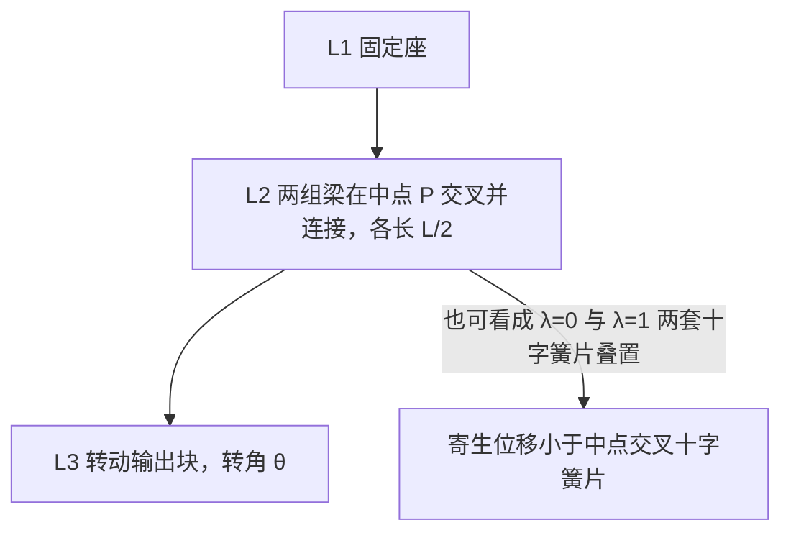

# 卡特轮柔性铰链（Cartwheel flexure）：中心交叉梁转动副，对照切口短铰与十字簧片

> [!summary] 一句话概述
> 卡特轮柔性铰链用两对（或可看成两组）柔性梁在中点交叉并在交点连成一体，形成一个比直圆、圆角短切口转角能力更大的柔性转动副。Naves 等把它解释成两套十字簧片（交叉位置 λ = 0 与 λ = 1）叠在一起，并给出寄生位移公式；在 α = 45°、θ = 30° 时寄生运动约为 L/162，小于中点交叉的普通十字簧片。它不是薄膜活铰，也不是短切口铰。

## 配图

![[附件/cartwheel-flexure-geometry.jpg]]
*图源：[Naves 等, *Precision Engineering* 63 (2020) 105–114](https://ris.utwente.nl/ws/files/175963914/1_s2.0_S0141635919308104_main.pdf) 第 107 页 Fig. 4；卡特轮示意：柔性梁在中点 P 相连，单根梁长为 L/2（L 为总体特征长度），交叉角 2α，转角 θ。右图把同一构型拆成 λ = 0 与 λ = 1 两套十字簧片的叠置*

![[附件/cross-spring-lambda.jpg]]
*图源：同上 PDF 第 107 页 Fig. 3；普通十字簧片对照：两片簧在相对位置 λ 处交叉，中点交叉为 λ = 1/2，也可以做成 λ > 1 的外交叉。卡特轮与它的差别是交点处梁是连成一体的，不是两片可以分开的簧*

![[附件/cartwheel-x2-modified-pivot.jpg]]
*图源：[Grossard, Martin, Huard, *Actuators* 2015, 4, 281–300](https://mdpi-res.com/d_attachment/actuators/actuators-04-00281/article_deploy/actuators-04-00281-v2.pdf?version=1449223763) 第 289 页 Figure 8；在卡特轮基础上沿垂直于转轴的中面切开，得到串联的两个卡特轮（文中称 X² 枢轴），用于手指指节，转角中心重合*

> 图片版权归原作者所有，仅作个人学习收藏；出处见文末「来源与核实记录」。

## 结构原理

> 本节所有数字只写来源里给出的；来源没有就写「来源未给出」。

### 堆叠方案

方向：**从固定座经过交叉梁到转动输出块，转轴通过交叉中心 P**

| 层级 | 零件 | 材料 | 厚度/尺寸 | 固定方式 | 依据 |
| --- | --- | --- | --- | --- | --- |
| L1 | 固定座 | 来源未给出牌号 | 作为梁的根部约束 | 与梁一体或固接 | Naves 等 Fig. 4 |
| L2 | 交叉柔性梁（卡特轮） | 弹性梁；半轮型转载页写 60Si2Mn（那是半轮构型，不是 Naves 样件的材料） | 总体特征长度 L，每根梁长 L/2；交叉角 2α；厚度来源未给出通用产品值 | 在中点 P 相互连接（这是与分立十字簧片的关键差别） | Naves 等 Fig. 4 与第 3.2 节 |
| L3 | 转动输出块（shuttle / 活动边） | 来源未给出 | 来源未给出 | 与梁的另一端一体 | Naves 等 Fig. 4 |
| L4（变体） | 串联切割后的第二套卡特轮（X²） | 来源未给出 | Grossard 等：H 为 X² 枢轴高度的一半，φ 为两叶夹角的一半 | 沿垂直转轴的中面切开后，两个卡特轮转心重合、串联 | Grossard 等第 4.1–4.2 节与 Figure 8 |

剖面示意：

和短切口铰、十字簧片的差别：

- 直圆/圆角直梁是短而厚的局部切口，转角小、中心相对稳。
- 十字簧片是分立簧片交叉，交点不必做成材料连续的“轮毂”；Naves 等 Fig. 3 与 Fig. 4 专门标出了这一差别。
- 半轮型（中文转载页）是两侧对称布置的两段直梁，用来在 Rz 方向柔、在 X/Y 方向刚，是卡特轮家族的半边构型，不是再一篇薄膜活铰。

### 零件清单

| 零件 | 数量 | 功能 | 材料 | 依据 |
| --- | --- | --- | --- | --- |
| 交叉柔性梁 | 两对/两组（卡特轮基本型）；半轮型为两侧各一个直梁单元 | 弯曲积累成转角 | Naves 未给牌号；半轮型转载页写 60Si2Mn | Naves Fig. 4；半轮型转载页第 1 节 |
| 固定座与输出块 | 各 1，常与梁一体 | 提供边界和输出 | 来源未给出 | Naves Fig. 4 |
| X² 变体中的切割面 | 1 道中面切口 | 把一个卡特轮变成转心重合的两个串联卡特轮 | 来源未给出 | Grossard 等 Figure 8 |

### 装配顺序

基本型按一体构型设计（成形工艺来源未给出）：

1. 确定转轴位置 P 和总体长度 L，使各梁在中点相交。
2. 按交叉角 2α 布置梁，每根梁长取 L/2，并在 P 点保持材料连续（不要做成两片只是贴在一起的簧）。
3. 一端固支，一端作为输出块。
4. 若采用 Grossard 等的 X²：再沿垂直于转轴的中面切开，使两套卡特轮串联、转心重合，用于需要更大转角或特定手指关节的场合。

> 半轮型转载页没有给出可核对的加工步骤，不编造其装配顺序。

### 受力与运动分析

- **受力路径**：输出块上的力矩使各梁弯曲，载荷沿梁传到固定座。卡特轮因为梁在 P 点相连，传力路径与分立十字簧片不同。
- **运动关系**：输出块绕接近 P 的轴线转过 θ。Naves 等给出卡特轮的寄生运动（相对理想圆弧轨迹的偏离）

  dᵧ = [L / (63 cos α)] θ²

  当 α = 45°、θ = 30° 时，寄生运动约为 L/162。同一条件下，中点交叉十字簧片约为 L/31，卡特轮更小；但比把交叉位置优化到 λ = 1/2 ± √5/6 的十字簧片仍略大，属于中间水平（Naves 等第 3.2 节）。
- **失效风险**：转角过大时梁互相干涉或应力超限（Naves 等在十字簧片节讨论了短梁段应力升高；卡特轮同样受应力限制，具体许用值来源未给出）。把短切口公式拿来算卡特轮会完全错（推断）。半轮型若 θ 偏离 45°，X 与 Y 向刚度不再相等（转载页 3.1 节）。

## 设计要点与参数

| 要点 | 内容 | 依据 |
| --- | --- | --- |
| 基本几何 | 梁在一半长度处相交并在 P 点相连；对特征长度 L，每根梁长 L/2；交叉角 2α | Naves 等第 3.2 节与 Fig. 4 |
| 寄生位移 | dᵧ = L θ² / (63 cos α)；α = 45°、θ = 30° 时约为 L/162 | Naves 等式 (6) 与随后文字 |
| 与十字簧片的量化比较 | 中点交叉十字簧片在 α = 45°、θ = 30° 时寄生约 L/31；卡特轮显著更小，但小于「最优 λ」十字簧片的改善幅度 | Naves 等第 3.1–3.2 节 |
| X² 变体 | 沿垂直转轴的中面切开，等价于两个转心重合的卡特轮串联；参数 H 为高度一半，φ 为两叶夹角一半 | Grossard 等第 4.1–4.2 节 |
| 半轮型参数含义 | 梁长 L、宽 b、厚 t，两侧子单元与端面法线夹角 θ；θ 从 15° 变到 75° 时，X 与 Y 向刚度呈对调趋势，θ = 45° 时两者相等 | 半轮型转载页第 1 节与 3.1 节 |
| 半轮型材料 | 转载页写两侧均匀直梁采用弹簧钢 60Si2Mn | 同上，表 1 文字说明（具体尺寸表未在转载页完整给出，不写） |
| 通用最大转角、梁厚、疲劳寿命 | Naves 文针对约 60° 行程的驱动悬挂来选构型，但未把 60° 写成卡特轮本身的额定转角；产品级寿命来源未给出 | Naves 标题与第 1 节 |

## 优缺点

**优点**
- 同样特征长度下，寄生运动小于普通中点交叉十字簧片，转角能力通常大于短切口铰。
- 一体交叉，没有销轴间隙。
- 可以用切割、串联（X²）或半轮布置，按刚度和转角需求变形。

**缺点 / 代价**
- 结构比直圆切口复杂，占用面积更大。
- 寄生运动仍不是零；若对准直要求极严，还要和优化 λ 的十字簧片或蝴蝶铰比较（Naves 等同时讨论了后者，本篇不展开）。
- 应力和干涉限制转角，不能按公式无限加大 θ。

## 可借鉴点

- 先画清交点是否材料连续：连续是卡特轮，分开是十字簧片。
- 用 Naves 的式 (6) 先估寄生位移，并与十字簧片的 L/31（α = 45°、θ = 30°）比较，再决定要不要上更复杂的 λ 优化或串联切割。
- 半轮型若要 X、Y 刚度对称，先把张角放到 45° 附近再调梁长和厚度。
- 不要用直圆/圆角短铰的 t、R 公式来设计卡特轮。

## 与库中相似案例对比

| 对比项 | 本案例：卡特轮 | [[直圆切口柔性铰链（Right circular flexure hinge）：最薄处厚度 t、切口半径 R 与公式适用范围]] | [[十字交叉簧片枢轴（Cross-spring pivot）：交叉位置对寄生位移的影响与 C-Flex I-10 实例]] | [[活动铰链（Living Hinge）：一体成型的柔性铰链]] |
| --- | --- | --- | --- | --- |
| 结构 | 中心相连的交叉长梁 | 短圆弧切口 | 分立簧片交叉，套筒或框架固定 | 塑料薄膜 |
| 转角 | 通常大于短切口；具体额定值来源未统一给出 | 小转角精密副 | 商品例 ±15°（C-Flex I-10 系列）或可达约 ±30°（产品页） | 大开合 |
| 寄生运动 | α = 45°、θ = 30° 时约 L/162 | 中心漂移相对较小（来源定性） | 中点交叉时约 L/31（同一比较条件） | 不是精密转心问题 |
| 是否重复 | 本篇只写轮式交叉梁 | 本轮另篇 | 本轮另篇，强调分立簧与 λ | 已有，不重复 |

## 相关案例

- [[直圆切口柔性铰链（Right circular flexure hinge）：最薄处厚度 t、切口半径 R 与公式适用范围]]
- [[圆角直梁柔性铰链（Corner-filleted flexure hinge）：等厚直梁加两端圆角 r，对照直圆切口铰]]
- [[十字交叉簧片枢轴（Cross-spring pivot）：交叉位置对寄生位移的影响与 C-Flex I-10 实例]]
- [[活动铰链（Living Hinge）：一体成型的柔性铰链]]
- 分类索引：[[03-转轴与铰链 索引]]

## 来源与核实记录

- 主来源：[M. Naves 等, Flexure-based 60 degrees stroke actuator suspension for a high torque iron core motor](https://ris.utwente.nl/ws/files/175963914/1_s2.0_S0141635919308104_main.pdf)（*Precision Engineering* 63 (2020) 105–114；特文特大学机构库开放 PDF。Fig. 3–4、卡特轮寄生位移式 (6) 及与十字簧片的比较）
- 补充来源 1：[Grossard, Martin, Huard, Force-Sensing Actuator with a Compliant Flexure-Type Joint](https://mdpi-res.com/d_attachment/actuators/actuators-04-00281/article_deploy/actuators-04-00281-v2.pdf?version=1449223763)（*Actuators* 2015, 4, 281–300；2015-12-03；CEA LIST 等。Figure 8 的 X² 变体，独立第二机构）
- 补充来源 2：[《半轮型柔性铰链的结构设计和分析》网页转载](https://www.sdfriendship.com/newsdetails.asp?id=628)（页面标注 2022/5/18。本轮打开的是该转载页正文，未打开原刊 PDF；只用其中关于 L、b、t、θ 和 θ = 45° 时 X/Y 刚度相等的叙述，不写入转载页未完整给出的表 1 尺寸，也不把转载网站当作原作者单位）
- 核实：2026-11-22 下载并打开上述 PDF 与网页。未把短切口铰或薄膜活铰写成卡特轮。
