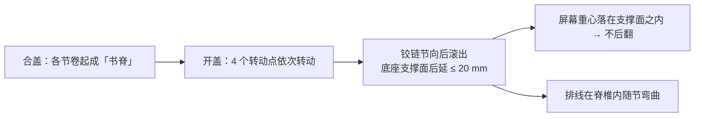

# 微软 Surface Book 动态支点铰链（分段铝铰链）

> [!summary] 一句话概述
> 屏幕比底座重的二合一笔记本，用普通单轴（筒形）铰链一打开就会后翻；Surface Book 改用 4 个转动点串成的分段铝「脊椎」，开盖时像地毯一样向后滚出，让底座的支撑面最多延长 20 mm、把支点后移，于是不用给底座配重，省下「几百克」。

## 配图

![[附件/surface-book-fulcrum-hinge-wired.jpg]]
*图源：[WIRED](https://www.wired.com/2015/10/story-behind-surface-books-crazy-new-hinge/)（Andrew White for WIRED）；分段式「动态支点铰链」外观*

![[附件/surface-book-hinge.jpg]]
*图源：[iFixit Surface Book 拆解](https://www.ifixit.com/Teardown/Microsoft+Surface+Book+Teardown/51972) 第 32 步；用 Torx 螺丝刀把分段铰链从底座上拆下，排线从铰链脊椎内穿过*

![[附件/surface-book-hinge-spine.jpg]]
*图源：同上；铰链连同排线整体从底座上取下*

> 图片版权归原作者所有，仅作个人学习收藏；出处见文末「来源与核实记录」。

## 结构原理

> 本节数字只写来源里给出的；来源没有就写「来源未给出」。

### 堆叠方案

方向：**从底座（键盘）后缘到屏幕下缘，沿铰链展开方向**

| 层级 | 零件 | 材料 | 厚度/尺寸 | 固定方式 | 依据 |
| --- | --- | --- | --- | --- | --- |
| L1 | 底座后缘安装面 | 镁合金机身 | 来源未给出 | 多颗 Torx 螺丝固定铰链 | iFixit 第 32 步；WIRED |
| L2 | 分段铰链节（多节嵌套，4 个转动点） | 铝 | 支撑面最多外伸 20 mm | 节与节由销轴/转轴串联；各节用螺丝固定 | WIRED；iFixit |
| L3 | 铰链内腔：屏幕–底座排线 | 柔性排线 | 来源未给出 | 从底座穿入「脊椎」 | iFixit 第 32 步 |
| L4 | 铰链顶端：锁舌与对插连接器（与肌肉线锁配合） | 金属 | 来源未给出 | 插入屏幕下缘锁座 | iFixit 第 21 步；WIRED |
| L5 | 屏幕（含 CPU、电池，偏重） | — | 屏幕电池 18 Wh；底座电池 51 Wh | 可拆 | iFixit 第 20、25 步 |

剖面示意（侧视，开盖过程）：

### 零件清单

| 零件 | 数量 | 功能 | 材料 | 依据 |
| --- | --- | --- | --- | --- |
| 分段铰链节 | 多节，4 个转动点 | 开合 + 延长支撑面 | 铝 | WIRED |
| 节间转轴/销 | 来源未给出 | 节与节之间转动 | 来源未给出 | — |
| 扭力/阻尼元件 | 来源未给出 | 维持任意开角 | 来源未给出 | — |
| 固定螺丝（Torx） | 多颗 | 铰链固定到底座；各节可拆 | 钢 | iFixit 第 32 步 |
| 屏幕–底座排线 | 来源未给出 | 穿过铰链脊椎 | — | iFixit 第 32 步 |

### 装配顺序

> 按 iFixit 拆解顺序反推。

1. 铰链节总成预先组装（节间转轴、内部扭力件，细节来源未给出）。
2. 排线穿过铰链脊椎。
3. 铰链总成用 Torx 螺丝固定在底座后缘，排线接到底座主板。
4. 屏幕插到铰链顶端的锁座上（由肌肉线锁锁住）。

### 受力与运动分析

- **受力路径**：屏幕重力 → 铰链顶端 → 各铰链节 → 底座后缘 → 桌面。打开时铰链自身外伸，接触桌面的支撑点后移，屏幕重心的倾覆力矩由更长的底座「力臂」平衡。
- **运动关系**：多节串联转动，单一开合自由度（各节运动由结构联动，联动方式来源未给出）；这跟只有一个转轴的筒形铰链不同，后者支点固定在底座后缘。
- **失效风险**：节多则累积旷量大；排线反复弯折；节间转轴磨损。iFixit 推断铰链、脊椎和线缆都靠螺丝固定，坏了可以单独换。

## 设计要点与参数

| 要点 | 内容 | 依据 |
| --- | --- | --- |
| 转动点 | 4 个 | WIRED |
| 支撑面延长 | 最多 20 mm（按需外伸） | WIRED |
| 减重 | 省下「几百克」（不用给底座配重） | WIRED |
| 材料 | 铰链铝，机身镁（镁比铝轻约 1/3）；铰链亮面外观「基本是偶然」 | WIRED |
| 加工 | 机械师为把铰链线条做亮做直，专门找 CNC 机床与刀具 | 微软 Devices Blog |
| 维修 | 铰链分段螺丝固定，可单独更换（iFixit 推断） | iFixit 第 32 步 |
| 扭矩、开角、寿命次数 | 来源未给出 | — |

## 优缺点

**优点**
- 不加配重就能平衡偏重的屏幕，整机更轻
- 合起来像「书脊」，外观辨识度高
- 排线走铰链内部，看不到外露线

**缺点 / 代价**
- 零件多、节间公差累积，成本与加工难度高
- 铰链本身占据后缘一段空间（来源未给出具体尺寸）

## 可借鉴点

- **先算倾覆**：屏幕（或上盖）重于底座时，检查「上盖重心投影是否落在支撑面内」；不满足时，与其给底座加配重，不如让铰链在打开时把支撑点往后移
- **多转动点铰链能改变支点位置**：转动点越多、每节越短，支撑点外伸越平滑；设计时要同时定好合盖时各节如何收拢
- **线缆走铰链内腔**时要给线留弯曲半径，并让铰链各节可单独拆换（螺丝而不是铆接）
- 可在台灯、显示器支架、折叠支架等「上重下轻」的产品上用同样的「展开即外伸」思路（推断）

## 与库中相似案例对比

| 对比项 | 本案例 | [[微软 Surface Duo 360° 双铰链]] | [[三星 Galaxy Fold 一代铰链与屏幕支撑结构]] |
| --- | --- | --- | --- |
| 目的 | 平衡重心、延长支撑面 | 双屏 360° 翻转 | 柔性屏弯折半径与支撑 |
| 转轴数 | 4 个转动点串联 | 双轴 | 多轴 + 齿轮同步 |
| 线缆 | 穿铰链脊椎 | 穿铰链 | 跨铰链 |
| 借鉴差异 | 关注「支点位置」，不关注屏幕弯折 | 关注翻转角度 | 关注屏幕弯折 |

## 相关案例

- [[微软 Surface Book 形状记忆合金（肌肉线）电控分离锁]]（同一产品）
- [[微软 Surface Duo 360° 双铰链]]
- [[三星 Galaxy Fold 一代铰链与屏幕支撑结构]]
- 分类索引：[[03-转轴与铰链 索引]]

## 来源与核实记录

- 主来源：[Microsoft Surface Book Teardown](https://www.ifixit.com/Teardown/Microsoft+Surface+Book+Teardown/51972)（iFixit，2015-11-03），第 20、25、32、33 步
- 补充来源 1：[WIRED：The Story Behind the Surface Book's Crazy New Hinge](https://www.wired.com/2015/10/story-behind-surface-books-crazy-new-hinge/)（2015-10-07，Margaret Rhodes）——4 个转动点、20 mm、几百克、铝/镁
- 补充来源 2：[Surface Book: Designed from the inside out](https://blogs.windows.com/devices/2016/03/24/surface-book-designed-from-the-inside-out/)（微软 Devices Blog，2016-03-24）——筒形铰链会后翻、「地毯滚出」、CNC 加工
- 核实：2026-11-13 打开以上三个页面原文核对。铰链内部扭力件与联动方式三个来源都没写，表中标「来源未给出」。
