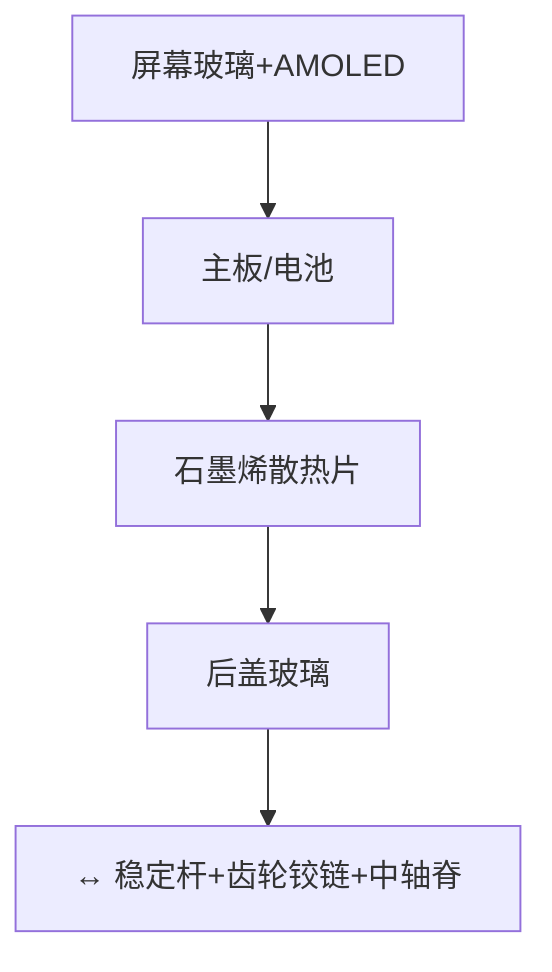

# 微软 Surface Duo 360° 双铰链

> [!summary] 一句话概述
> Surface Duo 不用柔性屏，而用两块独立屏 + 两个齿轮铰链（各用 3 颗螺丝固定在稳定杆上）实现 360° 翻折，排线从铰链壳体内穿过以防被夹，结构比折叠屏铰链简单得多。

## 配图

![[附件/surface-duo-hinge.jpg]]
*iFixit：齿轮铰链与稳定杆*

![[附件/surface-duo-spine.jpg]]
*iFixit：拆下中轴脊后的两侧框架*

> 图片版权归原作者所有，仅作个人学习收藏；出处见文末「来源与核实记录」。

## 结构原理

> 本节数字只写来源里给出的；来源没有就写「来源未给出」。

### 堆叠方案

方向：**从屏幕面向背面（单侧机身）**

| 层级 | 零件 | 材料 | 厚度/尺寸 | 固定方式 | 依据 |
| --- | --- | --- | --- | --- | --- |
| L1 | 屏幕盖板玻璃 + AMOLED | 玻璃 / OLED | 展开整机厚 4.9 mm | 胶粘 | Step 2、5 |
| L2 | 主板 / 电池 | — | 来源未给出 | 电池粘在后盖上 | Step 4 |
| L3 | 石墨烯散热片 + 胶条 | 石墨烯 | 来源未给出 | 粘接 | Step 4 |
| L4 | 后盖玻璃 | 玻璃 | 来源未给出 | 胶粘 | Step 4 |
| 中轴 | 稳定杆 + 齿轮铰链 ×2 + 中轴脊 | 金属（框架） | 来源未给出 | 每个铰链 3 颗螺丝；脊部大量 Torx 小螺丝 | Step 11-12 |

剖面示意：

### 零件清单

| 零件 | 数量 | 功能 | 材料 | 依据 |
| --- | --- | --- | --- | --- |
| 齿轮铰链 | 2 | 360° 翻折 | 来源未给出 | Step 12 |
| 稳定杆 / 两侧框架 | 2 | 提供结构与抗扭刚度，让两半均匀打开，并作为内部件安装点 | 来源未给出 | Step 11 |
| 多股互连线缆 | 2 | 连接两半，穿过铰链 | 多股线（非扁平排线） | Step 6 |
| 电池 | 2 | 10.37 Wh + 2.89 Wh | 锂电 | Step 7 |

### 装配顺序

1. (按拆解顺序反推) 两个齿轮铰链各用 3 颗螺丝固定到两侧稳定杆
2. 装中轴脊（大量 Torx 螺丝）
3. 互连线缆从铰链壳体内穿到另一侧
4. 装主板、电池、屏幕与后盖（均胶粘）

> 来源只给出拆解顺序，以上为按拆解顺序反推。

### 受力与运动分析

- **受力路径**：开合扭矩由两个齿轮铰链传到两侧稳定杆/框架；框架提供抗扭刚度，使两半「均匀打开」（Step 11）。
- **运动关系**：两半绕中轴 0–360° 翻转；线缆进入铰链壳体，避免在翻折时被夹（Step 12）。iFixit 将其类比为缩小版的 360° 笔记本铰链。
- **失效风险**：来源未提到铰链失效；可维修性问题集中在大量胶、三角螺丝、电池连接器压在主板下（Step 7、14）。

## 设计要点与参数

| 要点 | 内容 | 依据 |
| --- | --- | --- |
| 展开厚度 | 4.9 mm | Step 2 |
| 折叠厚度 | 9.8 mm（初代 Galaxy Fold 为 17 mm） | Step 2 |
| 铰链固定 | 每个铰链 3 颗螺丝 | Step 12 |
| 铰链扭矩 | 来源未给出 | — |

## 优缺点

**优点**
- 避开柔性屏折痕问题，铰链结构简单
- 线缆走铰链壳体内部，受保护

**缺点 / 代价**
- 双屏中间有缝
- 整机胶粘严重，可维修性 2/10

## 可借鉴点

- 360° 双轴铰链 + 线缆穿壳体是成熟的笔记本方案，可迁移到小型设备
- 两侧框架同时承担刚度和安装点，减少零件

## 相关案例

- [[三星 Galaxy Fold 一代铰链与屏幕支撑结构]]
- [[三星 Galaxy Z Flip 铰链与尼龙防尘刷]]
- 分类索引：[[03-转轴与铰链 索引]]

## 来源与核实记录

- 主来源：[Microsoft Surface Duo Teardown](https://www.ifixit.com/Teardown/Microsoft+Surface+Duo+Teardown/136576)（2020-09-11，Taylor Dixon / iFixit）
- 核实：2026-11-13 通过 iFixit API 读取 14 步原文，核对铰链数量、螺丝数量、厚度与线缆描述。
