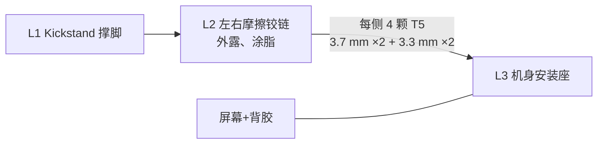

# 微软 Surface Pro Kickstand 宽角摩擦铰链

> [!summary] 一句话概述
> Surface Pro 后盖上的宽幅撑脚不是「几档卡位」，而是左右两只外露的摩擦铰链：从闭合到接近平放都能连续停住，用来同时满足打字、触控和手写。Microsoft 官方把 Pro 3 的范围写成 0–150°；到 Pro 5，iFixit 观察到铰链改过，又多出 15°、达到 165°。要换铰链必须先揭掉整块粘接屏幕。这是后盖撑脚摩擦铰链，不是 Surface Book 的分段动态支点，也不是肌肉线电控锁。

## 配图

![[附件/surface-pro4-kickstand-hinge-closeup.jpg]]
*图源：[iFixit Microsoft Surface Pro 4 Teardown](https://www.ifixit.com/Teardown/Microsoft+Surface+Pro+4+Teardown/51568) 第 3 步；Pro 4 外露的 Kickstand 铰链，表面可见润滑脂。iFixit 原文提醒：不要让毛絮、宠物毛或沙子进到这里。*

![[附件/surface-pro4-kickstand-hinge-xray.jpg]]
*图源：同上第 3 步，Creative Electron / iFixit X 光；铰链在机身内的轮廓。来源没有标出内部摩擦片数量或材料。*

![[附件/surface-pro4-kickstand-hinge-screws.jpg]]
*图源：[iFixit Microsoft Surface Pro 4 Kickstand Hinge Replacement](https://www.ifixit.com/Guide/Microsoft+Surface+Pro+4+Kickstand+Hinge+Replacement/145812) 拆下屏幕后的换铰链步骤；每只铰链 4 颗 T5 Torx：两颗 3.7 mm（红圈）和两颗 3.3 mm（橙圈）。*

> 图片版权归原作者所有，仅作个人学习收藏；出处见文末「来源与核实记录」。

## 结构原理

> 本节所有数字只写来源里给出的；来源没有就写「来源未给出」，不估算、不换算成看似精确的值。

### 堆叠方案

方向：**从后盖撑脚外侧到机身内部（以 Surface Pro 4 维修指南为准）**

| 层级 | 零件 | 材料 | 厚度/尺寸 | 固定方式 | 依据 |
| --- | --- | --- | --- | --- | --- |
| L1（最外） | Kickstand 撑脚板 | 来源未给出（外观为金属后盖的一部分） | 来源未给出 | 插到左右铰链上，由铰链螺丝固定 | iFixit 换铰链指南；微软 Learn Pro 7 流程提到泡沫插片 |
| L2 | 外露摩擦铰链（左、右各一） | 来源未给出；表面有润滑脂 | 来源未给出 | 每侧 4 颗 T5 Torx 钉在中框/后壳上 | iFixit 拆解第 3 步；换铰链指南 |
| L3 | 铰链安装座 / 机身开槽 | 镁合金机身（OnMSFT 转述 Pro 3 用镁合金外壳） | 来源未给出 | 与壳体一体或作为安装面 | OnMSFT；iFixit 换铰链图 |
| L4（最内，维修路径） | 屏幕组件（玻璃+LCD 融合） | 显示玻璃 0.4 mm（iFixit 实测 Pro 4） | 0.4 mm 玻璃 | 一圈背胶粘在中框上，两根显示排线 + 卡扣金属屏蔽罩 | iFixit 拆解第 6、5 步；换铰链指南 |

剖面示意：

### 零件清单

| 零件 | 数量 | 功能 | 材料 | 依据 |
| --- | --- | --- | --- | --- |
| Kickstand 撑脚 | 1 | 把平板支在桌面上，连续改变俯仰角 | 来源未给出 | 各代拆解/官方 |
| 摩擦铰链 | 2（左右各一，结构不完全相同） | 提供随角度变化的摩擦扭矩，使撑脚停在任意角 | 来源未给出；Pro 3 每只 8 个小零件，两只之间只共用 2 个相同件 | OnMSFT 转述 Vineet Thuvara |
| T5 螺丝（Pro 4） | 每铰链 4 颗：2×3.7 mm + 2×3.3 mm | 把铰链固定到机身 | 来源未给出 | iFixit 换铰链指南 |
| 润滑脂 | 来源未给出 | 降低外露铰链的干摩擦、配合宽角调节 | 来源未给出 | iFixit Pro 4 拆解第 3 步 |
| 屏幕背胶 + 两根显示排线 | 1 套 | 维修铰链前必须拆屏；排线被卡扣金属屏蔽罩压住 | 来源未给出 | 同上拆解第 5 步；换铰链指南 |

### 装配顺序

> 按 iFixit Surface Pro 4 换铰链指南的拆解顺序反推。指南明确：重组按相反顺序。

1. 先把左右摩擦铰链用 T5 螺丝装到机身安装座上（每侧两颗 3.7 mm、两颗 3.3 mm）。
2. 装上 Kickstand 撑脚，使其与铰链对位。
3. 连接两根显示排线，重新扣上 EMI 屏蔽罩（齿要对准主板边框，并压到排线的金色导带上）。
4. 按单独的屏幕背胶更换指南重新粘屏幕。

换铰链之前必须：给屏幕边缘加热（指南写 iOpener 每边约两分钟，可多次加热），沿安全区划开背胶。注意事项（数字均来自该指南）：

- 扬声器切口处撬片插入不超过 0.45 in（12 mm）
- 右下角不超过 0.25 in（6 mm），底边不超过 0.45 in（12 mm）
- 左边下方 2.5 inches（65 mm）范围内不超过 1/8 inch（3 mm），此处是显示排线
- 顶边有天线，先划到距左缘 2.75 inches（70 mm）处，其后 6 inches（15 cm）要用「点入再向右滚」而不是沿边滑动
- 指南开篇警告：未加强、易碎的显示面板在本工序中有明显破裂风险

**后续机型的维修差异（不要和 Pro 4 混用）：** 微软 Learn 的 Surface Pro 7 Kickstand 更换流程改为用 **3IP（Torx-Plus）** 拧铰链螺丝；先把撑脚放到约 90°，四颗螺丝先松 2–3 圈，再逐颗拆完；然后把铰链从 90° 用力推到约 30°（指南写 This requires a great deal of force），再抽出带泡沫插片（foam tabs）的撑脚。新撑脚也从约 30° 插入泡沫片，再把铰链推回约 90° 打螺丝，最后再多拧约 1/4 圈（约 90°）。这是官方服务文档，说明铰链仍可从外部拆撑脚，但紧固件规格和拆装角度已经改过。

### 受力与运动分析

- **受力路径**：平板自重和触控/手写的按压力 → 撑脚 → 左右摩擦铰链 → 机身安装座。OnMSFT 转述：打开初期（大约到 25°）几乎没有摩擦，方便展开；过了这一点后，摩擦要轻到能调节，又要强到用户点屏幕、用笔书写时撑脚不会塌。
- **运动关系**：绕铰链轴线一个转动自由度，连续角度，无多档卡位。官方称 Pro 3 为 friction-hinge，从 0° 到 150° 任选。两只铰链「功能上同步工作，但形体并不相同」（OnMSFT）。
- **失效风险**：外露铰链进灰、进毛、进沙（iFixit）；长期磨损（微软对 Pro 3 的寿命目标是 3–4 年不换，见 OnMSFT）；换铰链必须拆粘接屏幕，指南写明有很高的碎屏风险。评论区有猫跳上撑开的 Pro 4、两只铰链一起断、壳体外弓的案例，是否可修来源未给出明确结论。

## 设计要点与参数

| 要点 | 内容 | 依据 |
| --- | --- | --- |
| 角度范围（Pro 3，官方） | 连续可调，0–150° | 微软设备博客 *Announcing Surface Pro 3*（Panos Panay，2014-05-20） |
| 角度范围（Pro 5） | 新设计铰链又多出 15°，达到 165° | iFixit Surface Pro 5 Teardown 第 2 步 |
| 分段摩擦（Pro 3 设计说明） | 约到 25° 之前几乎无摩擦，之后「可调但能撑住点击和手写」 | OnMSFT 转述 Vineet Thuvara 在 Ignite 2015 的演讲 |
| 左右铰链是否对称 | 不对称：每只 8 个小零件，两只之间只有 2 个零件相同 | 同上 |
| 寿命目标（Pro 3） | 与电池一样，希望 3–4 年不用换 | 同上 |
| Pro 4 铰链固定螺丝 | T5 Torx；每侧 2×3.7 mm + 2×3.3 mm | iFixit 换铰链指南 |
| Pro 4 显示玻璃厚度 | 0.4 mm（iFixit 实测） | iFixit Pro 4 拆解第 6 步 |
| 润滑 | 外露铰链可见润滑脂 | iFixit Pro 4 拆解第 3 步 |
| Pro 7 官方拆法 | 3IP Torx-Plus；撑脚约 90° 拆螺丝；铰链需从 90° 用力推到约 30° 才能抽撑脚 | 微软 Learn *Surface Pro 7 Kickstand Component Disassembly and Reassembly* |
| 内部摩擦片数量/扭矩牛顿·米 | 来源未给出 | — |

## 优缺点

**优点**
- 连续角度，不再用「两档/三档卡位」去迁就笔记本姿势（微软自己承认早期固定档撑脚不好复制笔记本角度）
- 左右分置的宽基座摩擦铰链，能在点触和手写时稳住平板
- 打开前段几乎无摩擦（Pro 3 设计目标），减轻「扳开」的手感

**缺点 / 代价**
- 铰链外露，润滑面直接面对毛絮和沙粒
- 零件多、左右不共用模具（每侧 8 件、只共享 2 件），成本和装配都更重
- 在 Pro 4 上换铰链必须揭粘接屏幕，碎屏风险高，可维修性差（Pro 4 整机 iFixit 评分 2/10）
- 摩擦寿命有期限，官方设计讨论里按 3–4 年计

## 可借鉴点

- **「前段轻、后段够撑」的变摩擦曲线**：如果产品既要单手打开、又要在末端承受按压，不要做全程同一扭矩。来源给出的分界大约在 25°（Pro 3 设计说明），具体曲线来源未给出，但选型时可以主动分成「展开区」和「工作区」。
- **不要默认左右铰链对称**：内部走线、扬声器、散热占位不同时，可以像 Pro 3 那样「功能对称、零件不对称」，只把能共用的 2 个件做成标准件。
- **外露摩擦副要考虑污染**：要么加防尘罩，要么像本例一样接受涂脂外露并在说明书/维修里提示进灰风险。
- **维修路径不要被屏幕背胶堵死**：如果撑脚是易损件，应优先做成像 Pro 7 官方流程那样可从外部拆撑脚；至少不要让换一对铰链必须揭整块融合屏。
- 扭矩校核仍应回到元件级方法：铰链最低扭矩 > 屏幕重力矩，见 [[恒扭力摩擦铰链：卡簧过盈产生扭力与「最低扭力 > 盖板力矩」选型]]。本篇来源没有给出牛顿·米数值。

## 与库中相似案例对比

| 对比项 | 本案例（Surface Pro Kickstand） | [[微软 Surface Book 动态支点铰链（分段铝铰链）]] | [[恒扭力摩擦铰链：卡簧过盈产生扭力与「最低扭力 > 盖板力矩」选型]] | [[微软 Surface Book 形状记忆合金（肌肉线）电控分离锁]] |
| --- | --- | --- | --- | --- |
| 结构角色 | 后盖撑脚，把平板支在桌上 | 把更重的屏幕连到键盘底座，开盖时支点后移 | 元件级扭力插件，用于盖板/屏幕随停 | Book 屏幕与底座的电控分离锁，不是撑脚 |
| 运动 | 单轴连续摩擦，0–150°/165° | 4 个转动点串成的分段「脊椎」 | 单轴摩擦，扭矩由卡簧片数决定 | 锁舌/滚子的锁合与释放 |
| 为什么能站住 | 铰链摩擦 > 按压和自重力矩 | 支点后移，减小倾覆力矩 | 最低扭矩 > 盖板力矩 | 与撑脚无关 |
| 维修 | Pro 4 必须拆粘接屏；Pro 7 可用 3IP 从外部拆撑脚 | 整机拆解级 | 压入标准件 | 拆机才能看到肌肉线 |

## 相关案例

- [[微软 Surface Book 动态支点铰链（分段铝铰链）]]
- [[微软 Surface Book 形状记忆合金（肌肉线）电控分离锁]]
- [[恒扭力摩擦铰链：卡簧过盈产生扭力与「最低扭力 > 盖板力矩」选型]]
- [[显示器气弹簧支架：张力螺丝与悬停平衡]]
- 分类索引：[[03-转轴与铰链 索引]]

## 来源与核实记录

- 主来源：[Microsoft Surface Pro 4 Teardown](https://www.ifixit.com/Teardown/Microsoft+Surface+Pro+4+Teardown/51568)（iFixit，Sam Goldheart，指南 51568；拆解发表于 2015 年前后，本批于 2026-11-15 经官方 API 核对全文）
- 补充来源 1：[Microsoft Surface Pro 4 Kickstand Hinge Replacement](https://www.ifixit.com/Guide/Microsoft+Surface+Pro+4+Kickstand+Hinge+Replacement/145812)（iFixit，Sam Omiotek，指南 145812）——T5 螺丝长度、拆屏深度限制、EMI 罩装法
- 补充来源 2：[Announcing Surface Pro 3](https://blogs.windows.com/devices/2014/05/20/announcing-surface-pro-3/)（微软设备博客，Panos Panay，2014-05-20）——连续摩擦铰链、0–150°
- 补充来源 3：[Surface Pro 3: Designing every aspect of the engineering marvel](https://onmsft.com/feature-stories/surface-pro-3-designing-every-aspect-engineering-marvel/)（OnMSFT，Fahad Al-Riyami，2019-09-18，转述 Vineet Thuvara 在 Ignite 2015 的演讲）——约 25° 分段摩擦、左右铰链不对称、每只 8 零件只共享 2 件、3–4 年寿命目标、镁合金外壳
- 补充来源 4：[Microsoft Surface Pro 5 Teardown](https://www.ifixit.com/Teardown/Microsoft+Surface+Pro+5+Teardown/92362)（iFixit）——新铰链多 15°、到 165°
- 补充来源 5：[Surface Pro 7 Kickstand Component Disassembly and Reassembly](https://learn.microsoft.com/en-us/surface/service-guides/surface-pro7-kickstand-replacement/surface-pro7-kickstand-replacement-component-disassembly-and-reassembly)（Microsoft Learn）——3IP、90°/30° 拆装角度、泡沫插片
- 核实：2026-11-15 用 iFixit API 打开指南 51568、145812、92362，用 WebFetch/curl 打开微软博客、OnMSFT 与 Microsoft Learn。未把 Pro 7 的 3IP 螺丝写到 Pro 4 上。内部摩擦片结构和扭矩数值来源未给出，不编造。
