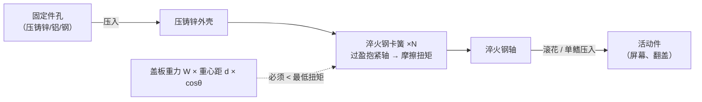

# 恒扭力摩擦铰链：卡簧过盈产生扭力与「最低扭力 > 盖板力矩」选型

> [!summary] 一句话概述
> 笔记本屏幕、设备翻盖能「停在任意角度」，是因为铰链里的摩擦扭矩大于盖板重力产生的力矩。Reell 的 TI-C5M 扭力插件把一串淬火钢卡簧过盈套在淬火钢轴上，**每多一片卡簧就多一份扭矩**，所以用标准件就能拼出 0.15/0.25/0.30 N·m，寿命 3 万次；整个插件压入塑料或金属孔即可，不需要螺丝。Sugatsune 的选型文章给出计算方法：力矩 = 重量 × 重心到转轴距离，按铰链数平分，然后**要用铰链扭矩公差的下限去比**，例如标称 60 lbf·in ±10% 的铰链最低只有 54 lbf·in。

## 配图

![[附件/reell-torque-insert-clips.png]]
*图源：[Reell TI-C5M Application and Installation Guide](https://reell.com/hubfs/Product-Images/TI-C5M/ti-c5m_application_and_installation_guide_02-28-20_0.pdf) 图 1；1 轴、2 外壳、3 卡簧组（卡簧数量决定扭矩）*

![[附件/reell-press-fit-profile.png]]
*图源：同上 图 2；压入孔型的过盈受力点：绿色箭头为正确的过盈压紧点，红色为只接触或过盈不正确的点*

> 图片版权归原作者所有，仅作个人学习收藏；出处见文末「来源与核实记录」。

## 结构原理

> 本节数字只写来源里给出的；来源没有就写「来源未给出」。

### 堆叠方案

方向：**沿转轴轴线，从固定件到活动件**（TI-C5M 插件）

| 层级 | 零件/区域 | 材料 | 厚度/尺寸 | 固定方式 | 依据 |
| --- | --- | --- | --- | --- | --- |
| L1 | 固定件安装孔（外壳端） | 测试过：压铸锌/铝、低碳钢、锻铝（滚花轴版）；POM（单鳍版） | 孔型按 Reell 销售图纸；拔模 ≤ 2°，有拔模时在孔深中点测量 | 压入 | Reell |
| L2 | 外壳 Housing | 压铸锌 | 来源未给出 | 压入孔内 | Reell |
| L3 | 卡簧组 Clips | 淬火钢 | 数量按扭矩定 | 与轴过盈配合 | Reell |
| L4 | 轴 Shaft | 淬火钢 | 来源未给出 | — | Reell |
| L5 | 轴端（活动件端） | 滚花轴（压入金属）或单鳍（压入塑料） | 整件重量：滚花 3.2 g，单鳍 4.1 g | 压入 | Reell |

剖面示意：

### 零件清单

| 零件 | 数量 | 功能 | 材料 | 依据 |
| --- | --- | --- | --- | --- |
| 轴 | 1 | 传递扭矩 | 淬火钢 | Reell |
| 卡簧 | N（随扭矩） | 与轴过盈产生恒定摩擦扭矩 | 淬火钢 | Reell |
| 外壳 | 1 | 容纳卡簧，压入固定件 | 压铸锌 | Reell |
| 润滑剂 | — | 保持扭矩稳定；全寿命免维护 | 矿物油基（专有配方） | Reell |
| 轴向限位（客户自备） | — | 插件不承受轴向分离力 | 客户结构 | Reell |

### 装配顺序

1. 按销售图纸做安装孔（可钻、冲或压铸），测孔型；孔大了抓不牢，孔小了难装且不安全（Reell）。
2. 如果先电镀或喷涂，测量时不计涂层厚度；插件不能浸入电镀或喷漆槽；安装后粉末喷涂不得超过 80 ℃（Reell）。
3. 用压力机压入：杠杆式（如 Arbor press）或量产用气动压力机，推荐 1 吨压力能力；**不要用锤子**，冲击力分布不均（Reell）。
4. 压头直径必须大于外壳，确保外壳和轴同时受压；用垫片或限位块控制两个件之间的间隙；对中不良会导致压装失败（Reell）。
5. 压入时滚花会从配合件刮下少量材料，要考虑碎屑对功能的影响（Reell）。

### 受力与运动分析

- **扭矩来源**：卡簧与轴之间受控的过盈配合产生摩擦力；静扭矩与动扭矩关系接近且可预测，所以放手即停、回弹 < 1°（Reell）。
- **重力力矩随角度变化**：盖板水平伸出时力臂最大、力矩最大；接近竖直时最小（Sugatsune；Reell 计算器提示「通常水平附近最高、竖直附近最低」）。恒扭力铰链在全行程扭矩一样，所以水平时刚好平衡的话，竖直附近会觉得偏紧（Sugatsune）。
- **力矩公式**：T = W × d（d 为重心到转轴的水平距离）；均匀盖板 d = 盖深 / 2（Sugatsune）。考虑角度：T = W × d × cosθ（推断，由「水平最大、竖直最小」推出）。
- **插件只管扭矩**：不承受轴向拉开力，要靠结构让固定件与活动件在轴向相互顶住；径向载荷额定：滥用/偶发 1.0 N·m（距外壳面 2.6 mm 处 380 N），每次循环的持续载荷 0.1 N·m（2.6 mm 处 38 N）。超出部分由客户结构承担（Reell）。
- **系统刚度**：对称扭矩插件两侧扭矩相同，Reell 提醒考虑系统刚度，防止扭曲（racking）。

## 设计要点与参数

| 要点 | 内容 | 依据 |
| --- | --- | --- |
| 扭矩档位 | 0.15 / 0.25 / 0.30 N·m（型号 TI-C5M-[扭矩]-[01 滚花 / 02 单鳍]） | Reell |
| 寿命 | 3 万次；循环频率最高 10 次/分钟 | Reell |
| 温度 | -20 ~ 80 ℃；扭矩在 20 ℃ 标定，偏离会变化 | Reell |
| 回弹 / 空程 | < 1° / 极小 | Reell |
| 环境 | 用于封闭环境，避开潮湿、盐雾、清洁剂与溶剂 | Reell |
| 安装材料 | 不要用于脆性塑料、软木和淬硬金属 | Reell |
| 计算示例 | 12 lb 上翻盖、转轴到边 20 in → 重心 10 in → 总力矩 120 lbf·in → 两个铰链各 60 lbf·in | Sugatsune |
| 公差裕量 | 60 lbf·in ±10% 的铰链实际 54–66 lbf·in；要选**最低值**仍高于需求的型号，但不要过大，否则开合费力或发涩 | Sugatsune |
| 计算器输入 | 产品长度、总重（含所有安装件、把手、电子件）、重心、保持角度、铰链数（多数应用用 2 个） | Reell 计算器页面 |

> 换算（推断）：120 lbf·in ≈ 13.6 N·m，60 lbf·in ≈ 6.8 N·m。对比之下，单个 TI-C5M 最大 0.30 N·m，只适合很轻的盖板。举例（推断，非来源数据）：0.5 kg 的盖板、重心距轴 10 cm，水平时总力矩约 0.49 N·m，两个铰链各约 0.25 N·m，0.30 N·m 档只剩约 20% 余量，还要再扣掉公差。

## 优缺点

**优点**
- 任意角度停住，不需要锁定机构
- 扭矩靠卡簧数量调节，用标准件做定制扭矩（Reell）
- 压入安装，可隐藏在结构内部，外观看不到铰链（Reell）

**缺点 / 代价**
- 恒扭矩与重力力矩不匹配：水平时平衡，竖直附近偏紧（Sugatsune）
- 不承受轴向力，径向承载有限，要靠外部结构
- 扭矩随温度、寿命变化；单个插件扭矩小

## 可借鉴点

- **选型永远用公差下限比力矩**，再留适度裕量（Sugatsune）
- **重量要算全**：把手、框、电子件都算进去（Reell 计算器）
- **把手位置会改变手感**：从远端拉省力，把手靠近转轴就会觉得重（Sugatsune）
- **插件只做扭矩，承载交给结构**：轴向、径向都按额定值校核
- 需要单向阻力时，可用单向扭力铰链，一个方向有阻力、另一个方向顺滑（Sugatsune）

## 与库中相似案例对比

| 对比项 | 本案例 | [[微软 Surface Book 动态支点铰链（分段铝铰链）]] | [[活动铰链（Living Hinge）：一体成型的柔性铰链]] |
| --- | --- | --- | --- |
| 保持角度的方式 | 卡簧摩擦，任意角度 | 分段铰链内的摩擦与链节结构（见该案例） | 不保持角度，靠材料弹性 |
| 参数可得性 | 扭矩档位、寿命、承载全部公开 | 公开参数较少 | 铰链厚度等 |
| 适用 | 笔记本、显示器、设备翻盖 | 二合一笔记本 | 低成本盖子 |

## 相关案例

- [[微软 Surface Book 动态支点铰链（分段铝铰链）]]
- [[微软 Surface Duo 360° 双铰链]]
- [[活动铰链（Living Hinge）：一体成型的柔性铰链]]
- 分类索引：[[03-转轴与铰链 索引]]

## 来源与核实记录

- 主来源：[TI-C5M Series Torque Insert Application and Installation Guide](https://reell.com/hubfs/Product-Images/TI-C5M/ti-c5m_application_and_installation_guide_02-28-20_0.pdf)（Reell Precision Manufacturing，2020-02-28 PDF）
- 补充来源 1：[Calculating Torque: How to Select the Right Friction Hinge](https://www.sugatsune.com/blog/calculating-torque-how-to-select-the-right-friction-hinge/)（Sugatsune America，2026-08-20）
- 补充来源 2：[Torque Inputs and Recommended Products](https://reell.com/hinge-selector-tool)（Reell 在线扭力计算器页面，只引用其输入项说明）
- 核实：2026-11-13 下载 PDF 并打开两个网页核对。Southco 的同类文章（southco.com）被网站防火墙拦截（403），未引用。
