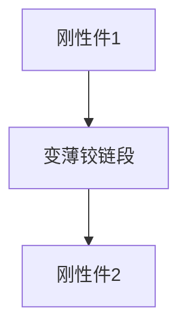

# 活动铰链（Living Hinge）：一体成型的柔性铰链

> [!summary] 一句话概述
> 用和两侧刚性件相同的材料做一段「变薄」的区域当铰链，一次注塑同时成型三部分；PP/PE 抗疲劳最好，常见于瓶盖、Tic Tac 盒盖和一次性包装。

## 配图

![[附件/living-hinge-soy-sauce-cap.jpg]]
*Wikimedia Commons：带活动铰链的酱油瓶盖*

> 图片版权归原作者所有，仅作个人学习收藏；出处见文末「来源与核实记录」。

## 结构原理

> 本节数字只写来源里给出的；来源没有就写「来源未给出」。

### 堆叠方案

方向：**（原理类案例，沿铰链方向）**

| 层级 | 零件 | 材料 | 厚度/尺寸 | 固定方式 | 依据 |
| --- | --- | --- | --- | --- | --- |
| A | 刚性件 1（如盖子） | PP/PE/ABS | 来源未给出 | 与铰链一体 | Description |
| B | 变薄的铰链段 | 同材料 | 「thinned or cut」，厚度来源未给出 | 一体成型 | Description |
| C | 刚性件 2（如瓶身盖座） | 同材料 | 来源未给出 | 与铰链一体 | Description |

剖面示意：

### 零件清单

| 零件 | 数量 | 功能 | 材料 | 依据 |
| --- | --- | --- | --- | --- |
| 整体注塑件 | 1 | 三部分一次成型 | PP/PE（最佳）、ABS | Plastic 段 |

### 装配顺序

1. 一次注塑（或热成型）同时成型刚性件与铰链，无需装配

> 木质版本：用激光切割在板材上切出锯缝图案形成大半径铰链。

### 受力与运动分析

- **受力路径**：弯曲集中在变薄段，摩擦极小、磨损很少（Wikipedia）。
- **运动关系**：绕变薄段弯折开合。
- **失效风险**：设计和制造正确才能在零件寿命内保持功能；材料选择影响疲劳寿命（PP/PE 最好）。

## 设计要点与参数

| 要点 | 内容 | 依据 |
| --- | --- | --- |
| 推荐材料 | PE、PP（抗疲劳最佳），ABS 也常用 | Plastic 段 |
| 铰链厚度/长度 | 来源未给出 | — |

## 优缺点

**优点**
- 零装配、成本低、易回收
- 摩擦极小，几乎无磨损

**缺点 / 代价**
- 对材料和设计要求高，材料选错容易疲劳断裂

## 可借鉴点

- 包装、盖子类零件优先考虑活动铰链省掉销轴
- 激光切割木板可用锯缝图案做大半径柔性铰链

## 相关案例

- [[卡扣三种基本形式：悬臂、环形、扭转]]
- [[三星 Galaxy Fold 一代铰链与屏幕支撑结构]]
- 分类索引：[[03-转轴与铰链 索引]]

## 来源与核实记录

- 主来源：[Living hinge - Wikipedia](https://en.wikipedia.org/wiki/Living_hinge)（持续更新的百科词条，Wikipedia 编者）
- 图片来自 Wikimedia Commons（随 Wikipedia 词条展示），遵循原图许可。
- 核实：2026-11-13 打开词条核对定义、材料、工艺与木质变体。
