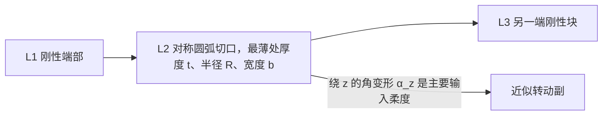

# 直圆切口柔性铰链（Right circular flexure hinge）：最薄处厚度 t、切口半径 R 与公式适用范围

> [!summary] 一句话概述
> 直圆切口柔性铰链是在刚性块上用一对垂直于端面的对称圆柱面切出圆弧槽，最薄处留下厚度 t、切口半径 R、宽度 b，靠颈部局部弯曲提供近似转动，而不是靠轴销或薄膜弯折。吴鹰飞、周兆英给出了一般切口（圆心角 θₘ）和直圆（θₘ = 90°）的闭合柔度公式；Yong 等用有限元核对了 Paros–Weisbord 简化式与精确式在不同 t/R 下的误差，并划出选用范围。它和库内已有的薄膜活铰、恒扭力摩擦铰链不是同一类转动副。

## 配图

![[附件/right-circular-yong-fig1.jpg]]
*图源：[Yong, Lu, Handley, *Precision Engineering* 32 (2008) 63–70](https://www.precisionmechatronicslab.com/wp-content/uploads/2017/11/Yong_Review.pdf) 第 64 页 Fig. 1；双边直圆切口的几何与载荷：宽度 b、最薄厚度 t、切口半径 R、圆心角 θₘ，以及 Fₓ、Fᵧ、M_z 与对应变形*

![[附件/right-circular-wu-fig1.jpg]]
*图源：[吴鹰飞、周兆英《柔性铰链的设计计算》，《工程力学》2002, 19(6): 136–140](https://pubs.cstam.org.cn/data/article/em/preview/pdf/em_4019.pdf) 第 137 页图 1；同一构型的几何、受力和变形定义，符号与 Paros–Weisbord 对齐，s = R/t*

![[附件/half-circular-yu-fig1.jpg]]
*图源：[于月民等《单边直圆柔性铰链的柔度计算与分析》，《力学研究》2019, 8(2): 156–164](https://pdf.hanspub.org/ijm20190200000_96658842.pdf) 第 157 页 Figure 1；单边直圆（只切一侧圆弧）的最小厚度 t、半径 R 与截面厚度 t(x)。本篇以双边直圆为主，单边只作对照，不另立一篇*

> 图片版权归原作者所有，仅作个人学习收藏；出处见文末「来源与核实记录」。

## 结构原理

> 本节所有数字只写来源里给出的；来源没有就写「来源未给出」，不估算、不换算成看似精确的值。

### 堆叠方案

方向：**沿铰链轴向，从一端刚性块经过圆弧颈部到另一端刚性块**

| 层级 | 零件 | 材料 | 厚度/尺寸 | 固定方式 | 依据 |
| --- | --- | --- | --- | --- | --- |
| L1（一端） | 刚性联接端部 | 来源按弹性体给出 E、G，牌号未给出 | 吴鹰飞：杆部截面为矩形，宽度为 b；端部其余尺寸来源未作为独立零件给出 | 与颈部一体，相对视为固定端或输出端 | 吴鹰飞第 2 节与图 1 |
| L2（中间） | 直圆切口颈部（一对对称圆弧，或单边只切一侧） | 同上 | 最薄处厚度 t、切口半径 R、宽度 b；一般切口还有圆心角 θₘ；直圆取 θₘ = 90°。无量纲 s = R/t（吴鹰飞） | 材料连续，无装配间隙 | 吴鹰飞图 1 与第 3 节；Yong Fig. 1 |
| L3（另一端） | 刚性联接端部 | 同上 | 来源未给出必须大于颈部的具体倍数 | 与颈部一体 | 吴鹰飞图 1 |

剖面示意：

和薄膜活铰、摩擦铰的分工（对照用，不是同一结构）：

- 本案例：金属（或其它弹性体）刚性块上的短切口，小转角、高转角精度，当作精密转动副用。
- [[活动铰链（Living Hinge）：一体成型的柔性铰链]]：PP/PE 等变薄一体薄膜，靠大变形反复开合，不是切口转动副。
- [[恒扭力摩擦铰链：卡簧过盈产生扭力与「最低扭力 > 盖板力矩」选型]]：摩擦副提供保持力矩，不是弹性弯曲铰。

于月民等把只切一侧圆弧的构型称为单边直圆，结构更紧凑，本篇只对照，不按「半边直圆」再开一篇。

### 零件清单

| 零件 | 数量 | 功能 | 材料 | 依据 |
| --- | --- | --- | --- | --- |
| 带对称直圆切口的整体铰链（或单边变体） | 1（与两端刚性块一体） | 提供绕主轴的角柔度，并限制其余方向变形 | 来源给出 E、G，牌号未给出 | 吴鹰飞图 1；Yong Fig. 1；于月民图 1 |
| 两端刚性联接部 | 与铰一体，不是另装的销轴 | 把载荷传到颈部，并与机构其他部分连接 | 同上 | 吴鹰飞第 2 节 |

来源都按整体切口建模，没有列出单独的销、轴承或装配件。

### 装配顺序

来源讨论的是一体切口，不是多件装配。设计/制造顺序按论文给出的几何定义反推如下（来源未写工艺步骤，加工方法标「来源未给出」）：

1. 在同一块材料上确定两端刚性区和中间颈部的位置。
2. 用一对垂直于端面的对称圆柱面切出圆弧槽（吴鹰飞第 2 节），留下最薄厚度 t、半径 R、宽度 b；直圆取 θₘ = 90°。
3. 把一端视为固定，另一端承受 Fₓ、Fᵧ、F_z、Mᵧ、M_z（吴鹰飞图 1），按柔度公式核算转角和寄生位移。
4. 若采用单边直圆，只切一侧圆弧，按于月民文的卡氏定理公式另行核算，不要直接套用双边直圆公式。

### 受力与运动分析

- **受力路径**：自由端的力和力矩经刚性端部进入圆弧颈部，在最薄截面附近产生弯曲（主运动是绕 z 的转角 α_z）。吴鹰飞还给出了剪切引起的线位移以及轴向拉伸/压缩 Δx。
- **运动关系**：理想上是绕切口中心附近的一个转动副。Yong 指出，相对左边（left-type）和圆角直梁铰，直圆铰的转动中心漂移较小，因而更常用于高精度微动台。实际转角能力远小于薄膜活铰，来源未给出一个统一的最大转角度数。
- **失效风险**：把 Paros–Weisbord 简化公式用到 t 接近 R 的厚颈部时，误差会显著增大（吴鹰飞引言；Yong 给出了具体 t/R 区间）。切口根部应力集中，超出材料弹性范围会永久变形或疲劳（推断；本篇打开的三份来源以柔度/刚度误差为主，未给出许用应力表）。单边与双边的柔度不同，不能混用公式。

## 设计要点与参数

| 要点 | 内容 | 依据 |
| --- | --- | --- |
| 几何参数 | 宽度 b、最薄厚度 t、切口半径 R；一般切口还有圆心角 θₘ。直圆：θₘ = 90°。定义 s = R/t | 吴鹰飞第 2、3 节与图 1 |
| 主柔度（直圆，绕 z 的转角） | 吴鹰飞式 (16)：α_z / M_z = (12 /(E b R²)) × [2s³(6s²+4s+1)/((2s+1)(4s+1)²) + 12s⁴(2s+1)/((4s+1)⁵) arctan√(4s+1)]。同文还给出 Fᵧ 引起的 α_z、以及 Δz、αᵧ、Δy、Δx 等全套公式 | 吴鹰飞第 3 节式 (16) 及随后各式 |
| 与 Paros–Weisbord 的关系 | 1965 年 Paros 和 Weisbord 给出柔性铰链设计公式，并在厚度远小于切割半径时给出简化式。吴鹰飞沿用其形状、受力和符号，另推一套更简洁的精确式；指出简化式在较厚铰链上误差较大。Yong 核对后写明：吴鹰飞、周兆英的结果与 Paros–Weisbord 精确式相同，只是 α_z/F_z 与 Δy/M_z 的符号相反 | 吴鹰飞引言与第 1 节；Yong 第 64 页 |
| 简化式适用的 t/R | Yong 转述：简化式相对精确式，对 t/R 在 0.02–0.1 的铰链，误差在 1% 以内；对更厚的铰链，t/R 在 0.2–0.6 时为 5–12%。Yong 并写：精确式和简化式的转动柔度 α_z/M_z 在 t/R = 0.6 时与有限元相差可达 25% 或更多 | Yong 第 64 页 |
| 按 t/R 分段的其它公式 | Yong 转述 Tseytlin 把铰链分成薄（t/R ≤ 0.07）、中（0.07 < t/R ≤ 0.2）、厚（0.2 < t/R ≤ 0.6）三组，分别给公式 | Yong 第 64 页 |
| 线位移公式的误差（Yong 与 FEA 比） | Δx/Fₓ：Paros–Weisbord 精确式、Lobontiu 与吴周结果相同，误差在 6% 以内；简化式最差时达 38%。Δy/Fᵧ（计剪切）：Lobontiu 在 0.05 ≤ t/R ≤ 0.1 时误差 5% 以内，0.1 < t/R ≤ 0.3 时 10% 以内，0.3 < t/R ≤ 0.65 时 15% 以内；Paros–Weisbord 精确式与吴周在 0.05 ≤ t/R ≤ 0.1 时 5% 以内，其后误差增大 | Yong 第 67 页 |
| Yong 经验刚度式范围 | 为弥补已有公式在较大 t/R 下不准，Yong 等拟合了 x、y 向经验刚度式，适用范围 0.05 ≤ t/R ≤ 0.8，与有限元比误差小于 3%。多项式系数见该文 Table 1，本篇不把系数表逐项抄写 | Yong 摘要与第 4 节 |
| 单边直圆 | 于月民等用卡氏定理推导单边直圆柔度，有限元相对误差均小于 10% | 于月民摘要 |
| 材料牌号、许用应力、疲劳寿命、最大转角 | 来源未给出统一产品级数值 | — |

## 优缺点

**优点**
- 一体切口，没有销轴间隙和摩擦，适合高精度、小转角的微动机构（吴鹰飞引言；Yong 引言）。
- 几何参数少（t、R、b），有闭合公式可先算再校核。
- 相对圆角直梁等构型，转动中心更稳（Yong 转述既有结论）。

**缺点 / 代价**
- 转角能力有限，不能当成大开合的门铰或薄膜活铰来用。
- 简化公式有明确的 t/R 适用边界，厚度接近半径时不能图省事。
- 颈部应力集中，尺寸和表面质量敏感；本篇来源没有给出可直接照搬的许用应力表。

## 可借鉴点

- 先定 t、R、b 和 θₘ，再选公式：t 远小于 R 时才考虑 Paros–Weisbord 简化式；t 接近 R（吴鹰飞说，为紧凑和高本征频率，厚度会接近切割半径）时用精确式或 Yong 指出的适用公式，不要默认简化式。
- 核算时至少要看转动柔度 α_z/M_z，以及 Δx、Δy 这类寄生线位移；Yong 说明计不计剪切会改变 Δy/Fᵧ 的误差。
- 双边直圆和单边直圆不要混用同一套公式。
- 需要更大转角或不同应力分布时，改看圆角直梁、卡特轮或十字簧片，而不是把直圆切口做得极薄去硬撑角度。

## 与库中相似案例对比

| 对比项 | 本案例：直圆切口柔性铰链 | [[活动铰链（Living Hinge）：一体成型的柔性铰链]] | [[恒扭力摩擦铰链：卡簧过盈产生扭力与「最低扭力 > 盖板力矩」选型]] | [[圆角直梁柔性铰链（Corner-filleted flexure hinge）：等厚直梁加两端圆角 r，对照直圆切口铰]] |
| --- | --- | --- | --- | --- |
| 核心结构 | 刚性块上对称圆弧切口，颈部局部弯曲 | PP/PE 变薄一体薄膜 | 卡簧过盈的摩擦副 | 中间等厚直梁，两端圆角过渡 |
| 运动本质 | 小转角弹性转动副 | 大变形反复开合 | 摩擦保持力矩 | 同样是弹性转动副，但厚度沿长度的分布不同 |
| 关键参数 | t、R、b、θₘ、t/R 适用范围 | 薄膜厚度与材料，几乎无切口公式 | 最低扭力大于盖板力矩 | 梁长 l、厚度 t、圆角 r |
| 是否重复收录 | 本篇只写切口转动副及公式范围 | 已有原理篇，本篇不重复薄膜活铰 | 已有摩擦铰，本篇不是摩擦副 | 本轮另篇，几何与公式都不同 |

## 相关案例

- [[活动铰链（Living Hinge）：一体成型的柔性铰链]]
- [[恒扭力摩擦铰链：卡簧过盈产生扭力与「最低扭力 > 盖板力矩」选型]]
- [[圆角直梁柔性铰链（Corner-filleted flexure hinge）：等厚直梁加两端圆角 r，对照直圆切口铰]]
- [[卡特轮柔性铰链（Cartwheel flexure）：中心交叉梁转动副，对照切口短铰与十字簧片]]
- [[应变式指点杆：十字薄片根部弯曲，将侧向按力变成二维输入]]（微应变传感，不是精密转动副）
- 分类索引：[[03-转轴与铰链 索引]]

## 来源与核实记录

- 主来源：[吴鹰飞、周兆英《柔性铰链的设计计算》](https://pubs.cstam.org.cn/data/article/em/preview/pdf/em_4019.pdf)（《工程力学》2002, 19(6): 136–140；收稿日期 2001-05-15。中文全文，图 1 与直圆公式 (16) 等）
- 补充来源 1：[Yong, Lu, Handley, Review of circular flexure hinge design equations and derivation of empirical formulations](https://www.precisionmechatronicslab.com/wp-content/uploads/2017/11/Yong_Review.pdf)（*Precision Engineering* 32 (2008) 63–70；大学独立机构。t/R 适用范围、与 FEA 的误差、吴周公式与 Paros–Weisbord 的关系）
- 补充来源 2：[于月民、丁元柱、于丽艳、盖芳芳《单边直圆柔性铰链的柔度计算与分析》](https://pdf.hanspub.org/ijm20190200000_96658842.pdf)（《力学研究》2019, 8(2): 156–164；CC BY。单边构型对照，相对误差小于 10%）
- 核实：2026-11-22 下载并打开上述三份 PDF。未把薄膜活铰或摩擦铰写成同一结构。未编造材料牌号或最大转角。
