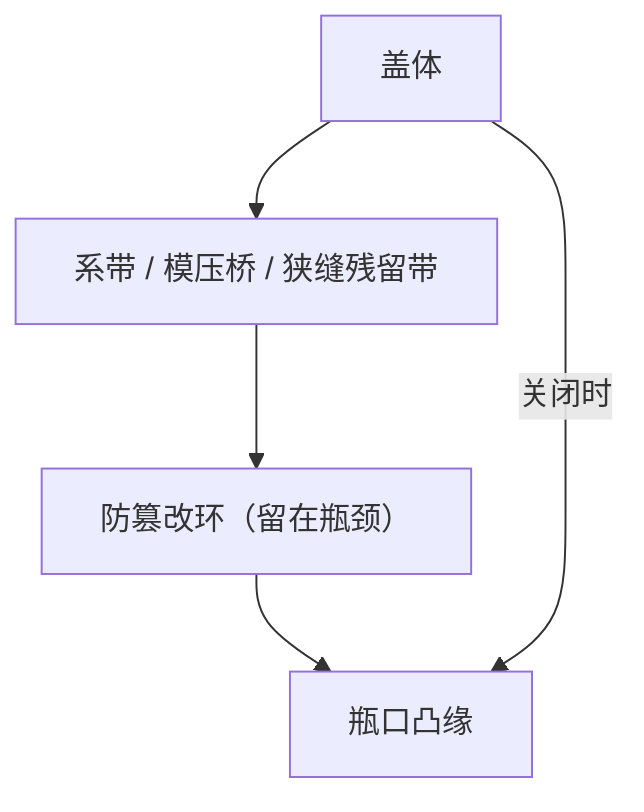

# 系带式连体瓶盖（Tethered cap）：防丢系带或模压桥把盖留在瓶口，并用开启后的停留几何区别于短薄膜活铰

> [!summary] 一句话概述
> 系带式连体瓶盖在盖体与防篡改环（或口颈）之间留下一段较长的系带或模压桥：旋开或掀开后，盖子不离开瓶子，并停在设定的侧面或翻转位置，避免短薄膜活铰那种「一掀就翻到背面、也容易被撕掉」的路径。它要同时满足防丢法规的拉断力和开合次数，而不是只做一个能弯折的薄皮。

## 配图

![[附件/husky-tethered-slit-vs-bridge.jpg]]
*图源：[赫斯基《您准备好应用连体盖了吗？连体式瓶盖基本指南》第 6 页](https://www.husky.co/siteassets/documents/tethered-closures-guide_cn-s.pdf)；两种形成防篡改环与系带的制造方法。左：狭缝（Slit）法，成型后用加热刀片刻痕，方法简单但「在引入复杂的连体盖系统方面则缺乏设计灵活性」。右：模压桥（Molded-In Bridge）法，采用铰链设计形成连体盖，可引入复杂的连体几何，且成型后不必再加工*

![[附件/husky-tethered-neck-range.jpg]]
*图源：同上第 7 页；按瓶颈标准陈列的连体盖样品，包括 25/22、26/21、26/22、PCO 1881、29/25、30/25 以及 32 mm、38 mm 等。下方为系带区域的模拟云图和盖-颈剖面。该页把饮用水、碳酸软饮料（CSD）和敏感性饮料（JSDT）列为已发布的标准解决方案*

![[附件/bericap-tethered-geometries.jpg]]
*图源：[BERICAP, Tethered caps – industry challenge & solutions（2020-06-23 PETPlanet 讲稿）第 10 页](https://petpla.net/assets/special/Bericap-Tethered-Caps.pdf)；按开启后盖子的停留方式分类：带铰的螺盖（SwingAside、ClipAside、HingeAside、ClipUnder），不带铰的螺盖系带（SwingDown、SwingOver、ClipIn），以及扣压盖（SnapCap、Thor）。同一盖体可以停在侧面、下方或翻到颈部一侧，这是与短薄膜活铰最大的几何差别*

> 图片版权归原作者所有，仅作个人学习收藏；出处见文末「来源与核实记录」。

## 结构原理

> 本节所有数字只写来源里给出的；来源没有就写「来源未给出」。

### 堆叠方案

方向：**从瓶口外侧到防篡改环（盖打开后，系带仍连着环与盖）**

| 层级 | 零件 | 材料 | 厚度/尺寸 | 固定方式 | 依据 |
| --- | --- | --- | --- | --- | --- |
| L1 | 盖体（螺盖或扣压盖） | 塑料，具体牌号来源未给出 | 赫斯基样品按瓶颈系列区分（如 26/21、PCO 1881），盖高、壁厚来源未给出统一数 | 螺纹或扣压与瓶口配合 | 赫斯基第 7 页；BERICAP 第 8、10 页 |
| L2 | 系带、模压桥或切开后残留的柔性带 | 与盖体、防篡改环一体 | 截面、长度来源未给出具体毫米值 | 狭缝法：成型后刀片刻出；模压桥：模具直接成型 | 赫斯基第 6 页 |
| L3 | 防篡改环（TE band），打开后留在瓶颈槽内 | 与盖一体射出后再分离大部分圆周 | 来源未给出环高、桥宽的通用数 | 环留在瓶口防篡改槽；系带把环和盖连住 | BERICAP 第 19–20 页（slit-flex bands） |
| L4 | PET 瓶口（既有瓶颈标准，不改瓶颈是 BERICAP 的卖点之一） | PET | 如 PCO 1881、PET 26/21、29/25 等 | 环卡住瓶口凸缘 | 赫斯基第 7 页；BERICAP 第 17 页 |

与库内已有的[[活动铰链（Living Hinge）：一体成型的柔性铰链]]相比：已有篇是酱油盖式短薄膜活铰，讲的是薄而短的一体弯折带。连体盖的关键不是「再做一条更短的薄膜」，而是：①盖打开后必须留在瓶上（防丢）；②系带要经得住规定的拉力和开合次数；③打开后盖要停在不影响饮用/倾倒的位置（BERICAP 所说 affirmed, defined open position 与宽开启角）。

### 零件清单

| 零件 | 数量 | 功能 | 材料 | 依据 |
| --- | --- | --- | --- | --- |
| 盖体 | 1 | 密封、旋开或掀开 | 塑料 | 两家指南 |
| 系带或模压桥 | 1 条或一组（具体条数来源未统一规定） | 打开后把盖留在瓶上，并引导停留位置 | 与盖一体 | 赫斯基第 6 页；BERICAP 第 10 页 |
| 防篡改环 | 1 | 首次打开的显示，并作为系带在瓶上的锚点 | 与盖一体 | BERICAP 第 20 页 |
| 瓶口 | 1（既有标准） | 密封与挂住防篡改环 | PET | 赫斯基第 7 页；BERICAP：bottlers 不必改瓶颈 |

### 装配顺序

1. 注塑出盖体、环和（模压桥时的）连接几何。狭缝法则在成型后用加热刀片刻出防篡改环与系带（赫斯基第 6 页）。
2. 灌装线上把盖压上或旋到既有瓶颈。BERICAP 第 19 页写：灌装商不必改瓶颈和灌装设备，旋盖机只需调整夹头；第 20 页写狭缝柔性环能承受实验室旋盖时 1 mm 偏心或盖倾斜，而不出现断桥、吞环或歪盖。
3. 消费者旋开或掀开：环留在瓶口，系带承拉，盖停在设计好的侧面或翻下位置；再盖回去要能重复开合。性能下限见下表。

> 来源给的是设计和法规要求，不是消费者拆解步骤。

### 受力与运动分析

- **受力路径**：首次打开时，防篡改桥（与系带不是同一回事）被拉断或分离，环留在瓶颈。之后每一次打开，拉力走系带或模压桥，再传到留在瓶口的环。法规/草案要求系带在规定方向上不能被拉断。
- **运动关系**：盖相对瓶口做螺旋旋开（螺盖）或掀开（扣压/铰链盖），同时绕系带或铰链转到停留位置。BERICAP 把停留几何分成「带铰」「不带铰的系带」和「扣压盖」三类，照片显示同一打开动作可以停在旁边、下方或翻过瓶肩。赫斯基把「操作简便且直观」和「零负面消费体验」列为设计依据。
- **失效风险**：系带截面太弱，达不到 25 N 或 15 次开合（两家都写到这条法规门槛）。狭缝法灵活度差，复杂停留几何做不出来（赫斯基）。现场旋盖偏心 1 mm 时，若环和桥太脆，会出现断桥、吞环、歪盖（BERICAP 用 slit-flex band 作为对策）。设计失误会妨碍饮用或倾倒，损害使用体验（赫斯基第 4 页）。

## 设计要点与参数

| 要点 | 内容 | 依据 |
| --- | --- | --- |
| 法规对象 | 欧盟 2019/904：容量不超过 3 L 的一次性 PET 塑料瓶须用连体式瓶盖；赫斯基写生产商须在 2024 年 7 月底前合规 | 赫斯基第 3 页 |
| 拉断力 | 赫斯基：须承受 25 N 的拉力。BERICAP 转述当时尚未正式的 CEN 草案：一体瓶颈（如 PET 一次瓶）垂直和水平方向最小 25 N；非一体瓶颈（如饮料盒、袋）为 12 N | 赫斯基第 4 页；BERICAP 第 7、15 页 |
| 开合次数 | 两家均为至少 15 次打开和关闭而系带不断。BERICAP 写时间间隔未定义 | 赫斯基第 4 页；BERICAP 第 7、15 页 |
| 两种制法 | 狭缝（Slit）：成型后加热刀片刻痕，简单合规，但复杂几何灵活性差。模压桥（Molded-In Bridge）：模具内做出铰链/桥，可做更复杂连体几何，成型后不必再加工 | 赫斯基第 6 页 |
| 停留几何 | SwingAside、ClipAside、HingeAside、ClipUnder、SwingDown、SwingOver、ClipIn、SnapCap、Thor 等，对应「打开后盖停在哪」 | BERICAP 第 10 页 |
| 使用要求（BERICAP） | 开启关闭直观；有被确认的、确定的打开位置；开启角要宽，便于饮用且倾倒不溅 | BERICAP 第 15 页 |
| 瓶颈兼容 | 赫斯基样品覆盖 25/22、26/21、26/22、1881、29/25、30/25、32 mm、38 mm 等。BERICAP 列 PET 26/1T、26/3T、PCO 1881、29/25、30/25、33、38 等 | 赫斯基第 7 页；BERICAP 第 17 页 |
| 系带长度、截面尺寸的通用数 | 来源未给出统一的毫米值 | — |

## 优缺点

**优点**
- 盖子打不开丢，满足一次性塑料指令的防丢要求，也不必改既有瓶颈（BERICAP 的明确主张）。
- 停留几何可以按饮用/倾倒来设计，而不是让盖随意甩到脸上或挡住瓶口。
- 狭缝法改模具较少，便于从现有防篡改盖过渡；模压桥则能做更复杂的铰链带。

**缺点 / 代价**
- 系带和环要同时满足拉断力、开合次数和灌装偏心，截面不能只按「能弯」来做。
- 狭缝法省事但几何自由度低；模压桥自由度高但往往要换模具（BERICAP 也写连体特征会导致大量换模）。
- 打开后的盖仍占空间，停留位置若设计不好会妨碍饮用，这是短活铰很少需要单独处理的问题。

## 可借鉴点

- 先画打开后的停留位置，再反推系带长度、出铰位置和是否需要第二条平行带防过度弯折——不要先做一条短薄膜再希望它「顺便不丢」。
- 把 25 N（或草案里的垂直/水平方向）和 15 次开合写成必测项，和灌装 1 mm 偏心/歪盖一起做工艺窗口，而不是只做开合手感。
- 在「改刀片刻缝」和「改模具做桥」之间按几何复杂度选择：只为合规、停留姿态简单，狭缝法足够；要 clip、hinge、宽开启角，走模压桥。
- 防篡改环是系带的锚点，环被吞进盖内或桥全断，防丢功能就失效。环的柔性和桥的位置要一起设计。

## 与库中相似案例对比

| 对比项 | 本案例（系带式连体瓶盖） | [[活动铰链（Living Hinge）：一体成型的柔性铰链]] | [[儿童安全瓶盖压旋锁：外盖与内芯齿平时不啮合，按下后啮合再旋转]] |
| --- | --- | --- | --- |
| 要解决的问题 | 打开后盖不离瓶，并停在可饮用/倾倒的位置 | 一体薄膜弯折，让盖能翻开 | 防止儿童打开，不是防丢 |
| 铰链几何 | 较长系带或模压桥，常与防篡改环相连；有多种停留姿态 | 短而薄的活铰带 | 不是柔性铰 |
| 法规约束 | 欧盟 2019/904 及 25 N / 15 次等性能门檻 | 已有篇几乎无这类参数 | 儿童安全标准，另一套 |
| 是否重复短活铰 | 否，本篇写防丢系带与停留几何 | 已有，不再泛述 | 已有 |

## 相关案例

- [[活动铰链（Living Hinge）：一体成型的柔性铰链]]
- [[儿童安全瓶盖压旋锁：外盖与内芯齿平时不啮合，按下后啮合再旋转]]
- [[卡扣三种基本形式：悬臂、环形、扭转]]
- 分类索引：[[03-转轴与铰链 索引]]

## 来源与核实记录

- 主来源：[赫斯基《您准备好应用连体盖了吗？连体式瓶盖基本指南》](https://www.husky.co/siteassets/documents/tethered-closures-guide_cn-s.pdf)（© 2020 赫斯基注塑系统有限公司，资料编号 20-086；PDF 创建 2021-05-07。中文：3 L 以下 PET 瓶、25 N、15 次、狭缝法与模压桥、瓶颈系列样品）
- 同一机构产品页：[赫斯基连体盖中文页](https://www.husky.co/zh-cn/industries/consumer-goods/closures/tethered-closures/)（已打开，不另计机构）
- 补充来源：[BERICAP, Tethered caps – industry challenge & solutions, Andreas Brem, 2020-06-23](https://petpla.net/assets/special/Bericap-Tethered-Caps.pdf)（PETPlanet webinar，24 页。CEN 草案 25 N / 12 N / 15 次，以及第 10、15、17、20 页的停留几何与 1 mm 偏心。独立第二机构）
- 核实：2026-11-22 下载并打开上述 PDF 与页面。打开后确认有结构与性能门檻，不是纯营销页，故保留本题。未把短薄膜活铰原理再写一遍。
