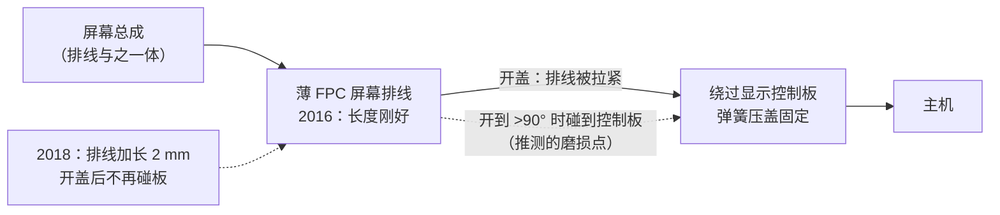

# 苹果 MacBook Pro 2016 Flexgate（反面案例）：绕板的屏幕排线与 2018 年加长 2 mm

> [!summary] 一句话概述
> 2016 年 Touch Bar 世代 MacBook Pro 不再像前代那样把较粗的线缆**穿过**铰链，改为把薄 FPC 屏幕排线**绕过**铰链下方的显示控制板，用一对弹簧压盖固定。每次开合排线都被拉紧，一两年后背光排线最先疲劳撕裂，屏幕底部出现「舞台灯」状的亮区，最后开盖超过约 40° 背光全灭。排线又是屏幕总成的一部分，不能单独换，iFixit 说「把 6 美元的问题变成 600 美元的灾难」。2018 款悄悄把排线加长 2 mm，开到 90° 以上时排线不再碰到控制板。Apple 后来为 13 英寸 2016 款开了免费服务计划（覆盖首次零售起 5 年）。

## 配图

![[附件/flexgate-2016-cable-open.jpg]]
*图源：[iFixit News 13979](https://www.ifixit.com/News/13979/apples-2018-macbook-pros-attempt-to-solve-flexgate-without-admitting-it-exists)：2016 款铰链全开时的背光排线（箭头处），已经贴紧*

![[附件/flexgate-2018-cable-open.jpg]]
*图源：同上：2018 款铰链全开时，同一位置的排线余量明显更大*

![[附件/flexgate-cable-length-2mm.jpg]]
*图源：同上：iFixit 用尺子对比 2016 和 2018 两代排线，2018 版长 2 mm*

> 图片版权归原作者所有，仅作个人学习收藏；出处见文末「来源与核实记录」。

## 结构原理

> 本节数字只写来源里给出的；来源没有就写「来源未给出」。

### 堆叠方案

方向：**从屏幕到主机，沿排线路径**

| 段 | 零件 | 材料 | 设计 | 依据 |
| --- | --- | --- | --- | --- |
| 1 | 屏幕总成（含背光） | — | 排线与屏幕一体，不能单换 | iFixit 12903 |
| 2 | 屏幕排线（含背光排线） | 薄 FPC | 从屏幕下沿出来，绕过铰链 | iFixit 12903 |
| 3 | 铰链区 | 铝 | 排线**绕过**而不是**穿过**铰链 | iFixit 12903 |
| 4 | 显示控制板（Touch Bar 下方） | PCB | 排线包在板上，弹簧压盖固定 | iFixit 12903 |

剖面示意：

### 零件清单

| 零件 | 数量 | 规格 | 依据 |
| --- | --- | --- | --- |
| 屏幕排线 | 多根（背光排线最先坏） | 薄 FPC；2018 款比 2016 款长 2 mm | iFixit 两篇 |
| 弹簧压盖 | 1 对 | 压住包在控制板上的排线 | iFixit 12903 |
| 显示控制板 | 1 | 位于 Touch Bar 下方 | iFixit 12903 |
| 前代方案 | — | 较粗的线缆穿过铰链 | iFixit 12903 |

### 装配顺序

> 维修层面的事实：排线与屏幕一体，**坏了只能换整块屏幕总成**（iFixit 12903 报约 600 美元，13979 报约 700 美元的零件价）。具体拆装步骤来源未给出，iFixit 屏幕更换指南 122604 未打开。

### 受力与运动分析

- **弯曲疲劳**：每次开合排线都被弯折、拉紧。iFixit 12903 的描述是「pulled taut as the display is opened, causing them to tear over time」。
- **失效顺序**：背光排线最先坏 → 屏幕底部出现竖向亮区（舞台灯）→ 开盖超过约 40° 背光全灭（iFixit 12903）。Apple 服务计划页面的描述是「屏幕底部持续或间歇出现竖向亮区」「背光完全停止工作」。
- **2018 年的改法**：排线加长 2 mm，「开盖超过 90° 时排线有更多空间绕过控制板，不再接触控制板」（iFixit 工程师 Taylor Dixon）。iFixit 也承认很难确定问题有多少来自贴近控制板、多少来自长度本身。
- **为什么是 40° 和 90°**：排线张紧程度随开合角变化，具体张紧力和弯曲半径来源未给出。推断：开角越大排线被拉得越紧，损伤处在大开角下先断开。

## 设计要点与参数

| 要点 | 参数 | 依据 |
| --- | --- | --- |
| 受影响机型 | 2016 起 Touch Bar 世代；服务计划只覆盖 13 英寸 2016 款（四雷雳 3 口、两雷雳 3 口） | iFixit 12903；Apple |
| 受影响销售期 | 2016-10 至 2018-02 | Apple |
| 服务计划期限 | 首次零售起 5 年，或计划开始起 3 年，取较长者 | Apple |
| 背光全灭角度 | 开盖超过约 40° | iFixit 12903 |
| 2018 改进 | 排线加长 2 mm（15 英寸实测，13 英寸由 MacRumors 用户发现） | iFixit 13979 |
| 维修成本 | 排线问题约 6 美元，整块屏幕约 600–700 美元 | iFixit 两篇 |
| 可维修评分 | 2018 款 1/10 | iFixit 13979 |
| 排线最小弯曲半径、开合寿命 | 来源未给出 | — |

## 优缺点

**这套设计换来的**
- 屏幕和铰链做得更薄（iFixit 认为是「不惜代价的轻薄」）

**代价**
- 排线在正常开合中疲劳，一两年后失效
- 排线不可单换，维修成本放大约 100 倍
- 加长 2 mm 只能延缓，不能确证彻底解决

## 可借鉴点

- **过铰链的排线按开合寿命做疲劳验证**，并在最大开角检查排线是否接触其他零件
- **排线余量按最大开角留，不按装配角留**
- **易疲劳的排线做成可单独更换**，不要与贵件一体
- **比较「穿过铰链」与「绕过铰链」**：穿过时弯曲集中在铰链轴附近、半径可控；绕过时排线还会碰到板边
- **小改动可能就是修复**：2 mm 余量就让排线不再贴板，设计初期多留一点余量成本很低

## 与库中相似案例对比

| 对比项 | 本案例 | [[微软 Surface Book 动态支点铰链（分段铝铰链）]] | [[三星 Galaxy Z Flip 铰链与尼龙防尘刷]] | [[苹果蝶式键盘（反面案例）：变薄 40% 的代价与硅胶防尘膜补救]] |
| --- | --- | --- | --- | --- |
| 问题 | 屏幕排线过铰链疲劳 | 见该案例（分段铰链、屏幕与键盘分离） | 防尘 | 键盘进灰卡键 |
| 与轻薄的关系 | 为变薄改用绕板 FPC | — | — | 为变薄改蝶式结构 |
| 补救 | 2018 加长 2 mm + 服务计划 | — | 尼龙刷 | 硅胶防尘膜 + 服务计划 |
| 同一时期 | 2016 Touch Bar 世代 | — | — | 2015–2019 |

## 相关案例

- [[苹果蝶式键盘（反面案例）：变薄 40% 的代价与硅胶防尘膜补救]]（同一世代的另一个反面案例）
- [[恒扭力摩擦铰链：卡簧过盈产生扭力与「最低扭力 > 盖板力矩」选型]]
- [[微软 Surface Book 动态支点铰链（分段铝铰链）]]
- [[微软 Surface Duo 360° 双铰链]]
- 分类索引：[[03-转轴与铰链 索引]]

## 来源与核实记录

- 主来源：[The Design Flaw Behind MacBook Pro's "Stage Light" Effect](https://www.ifixit.com/News/12903/flexgate)（iFixit，Taylor Dixon，2019-01-22）
- 补充来源 1：[2018 MacBook Pros Try to Solve Flexgate Without Admitting It Exists](https://www.ifixit.com/News/13979/apples-2018-macbook-pros-attempt-to-solve-flexgate-without-admitting-it-exists)（iFixit，Whitson Gordon，2019-03-04）
- 补充来源 2：[13-inch MacBook Pro Display Backlight Service Program](https://web.archive.org/web/20210117230015/https://support.apple.com/13-inch-macbook-pro-display-backlight-service)（Apple 官方，Wayback 存档，信息截至 2021-01-15；现网址已跳转到服务计划状态页；独立来源）
- 核实：2026-11-13 打开全部来源核对。The Verge、TechRadar 的同题报道转述 iFixit，不计作独立来源。
