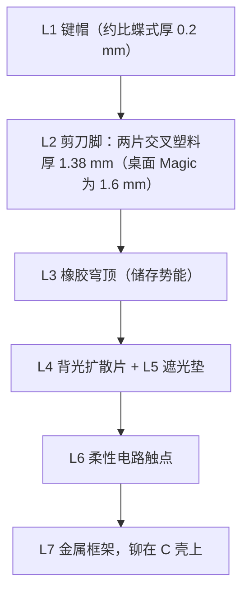

# 16 英寸 MacBook Pro 剪刀脚键盘：1 mm 键程与交叉支架（对照蝶式）

> [!summary] 一句话概述
> 2019 年 16 英寸 MacBook Pro 放弃蝶式，改回两片塑料交叉的剪刀脚：苹果新闻稿写键程 1 mm，并配上「能储存更多势能」的橡胶穹顶。iFixit 测得这套剪刀脚厚 1.38 mm，比桌面 Magic Keyboard 的 1.6 mm 略薄，键帽也加厚约 0.2 mm，而且不再铺硅胶防尘膜——间隙本身就能容忍更多碎屑。整块键盘却仍然铆在 C 壳上，可维修性没有一起回来。本篇只写剪刀脚，已收录的蝶式案例作为反面对照。

## 配图

![[附件/macbook-pro16-scissor-dome-thickness.jpg]]
*图源：[iFixit MacBook Pro 16" 2019 Teardown](https://www.ifixit.com/Teardown/MacBook+Pro+16-Inch+2019+Teardown/128106) 第 4 步前后；揭开键帽后看到两片交叉的白色塑料剪刀脚，中间让出橡胶穹顶的位置。*

![[附件/macbook-pro16-scissor-vs-magic-thickness.jpg]]
*图源：同上第 4 步对照图；笔记本这套剪刀脚与桌面 Magic Keyboard 几乎一样，只是更薄一点：iFixit 测得 1.38 mm vs 1.6 mm。*

![[附件/macbook-pro16-butterfly-vs-scissor.jpg]]
*图源：同上第 3 步，把几个月前仍在 15 英寸 MacBook Pro 上使用的蝶式支架放在旁边对照——蝶式是单件 V 形，间隙更小，后来还要靠硅胶膜补救。*

> 图片版权归原作者所有，仅作个人学习收藏；出处见文末「来源与核实记录」。

## 结构原理

> 本节所有数字只写来源里给出的。不要把「键程 1 mm」和「支架厚 1.38 mm」混成同一个参数。

### 堆叠方案

方向：**从键帽向下到 C 壳（2019 16 英寸 MacBook Pro）**

| 层级 | 零件 | 材料 | 厚度/尺寸 | 固定方式 | 依据 |
| --- | --- | --- | --- | --- | --- |
| L1（最上） | 键帽 | 来源未给出树脂牌号；iFixit 新闻写键帽比蝶式厚约 0.2 mm，挂钩有加强 | 厚约 +0.2 mm（相对蝶式，iFixit 新闻） | 卡在剪刀脚的挂钩上，可拆下清洁；不是每一颗都能和桌面 Magic Keyboard 互换 | iFixit 新闻 33820；拆解第 5 步：2015 白帽可以盖上，但旧 Command 键更小更厚，且无背光透字 |
| L2 | 剪刀脚（两片交叉塑料，中心铰接） | 塑料 | 这套支架 1.38 mm 厚；桌面 Magic Keyboard 为 1.6 mm | 一端相对键帽/底座铰接，另一端在导槽里滑动（机构描述见 iFixit 新闻） | 拆解第 4 步；新闻 33820 |
| L3 | 橡胶穹顶（dome） | 苹果称为 “Apple-designed rubber dome that stores more potential energy for a responsive key press” | 来源未给出穹顶高度或硬度 | 坐在剪刀脚中央的开孔下，被按下后导通 | 苹果新闻稿；iFixit 拆解第 4 步引用同一句 |
| L4 | 背光组件 | 柔性扩散片，边缘 LED 进光，表面有特殊蚀刻（iFixit 推测为了更均匀） | 来源未给出 | 铺在金属底板之上 | 拆解第 4、11 步 |
| L5 | 薄黑色遮光垫 | 来源未给出 | 来源未给出 | 围在键位周围，「大概是为了不让光从键帽边缘漏出去」 | 拆解第 4 步 |
| L6 | 柔性电路 / 触点层 | 来源未给出 | 来源未给出 | 夹在按键与金属底板之间，iFixit 撬开键盘后见到 | 拆解第 11 步 |
| L7（最下） | 金属键盘框架 + C 壳 | 金属 | 来源未给出 | 框架边缘能看到 Pentalobe P2，但整块键盘仍被铆钉固定，不能当可拆模块换掉 | 拆解第 11 步 |

剖面示意：

蝶式对照（已收录案例，不在本机展开）：蝶式是一体 V 形支架，苹果 2015 年称比传统剪刀脚薄 40%、稳 4 倍，整键盘薄 34%；少数派转述第一代键程从约 1.2 mm 降到 0.5 mm，iFixit 新闻写 2015 Retina MacBook 的蝶式行程为 0.7 mm。2018 年第三代加冲切硅胶膜防尘，仍会从膜角的孔进沙。2019 年 16 英寸回到剪刀脚。

### 零件清单

| 零件 | 数量 | 功能 | 材料 | 依据 |
| --- | --- | --- | --- | --- |
| 键帽 | 全键盘 | 触摸面；挂钩加强，拆装更不容易断 | 来源未给出 | iFixit 新闻 |
| 剪刀脚 | 每键一套（两片） | 保持键帽平行下沉，并留下比蝶式更大的容屑空间 | 塑料 | iFixit 新闻与拆解 |
| 橡胶穹顶 | 每键 1 | 提供回弹和触发手感 | 橡胶 | 苹果新闻稿 |
| 防尘膜 | 无 | iFixit 把「不再贴膜」读成苹果对耐用/防尘更有信心 | — | 拆解第 3 步；新闻 33820 |
| 键盘组件铆钉 | 来源未给出数量 | 把整块键盘钉死在 C 壳上 | 来源未给出 | 拆解第 11 步 |
| 独立 Esc、倒 T 方向键、缩短的 Touch Bar | — | 布局变化：Touch Bar 缩短约 19 mm，方向键为倒 T 且都是半高 | 来源未给出 | 拆解第 2 步；苹果新闻稿 |

### 装配顺序

> 来源没有工厂装配工艺。下面按 iFixit 拆解观察，从键帽往下写。整机可维修性评分 1/10，键盘本身不可按键单独从 C 壳拆出更换。

1. 剪刀脚先装到金属框架的导槽/铰接点上，橡胶穹顶对正中央。
2. 铺柔性电路和背光扩散片，周边加遮光垫。
3. 键帽卡到剪刀脚挂钩上。
4. 整块键盘铆到 C 壳。用户若只是清洁，可以拔键帽；iFixit 认为新挂钩更不容易在拔帽时折断。
5. 拆解时即便看到 P2 螺丝，铆钉仍会挡住「把键盘当模块换掉」的路径。

### 受力与运动分析

- **受力路径**：手指按下 → 键帽保持水平（剪刀脚的交叉导向）→ 压缩橡胶穹顶 → 穹顶把力传到触点。回程由穹顶储存的势能完成。苹果把这套称为 redesigned scissor mechanism，并强调穹顶「储存更多势能」。
- **运动关系**：键帽主要是一个垂直移动的自由度，剪刀脚限制倾斜。苹果新闻稿给出 1 mm 键程。iFixit 新闻写，相对蝶式大约多了 0.5 mm 行程，碎屑更不容易把键卡死。
- **失效风险**：剪刀脚本身被 iFixit 认为比蝶式更抗渣。但整块键盘仍铆死，单颗轴坏了还是要拆整机、面对铆钉，和蝶式时代的维修路径几乎一样（拆解第 11、14 步）。键盘也没有进入此前的 Keyboard Service Program。

## 设计要点与参数

| 要点 | 内容 | 依据 |
| --- | --- | --- |
| 键程 | 1 mm（苹果新闻稿原文 “1mm of key travel”） | 苹果 2019-11-13 新闻稿；少数派完整引用中文新闻稿 |
| 相对蝶式的行程差 | 约多 0.5 mm | iFixit 新闻 33820 |
| 剪刀脚厚度 | 本机 1.38 mm；桌面 Magic Keyboard 1.6 mm | iFixit 拆解第 4 步 |
| 键帽厚度 | 约比前代厚 0.2 mm；挂钩加强 | iFixit 新闻 |
| 防尘膜 | 没有 | iFixit 拆解第 3 步 |
| 第一代蝶式行程（对照） | iFixit 新闻：0.7 mm（2015 Retina MacBook）；少数派转述：由约 1.2 mm 降到 0.5 mm。两处数字不一致，对照时分别注明来源，不调和 | iFixit 新闻；少数派 |
| 布局 | 实体 Esc；倒 T 方向键；Touch Bar 缩短约 19 mm | 拆解第 2 步；苹果新闻稿 |
| 可维修性 | 整机 1/10；键盘仍铆接 | 拆解第 15 步 |
| 键帽互换 | 2015 白帽可以盖上并工作，但不能全部互换，旧帽无背光透字 | 拆解第 5 步 |

## 优缺点

**优点**
- 1 mm 键程和交叉支架，把蝶式过薄、过怕灰的问题退回去
- 与已经验证过的桌面 Magic Keyboard 几乎同一套机构，只做了 0.22 mm 量级的减薄
- 取消防尘膜，说明设计方重新把「容屑空间」交给机构本身
- 键帽挂钩加强，日常清洁时更不容易把帽拆坏

**缺点 / 代价**
- 相对蝶式，机构和键程都占回一点垂直空间（苹果接受了「可以略厚」）
- 键盘整块仍铆在 C 壳上，坏一颗键还是大修
- 背光边缘漏光的观感，少数派认为蝶式反而更「精致」——这是观感，不是结构失效

## 可借鉴点

- **键程和防尘是同一笔预算。** 把行程从蝶式的亚毫米拉回 1 mm，间隙变大，就可以去掉那层补救用的硅胶膜。先给渣留出路，再谈薄膜。
- **减薄要写清减的是哪一层。** 本机减的是剪刀脚的厚度（1.60→1.38 mm），不是把键程减到 0.5 mm。键程（苹果 1 mm）和支架厚度（iFixit 1.38 mm）要分开写进图纸。
- **「和已经量产、口碑稳定的桌面键盘共用机构」** 比重新发明一种更薄的支架更安全；本例甚至能把旧桌面键帽盖上去（有限制）。
- **机构改进不会自动变成可维修改进。** 铆钉还在，评分就还是 1/10。如果目标是可维修，要把键盘改成可拆模块，而不是只改轴。
- 详细的蝶式失败过程和硅胶膜实验，见已收录的反面案例，不要在本篇重复展开。

## 与库中相似案例对比

| 对比项 | 本案例（2019 剪刀脚） | [[苹果蝶式键盘（反面案例）：变薄 40% 的代价与硅胶防尘膜补救]] | [[iPad Magic Keyboard 双铰链悬浮支架与配重]] |
| --- | --- | --- | --- |
| 导向机构 | 两片交叉塑料，中心铰接 | 一体 V 形蝶式支架 | 同为剪刀脚（iFixit 在 X 光文中指出） |
| 键程 | 苹果：1 mm | 来源中有 0.5 / 0.7 mm 等不同表述，见该篇 | 来源未给出 iPad 版键程 |
| 防尘 | 无膜，靠更大间隙 | 第三代加硅胶膜，仍会从膜角进沙 | 未作为该篇重点 |
| 固定 | 整块铆在 C 壳 | 铆钉 + 五星螺丝 + 胶，几乎不能单换 | 附件键盘，维修性差在别处 |
| 设计目标 | 手感和耐用优先，接受略厚 | 为了整机 13.1 mm 而把键盘再削 40% | 平板支架，键盘是其中一层 |

## 相关案例

- [[苹果蝶式键盘（反面案例）：变薄 40% 的代价与硅胶防尘膜补救]]
- [[iPad Magic Keyboard 双铰链悬浮支架与配重]]
- [[苹果 MacBook Pro 2016 Flexgate（反面案例）：绕板的屏幕排线与 2018 年加长 2 mm]]
- 分类索引：[[04-机构与运动 索引]]

## 来源与核实记录

- 主来源：[MacBook Pro 16" 2019 Teardown](https://www.ifixit.com/Teardown/MacBook+Pro+16-Inch+2019+Teardown/128106)（iFixit 指南 128106）——1.38 / 1.6 mm 支架厚度、无防尘膜、铆接、键帽互换、布局变化
- 补充来源 1：[The New MacBook Pro Keyboard is a Throwback in the Best Way](https://www.ifixit.com/News/33820/16-inch-macbook-pro-magic-keyboard-throwback)（iFixit，Kevin Purdy，2019-11-15）——约多 0.5 mm 行程、键帽约厚 0.2 mm、挂钩加强、机构几乎与桌面 Magic Keyboard 相同
- 补充来源 2：[Apple introduces 16-inch MacBook Pro…](https://www.apple.com/newsroom/2019/11/apple-introduces-16-inch-macbook-pro-the-worlds-best-pro-notebook/)（Apple Newsroom，2019-11-13）——redesigned scissor mechanism、1 mm 键程、橡胶穹顶「储存更多势能」、实体 Esc 与倒 T 方向键
- 补充来源 3：[蝴蝶终飞去：蝶式键盘的前世今生](https://sspai.com/post/91242)（少数派，2024-08-13）——中文引用苹果新闻稿，并整理蝶式键程与迭代。其中第一代蝶式 0.5 mm 与 iFixit 新闻的 0.7 mm 并存，正文已分别标注
- 核实：2026-11-15 用 iFixit API 打开指南 128106，用 WebFetch 打开新闻 33820、苹果新闻稿和少数派文章。不把支架厚度写成键程。
