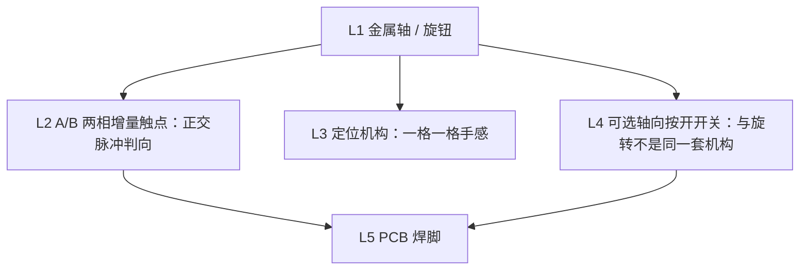

# ALPS EC11 旋转编码器：11 mm 金属轴增量脉冲与可选按压开关

> [!summary] 一句话概述
> ALPS EC11 是 11 mm 规格的金属轴增量式旋转编码器：旋转时输出 A、B 两相脉冲，用来判断方向和格数；带按压的型号另有一套沿轴向的开关，和旋转编码不是同一套机构。目录中的 EC11E 系列额定 10 mA 5 V DC、操作寿命 15,000 cycles，定位扭矩 10±7 mN·m，定位数/脉冲数有 18/9、30/15、36/18 三档，轴长示例 20 mm，带开关时行程有 0.5 mm 或 1.5 mm。不要把它写成硅胶按键、锅仔或机械轴体那种“通用按键”。

## 配图

![[附件/alps-ec11e-spec-table.jpg]]
*图源：[ALPS ALPINE 编码器产品目录（中文）](https://tech.alpsalpine.com/assets/catalog/product-catalog-ec-01.zh-hans.pdf)（更新代号 2510）EC11E 系列页；列出操作方向、轴形状与长度、定位扭矩、定位数、脉冲数、是否带按开开关及行程。表下注明：目录为粗略规格，使用前要交换正式交付规格。*

![[附件/alps-ec11e-outline.jpg]]
*图源：同上 EC11E 外形图 / 安装孔尺寸图页（图号 1/2/3）。具体孔距和轴外形以该页图纸为准；本笔记不从图上估读未写成数字的尺寸。*

> 图片版权归原作者所有，仅作个人学习收藏；出处见文末「来源与核实记录」。

## 结构原理

> 参数只写目录里的具体型号。器赋开物文解释的是 EC11 增量式模块的通用读法，用来理解 A/B 相位和按压开关，不把它的“常见一圈 20 格”写成 ALPS EC11E 的规格。

### 堆叠方案

方向：**从旋钮/轴端到本体，再到 PCB 焊脚；带开关时再沿轴向往下。**

| 层级 | 零件/区域 | 材料 | 厚度/尺寸 | 固定方式 | 依据 |
| --- | --- | --- | --- | --- | --- |
| L1 | 金属操作轴 | 金属 | EC11E 表示例为平轴、长度 20 mm；EC11M 示例为锯齿轴、25 mm | 套旋钮；把旋转和（若有）按压传进本体 | ALPS 目录 EC11E/EC11M 表 |
| L2 | 旋转编码机构（A、B 两相） | 机械触点式增量编码（器赋开物：两路错开约 90° 的触点） | EC11E：定位数 18/30/36，对应脉冲数 9/15/18 | 旋转时输出正交脉冲，不记忆绝对角度 | ALPS 目录；器赋开物 |
| L3 | 定位（棘轮手感） | — | EC11E 定位扭矩 10±7 mN·m；EC11M1565403 为 12±7 mN·m。EC11M1575403 写“无”定位、另有旋转扭矩 8.5±5 mN·m | 给出一格一格的手感 | ALPS 目录 |
| L4 | 可选按开开关 | 与旋转分开的轴向开关 | EC11E 带开关型号行程 0.5 mm 或 1.5 mm；无开关型号行程栏为“—” | 按下导通（器赋开物：常见常开，按下接地） | ALPS 目录；器赋开物 |
| L5 | 本体与 PCB 焊脚 | — | 11 型金属轴型，安装孔见外形图页 | 焊接到电路板。目录注意事项：插入基板的金属脚焊接，避免只焊在板面；端子不可额外受力 | ALPS 目录焊接/注意事项页 |

剖面示意：

### 零件清单

| 零件 | 数量 | 功能 | 材料 | 依据 |
| --- | --- | --- | --- | --- |
| EC11 编码器本体 | 1 | 旋转编码 + 可选按压 | 金属轴；其余来源未列明细 | ALPS |
| 旋钮（客户件） | 1 | 操作界面 | 来源未给出 | — |
| PCB | 1 | 焊接、上拉和读入 | 器赋开物强调 A/B/SW 均需上拉 | 器赋开物 |

### 装配顺序

1. 按目录外形图开安装孔和轴孔，检查轴长、是否带开关、行程是否与面板厚度匹配。
2. 把编码器插入 PCB，焊接金属插脚（ALPS：不要只把接线焊在印刷电路板表面，否则可能接触不良；焊接时避免端子受力导致松动、变形或电特性变差）。
3. 装面板旋钮。带按压的型号要保证按到底时行程落在 0.5 mm 或 1.5 mm 这一档，且不会把力传到焊脚。
4. 电路上处理 A/B 正交脉冲和独立的 SW 开关。器赋开物建议：机械触点要去抖；用中断读 A 相、同时看 B 相判断方向；三路空闲时上拉。

### 受力与运动分析

- **旋转**：轴带动内部编码机构，A、B 两相依次通断，相位差约 90°（器赋开物）。顺时针、逆时针时超前相相反，从而判断方向；脉冲数决定一圈的电格数。定位机构提供分度和手感扭矩。
- **按压**：沿轴向下压，走另一套开关。目录把“按开开关”和“定位数/脉冲数”分成独立列，说明旋转和按压是两套功能。
- **失效风险**：焊脚受力、板面虚焊（ALPS 注意事项）；转动过快或去抖不当丢格（器赋开物）；把 5 V 上拉灌进 3.3 V GPIO（器赋开物针对模块板的提醒，官方目录额定是 10 mA 5 V DC，电路设计仍要按器件和 MCU 电平来）。寿命以目录 15,000 cycles 为准，不要按机械键盘轴的千万次去比。

## 设计要点与参数

以下为 ALPS 目录 EC11E / EC11M 已列出的型号，电额定均为 10 mA 5 V DC，操作寿命 15,000 cycles。定位扭矩除另行注明外为 10±7 mN·m，轴为 Vertical 平轴 20 mm（EC11E）。

| 要点 | 内容 | 依据 |
| --- | --- | --- |
| EC11E09204A4 | 定位 18，脉冲 9，无开关 | ALPS EC11E 表 |
| EC11E15204A3 | 定位 30，脉冲 15，无开关 | 同上 |
| EC11E1820402 | 定位 36，脉冲 18，无开关 | 同上 |
| EC11E09244BS / EC11E15244G1 / EC11E18244AU | 上述三档定位/脉冲，带开关，行程 0.5 mm | 同上 |
| EC11E09244AQ / EC11E15244B2 / EC11E18244A5 | 同上三档，带开关，行程 1.5 mm | 同上 |
| EC11M1565403 | 锯齿轴 25 mm，定位扭矩 12±7 mN·m，定位 30，脉冲 15，带开关，行程 1.5 mm | ALPS EC11M 表 |
| EC11M1575403 | 锯齿轴 25 mm，旋转扭矩 8.5±5 mN·m，无定位，脉冲 15，带开关，行程 1.5 mm | 同上 |
| 用途（目录） | 工业设备/转换器、白色家电、画面与音响、汽车导航/音响/HVAC | 目录 |
| 脉冲处理注意 | 注意动作速度、取样和屏蔽时间，建议在回路中加滤波（目录注意事项页） | ALPS |
| 独立来源对结构的补充 | A、B 为错开约 90° 的机械触点，给相对增量不是绝对角度；按压是独立开关。该文写“EC11 常见一圈 20 格、多数自带按下开关”——这是对常见模块的概括，与上表 ALPS 型号（18/30/36 定位，9/15/18 脉冲）不是同一组数字 | 器赋开物 2026-06-20 |

## 优缺点

**优点**
- 无限旋转的相对调节，比电位器更适合菜单和参数微调
- 旋转和按压可做在同一轴上，但机构分开，界面占用小
- 目录分档清楚：定位数、脉冲数、是否带开关、两种按压行程

**缺点 / 代价**
- 机械触点会弹跳，必须在硬件或软件上去抖
- 断电不保留绝对位置（增量式）
- EC11E/EC11M 目录寿命 15,000 cycles，高频率人机界面要核算
- 焊脚和轴侧载荷敏感，结构和电气要一起设计

## 可借鉴点

- 选型先锁三个数：**定位数/脉冲数、轴长与轴形、按压行程（0.5 还是 1.5 mm，或不要开关）**，再对安装孔
- 面板厚度和旋钮深度必须把按压行程留出来，不要让旋钮先碰上壳
- 旋转和按压在软件里当成两个独立事件处理
- 不要把网上“EC11 = 20 格”写进与 ALPS 型号相关的图纸，以该型号目录为准
- 焊接只焊插脚、避免端子受力，这是结构工程师给工艺的明确约束

## 与库中相似案例对比

| 对比项 | 本案例（EC11 增量编码器） | [[鼠标微动开关（Omron D2FC）：杠杆、簧片翻转与触点]] | [[硅胶导电按键：斜壁荷重、碳粒与排气槽]] | [[Cherry MX 机械键盘轴：轴心、螺旋弹簧与金交叉触点]] | [[金属锅仔片阵列：直径、力值、行程与寿命互换]] |
| --- | --- | --- | --- | --- | --- |
| 主运动 | 旋转（正交脉冲）+ 可选轴向按压 | 按压杠杆，簧片翻转 | 按压斜壁，碳粒导通 | 轴心下压，弹簧回弹 | 锅仔失稳点击 |
| 信号 | A/B 增量，不是开/关一档 | 单路通断 | 单路通断 | 单路通断 | 单路通断 |
| 手感来源 | 定位扭矩（棘轮） | 簧片与杠杆 | 斜壁荷重 | 弹簧与击发结构 | 锅仔力值曲线 |
| 不要写成 | 通用按键 | — | — | — | — |

## 相关案例

- [[鼠标微动开关（Omron D2FC）：杠杆、簧片翻转与触点]]
- [[硅胶导电按键：斜壁荷重、碳粒与排气槽]]
- [[Cherry MX 机械键盘轴：轴心、螺旋弹簧与金交叉触点]]
- [[金属锅仔片阵列：直径、力值、行程与寿命互换]]
- 分类索引：[[04-机构与运动 索引]]

## 来源与核实记录

- 主来源：[ALPS ALPINE《编码器 / 金属轴编码器》中文目录](https://tech.alpsalpine.com/assets/catalog/product-catalog-ec-01.zh-hans.pdf)（更新 2510；2026-11-21 GET，HTTP 200，约 1.5 MB。EC11E/EC11M 规格、外形图、焊接与脉冲处理注意事项。ALPS 各页/各 PDF 只计为同一来源。）
- 独立第二来源：[器赋开物《旋转编码器（EC11 增量式）》](https://qifudev.com/sensor/rotary-encoder/)（最后更新 2026-06-20；2026-11-21 GET 打开。A/B 正交机械触点、按压开关独立、去抖与上拉。文末声明为公开资料整理、非亲测；其中“一圈 20 格”不作为 ALPS 型号参数。）
- 核实：2026-11-21 打开目录 PDF 与该中文原理文。立创文档等更多是开发板用法，未再计独立来源。按压开关力值目录未给出，故写“来源未给出”。
