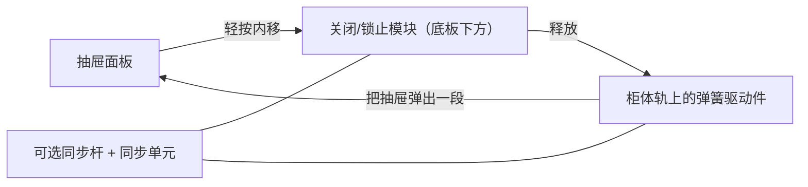

# Blum TIP-ON 按压弹开抽屉：柜体轨弹簧单元与抽屉锁止模块

> [!summary] 一句话概述
> Blum TIP-ON 做无拉手抽屉，不是把一颗心形槽锁嵌进门板那么简单：柜体轨上预装带弹簧的弹出单元（驱动件），抽屉底板下再装锁止/关闭模块；按一下面板内移，模块释放，轨上弹簧把抽屉弹出一段，再用手拉开。宽抽屉要加同步杆。它和 Nifco/ITW 那种单点撞销锁、以及按动笔的旋转凸轮，不在同一个装配层级上。

## 配图

![[附件/blum-tip-on-tandembox-components.jpg]]
*图源：[TIP-ON pro TANDEMBOX 安装手册](https://www.demos24plus.com/content/wysiwyg/cz/Dokumenty/Katalogy/Katalogy_dodavatelu_CS/Blum/BLUM_navod_Tandembox_Tip_On.pdf) 第 9 页；1 柜体轨（预装驱动件/unašeč），2 带调节齿轮的关闭模块，3a 同步单元（建议柜体宽度 ≥ 550 mm），3b 同步杆，3c L 型型材，5 可选面板稳定件*

![[附件/blum-tip-on-depth-adjustment.jpg]]
*图源：同上第 13 页；关闭模块上的调节齿轮可免工具、不用卸抽屉就调面板深度/门缝*

> 图片版权归原作者所有，仅作个人学习收藏；出处见文末「来源与核实记录」。

## 结构原理

> 本节数字只写来源里给出的。Furnica 文中的通用范围（门缝 1.5–2.5 mm、弹出 20–40 mm 等）是该文对「push-to-open」类产品的归纳，不是 Blum TIP-ON 官方规格，下文分开写。

### 堆叠方案

方向：**从柜体侧板到抽屉底板下方（TIP-ON for TANDEMBOX）**

| 层级 | 零件 | 材料 | 厚度/尺寸 | 固定方式 | 依据 |
| --- | --- | --- | --- | --- | --- |
| L1 | 柜体轨，带预装驱动件（unašeč / 弹簧弹出单元） | 来源未给出材质明细 | 额定长度 NL 270–650 mm；最大总重分档见下表 | 装在柜体侧板，与现有 TANDEMBOX 侧帮兼容 | 安装手册第 8–9、14 页 |
| L2 | 同步单元 3a + 同步杆 3b（可选） | 来源未给出 | 建议柜体宽度从 550 mm 起使用；同步杆按柜宽分段供货（如 508–570 mm 对应 Z55S1350E，一直到约 1.108–1.170 mm） | 同步杆卡接到关闭模块与同步单元 | 第 9、14–15 页 |
| L3 | L 型型材 3c（用同步时）或面板稳定件 5 | 来源未给出 | 来源未给出截面尺寸 | 装在中部，支撑抽屉底板，避免同步单元与柜体底板打架 | 第 9 页 |
| L4 | 抽屉底板 | 来源未给出 | 关闭模块与同步单元的安装孔 Ø 5 mm（手册区分「独立底板」与「三边预装底板」） | 抽屉结构自身 | 第 16 页附近 |
| L5 | TIP-ON 关闭模块（dovírací jednotka），带深度调节齿轮 | 来源未给出 | 来源未给出外形尺寸 | EXPANDO 方式装在抽屉底板下侧；关闭时锁住并保持关闭 | 第 8–9 页 |

剖面示意：

官网还把同一套 TIP-ON 机械开合用在柜门和 AVENTOS 上翻门：按一下开一条缝、再手拉开，关上时再按紧。本篇零件表以抽屉（TANDEMBOX）安装手册为准。

### 零件清单

| 零件 | 数量 | 功能 | 材料 | 依据 |
| --- | --- | --- | --- | --- |
| 柜体轨 + 预装驱动件 | 左/右各 1 | 导向 + 弹簧储能弹出 | 来源未给出 | 手册：系统由「特殊柜体轨 + 关闭单元」构成 |
| 关闭模块（带调节齿轮） | 左/右各 1 | 关闭时锁住抽屉，再按时释放；调门缝深度 | 来源未给出 | 第 8–9 页 |
| 同步单元 + 同步杆 | 宽抽屉建议 1 套 | 让宽面板任意位置按压都能触发 | 来源未给出 | 第 9 页：建议柜宽 550 mm 起使用 |
| L 型型材或面板稳定件 | 按需 | 支撑底板 / 稳定高面板 | 来源未给出 | 第 9 页 |
| 钻孔模板 65.5050 | 1（装配用） | 预钻关闭模块与同步单元安装孔 | — | 第 14 页 |

### 装配顺序

据安装手册（关闭模块在抽屉底板下侧）：

1. 按现有 TANDEMBOX 方式安装滑轨系统——手册写明：用 TIP-ON 并不改变原抽屉系统的安装。
2. 用钻孔模板在抽屉底板预钻关闭模块（及同步单元）的安装位置；底板安装孔 Ø 5 mm。
3. 若用同步：先把同步杆靠到尚未固定的关闭模块上并卡接，再把同步单元对中后固定；中部加 L 型型材或改用面板稳定件支撑底板。
4. 把关闭模块以 EXPANDO 方式装到抽屉底板下侧。
5. 抽屉装入柜体轨；关门时关闭模块与轨上驱动件啮合并锁住。
6. 免工具转动关闭模块上的调节齿轮，微调面板深度与门缝，不必把抽屉卸下来。

### 受力与运动分析

- **受力路径**：手指按面板 → 整屉内移一小段 → 关闭模块解锁 → 柜体轨上已储能的弹簧把抽屉向外推。关闭时反向：把抽屉推入，关闭模块重新咬住驱动件并锁住。Blum 官网写：即使有人直接把手拉开，TIP-ON 仍能正常工作；关上再按紧即可。
- **运动关系**：弹出只负责开一条缝，不是全行程自动开到位。Furnica 对这类机构的概括是：按压释放后弹簧把门/抽屉推开一个间隙，再用手完全拉开。Blum 纯 TIP-ON 安装手册未给出弹出毫米数。
- **与阻尼的关系**：Furnica 强调，经典 push-to-open 与软关阻尼方向相反——阻尼把面板拉回关上，push-to-open 则往外推；普通带闭合力的杯型铰链不适合再配纯机械碰碰锁，对向力会打架。组合「按开 + 缓关」需要专门的集成系统。Blum 另有 TIP-ON BLUMOTION，中文手册称为「阻尼碰碰开」，是把 TIP-ON 与 BLUMOTION 合在一个纯机械方案里，不要和本篇的纯 TIP-ON 抽屉套件混成同一组参数。
- **失效风险**（推断，已标注）：宽面板只按一边时，若无同步，对侧关闭模块可能未释放；门缝不一致时触发会发闷。手册为此推荐同步，并用调节齿轮专门调深度。

## 设计要点与参数

| 要点 | 内容 | 依据 |
| --- | --- | --- |
| 系统拆分 | 柜体轨上的弹簧弹出单元 + 抽屉底板下的锁止/关闭模块，不是单点心形槽锁 | 安装手册第 8 页 |
| 额定长度与载荷（TIP-ON for TANDEMBOX） | NL 270 / 300 mm：20 kg；350 / 400 mm：30 kg；450 / 500 / 550 / 600 / 650 mm：50 kg（手册写最大总重 50 kg，并覆盖全部额定长度） | 第 9、14 页订货表，货号如 559.2701T…559.6501T |
| 同步起点 | 建议柜体宽度从 550 mm 起加同步 | 第 9 页 |
| 同步杆分段 | 例如 508–570 mm → Z55S1350E，其后每档约 50 mm，直到 1.108–1.170 mm → Z55S4350E | 第 15 页 |
| 深度调节 | 关闭模块上的齿轮，免工具、不用卸抽屉 | 第 9、13 页 |
| 底板孔 | Ø 5 mm | 手册安装图 |
| 纯 TIP-ON 门缝 / 弹出行程 / 触发力 | 本安装手册与 Blum 概述页均未给出 | — |
| TIP-ON BLUMOTION 门缝（相关变体，勿当作纯 TIP-ON 规格） | Blum 中文 2024/2025 手册与 EASY ASSEMBLY 博客均写：2.5 mm 门缝即可触发；博客还要求高面板上下门缝连续为 2.5 mm，并用模板 65.5631 配合橙色调节轮调整 | publications.blum.com.cn 第 394 页；ea.blum.com |
| Furnica 对通用 push-to-open 的范围（非 Blum 官方） | 门缝须严格设在 1.5–2.5 mm；弹出通常 20–40 mm；嵌入式碰锁钻孔常为 Ø 10 mm、深 50–70 mm；带该功能的滑轨常见长度 250–700 mm、载荷 30 kg 或 45 kg | Furnica，2025-12-20。不要写成 Blum TIP-ON 规格 |

## 优缺点

**优点**
- 全机械，不接电；Blum 对比 SERVO-DRIVE 时特别写到，没电或不宜用电的场合也能用
- 面板任意位置轻按即可（宽屉加同步）
- 关闭模块可装上后再调门缝，装配容差好消化
- 与现有 TANDEMBOX 侧帮兼容，不另改一套滑轨安装逻辑

**缺点 / 代价**
- 比「柜体上打一个碰锁」零件多：左右轨、左右关闭模块，宽屉还要同步杆和底板支撑
- 要给面板留内移行程；门缝过小或上下不一致，触发会变差
- 不能拿普通带闭合力的铰链/阻尼去「凑」同一扇门，力会互相抵消（Furnica）
- 弹出后仍要手拉，不是电动全开

## 可借鉴点

- **无拉手抽屉按系统做，不要只在面板背后塞一颗推推锁**：活动件在滑轨和底板下，面板保持平整
- **宽面板加同步**：Blum 以柜宽 550 mm 为建议起点；自己做类似机构时，也要规定「多宽必须把左右释放连起来」
- **把深度调节做到锁止模块上**，装好后还能拧，不必靠垫片碰门缝
- **用同步时先解决底板下的干涉**：L 型型材或稳定件把底板托住，避免同步单元蹭柜体底板
- 若产品还要缓关，选用专门的组合系统（如 TIP-ON BLUMOTION），并按其自己的 2.5 mm 门缝来调，不要把两套参数混用

## 与库中相似案例对比

| 对比项 | 本案例（Blum TIP-ON 抽屉） | [[Nifco 经典心形槽 Push-Push：U 形销与片簧（对照 ITW 防变形版）]] | [[防变形静音 Push-Push 按压弹跳锁（ITW 专利 EP1596030）]] | [[按动圆珠笔：旋转凸轮的按压伸缩机构]] |
| --- | --- | --- | --- | --- |
| 装配层级 | 柜体轨弹出单元 + 抽屉锁止模块，作用在整屉 | 单点锁：壳体里的心形槽 + 卡爪抓一根撞销 | 单点锁，夹爪强制开合 | 笔杆内同轴凸轮 |
| 输出运动 | 把抽屉弹出一段后再手拉 | 释放门板/舱门 | 同左 | 笔芯伸出/缩回 |
| 宽幅问题 | 用同步杆解决「按一边另一边不动」 | 不涉及宽面板 | 不涉及 | 不涉及 |
| 与阻尼 | 纯 TIP-ON 与软关力向相反；组合款是另一套 TIP-ON BLUMOTION | 无 | 无 | 无 |

## 相关案例

- [[Nifco 经典心形槽 Push-Push：U 形销与片簧（对照 ITW 防变形版）]]
- [[防变形静音 Push-Push 按压弹跳锁（ITW 专利 EP1596030）]]
- [[按动圆珠笔：旋转凸轮的按压伸缩机构]]
- [[旋转阻尼器（缓降盖板）：硅油黏性、水平型与垂直型的扭矩曲线]]（缓关是另一类元件，勿与纯 TIP-ON 对向安装）
- 分类索引：[[04-机构与运动 索引]]

## 来源与核实记录

- 主来源：[TIP-ON pro TANDEMBOX 安装与订货手册](https://www.demos24plus.com/content/wysiwyg/cz/Dokumenty/Katalogy/Katalogy_dodavatelu_CS/Blum/BLUM_navod_Tandembox_Tip_On.pdf)（Blum 内容，经销商 Demos24plus 托管的 24 页 PDF）——零件组成、20/30/50 kg 分档、同步从 550 mm 起、调节齿轮、Ø 5 mm 孔
- 同一公司补充：[TIP-ON 概述](https://www.blum.com/eu/en/products/motion-technologies/tip-on/overview/)（Blum 官网）——门、上翻门、抽屉均可按压开启，宽抽屉可选同步，关上再按紧
- 独立第二来源：[Push-to-Open Mechanism — Function and Suitable Replacements for Tip-On](https://furnica.com/blogs/guides/push-to-open-mechanism-tip-on-replacement)（Furnica LTD，Published December 20, 2025）——通用原理、与软关对向、门缝/弹出/钻孔的通用范围；文中数值未当作 Blum 官方规格
- 同一公司补充：[产品手册 2024-2025 zh 第 394 页 TIP-ON BLUMOTION](https://publications.blum.com.cn/2024/catalogue/zh/394/)；[TIP-ON BLUMOTION: front gap](https://ea.blum.com/en/tip-on-blumotion-front-gap/)（Andrea Gruber，2016-01-09，页面还标注 2021-10-13）——仅用于说明组合款 2.5 mm 门缝
- 核实：2026-11-17 下载安装手册全文并打开其余页面核对。未把 Furnica 通用范围或 TIP-ON BLUMOTION 的 2.5 mm 写成纯 TIP-ON 抽屉套件的官方行程。
