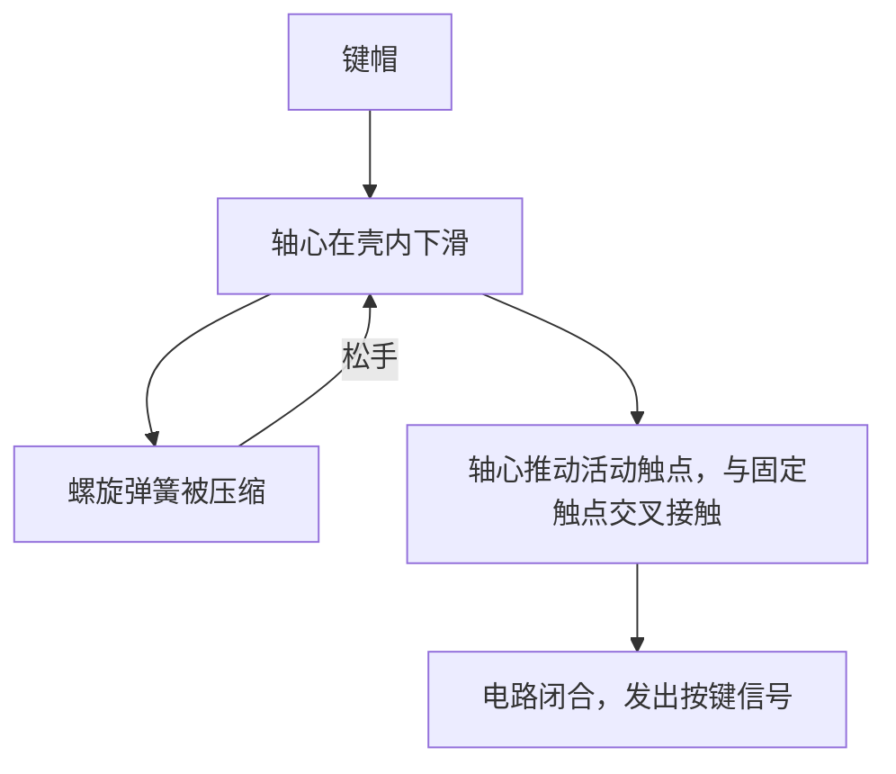

# Cherry MX 机械键盘轴：轴心、螺旋弹簧与金交叉触点

> [!summary] 一句话概述
> Cherry MX 是独立的机械轴体，不是笔记本里的剪刀脚或蝶式支架：键帽插在轴心（stem）上，轴心在壳里竖直滑动，螺旋弹簧负责回弹，轴心再驱动两片交叉的金属触点接通。官网页把这种触点叫做 Gold Crosspoint，两片三角形截面的触点相互垂直相切。以现行 MX2A RED 为例，数据表给出线性特性、操作力 45 cN、预行程 2 mm、总行程 4 mm、初压力 30 cN、末压力 100 cN、寿命大于 1 亿次。本篇对照已收录的 [[16 英寸 MacBook Pro 剪刀脚键盘：1 mm 键程与交叉支架（对照蝶式）]]：那边是整片键盘上的交叉支架 + 橡胶穹顶，这里是一颗可单独拆装的轴。

## 配图

![[附件/cherry-mx-brown-disassembled.jpg]]
*图源：[Keyboard Wiki: Cherry MX](https://wiki.themk.org/index.php/Cherry_MX)「Fully disassembled MX Brown (top views)」；上盖、底座、茶色轴心、螺旋弹簧，以及两片构成交叉触点的金属片。茶轴是触感轴，零件组成与红轴同类，手感由轴心形状和弹簧决定*

![[附件/cherry-mx-gold-crosspoint.png]]
*图源：[CHERRY MX 技术说明页](https://www.cherry.de/zh-tw/%E5%85%AC%E5%8F%B8%E7%B0%A1%E4%BB%8B/cherry-%E6%8A%80%E8%A1%93/%E6%A9%9F%E6%A2%B0%E5%BC%8F%E6%8A%80%E8%A1%93) / 同站 MX 技术图；官网所称 Gold Crosspoint：两片触点交叉相接*

> 图片版权归原作者所有，仅作个人学习收藏；出处见文末「来源与核实记录」。

## 结构原理

> 本节所有数字只写来源里给出的；来源没有就写「来源未给出」。

### 堆叠方案

方向：**从上（键帽）到下（PCB）**

| 层级 | 零件 | 材料 | 厚度/尺寸 | 固定方式 | 依据 |
| --- | --- | --- | --- | --- | --- |
| L1（最上） | 键帽 | 来源未给出（本篇不展开键帽） | 来源未给出 | 插在轴心十字脚上 | MX 技术页：keycap hits the stem |
| L2 | 上盖（Upper Housing） | 塑料聚合物 | 导向公差小于 0.01 mm；MX2A RED 外形：宽、深 15.63 mm，总高 18.5 mm（整轴） | 与底座卡扣扣合 | MX RED 产品页；数据表 |
| L3 | 轴心 / 滑块（Stem） | 塑料聚合物 | 提供预行程与手感；红轴为直线（linear）表面 | 在上盖中导向，下压螺旋弹簧 | 产品页「SWITCHING SLIDE / STEM」 |
| L4 | 螺旋弹簧 | 金属合金（牌号来源未给出） | 来源未给出线径、圈数；力值见下表 | 一端顶轴心，一端坐在底座里 | 产品页；数据表 |
| L5 | 金交叉触点（两片） | 金基触点（官网）；Telcontar 补充了不同年代的合金/线材做法 | 来源未给出触点棱长 | 固定在底座里，一根被轴心推动 | 产品页；wiki 拆解图；Telcontar |
| L6 | 底座（Housing Base） | 塑料聚合物 + 玻璃纤维 | 对 PCB 或钢板安装；RGB 版底座半透明并留 LED 孔 | 卡扣与上盖扣合，引脚插入或焊接 PCB | 产品页 |
| L7 | PCB | 来源未给出 | 来源未给出 | 触点引脚接通电路 | MX 技术页 |

剖面示意：

MX 技术页对动作的分步：按下 → 轴心下行、弹簧压缩 → 在触底之前触点已经接通（触发点） → 松手后弹簧把轴心顶回。线性轴没有段落或响声；触感轴有段落；点击轴另有可听见的点击。青、绿等点击轴在 ZOL 2008 拆解里被看到用双层轴心产生机械点击——那是旧拆解观察，不能自动写成现行每一颗青轴的内部图。

### 零件清单

| 零件 | 数量 | 功能 | 材料 | 依据 |
| --- | --- | --- | --- | --- |
| 上盖 | 1 | 导向轴心，组成壳体 | 塑料聚合物 | 产品页 |
| 轴心 | 1 | 滑动、决定手感曲线、带动触点 | 塑料聚合物 | 产品页；wiki / ZOL 拆解 |
| 螺旋弹簧 | 1 | 回弹与力曲线 | 金属合金 | 产品页 |
| 金交叉触点 | 2 片 | 电气通断，官网称自清洁、抗腐蚀 | 金基 | 产品页；wiki 照片 |
| 底座 | 1 | 安装触点、弹簧，固定到键盘 | 聚合物 + 玻璃纤维 | 产品页 |
| 侧卡（壳体卡扣） | 来源未给出 | 上下壳扣合；打开轴时要撬开 | 与壳体一体 | ZOL：撬开两侧卡扣即可拆开；wiki Disassembly |

### 装配顺序

按拆解观察反推（wiki、ZOL）：

1. 把触点片装进底座（位置决定交叉接触）。
2. 放入螺旋弹簧。
3. 放入轴心，对准导向筋。
4. 盖上上盖，两侧卡扣扣死。
5. 整轴插入钢板或 PCB（板本或 PCB 直插；热插拔键盘可拔换，技术页提到 Hot Swap 可不必焊接）。

> 以上按拆解顺序反推。官方安装到键盘上的工厂流程来源未给出。

### 受力与运动分析

- **受力路径**：指力经键帽到轴心，一路压弹簧，一路在触发行程处推动活动触点克服其自身弹力，与固定触点交叉接触。电路一通，信号就发出，不必等到触底。松手后弹簧把轴心送回，触点分开。
- **运动关系**：轴心主要是单轴滑动。点击轴还可能有额外的撞击件（ZOL 观察到青/绿双层轴心）。触发可以发生在总行程中途：MX2A RED 是预行程 2 mm、总行程 4 mm。
- **失效风险**：触点污染或氧化会造成接触不良——官网把交叉金触点宣传为自清洁、抗腐蚀。弹簧疲劳会改变力曲线；现行 MX2A RED 数据表保大于 1 亿次。壳体侧卡若在反复开轴后变形，上盖可能松。数据表给出 IP40，不防水，只是防一定异物。

## 设计要点与参数

下列力值和行程，除非另注，都来自 **CHERRY MX2A RED** 产品页与数据表，不要套到所有颜色的轴上。

| 要点 | 内容 | 依据 |
| --- | --- | --- |
| 特性 | 线性，无段落、无点击 | 产品页；数据表 |
| 操作力 | 45 cN | 产品页；数据表；cherry.cn「红轴」同样写 45 cN（同公司） |
| 预行程 / 总行程 | 2 mm / 4 mm | 同上 |
| 初压力 / 末压力 | 30 cN / 100 cN | 产品页 Properties；数据表 |
| 寿命 | 大于 1 亿次 | 产品页；数据表 |
| 接触电阻 / 弹跳时间 | 200 Ω；5 ms（数据表） | MX2A RED 数据表。themk wiki 写 2019-11 起改触点后弹跳应小于 1 ms，与这份数据表不一致，两数并存，不以 wiki 覆盖数据表 |
| 外形 | 15.63 × 15.63 × 18.5 mm | 数据表 |
| 防护 / 温度 | IP40；工作 10–70 °C | 数据表 |
| 上盖导向公差 | 小于 0.01 mm | 产品页 |
| 触点 | Gold Crosspoint，三角形截面、互相垂直；官网称自清洁、抗腐蚀 | 产品页；技术页 |
| 历史寿命（对照，非 MX2A RED） | themk：1985 年资料 2000 万；1994 年按类型 50 万 / 2000 万 / 5000 万不等；2017 年系列多改为 5000 万；2020 年部分线性轴和茶轴改到 1 亿 | themk wiki，转述不同年代资料 |
| 2008 年拆解参数（旧，勿当现行值） | ZOL 表：青轴触发 2.0 mm / 60 g / 2000 万；黑轴 1.8 mm / 80 g / 5000 万 等 | ZOL 2008，只证明当时的拆解观察和当时厂家或媒体表，不覆盖 MX2A |

触点材料的独立考证（Telcontar.net，转述前 Cherry 工程副总裁 Günter Murmann 等）：早期有西电合金棱柱、德国三角棱柱、镀金镍丝等不同做法；较新的 MX 又回到实心金合金棱柱，Cherry 方面曾称大约 2006 年改变。这些是接触系统的沿革，不能把某一年的合金成分自动写进今天每一颗 MX2A RED 的 BOM。

## 优缺点

**优点**
- 每颗键独立成轴，触发点清楚，可多键同时识别（技术页：相对橡胶锅仔，强调无幽灵键、N 键无冲等，具体还取决于键盘电路）
- 轴心颜色对应手感，同一套壳和触点可以派生线性 / 触感 / 点击
- 可以开壳换轴心或弹簧（拆解观察），热插拔键盘上整轴可换
- 现行红轴数据表给出完整的力-行程点和大于 1 亿次寿命

**缺点 / 代价**
- 比橡胶锅仔或剪刀脚键盘更高、更贵（技术页也承认一般更贵）
- 总行程 4 mm、整轴高 18.5 mm，薄本笔记本不容易直接搬用这套标准 MX
- 不同年代的官方寿命、弹跳时间并不相同，维修和选型必须对着具体型号数据表，不能只记「MX」两个字母

## 可借鉴点

- **把「手感零件」和「电接触零件」分开**：弹簧和轴心管手感，交叉金属片管通断。改手感不必重做触点；改触点不必改键程。
- **让触发发生在触底之前**，并在数据表里同时给出预行程、总行程、初压力、操作力和末压力，而不是只给一个「克数」。
- **交叉刃口触点**适合小电流信号：两点接触面积小、压强大，官网用它来讲可靠性和自清洁。具体合金要以对应年代和工厂为准。
- **导向公差写进壳体**（小于 0.01 mm）比把希望寄托在润滑上更基本；现行红轴仍出厂润滑，是叠加项。
- 对标笔记本键盘时不要混结构：剪刀脚是两片支架 + 穹顶，MX 是滑杆 + 螺旋弹簧 + 金属触点。

## 与库中相似案例对比

| 对比项 | 本案例 | [[16 英寸 MacBook Pro 剪刀脚键盘：1 mm 键程与交叉支架（对照蝶式）]] | [[苹果蝶式键盘（反面案例）：变薄 40% 的代价与硅胶防尘膜补救]] |
| --- | --- | --- | --- |
| 结构 | 独立轴：滑杆 + 螺旋弹簧 + 金交叉触点 | 交叉塑料支架 + 橡胶穹顶，整块铆在 C 壳 | 蝶式支架，更薄 |
| 键程 | MX2A RED：预行程 2 mm，总行程 4 mm | 苹果新闻稿 1 mm 键程 | 更短，薄 40%（该篇来源） |
| 维修 | 可开轴、热插拔键盘可换整轴 | 整块键盘仍铆住 | 难修，碎屑问题 |
| 触发元件 | 金属触点 | 橡胶穹顶 | 该篇所述蝶式方案 |

## 相关案例

- [[16 英寸 MacBook Pro 剪刀脚键盘：1 mm 键程与交叉支架（对照蝶式）]]
- [[苹果蝶式键盘（反面案例）：变薄 40% 的代价与硅胶防尘膜补救]]
- [[鼠标微动开关（Omron D2FC）：杠杆、簧片翻转与触点]]
- 分类索引：[[04-机构与运动 索引]]

## 来源与核实记录

- 主来源：[CHERRY MX RED / MX2A RED 产品页](https://www.cherry.de/en-us/product/mx2a-red)（壳体、轴心、金交叉触点、弹簧的分件说明；45 cN、2.0 / 4.0 mm、30 / 100 cN、大于 1 亿次）
- 补充来源 1：[CHERRY MX2A RED 数据表 PDF](https://cdn.sparkfun.com/assets/a/9/b/6/2/MX2A_RED-Datasheet-EN_US.pdf)（与产品页一致的力值行程，另有 15.63 mm、18.5 mm、IP40、接触电阻 200 Ω、弹跳 5 ms。经 SparkFun CDN 打开，内容为 Cherry 数据表）
- 补充来源 2：[CHERRY 机械式技术说明](https://www.cherry.de/zh-tw/%E5%85%AC%E5%8F%B8%E7%B0%A1%E4%BB%8B/cherry-%E6%8A%80%E8%A1%93/%E6%A9%9F%E6%A2%B0%E5%BC%8F%E6%8A%80%E8%A1%93)（同公司；按下-触发-回位，金交叉触点寿命「高达 1 亿次」的表述）
- 补充来源 3：[cherry.cn 轴体页](https://www.cherry.cn/switchs.html)（同公司；红轴 45 cN / 2.0 / 4.0 mm / 约 1 亿次，与 MX2A RED 一致。其他颜色数字未在本篇当作 MX2A 数据使用）
- 补充来源 4：[Keyboard Wiki: Cherry MX](https://wiki.themk.org/index.php/Cherry_MX)（独立汇编：历史寿命、拆解照片、开轴方法、2019/2020 年改款记述）
- 补充来源 5：[Telcontar.net: Cherry switch contacts](https://telcontar.net/KBK/Cherry/contacts)（独立考证不同年代触点结构）
- 补充来源 6：[ZOL：Cherry MX 系列机械轴解析及拆解](https://mouse.zol.com.cn/91/917571.html)（李刚，2008-05-09；中文拆解：上盖、轴心、弹簧、金属片、两侧卡扣；青/绿双层轴心。旧参数表不当作现行官方值）
- 核实：2026-11-17 打开上述页面并下载 MX2A RED 数据表。
